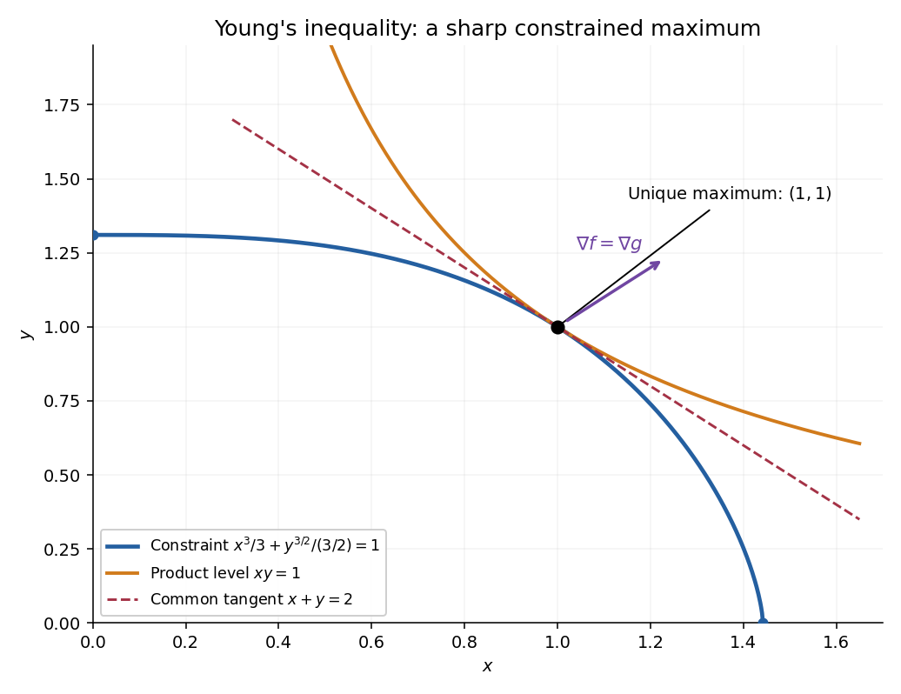

<h1 id="4/c/solution">Solution</h1>

↑ **Parent:** [C](../c.md)

The feasible set is closed and contained in the rectangle

$$
0\leq x\leq p^{1/p},\qquad0\leq y\leq q^{1/q}.
$$

It is therefore [compact](../../../../compact-space.md), and the continuous [function](../../../../function-split.md) $xy$ attains a global maximum there by the [extreme value theorem](../../../../extreme-value-theorem.md). At the two boundary endpoints where a coordinate is zero, the product is zero. Meanwhile $(1,1)$ is feasible because the [conjugate exponents](../../../../conjugate-exponents.md) satisfy $1/p+1/q=1$, and its product is one. Hence every maximizer has $x,y>0$.

On that positive region the constraint is $C^1$ with nonzero [gradient](../../../../gradient.md). The [Lagrange multiplier](../../../../lagrange-multiplier.md) equations are

$$
y=\lambda x^{p-1},\qquad x=\lambda y^{q-1},\qquad
\frac{x^p}{p}+\frac{y^q}{q}=1.
$$

The first two identities imply $xy=\lambda x^p=\lambda y^q$. Since $x,y>0$, the multiplier is nonzero, so $x^p=y^q=r$. The constraint now gives

$$
r\left(\frac1p+\frac1q\right)=1,\qquad r=1.
$$

Thus the sole interior candidate is $(1,1)$. Existence of a maximum and the boundary comparison prove the unique global result

$$
\boxed{\max xy=1,\qquad\text{attained exactly at }x=y=1.}
$$

This [conjugate-power constrained product maximum](../../../../conjugate-power-constrained-product-maximum.md) is valid for all real $p,q>1$ with $1/p+1/q=1$; no integrality of the exponents is needed.

**[Figure 1](#4/c/image-the-constrained-product-reaches-one-where-the-two-level-curves-are-tangent). The constrained product reaches one where the two level curves are tangent**. Original illustration for p=3 and q=3/2. The constraint arc meets the product level xy=1 only at (1,1), where both gradients point along (1,1). The red dashed line is their common tangent.

## ↑ Ancestors (12)

1. [C](../c.md)
2. [4](../../4.md)
3. [2015](../../../2015-split.md)
4. [Past exam of the short options course of the University of Oxford](../../../split.md)
5. [Short options course of the University of Oxford](../../../../short-options-course-of-the-university-of-oxford.md)
6. [Year 2 of the mathematics course of the University of Oxford](../../../../year-2-of-the-mathematics-course-of-the-university-of-oxford.md)
7. [Mathematics course of the University of Oxford](../../../../mathematics-course-of-the-university-of-oxford.md)
8. [Undergraduate course of the University of Oxford](../../../../undergraduate-course-of-the-university-of-oxford.md)
9. [Course of the University of Oxford](../../../../course-of-the-university-of-oxford.md)
10. [University of Oxford](../../../../university-of-oxford-split.md)
11. [List of universities](../../../../list-of-universities.md)
12. [Codex Wiki](../../../../split.md)
