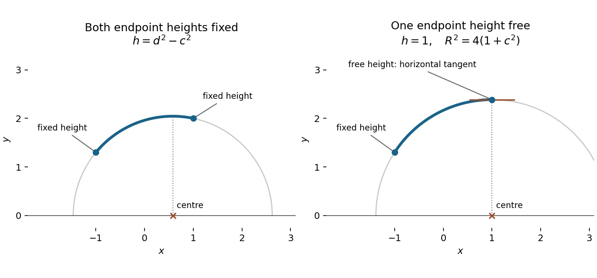

<h1 id="6/b/solution">Solution</h1>

↑ **Parent:** [B](../b.md)

For the specified [functional](../../../../functional.md),

$$
F_{y'}=\frac{y'}{y\sqrt{1+y'^2}},\qquad
y'F_{y'}-F=-\frac1{y\sqrt{1+y'^2}}.
$$

Since $y>0$, the [Beltrami identity](../../../../beltrami-identity.md) gives $y\sqrt{1+y'^2}=R$ for some $R>0$. This suggests a [circular arc](../../../../circular-arc.md), but it is worth deriving its equation without dividing by $y'$: such division would lose the point where the arc is horizontal.

Substitute the displayed [partial derivative](../../../../partial-derivative.md) and $F_y=-\sqrt{1+y'^2}/y^2$ in the full [Euler-Lagrange equation](../../../../euler-lagrange-equation.md). Combining terms over the common denominator gives

$$
\frac d{dx}F_{y'}-F_y
=\frac{yy''+1+y'^2}{y^2(1+y'^2)^{3/2}}=0.
$$

Thus $(yy')'=-1$, so $yy'=h-x$ and a second integration gives

$$
(x-h)^2+y^2=R^2.
$$

This establishes the [semicircular extremals of the hyperbolic length functional](../../../../semicircular-extremals-of-the-hyperbolic-length-functional.md) and excludes constant $y$, which would satisfy the first-order [Beltrami identity](../../../../beltrami-identity.md) for a suitable $R$ but not the full [Euler-Lagrange equation](../../../../euler-lagrange-equation.md).

The two prescribed endpoints give

$$
(-1-h)^2+4c^2=R^2=(1-h)^2+4d^2.
$$

Subtracting yields $4h=4(d^2-c^2)$. Therefore

$$
\boxed{h=d^2-c^2,\qquad R^2=(1+h)^2+4c^2,\qquad
y(x)=\sqrt{R^2-(x-h)^2}.}
$$

In particular the centre is $\boxed{(d^2-c^2,0)}$. Admissibility requires $c,d>0$, as the prescribed heights must lie in $y>0$. Under that condition the radicand is positive throughout $[-1,1]$: it is a concave [quadratic polynomial](../../../../quadratic-polynomial.md) whose two endpoint values are $4c^2$ and $4d^2$. The positive root consequently gives one smooth admissible arc, uniquely determined by the endpoints.

**[Figure 2](#6/b/image-fixed-endpoint-heights-determine-the-circle-centre-a-free-endpoint-height-forces-a-horizontal-tangent). Fixed endpoint heights determine the circle centre; a free endpoint height forces a horizontal tangent**.

## ↑ Ancestors (12)

1. [B](../b.md)
2. [6](../../6.md)
3. [2015](../../../2015-split.md)
4. [Past exam of the short options course of the University of Oxford](../../../split.md)
5. [Short options course of the University of Oxford](../../../../short-options-course-of-the-university-of-oxford.md)
6. [Year 2 of the mathematics course of the University of Oxford](../../../../year-2-of-the-mathematics-course-of-the-university-of-oxford.md)
7. [Mathematics course of the University of Oxford](../../../../mathematics-course-of-the-university-of-oxford.md)
8. [Undergraduate course of the University of Oxford](../../../../undergraduate-course-of-the-university-of-oxford.md)
9. [Course of the University of Oxford](../../../../course-of-the-university-of-oxford.md)
10. [University of Oxford](../../../../university-of-oxford-split.md)
11. [List of universities](../../../../list-of-universities.md)
12. [Codex Wiki](../../../../split.md)
