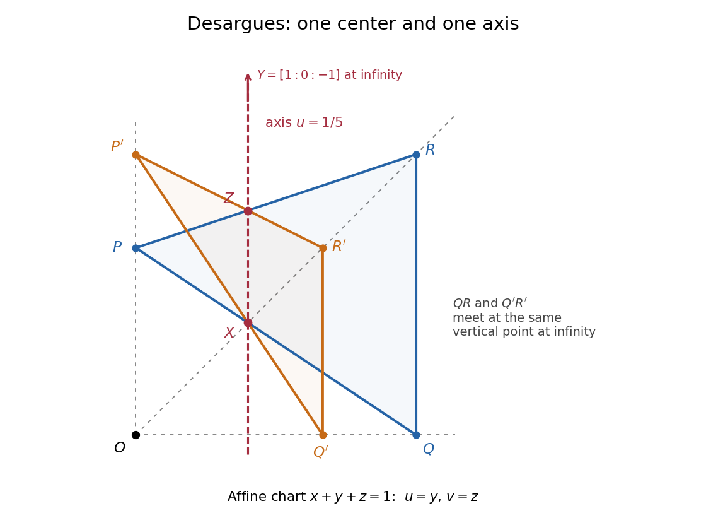
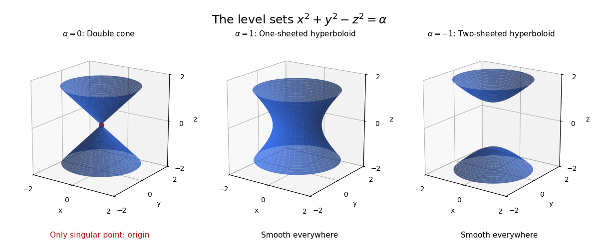
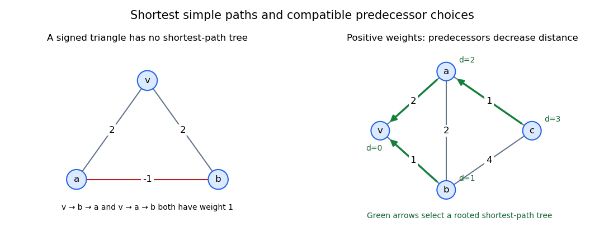
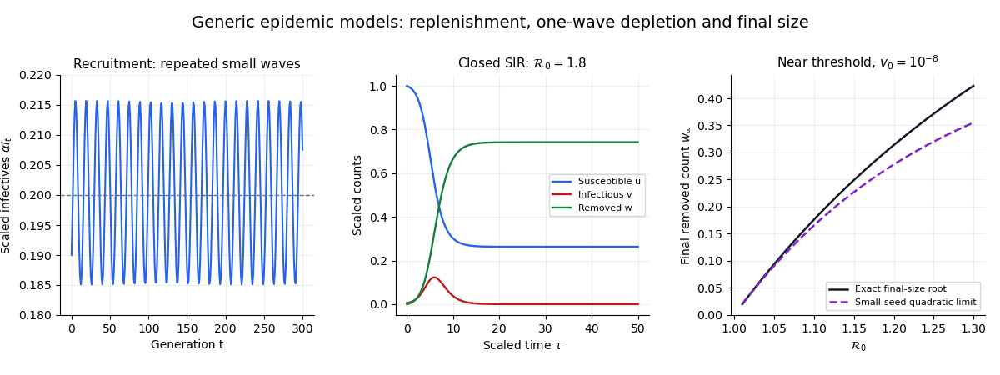

# 2017

↑ **Parent:** [Past exam of the short options course of the University of Oxford](../past-exam-of-the-short-options-course-of-the-university-of-oxford.md)

Source paper: [released examination archive](https://www.whatdotheyknow.com/request/ba_computer_science_past_papers/response/2577745/attach/2/202402%20183%20CS%20Papers.zip?cookie_passthrough=1), member `2016/T/a13752w1.pdf`. The original cover dates this examination to 2017-06-19.

An intact copy in [the Mathematics Part A release](https://www.whatdotheyknow.com/request/maths_papers_2/response/1850333/attach/3/FOI%2020210708%201%20Data.zip?cookie_passthrough=1), member `FOI-20210708-1 - Data/a13752w1 (2).pdf`, restores printed pages 2–3. All nine questions, comprising 51 leaf subparts, are answered below. The earlier source provenance above is retained.

**Table of contents**

- [1](#1)
  - [a](#1/a)
    - [Solution](#1/a/solution)
  - [b](#1/b)
    - [Solution](#1/b/solution)
  - [c](#1/c)
    - [Solution](#1/c/solution)
  - [d](#1/d)
    - [Solution](#1/d/solution)
- [2](#2)
  - [a](#2/a)
    - [i](#2/a/i)
      - [Solution](#2/a/i/solution)
    - [ii](#2/a/ii)
      - [Solution](#2/a/ii/solution)
  - [b](#2/b)
    - [i](#2/b/i)
      - [Solution](#2/b/i/solution)
    - [ii](#2/b/ii)
      - [Solution](#2/b/ii/solution)
    - [iii](#2/b/iii)
      - [Solution](#2/b/iii/solution)
- [3](#3)
  - [a](#3/a)
    - [i](#3/a/i)
      - [Solution](#3/a/i/solution)
    - [ii](#3/a/ii)
      - [Solution](#3/a/ii/solution)
    - [iii](#3/a/iii)
      - [Solution](#3/a/iii/solution)
    - [iv](#3/a/iv)
      - [Solution](#3/a/iv/solution)
  - [b](#3/b)
    - [i](#3/b/i)
      - [Solution](#3/b/i/solution)
    - [ii](#3/b/ii)
      - [Solution](#3/b/ii/solution)
- [4](#4)
  - [a](#4/a)
    - [i](#4/a/i)
      - [Solution](#4/a/i/solution)
    - [ii](#4/a/ii)
      - [Solution](#4/a/ii/solution)
  - [b](#4/b)
    - [i](#4/b/i)
      - [Solution](#4/b/i/solution)
    - [ii](#4/b/ii)
      - [Solution](#4/b/ii/solution)
  - [c](#4/c)
    - [Solution](#4/c/solution)
- [5](#5)
  - [a](#5/a)
    - [i](#5/a/i)
      - [Solution](#5/a/i/solution)
    - [ii](#5/a/ii)
      - [Solution](#5/a/ii/solution)
    - [iii](#5/a/iii)
      - [Solution](#5/a/iii/solution)
    - [iv](#5/a/iv)
      - [Solution](#5/a/iv/solution)
  - [b](#5/b)
    - [Solution](#5/b/solution)
  - [c](#5/c)
    - [Solution](#5/c/solution)
- [6](#6)
  - [a](#6/a)
    - [i](#6/a/i)
      - [Solution](#6/a/i/solution)
    - [ii](#6/a/ii)
      - [Solution](#6/a/ii/solution)
    - [iii](#6/a/iii)
      - [Solution](#6/a/iii/solution)
  - [b](#6/b)
    - [i](#6/b/i)
      - [Solution](#6/b/i/solution)
    - [ii](#6/b/ii)
      - [Solution](#6/b/ii/solution)
    - [iii](#6/b/iii)
      - [Solution](#6/b/iii/solution)
    - [iv](#6/b/iv)
      - [Solution](#6/b/iv/solution)
- [7](#7)
  - [a](#7/a)
    - [i](#7/a/i)
      - [Solution](#7/a/i/solution)
    - [ii](#7/a/ii)
      - [Solution](#7/a/ii/solution)
    - [iii](#7/a/iii)
      - [Solution](#7/a/iii/solution)
  - [b](#7/b)
    - [Solution](#7/b/solution)
  - [c](#7/c)
    - [Solution](#7/c/solution)
  - [d](#7/d)
    - [i](#7/d/i)
      - [Solution](#7/d/i/solution)
    - [ii](#7/d/ii)
      - [Solution](#7/d/ii/solution)
- [8](#8)
  - [a](#8/a)
    - [i](#8/a/i)
      - [Solution](#8/a/i/solution)
    - [ii](#8/a/ii)
      - [Solution](#8/a/ii/solution)
  - [b](#8/b)
    - [i](#8/b/i)
      - [Solution](#8/b/i/solution)
    - [ii](#8/b/ii)
      - [Solution](#8/b/ii/solution)
    - [iii](#8/b/iii)
      - [Solution](#8/b/iii/solution)
- [9](#9)
  - [a](#9/a)
    - [i](#9/a/i)
      - [Solution](#9/a/i/solution)
    - [ii](#9/a/ii)
      - [Solution](#9/a/ii/solution)
    - [iii](#9/a/iii)
      - [Solution](#9/a/iii/solution)
  - [b](#9/b)
    - [i](#9/b/i)
      - [Solution](#9/b/i/solution)
    - [ii](#9/b/ii)
      - [Solution](#9/b/ii/solution)
    - [iii](#9/b/iii)
      - [Solution](#9/b/iii/solution)

## 1

↑ **Parent:** [2017](2017.md)

<h3 id="1/a">a</h3>

↑ **Parent:** [1](#1)

<h4 id="1/a/solution">Solution</h4>

↑ **Parent:** [A](#1/a)

For distinct [odd primes](../prime-number.md#odd-prime) $p,q$, [quadratic reciprocity](../number-theory.md#quadratic-reciprocity) states

$$
\boxed{\left(\frac pq\right)\left(\frac qp\right)=(-1)^{(p-1)(q-1)/4}.}
$$

Here the [Legendre symbol](../quadratic-residue.md#legendre-symbol) records whether a nonzero [congruence class](../modular-arithmetic.md#congruence-class) is a [quadratic residue](../quadratic-residue.md). The [first supplementary law for quadratic reciprocity](../quadratic-residue.md#first-supplementary-law-for-quadratic-reciprocity) and [second supplementary law for quadratic reciprocity](../quadratic-residue.md#second-supplementary-law-for-quadratic-reciprocity) give

$$
\left(\frac{-1}p\right)=(-1)^{(p-1)/2},\qquad
\left(\frac2p\right)=(-1)^{(p^2-1)/8}.
$$

Thus **minus one is a square exactly when $p\equiv1\pmod4$, and two is a square exactly when $p\equiv1$ or $7\pmod8$**.

To test the specified [congruence class](../modular-arithmetic.md#congruence-class), factor $111=3\cdot37$. Since $2017\equiv1\pmod4$, [multiplicativity of the Legendre symbol](../quadratic-residue.md#multiplicativity-of-the-legendre-symbol) and [quadratic reciprocity](../number-theory.md#quadratic-reciprocity) yield

$$
\begin{aligned}
\left(\frac{111}{2017}\right)
&=\left(\frac3{2017}\right)\left(\frac{37}{2017}\right)
=\left(\frac{2017}3\right)\left(\frac{2017}{37}\right)\\
&=\left(\frac13\right)\left(\frac{19}{37}\right)
=\left(\frac{37}{19}\right)
=\left(\frac{18}{19}\right).
\end{aligned}
$$

There is no sign change on swapping $19$ and $37$ because $37\equiv1\pmod4$. Finally $18=2\cdot3^2$, so [multiplicativity of the Legendre symbol](../quadratic-residue.md#multiplicativity-of-the-legendre-symbol) gives $(18/19)=(2/19)=-1$, since $19\equiv3\pmod8$. Therefore

$$
\boxed{x^2\equiv111\pmod{2017}\text{ has no integer solution}.}
$$

<h3 id="1/b">b</h3>

↑ **Parent:** [1](#1)

<h4 id="1/b/solution">Solution</h4>

↑ **Parent:** [B](#1/b)

For an [odd prime](../prime-number.md#odd-prime) $p$, [Euler's criterion](../quadratic-residue.md#euler-s-criterion) states

$$
\boxed{a^{(p-1)/2}\equiv\left(\frac ap\right)\pmod p.}
$$

For $p\nmid a$, the [Legendre symbol](../quadratic-residue.md#legendre-symbol) is $1$ for a [quadratic residue](../quadratic-residue.md) and $-1$ for a [quadratic nonresidue](../quadratic-residue.md#quadratic-nonresidue); if $p\mid a$, both sides are zero.

The product is a single power because the [arithmetic progression](../arithmetic.md#arithmetic-progression) of exponents has sum $2017\cdot2018/2$:

$$
\prod_{j=1}^{2017}2^j=2^{2017\cdot1009}.
$$

Since $2017\equiv1\pmod8$, the [second supplementary law for quadratic reciprocity](../quadratic-residue.md#second-supplementary-law-for-quadratic-reciprocity) gives $(2/2017)=1$. Hence [Euler's criterion](../quadratic-residue.md#euler-s-criterion) gives $2^{1008}\equiv1\pmod{2017}$. Reduce the exponent using $1009=1008+1$ and $2017=2\cdot1008+1$:

$$
2^{2017\cdot1009}\equiv2^{2017}
=2(2^{1008})^2\equiv2\pmod{2017}.
$$

The least nonnegative [remainder](../integer.md#remainder) is therefore **$2$**.

<h3 id="1/c">c</h3>

↑ **Parent:** [1](#1)

<h4 id="1/c/solution">Solution</h4>

↑ **Parent:** [C](#1/c)

[Euler's totient function](../number-theory.md#euler-totient-function) counts the [integers](../integer.md) in a complete [complete residue system](../modular-arithmetic.md#complete-residue-system) that are [coprime](../divisibility.md#coprime-integers) to the modulus:

$$
\boxed{\phi(n)=\#\{1\leq a\leq n:\gcd(a,n)=1\}.}
$$

If the [prime factorization](../prime-number.md#fundamental-theorem-of-arithmetic) is $n=\prod_{j=1}^r p_j^{e_j}$ with distinct [prime numbers](../prime-number.md) $p_j$, [Euler's totient product formula](../number-theory.md#euler-s-totient-product-formula) is

$$
\boxed{\phi(n)=n\prod_{j=1}^r\left(1-\frac1{p_j}\right)
=\prod_{j=1}^r p_j^{e_j-1}(p_j-1).}
$$

In particular, $\phi(2017)=2016$. Adjoining the [prime factor](../prime-number.md#prime-factor) $2$ changes neither the odd factor nor its count of [units](../algebra.md#unit-in-a-ring), since $\phi(2)=1$. The product formula gives

$$
\boxed{n=4034=2\cdot2017,\qquad\phi(4034)=(2-1)(2017-1)=2016.}
$$

This is a positive [integer](../integer.md) distinct from $2017$, as required.

<h3 id="1/d">d</h3>

↑ **Parent:** [1](#1)

<h4 id="1/d/solution">Solution</h4>

↑ **Parent:** [D](#1/d)

The [Chinese remainder theorem](../mathematics.md#chinese-remainder-theorem) says that for pairwise [coprime](../divisibility.md#coprime-integers) positive moduli $m_1,\ldots,m_r$ and arbitrary [integers](../integer.md) $a_1,\ldots,a_r$, the simultaneous [modular congruences](../modular-arithmetic.md#modular-congruence)

$$
n\equiv a_i\pmod{m_i}\qquad(1\leq i\leq r)
$$

have a solution, unique modulo $M=\prod_i m_i$.

Choose $2017$ distinct [prime numbers](../prime-number.md) $q_1,\ldots,q_{2017}$. Their [prime powers](../prime-number.md#prime-power) $q_i^{2017}$ are pairwise [coprime](../divisibility.md#coprime-integers). Apply the [Chinese remainder theorem](../mathematics.md#chinese-remainder-theorem) to

$$
\boxed{n\equiv-i\pmod{q_i^{2017}}\qquad(1\leq i\leq2017).}
$$

For the resulting [integer](../integer.md) $n$, each $n+i$ is divisible by $q_i^{2017}$, the required power of an [integer](../integer.md) greater than one. Adding a sufficiently large multiple of $\prod_iq_i^{2017}$ makes $n$ positive without changing any [modular congruence](../modular-arithmetic.md#modular-congruence). Thus **such a positive $n$ exists**, indeed infinitely many do. This is the general construction of [consecutive integers divisible by prescribed prime powers](../mathematics.md#consecutive-integers-divisible-by-prescribed-prime-powers).

## 2

↑ **Parent:** [2017](2017.md)

<h3 id="2/a">a</h3>

↑ **Parent:** [2](#2)

<h4 id="2/a/i">i</h4>

↑ **Parent:** [A](#2/a)

<h5 id="2/a/i/solution">Solution</h5>

↑ **Parent:** [I](#2/a/i)

Use the fact that $K$ is a [normal subgroup](../group-theory.md#normal-subgroup) to move a factor of $K$ past a factor of $H$. For $h_1,h_2\in H$ and $k_1,k_2\in K$,

$$
(h_1k_1)(h_2k_2)=h_1h_2(h_2^{-1}k_1h_2)k_2\in HK,
$$

while

$$
(hk)^{-1}=k^{-1}h^{-1}=h^{-1}(hk^{-1}h^{-1})\in HK.
$$

The [identity element](../algebraic-operation.md#identity-element) belongs to $HK$. Hence **$HK$ is a [subgroup](../group.md#subgroup)**, by the [subgroup test](../group.md#subgroup-test). This proves the [product of a subgroup with a normal subgroup](../group-theory.md#product-of-a-subgroup-with-a-normal-subgroup) construction; $H$ need not be a [normal subgroup](../group-theory.md#normal-subgroup).

For each $h\in H$, [conjugation](../group-action.md#conjugation) maps $K$ to itself and respects its multiplication. The inverse of $k\mapsto h^{-1}kh$ is $k\mapsto hkh^{-1}$, so both are [group automorphisms](../algebra.md#group-automorphism) of $K$.

**The printed formula requires a composition convention.** For the printed $\phi_h(k)=h^{-1}kh$, ordinary [function composition](../function.md#function-composition) gives

$$
\boxed{\phi_{h_1h_2}=\phi_{h_2}\circ\phi_{h_1}.}
$$

Indeed, $(h_1h_2)^{-1}k(h_1h_2)=h_2^{-1}(h_1^{-1}kh_1)h_2$. Thus the displayed assignment is a [group antihomomorphism](../group-theory.md#group-antihomomorphism) with the usual multiplication in the [automorphism group](../group-theory.md#automorphism-group). It is a [group homomorphism](../group-theory.md#group-homomorphism) if the [automorphisms](../algebra.md#automorphism) are written as right operators and multiplied in the corresponding reverse order; this is precisely why [right conjugation reverses composition](../group-action.md#right-conjugation-reverses-composition).

With the usual left [function composition](../function.md#function-composition), the corresponding [group homomorphism](../group-theory.md#group-homomorphism) is instead

$$
\boxed{\psi:H\longrightarrow\operatorname{Aut}(K),\qquad\psi_h(k)=hkh^{-1}.}
$$

Direct expansion gives $\psi_{h_1h_2}(k)=h_1(h_2kh_2^{-1})h_1^{-1}=(\psi_{h_1}\circ\psi_{h_2})(k)$. This states the intended [conjugation action](../group-action.md#conjugation-action) without silently reversing the order in the printed formula.

<h4 id="2/a/ii">ii</h4>

↑ **Parent:** [A](#2/a)

<h5 id="2/a/ii/solution">Solution</h5>

↑ **Parent:** [Ii](#2/a/ii)

Write the [group order](../group.md#order-of-a-finite-group) as $|G|=p^am$, where $p$ is a [prime number](../prime-number.md) and $p\nmid m$. A [Sylow p-subgroup](../finite-group-theory.md#sylow-subgroup) is a [subgroup](../group.md#subgroup) of [group order](../group.md#order-of-a-finite-group) $p^a$, the largest power of $p$ dividing $|G|$.

The three [Sylow theorems](../finite-group-theory.md#sylow-theorems) assert:

- **Existence:** a [Sylow p-subgroup](../finite-group-theory.md#sylow-subgroup) exists, and every [subgroup](../group.md#subgroup) of [prime power](../prime-number.md#prime-power) order a power of $p$ is contained in one.
- **Conjugacy:** any two [Sylow p-subgroups](../finite-group-theory.md#sylow-subgroup) are conjugate in $G$.
- **Counting:** their number $n_p$ satisfies $n_p\mid m$ and $n_p\equiv1\pmod p$.

In particular, a unique [Sylow p-subgroup](../finite-group-theory.md#sylow-subgroup) is a [normal subgroup](../group-theory.md#normal-subgroup), since all its conjugates must equal it.

<h3 id="2/b">b</h3>

↑ **Parent:** [2](#2)

<h4 id="2/b/i">i</h4>

↑ **Parent:** [B](#2/b)

<h5 id="2/b/i/solution">Solution</h5>

↑ **Parent:** [I](#2/b/i)

The [Sylow theorems](../finite-group-theory.md#sylow-theorems) give $n_7\mid10$ and $n_7\equiv1\pmod7$. Among the [divisors](../divisibility.md#divisor) $1,2,5,10$, only $1$ satisfies the [modular congruence](../modular-arithmetic.md#modular-congruence). Hence

$$
\boxed{n_7=1,\qquad K\triangleleft G,\qquad |K|=7.}
$$

Uniqueness and the conjugacy assertion of the [Sylow theorems](../finite-group-theory.md#sylow-theorems) make $K$ a [normal subgroup](../group-theory.md#normal-subgroup).

<h4 id="2/b/ii">ii</h4>

↑ **Parent:** [B](#2/b)

<h5 id="2/b/ii/solution">Solution</h5>

↑ **Parent:** [Ii](#2/b/ii)

The [Sylow theorems](../finite-group-theory.md#sylow-theorems) also give $n_5\mid14$ and $n_5\equiv1\pmod5$. Of $1,2,7,14$, only $1$ is congruent to one modulo five. Thus $H$ is a [normal subgroup](../group-theory.md#normal-subgroup) of $G$ as well.

By [Lagrange's theorem](../group-theory.md#lagrange-s-theorem), $H\cap K=\{1\}$, since its [group order](../group.md#order-of-a-finite-group) divides both $5$ and $7$. For $h\in H$ and $k\in K$, the [group commutator](../group.md#group-commutator) $hkh^{-1}k^{-1}$ lies in $H$ by the [normal subgroup](../group-theory.md#normal-subgroup) property of $H$, and in $K$ by the [normal subgroup](../group-theory.md#normal-subgroup) property of $K$. It is therefore the [identity element](../algebraic-operation.md#identity-element), so all elements of $H$ commute with all elements of $K$. This is the fact that [normal subgroups of coprime order commute](../group-theory.md#normal-subgroups-of-coprime-order-commute).

The [subgroup](../group.md#subgroup) $HK$ consequently has $|H||K|=35$ elements: the expression $hk$ is unique because $H\cap K=\{1\}$. Since $H$ and $K$ have [prime](../prime-number.md) orders, they are [cyclic groups](../group.md#cyclic-group). Write $H=\langle h\rangle$ and $K=\langle k\rangle$. The [product of commuting elements of coprime order](../group-theory.md#product-of-commuting-elements-of-coprime-order) has order $35$, so $hk$ generates $HK$. Finally, $HK$ is a [normal subgroup](../group-theory.md#normal-subgroup) because both its factors are [normal subgroups](../group-theory.md#normal-subgroup); equivalently, it has [subgroup index](../group.md#index-of-a-subgroup) two. Therefore

$$
\boxed{HK\cong C_{35},\qquad HK\triangleleft G.}
$$

<h4 id="2/b/iii">iii</h4>

↑ **Parent:** [B](#2/b)

<h5 id="2/b/iii/solution">Solution</h5>

↑ **Parent:** [Iii](#2/b/iii)

Put $N=HK=\langle r\rangle$, the [normal subgroup](../group-theory.md#normal-subgroup) of order $35$. By [Cauchy's theorem for finite groups](../finite-group-theory.md#cauchy-theorem-for-groups), $G$ contains an element $t$ of order two. Such an element cannot belong to the odd-order [subgroup](../group.md#subgroup) $N$. Thus $N\cap\langle t\rangle=\{1\}$ and $G=N\langle t\rangle$, giving the [semidirect product](../group-theory.md#semidirect-product)

$$
\boxed{G\cong C_{35}\rtimes C_2.}
$$

Every [automorphism of a finite cyclic group](../group-theory.md#automorphism-of-a-finite-cyclic-group) sends $r$ to $r^a$ for a [unit](../algebra.md#unit-in-a-ring) $a$ modulo $35$. The relation $t^2=1$ forces the [conjugation action](../group-action.md#conjugation-action) of $t$ to square to the identity:

$$
trt^{-1}=r^a,\qquad a^2\equiv1\pmod{35}.
$$

The [Chinese remainder theorem](../mathematics.md#chinese-remainder-theorem) identifies a [congruence class](../modular-arithmetic.md#congruence-class) modulo $35$ with its pair of classes modulo $5$ and $7$. In each of these [prime fields](../algebra.md#prime-field), the factorization $(a-1)(a+1)=0$ forces $a=1$ or $a=-1$. The choices are independent, giving exactly four [homomorphisms from a finite cyclic group](../group.md#homomorphism-from-a-finite-cyclic-group) $C_2\to\operatorname{Aut}(C_{35})$. Explicitly,

$$
\boxed{a\equiv1,6,29,34\pmod{35}.}
$$

The factors $C_5$ and $C_7$ of $N$ are preserved by every [automorphism](../algebra.md#automorphism), since each is its unique [subgroup](../group.md#subgroup) of that order. The four [conjugation actions](../group-action.md#conjugation-action) therefore give:

- $a=1$: the action is trivial on both factors, so $G\cong C_{35}\times C_2\cong\boxed{C_{70}}$, by [cyclicity of a product of two finite cyclic groups](../group-theory.md#cyclicity-of-a-product-of-two-finite-cyclic-groups).
- $a=34$: the action inverts both factors, so $\langle r,t\mid r^{35}=t^2=1,\ trt^{-1}=r^{-1}\rangle$ is the [dihedral group](../finite-group-theory.md#dihedral-group) $\boxed{D_{70}}$.
- $a=6$: it is the identity modulo $5$ and inversion modulo $7$, so the $C_5$ factor commutes with the other factors and $G\cong\boxed{D_{14}\times C_5}$.
- $a=29$: it is inversion modulo $5$ and the identity modulo $7$, giving $G\cong\boxed{D_{10}\times C_7}$.

Here $D_n$ has [group order](../group.md#order-of-a-finite-group) $n$, as in the paper. The [center of a group](../group-theory.md#center-of-a-group) distinguishes these four [groups of order seventy](../finite-group-theory.md#groups-of-order-seventy): its orders are $70,1,5,7$, respectively, so the four groups are pairwise nonisomorphic. Each construction is a [semidirect product](../group-theory.md#semidirect-product) with $70$ elements, so every listed possibility occurs.

## 3

↑ **Parent:** [2017](2017.md)

<h3 id="3/a">a</h3>

↑ **Parent:** [3](#3)

<h4 id="3/a/i">i</h4>

↑ **Parent:** [A](#3/a)

<h5 id="3/a/i/solution">Solution</h5>

↑ **Parent:** [I](#3/a/i)

The [real projective plane](../differential-geometry.md#real-projective-plane) is the set of one-dimensional [linear subspaces](../vector-space.md#vector-subspace) of $\mathbb R^3$. Equivalently,

$$
\boxed{\mathbb{RP}^2=(\mathbb R^3\setminus\{0\})/\sim,\qquad v\sim\lambda v\ (\lambda\in\mathbb R\setminus\{0\}).}
$$

A [projective point](../projective-space.md#projective-point) is written in [homogeneous coordinates](../projective-space.md#homogeneous-coordinate) $[x:y:z]$. A [projective line](../finite-group-theory.md#projective-line) is the set of [projective points](../projective-space.md#projective-point) whose representatives belong to one fixed two-dimensional [linear subspace](../vector-space.md#vector-subspace) of $\mathbb R^3$. Such a [linear subspace](../vector-space.md#vector-subspace) is the [kernel of a linear map](../kernel-of-a-linear-map.md) of a nonzero [linear functional](../dual-space.md#linear-functional), so its equation has the form $\alpha x+\beta y+\gamma z=0$ with $(\alpha,\beta,\gamma)\ne0$.

Two distinct [projective points](../projective-space.md#projective-point) have [linearly independent](../vector-space.md#linear-independence) representatives $p,q$. Their [linear span](../vector-space.md#linear-span) has dimension two and hence defines a [projective line](../finite-group-theory.md#projective-line) containing both. Conversely, any two-dimensional [linear subspace](../vector-space.md#vector-subspace) containing both representatives contains their entire [linear span](../vector-space.md#linear-span) and therefore equals it. Thus **exactly one [projective line](../finite-group-theory.md#projective-line) passes through two distinct [projective points](../projective-space.md#projective-point)**.

<h4 id="3/a/ii">ii</h4>

↑ **Parent:** [A](#3/a)

<h5 id="3/a/ii/solution">Solution</h5>

↑ **Parent:** [Ii](#3/a/ii)

For representatives $p=(a,b,c)$ and $p'=(a',b',c')$, a point $[x:y:z]$ belongs to their [projective line](../finite-group-theory.md#projective-line) exactly when these three vectors are [linearly dependent](../vector-space.md#linear-dependence). The [determinant](../multilinear-algebra.md#determinant) criterion gives

$$
\begin{vmatrix}x&y&z\\a&b&c\\a'&b'&c'\end{vmatrix}=0.
$$

Expanding along the first row gives

$$
\boxed{(bc'-cb')x+(ca'-ac')y+(ab'-ba')z=0.}
$$

The coefficient vector is the [cross product](../vector-space.md#cross-product) $p\times p'$. It is nonzero because the [projective points](../projective-space.md#projective-point) are distinct. Rescaling either representative merely rescales all three coefficients, leaving the [projective line](../finite-group-theory.md#projective-line) unchanged. This is the join formula in [projective joins and meets by cross products](../projective-space.md#projective-joins-and-meets-by-cross-products).

<h4 id="3/a/iii">iii</h4>

↑ **Parent:** [A](#3/a)

<h5 id="3/a/iii/solution">Solution</h5>

↑ **Parent:** [Iii](#3/a/iii)

Two [projective triangles](../projective-space.md#projective-triangle) are in [perspectivity from a point](../projective-space.md#perspectivity-from-a-point) $O$ when their three corresponding-vertex [projective lines](../finite-group-theory.md#projective-line) $PP'$, $QQ'$, and $RR'$ all pass through $O$.

**[Desargues's theorem](../projective-space.md#desargues-s-theorem): [perspectivity from a point](../projective-space.md#perspectivity-from-a-point) implies [perspectivity from a line](../projective-space.md#perspectivity-from-a-line).** More explicitly, if $PP',QQ',RR'$ are concurrent, then the three corresponding-side intersections

$$
X=PQ\cap P'Q',\qquad Y=QR\cap Q'R',\qquad Z=RP\cap R'P'
$$

are [collinear](../euclidean-geometry.md#collinearity). The usual statement assumes nondegenerate [projective triangles](../projective-space.md#projective-triangle) and well-defined, distinct corresponding-side intersections. The [projective line](../finite-group-theory.md#projective-line) containing $X,Y,Z$ is the axis of [perspectivity from a line](../projective-space.md#perspectivity-from-a-line). All intersections are projective: parallel lines in an [affine chart](../locally-ringed-space.md#affine-chart-of-a-variety) meet on its [projective line at infinity](../projective-space.md#projective-line-at-infinity).

<h4 id="3/a/iv">iv</h4>

↑ **Parent:** [A](#3/a)

<h5 id="3/a/iv/solution">Solution</h5>

↑ **Parent:** [Iv](#3/a/iv)

The [dual projective space](../projective-space.md#dual-projective-space) is $\mathbb P((\mathbb R^3)^*)$. A [projective line](../finite-group-theory.md#projective-line) with coefficients $[\alpha:\beta:\gamma]$ becomes a [projective point](../projective-space.md#projective-point) in this dual plane; a [projective point](../projective-space.md#projective-point) $[a:b:c]$ becomes the dual [projective line](../finite-group-theory.md#projective-line) $a\alpha+b\beta+c\gamma=0$.

The [point-line duality](../projective-space.md#point-line-duality) reverses incidence:

$$
\boxed{P\in l\quad\Longleftrightarrow\quad l^*\in P^*.}
$$

Thus **the dual statement is that the dual point $l^*$ lies on the dual line $P^*$**. A join of [projective points](../projective-space.md#projective-point) becomes an intersection of dual [projective lines](../finite-group-theory.md#projective-line), and the converse holds too. In particular, [collinear](../euclidean-geometry.md#collinearity) [projective points](../projective-space.md#projective-point) correspond to concurrent dual [projective lines](../finite-group-theory.md#projective-line).

The dual of [Desargues's theorem](../projective-space.md#desargues-s-theorem) is its converse: **if the intersections of the three pairs of corresponding sides are [collinear](../euclidean-geometry.md#collinearity), then the three lines joining corresponding vertices are concurrent**. In the same nondegenerate setting, [perspectivity from a line](../projective-space.md#perspectivity-from-a-line) therefore implies [perspectivity from a point](../projective-space.md#perspectivity-from-a-point).

<h3 id="3/b">b</h3>

↑ **Parent:** [3](#3)

<h4 id="3/b/i">i</h4>

↑ **Parent:** [B](#3/b)

<h5 id="3/b/i/solution">Solution</h5>

↑ **Parent:** [I](#3/b/i)

Apply [projective joins and meets by cross products](../projective-space.md#projective-joins-and-meets-by-cross-products) to each corresponding pair. The [cross products](../vector-space.md#cross-product) of their representatives are proportional to $(0,1,0)$, $(0,0,1)$, and $(0,1,-1)$, respectively. Hence

$$
\boxed{PP':y=0,\qquad QQ':z=0,\qquad RR':y-z=0.}
$$

Their common point is

$$
\boxed{O=[1:0:0].}
$$

It is a valid [projective point](../projective-space.md#projective-point), because its representative is nonzero. The three equations force $y=z=0$, so this common [projective point](../projective-space.md#projective-point) is unique. Thus the two [projective triangles](../projective-space.md#projective-triangle) are in [perspectivity from a point](../projective-space.md#perspectivity-from-a-point) $O$.

<h4 id="3/b/ii">ii</h4>

↑ **Parent:** [B](#3/b)

<h5 id="3/b/ii/solution">Solution</h5>

↑ **Parent:** [Ii](#3/b/ii)

The corresponding side equations, computed using [projective joins and meets by cross products](../projective-space.md#projective-joins-and-meets-by-cross-products), are

$$
\begin{aligned}
PQ&:x-y-2z=0,&P'Q'&:x-2y-z=0,\\
QR&:x-y+z=0,&Q'R'&:x-2y+z=0,\\
RP&:x+2y-2z=0,&R'P'&:x-z=0.
\end{aligned}
$$

Subtracting the two equations in each row and substituting back gives the three [projective points](../projective-space.md#projective-point)

$$
\boxed{X=[3:1:1],\qquad Y=[1:0:-1],\qquad Z=[2:1:2].}
$$

For example, the first pair forces $y=z$ and $x=3z$; the second pair forces $y=0$ and $x=-z$; the last pair forces $x=z=2y$. All three satisfy

$$
\boxed{x-4y+z=0,}
$$

since $3-4+1=0$, $1-0-1=0$, and $2-4+2=0$. The coefficient vector is nonzero, so this is a [projective line](../finite-group-theory.md#projective-line). Thus **the corresponding-side intersections are [collinear](../euclidean-geometry.md#collinearity)**, explicitly confirming [Desargues's theorem](../projective-space.md#desargues-s-theorem).

The diagram uses the [affine chart](../locally-ringed-space.md#affine-chart-of-a-variety) $x+y+z\ne0$ with coordinates $u=y/(x+y+z)$ and $v=z/(x+y+z)$. Here the center $O$ is finite, the axis is $u=1/5$, and $Y$ lies on the [projective line at infinity](../projective-space.md#projective-line-at-infinity). The apparent parallelism of $QR$ and $Q'R'$ records their common vertical point at infinity, which also belongs to the axis.

**[Figure 1](#3/b/ii/image-desargues-s-theorem-three-connectors-meet-at-o-and-three-side-intersections-lie-on-one-projective-line). Desargues's theorem: three connectors meet at O and three side intersections lie on one projective line**. Original drawing in the affine chart x+y+z=1. Blue and orange triangles are in perspectivity from O. Two side intersections X and Z lie on the red vertical axis; the third intersection Y is its vertical point at infinity.

## 4

↑ **Parent:** [2017](2017.md)

<h3 id="4/a">a</h3>

↑ **Parent:** [4](#4)

<h4 id="4/a/i">i</h4>

↑ **Parent:** [A](#4/a)

<h5 id="4/a/i/solution">Solution</h5>

↑ **Parent:** [I](#4/a/i)

The map is [differentiable](../analysis.md#differentiable-function) at $x$ if there is a [linear map](../vector-space.md#linear-map) $L:\mathbb R^n\to\mathbb R^m$ such that

$$
\lim_{h\to0}\frac{\|f(x+h)-f(x)-Lh\|}{\|h\|}=0.
$$

Equivalently, $f(x+h)=f(x)+Lh+o(\|h\|)$. This linear map is unique and is the [Fréchet derivative](../multivariable-calculus.md#frechet-derivative) $Df_x$. Its matrix in the standard bases is the [Jacobian matrix](../multivariable-calculus.md#jacobian-matrix), whose $(i,j)$ entry is $\partial f_i/\partial x_j$ at $x$. A function is differentiable on its domain if this condition holds at every point.

<h4 id="4/a/ii">ii</h4>

↑ **Parent:** [A](#4/a)

<h5 id="4/a/ii/solution">Solution</h5>

↑ **Parent:** [Ii](#4/a/ii)

A sufficient condition is that the [derivative](../calculus.md#derivative) $Df_x:\mathbb R^n\to\mathbb R^m$ is [surjective](../algebra.md#surjective-function), equivalently that its [Jacobian matrix](../multivariable-calculus.md#jacobian-matrix) has rank $m$. Then the [implicit function theorem](../multivariable-calculus.md#implicit-function-theorem) makes the zero set near $x$ a $C^1$ [embedded submanifold](../smooth-manifold.md#embedded-submanifold) of dimension

$$
\boxed{n-m.}
$$

The rank condition persists nearby because the derivative is continuous. This is the local form of the [regular level set theorem](../differential-geometry.md#regular-level-set-theorem); only the rank at the specified point is needed for this local conclusion.

<h3 id="4/b">b</h3>

↑ **Parent:** [4](#4)

<h4 id="4/b/i">i</h4>

↑ **Parent:** [B](#4/b)

<h5 id="4/b/i/solution">Solution</h5>

↑ **Parent:** [I](#4/b/i)

Expand the increment of the [quadratic form](../quadratic-form.md), using $A^T=A$:

$$
q(v+h)-q(v)=v^TAh+h^TAv+h^TAh=2v^TAh+h^TAh.
$$

The last term obeys $|h^TAh|\leq\|A\|\|h\|^2=o(\|h\|)$. Thus $q$ is differentiable and

$$
\boxed{Dq_v(h)=2v^TAh,\qquad\nabla q(v)=2Av.}
$$

This is the [quadratic form gradient](../quadratic-form.md#quadratic-form-gradient). The derivative is a linear functional of the increment $h$, whereas the [gradient](../multivariable-calculus.md#gradient) is its representing vector under the Euclidean inner product.

<h4 id="4/b/ii">ii</h4>

↑ **Parent:** [B](#4/b)

<h5 id="4/b/ii/solution">Solution</h5>

↑ **Parent:** [Ii](#4/b/ii)

Since $A$ is invertible, the [quadratic form gradient](../quadratic-form.md#quadratic-form-gradient) vanishes exactly at the origin. At every nonzero point of $C_\alpha$, the scalar derivative is surjective, so the [regular level set theorem](../differential-geometry.md#regular-level-set-theorem) gives a smooth submanifold of dimension $n-1$.

If $\alpha\ne0$, the origin is absent. Therefore **the largest relatively open smooth subset is all of $C_\alpha$**.

If $\alpha=0$, the nontriviality assumption forces the form to be an [indefinite quadratic form](../quadratic-form.md#indefinite-quadratic-form): an invertible definite form would have zero set consisting only of the origin. Every nonzero point is regular. To show that the origin really fails to be a manifold point, use [Sylvester's law of inertia](../quadratic-form.md#sylvester-s-law-of-inertia) to reduce to $|u|^2-|w|^2=0$. With positive and negative coordinate vectors $e_i,f_j$, the null vectors $e_i+f_j$ and $e_i-f_j$ span $\mathbb R^n$. Each line in one of these directions lies in the cone.

If a relatively open manifold neighborhood of the origin existed, its [tangent space](../tangent-vector.md#tangent-space) would contain all these line directions, so would have dimension $n$. Such an embedded manifold would be open in $\mathbb R^n$, impossible for the zero set of a nonzero quadratic form. Consequently

$$
\boxed{\text{smooth locus}=\begin{cases}C_\alpha,&\alpha\ne0,\\C_0\setminus\{0\},&\alpha=0.\end{cases}}
$$

This gives the [smooth locus of a nondegenerate real quadratic level set](../quadratic-form.md#smooth-locus-of-a-nondegenerate-real-quadratic-level-set), including maximality at the singular vertex.

<h3 id="4/c">c</h3>

↑ **Parent:** [4](#4)

<h4 id="4/c/solution">Solution</h4>

↑ **Parent:** [C](#4/c)

Writing the coordinates as $(x,y,z)$, the level equation is $x^2+y^2-z^2=\alpha$. Therefore:

- **$\alpha=0$: a circular double cone**, $x^2+y^2=z^2$. Its vertex at the origin is the sole singular point; every other point is a smooth surface point.
- **$\alpha=1$: a one-sheeted [hyperboloid](../differential-geometry.md#hyperboloid)**, with horizontal radius $\sqrt{1+z^2}$. It is smooth everywhere.
- **$\alpha=-1$: a two-sheeted [hyperboloid](../differential-geometry.md#hyperboloid)**, $z=\pm\sqrt{1+x^2+y^2}$. Both sheets are smooth everywhere, including their tips $(0,0,\pm1)$.

The cone vertex is an instance of the [double cone singularity](../topological-surface.md#double-cone-singularity). The tips of the two-sheeted hyperboloid are regular because the [gradient](../multivariable-calculus.md#gradient) $(2x,2y,-2z)$ is nonzero there.

**[Figure 2](#4/c/image-quadratic-level-surfaces-a-singular-double-cone-and-two-smooth-hyperboloids). Quadratic level surfaces: a singular double cone and two smooth hyperboloids**. Original surface plots for levels zero, one and minus one. The red point marks the cone vertex, the only failure of the submanifold condition. The displayed hyperboloid tips are regular.

## 5

↑ **Parent:** [2017](2017.md)

<h3 id="5/a">a</h3>

↑ **Parent:** [5](#5)

<h4 id="5/a/i">i</h4>

↑ **Parent:** [A](#5/a)

<h5 id="5/a/i/solution">Solution</h5>

↑ **Parent:** [I](#5/a/i)

Use the angular-frequency [Fourier transform](../fourier-transform.md) convention

$$
\boxed{\widehat f(s)=\int_{-\infty}^{\infty}f(x)e^{-isx}\,dx.}
$$

For $f,f'\in L^1(\mathbb R)$ with the usual local absolute-continuity hypothesis, the [Fourier transform of a derivative](../fourier-analysis.md#fourier-transform-of-a-derivative) is

$$
\boxed{\widehat{f'}(s)=is\widehat f(s).}
$$

For example, this applies when $f$ is $C^1$ and both displayed functions are integrable. These assumptions make integration by parts valid and the endpoint terms vanish.

<h4 id="5/a/ii">ii</h4>

↑ **Parent:** [A](#5/a)

<h5 id="5/a/ii/solution">Solution</h5>

↑ **Parent:** [Ii](#5/a/ii)

Split the integral at the origin and reflect the negative half:

$$
\begin{aligned}
\widehat{e^{-a|x|}}(s)
&=\int_0^\infty e^{-(a+is)x}\,dx+\int_0^\infty e^{-(a-is)x}\,dx\\
&=\frac1{a+is}+\frac1{a-is}=\frac{2a}{a^2+s^2}.
\end{aligned}
$$

Thus the [Fourier transform of a two-sided exponential](../fourier-transform.md#fourier-transform-of-a-two-sided-exponential) is

$$
\boxed{\widehat{e^{-a|x|}}(s)=\frac{2a}{a^2+s^2}\quad(a>0).}
$$

<h4 id="5/a/iii">iii</h4>

↑ **Parent:** [A](#5/a)

<h5 id="5/a/iii/solution">Solution</h5>

↑ **Parent:** [Iii](#5/a/iii)

With this convention, the [Fourier inversion theorem](../fourier-analysis.md#fourier-inversion-theorem) states that if $f,\widehat f\in L^1(\mathbb R)$, then

$$
f(x)=\frac1{2\pi}\int_{\mathbb R}\widehat f(s)e^{isx}\,ds
$$

almost everywhere and at every continuity point of $f$. Apply this to the continuous function in part (ii):

$$
e^{-a|x|}=\frac a\pi\int_{\mathbb R}\frac{e^{isx}}{a^2+s^2}\,ds.
$$

The denominator is even. Replacing $x$ by $-t$ and renaming the integration variable gives

$$
\boxed{\mathcal F\!\left(\frac1{a^2+x^2}\right)(t)=\frac\pi a e^{-a|t|}.}
$$

Both integrable members of this transform pair satisfy the inversion hypotheses.

<h4 id="5/a/iv">iv</h4>

↑ **Parent:** [A](#5/a)

<h5 id="5/a/iv/solution">Solution</h5>

↑ **Parent:** [Iv](#5/a/iv)

Complete the square: $x^2+2x+2=(x+1)^2+1$. In the [Fourier transform](../fourier-transform.md), the substitution $u=x+1$ gives

$$
\boxed{\mathcal F\!\left(\frac1{x^2+2x+2}\right)(s)=\pi e^{-|s|}e^{is}.}
$$

The phase $e^{is}$ is important. Taking the real part at $s=a$ gives the cosine integral, since changing the sign in the exponential does not change its real part:

$$
\boxed{\int_{-\infty}^{\infty}\frac{\cos(ax)}{x^2+2x+2}\,dx=\pi e^{-|a|}\cos a\qquad(a\in\mathbb R).}
$$

<h3 id="5/b">b</h3>

↑ **Parent:** [5](#5)

<h4 id="5/b/solution">Solution</h4>

↑ **Parent:** [B](#5/b)

For integrable functions $u,v$, the [convolution theorem](../fourier-analysis.md#convolution-theorem) in the chosen convention is

$$
\widehat{u*v}(s)=\widehat u(s)\widehat v(s),\qquad (u*v)(x)=\int_{\mathbb R}u(x-t)v(t)\,dt.
$$

Let $F(s,y)$ be the [Fourier transform](../fourier-transform.md) of $f(\cdot,y)$ in the horizontal coordinate. Transforming [Laplace's equation](../partial-differential-equation.md#laplace-equation) gives

$$
F_{yy}-s^2F=0,\qquad F(s,0)=\frac2{1+s^2}.
$$

For $s\ne0$, exclude the growing exponential and obtain $F(s,y)=2e^{-|s|y}/(1+s^2)$. At $s=0$, continuity in frequency gives $F(0,y)=2$; a constant zero-frequency transform is compatible with spatial decay of $f$.

By the transform pair in part (a), the inverse transform of $e^{-|s|y}$ is the [Poisson kernel for the upper half-plane](../partial-differential-equation.md#poisson-kernel-for-the-upper-half-plane), $P_y(x)=y/[\pi(x^2+y^2)]$. Thus

$$
\boxed{f(x,y)=(P_y*e^{-|\cdot|})(x)=\frac y\pi\int_{\mathbb R}\frac{e^{-|t|}}{(x-t)^2+y^2}\,dt\quad(y>0).}
$$

The [Poisson extension of exponential boundary data](../partial-differential-equation.md#poisson-extension-of-exponential-boundary-data) is harmonic, approaches the continuous boundary data and decays at spatial infinity. For uniqueness, apply the [maximum principle for harmonic functions](../partial-differential-equation.md#maximum-principle-for-harmonic-functions) to the difference of two solutions on increasingly large half-discs: it is zero on the real boundary and uniformly small on the distant semicircle.

<h3 id="5/c">c</h3>

↑ **Parent:** [5](#5)

<h4 id="5/c/solution">Solution</h4>

↑ **Parent:** [C](#5/c)

Use the [squaring map from a quadrant to the upper half-plane](../geometry-and-topology.md#squaring-map-from-a-quadrant-to-the-upper-half-plane):

$$
(x+iy)^2=(x^2-y^2)+i(2xy).
$$

By [conformal invariance of harmonicity](../riemann-surfaces.md#conformal-invariance-of-harmonicity), the answer is

$$
\boxed{g(x,y)=f(x^2-y^2,2xy).}
$$

On the horizontal axis it gives $f(x^2,0)=e^{-x^2}$, and on the vertical axis it gives $f(-y^2,0)=e^{-y^2}$. Also $|(x+iy)^2|=x^2+y^2$, so spatial infinity maps to spatial infinity and the required decay follows. The two boundary values agree at the origin.

## 6

↑ **Parent:** [2017](2017.md)

<h3 id="6/a">a</h3>

↑ **Parent:** [6](#6)

<h4 id="6/a/i">i</h4>

↑ **Parent:** [A](#6/a)

<h5 id="6/a/i/solution">Solution</h5>

↑ **Parent:** [I](#6/a/i)

Apply a constant [Lagrange multiplier](../mathematical-optimization.md#lagrange-multiplier) to the [isoperimetric constraint](../analysis.md#isoperimetric-constraint), using the augmented functional $J-\lambda(I-1)$. Its integrand is

$$
F(x,y,y')=p(x)y'^2-q(x)y^2-\lambda w(x)y^2.
$$

The [Euler-Lagrange equation](../analysis.md#euler-lagrange-equation) gives $-2qy-2\lambda wy-2(py')'=0$, hence

$$
\boxed{(py')'+qy+\lambda wy=0.}
$$

The multiplier rule applies because the constraint derivative in direction $y$ is $DI_y[y]=2I[y]=2$, so the constraint derivative is not zero. The prescribed endpoint values remove boundary variations.

<h4 id="6/a/ii">ii</h4>

↑ **Parent:** [A](#6/a)

<h5 id="6/a/ii/solution">Solution</h5>

↑ **Parent:** [Ii](#6/a/ii)

Multiply the [Sturm-Liouville equation](../sturm-liouville-theory.md#sturm-liouville-equation) by $y$ and integrate. The endpoint values and [integration by parts](../calculus.md#integration-by-parts) give

$$
0=\int_{x_0}^{x_1}\bigl[y(py')'+qy^2+\lambda wy^2\bigr]dx
=-\int_{x_0}^{x_1}(py'^2-qy^2)dx+\lambda I[y].
$$

Since $I[y]=1$,

$$
\boxed{J[y]=\lambda.}
$$

Thus the multiplier equals the stationary value of $J$ at the extremal, as in [stationary values of a quadratic functional with a quadratic constraint](../calculus-of-variations.md#stationary-values-of-a-quadratic-functional-with-a-quadratic-constraint). It is also the corresponding [Rayleigh quotient](../linear-operator-theory.md#rayleigh-quotient).

<h4 id="6/a/iii">iii</h4>

↑ **Parent:** [A](#6/a)

<h5 id="6/a/iii/solution">Solution</h5>

↑ **Parent:** [Iii](#6/a/iii)

Multiply the equation for $y_n$ by $y_m$ and that for $y_m$ by $y_n$, then subtract. Integrating the resulting identity yields

$$
\bigl[p(y_my_n'-y_ny_m')\bigr]_{x_0}^{x_1}
+(\lambda_n-\lambda_m)\int_{x_0}^{x_1}wy_ny_m\,dx=0.
$$

All endpoint terms vanish because both functions satisfy the zero [Dirichlet boundary conditions](../differential-equation.md#dirichlet-boundary-condition). Since the multipliers differ,

$$
\boxed{\int_{x_0}^{x_1}w(x)y_n(x)y_m(x)\,dx=0.}
$$

This is the weighted [orthogonality of Sturm-Liouville eigenfunctions](../sturm-liouville-theory.md#orthogonality-of-sturm-liouville-eigenfunctions).

<h3 id="6/b">b</h3>

↑ **Parent:** [6](#6)

<h4 id="6/b/i">i</h4>

↑ **Parent:** [B](#6/b)

<h5 id="6/b/i/solution">Solution</h5>

↑ **Parent:** [I](#6/b/i)

Part (a)(ii) now gives

$$
\lambda=J[y]=\int_0^\pi y'(x)^2\,dx\geq0.
$$

If $\lambda=0$, continuity makes $y'$ identically zero. Thus $y$ is constant, and the boundary condition forces $y=0$, contradicting $\int_0^\pi y^2=1$. Hence

$$
\boxed{\lambda>0\quad\text{for every normalized extremal}.}
$$

<h4 id="6/b/ii">ii</h4>

↑ **Parent:** [B](#6/b)

<h5 id="6/b/ii/solution">Solution</h5>

↑ **Parent:** [Ii](#6/b/ii)

The extremal equation is $y''+\lambda y=0$. For $\lambda>0$, its general solution is $A\cos(\sqrt\lambda x)+B\sin(\sqrt\lambda x)$. The left endpoint forces $A=0$, while the right endpoint and $B\ne0$ require $\sin(\sqrt\lambda\pi)=0$. Therefore

$$
\boxed{\lambda=n^2,\qquad y(x)=B\sin(nx)\quad(n\in\mathbb N).}
$$

In particular, each extremal has the requested [Fourier sine series](../fourier-series.md#fourier-sine-series) form $y=\sum_{k\geq1}a_k\sin(kx)$. More strongly, for an individual extremal only the coefficient at $k=n$ can be nonzero. An arbitrary combination of distinct modes is an admissible function, but does not solve this one-eigenvalue equation.

<h4 id="6/b/iii">iii</h4>

↑ **Parent:** [B](#6/b)

<h5 id="6/b/iii/solution">Solution</h5>

↑ **Parent:** [Iii](#6/b/iii)

The sine functions obey $\int_0^\pi\sin(nx)\sin(mx)dx=(\pi/2)\delta_{nm}$. The [Parseval identity](../fourier-analysis.md#parseval-identity) for the [Fourier sine series](../fourier-series.md#fourier-sine-series) gives

$$
1=\int_0^\pi y(x)^2\,dx=\frac\pi2\sum_{n\geq1}a_n^2.
$$

Consequently

$$
\boxed{\sum_{n\geq1}a_n^2=\frac2\pi.}
$$

<h4 id="6/b/iv">iv</h4>

↑ **Parent:** [B](#6/b)

<h5 id="6/b/iv/solution">Solution</h5>

↑ **Parent:** [Iv](#6/b/iv)

For $y=\pm\sqrt{2/\pi}\sin x$, both the constraint and endpoint values hold, the extremal equation has $\lambda=1$, and direct integration gives $J[y]=1$.

For any admissible function, its derivative has [Fourier cosine series](../fourier-series.md#fourier-cosine-series) coefficients $na_n$ and zero constant coefficient. This follows by [integration by parts](../calculus.md#integration-by-parts): $\int_0^\pi y'\cos(nx)dx=n\int_0^\pi y\sin(nx)dx$, and $\int_0^\pi y'=0$. Thus the [Parseval identity](../fourier-analysis.md#parseval-identity) gives

$$
J[y]=\frac\pi2\sum_{n\geq1}n^2a_n^2
\geq\frac\pi2\sum_{n\geq1}a_n^2=1.
$$

For finite sums the same identity follows directly from the cosine product formula in the hint; the $L^2$ identity justifies the general case. Equality holds only if $a_n=0$ for all $n\geq2$, and normalization then fixes $a_1=\pm\sqrt{2/\pi}$. Therefore

$$
\boxed{J_{\min}=1,\qquad y_{\min}(x)=\pm\sqrt{\frac2\pi}\sin x.}
$$

This is the [minimum Dirichlet energy at fixed L2 norm on an interval](../calculus-of-variations.md#minimum-dirichlet-energy-at-fixed-l2-norm-on-an-interval), equivalently the sharp [Wirtinger inequality](../calculus-of-variations.md#wirtinger-inequality) for this interval.

## 7

↑ **Parent:** [2017](2017.md)

<h3 id="7/a">a</h3>

↑ **Parent:** [7](#7)

<h4 id="7/a/i">i</h4>

↑ **Parent:** [A](#7/a)

<h5 id="7/a/i/solution">Solution</h5>

↑ **Parent:** [I](#7/a/i)

A **[tree](../tree-graph-theory.md)** is a connected [graph](../graph.md) with no [cycles](../finite-group-theory.md#permutation-cycle). Equivalently, between any two of its vertices there is exactly one [graph path](../graph-theory.md#path-in-a-graph). A single vertex with no edges is also a tree.

<h4 id="7/a/ii">ii</h4>

↑ **Parent:** [A](#7/a)

<h5 id="7/a/ii/solution">Solution</h5>

↑ **Parent:** [Ii](#7/a/ii)

A **[shortest path](../shortest-path-problem.md#shortest-path)** from $u$ to $v$ is a [graph path](../graph-theory.md#path-in-a-graph) $P$ joining these endpoints such that

$$
w(P)\leq w(P')
$$

for every other $uv$-path $P'$ in $G$, where $w(P)$ is the sum of its edge weights. Here paths have no repeated vertices; minimizing over unrestricted walks is a different problem when negative edge weights occur.

<h4 id="7/a/iii">iii</h4>

↑ **Parent:** [A](#7/a)

<h5 id="7/a/iii/solution">Solution</h5>

↑ **Parent:** [Iii](#7/a/iii)

A **[shortest-path tree](../shortest-path-problem.md#shortest-path-tree)** rooted at $v$ is a [spanning tree](../tree-graph-theory.md#spanning-tree) $T$ of $G$ for which the unique $vu$-path in $T$ is a $w$-shortest $vu$-path in $G$ for every vertex $u$. It simultaneously realizes all distances from the root. It need not be a [minimum spanning tree](../tree-graph-theory.md#minimum-spanning-tree), which minimizes total tree weight instead.

<h3 id="7/b">b</h3>

↑ **Parent:** [7](#7)

<h4 id="7/b/solution">Solution</h4>

↑ **Parent:** [B](#7/b)

Use a triangle with vertices $v,a,b$ and weights $w(va)=w(vb)=2$, $w(ab)=-1$. The unique shortest $va$-path is $v,b,a$, of weight one, while the unique shortest $vb$-path is $v,a,b$, also of weight one. A shortest-path tree would therefore need all three edges of the triangle. This is impossible for a tree.

Thus **negative edge weights can prevent a [shortest-path tree](../shortest-path-problem.md#shortest-path-tree)**, even though the shortest simple path to each individual vertex exists. This is the example in [signed edge weights can prevent a shortest-path tree](../shortest-path-problem.md#signed-edge-weights-can-prevent-a-shortest-path-tree).

<h3 id="7/c">c</h3>

↑ **Parent:** [7](#7)

<h4 id="7/c/solution">Solution</h4>

↑ **Parent:** [C](#7/c)

Under the usual [walk](../graph-theory.md#walk-in-a-graph) convention allowing repeated edges, **the stated hypothesis is insufficient**. Take the connected graph consisting of one zero-weight edge $xy$. It has no simple cycles, so the cycle condition holds. Nevertheless $Q=x,y,x,y$ is a minimum-weight $xy$-walk of weight zero and is not a path.

If the course uses “walk” to mean an edge-nonrepeating [trail](../graph-theory.md#trail-in-a-graph), the intended argument is valid. If such a minimum trail repeats a vertex, take its first repeated-vertex segment. Its interior vertices are distinct and no edge repeats, so this segment is a simple cycle $C$. Removing it leaves an $xy$-trail of weight $w(Q)-w(C)<w(Q)$, a contradiction. Hence $Q$ is a path. Since every $xy$-path is a competing trail, it is a shortest path.

For unrestricted walks, the same proof works if every nontrivial closed subwalk has positive weight, in particular if every edge has positive weight. This is [cycle erasure in minimum-weight walks](../shortest-path-problem.md#cycle-erasure-in-minimum-weight-walks). The exact 2017 course convention was not available to check; the counterexample and the trail interpretation distinguish the two meanings explicitly.

<h3 id="7/d">d</h3>

↑ **Parent:** [7](#7)

<h4 id="7/d/i">i</h4>

↑ **Parent:** [D](#7/d)

<h5 id="7/d/i/solution">Solution</h5>

↑ **Parent:** [I](#7/d/i)

Let $d(u)$ be the weight of a shortest $vu$-path, and let $p(u)$ be the predecessor of $u$ on the chosen $P_u$. Its prefix to $p(u)$ must also be shortest: a cheaper prefix followed by the final edge would give a cheaper walk to $u$, and [cycle erasure in minimum-weight walks](../shortest-path-problem.md#cycle-erasure-in-minimum-weight-walks) would produce a cheaper path because every edge weight is positive. Therefore

$$
d(u)=d(p(u))+w(e_u)>d(p(u)).
$$

Following predecessor arrows strictly decreases $d$, so cannot revisit a vertex. Since each nonroot vertex has a predecessor, finiteness forces every predecessor chain to end at $v$. Thus $T$ is connected.

The edges $e_u$ are distinct: if two vertices selected the same undirected edge, each would be the other's predecessor, contradicting strict decrease. Hence $T$ has exactly $|V(G)|-1$ edges. A finite connected graph with this edge count is a tree. This proves that [positive-weight shortest-path predecessors form a tree](../shortest-path-problem.md#positive-weight-shortest-path-predecessors-form-a-tree), without requiring the initially chosen paths to be mutually consistent.

<h4 id="7/d/ii">ii</h4>

↑ **Parent:** [D](#7/d)

<h5 id="7/d/ii/solution">Solution</h5>

↑ **Parent:** [Ii](#7/d/ii)

The unique root-to-$u$ path in $T$ is the reversal of its predecessor chain. Every edge satisfies $w(e_z)=d(z)-d(p(z))$. Summing along that chain telescopes to

$$
w(P^T_{vu})=d(u)-d(v)=d(u),
$$

since $d(v)=0$ for positive weights. Thus the tree path is a shortest $vu$-path in $G$ for every $u$, and **$T$ is a [shortest-path tree](../shortest-path-problem.md#shortest-path-tree) rooted at $v$**.

**[Figure 3](#7/d/ii/image-negative-weights-obstruct-a-shortest-path-tree-positive-predecessors-decrease-distance). Negative weights obstruct a shortest-path tree; positive predecessors decrease distance**. Original examples. In the left triangle, the two individually shortest root paths require all three edges. In the right graph, selected predecessors point strictly toward smaller root distances and therefore form a tree.

## 8

↑ **Parent:** [2017](2017.md)

<h3 id="8/a">a</h3>

↑ **Parent:** [8](#8)

<h4 id="8/a/i">i</h4>

↑ **Parent:** [A](#8/a)

<h5 id="8/a/i/solution">Solution</h5>

↑ **Parent:** [I](#8/a/i)

Use the [four-momentum](../special-relativity.md#four-momentum) convention $p^\mu=(E/c,\mathbf p)$, with Minkowski signature $(+,-,-,-)$. For a particle of rest mass $m>0$ and three-velocity $\mathbf v$,

$$
\boxed{p^\mu=m\gamma(c,\mathbf v),\qquad\gamma=\frac1{\sqrt{1-|\mathbf v|^2/c^2}}.}
$$

Here $E=\gamma mc^2$ and $\mathbf p=\gamma m\mathbf v$, so $p^\mu p_\mu=m^2c^2$.

<h4 id="8/a/ii">ii</h4>

↑ **Parent:** [A](#8/a)

<h5 id="8/a/ii/solution">Solution</h5>

↑ **Parent:** [Ii](#8/a/ii)

For a [massless particle](../physics.md#massless-particle) of energy $E>0$ moving in the unit direction $\mathbf n$,

$$
\boxed{p^\mu=\frac Ec(1,\mathbf n),\qquad|\mathbf n|=1.}
$$

Its spatial momentum is $(E/c)\mathbf n$, and its four-momentum has Minkowski norm zero. A rest-frame expression $m\gamma(c,\mathbf v)$ is not used for a massless particle.

<h3 id="8/b">b</h3>

↑ **Parent:** [8](#8)

<h4 id="8/b/i">i</h4>

↑ **Parent:** [B](#8/b)

<h5 id="8/b/i/solution">Solution</h5>

↑ **Parent:** [I](#8/b/i)

The two initial momenta cancel, so the laboratory is the [centre-of-momentum frame](../special-relativity.md#center-of-momentum-frame). Let $\mathcal E=2\gamma_A m_Ac^2$ be the total initial energy. [Four-momentum conservation](../special-relativity.md#four-momentum-conservation) gives $\mathbf p_B=-\mathbf p_\gamma$ and $E_B+E_\gamma=\mathcal E$. The [energy–momentum relation](../special-relativity.md#energy-momentum-relation) then yields

$$
m_B^2c^4=E_B^2-c^2|\mathbf p_B|^2
=(\mathcal E-E_\gamma)^2-E_\gamma^2
=\mathcal E^2-2\mathcal E E_\gamma.
$$

Thus

$$
E_\gamma=\frac{\mathcal E^2-m_B^2c^4}{2\mathcal E},\qquad
E_B=\frac{\mathcal E^2+m_B^2c^4}{2\mathcal E}.
$$

Using $v_B/c=c|\mathbf p_B|/E_B=E_\gamma/E_B$ gives

$$
\boxed{\frac{v_B}c=\frac{4m_A^2-m_B^2(1-v_A^2/c^2)}{4m_A^2+m_B^2(1-v_A^2/c^2)}.}
$$

This is [relativistic production of a massive particle and a photon](../special-relativity.md#relativistic-production-of-a-massive-particle-and-a-photon). A positive-energy photon requires $\mathcal E>m_Bc^2$; equality is the zero-photon-energy threshold.

The velocity vector is $\mathbf v_B=-v_B\mathbf n_\gamma$. Its direction is opposite the photon, but is not fixed relative to the incoming beam by conservation alone. Kinematics supplies its magnitude; an angular distribution needs the collision dynamics.

<h4 id="8/b/ii">ii</h4>

↑ **Parent:** [B](#8/b)

<h5 id="8/b/ii/solution">Solution</h5>

↑ **Parent:** [Ii](#8/b/ii)

The laboratory flight time is $R/v_B$. By [time dilation](../special-relativity.md#time-dilation), the accumulated [proper time](../special-relativity.md#proper-time) is $\tau=R/(\gamma_Bv_B)$. The definition of the rest-frame [half-life](../analysis.md#half-life) gives at least one-half survival when $\tau\leq T$, or $\gamma_Bv_B\geq R/T$. Equivalently,

$$
\frac{v_B^2}{1-v_B^2/c^2}\geq\frac{R^2}{T^2}.
$$

Solving for the minimum speed gives

$$
\boxed{v_{B,\min}=\frac{cR}{\sqrt{R^2+c^2T^2}}.}
$$

Under the usual exponential decay law, the survival probability is exactly $2^{-R/(\gamma_Bv_BT)}$. This is [relativistic decay survival to a detector](../special-relativity.md#relativistic-decay-survival-to-a-detector).

<h4 id="8/b/iii">iii</h4>

↑ **Parent:** [B](#8/b)

<h5 id="8/b/iii/solution">Solution</h5>

↑ **Parent:** [Iii](#8/b/iii)

For $R=(3/4)cT$, part (ii) requires $\gamma_Bv_B/c\geq3/4$, so

$$
\frac{v_B}c\geq\frac35,\qquad \gamma_B\geq\frac54.
$$

The speed formula in part (i) can be written $v_B/c=(\mathcal E^2-m_B^2c^4)/(\mathcal E^2+m_B^2c^4)$. Requiring it to be at least $3/5$ gives $\mathcal E\geq2m_Bc^2$, hence $\gamma_A m_A\geq m_B$.

Since $\gamma_A\geq1$ already, the exact minimum is

$$
\boxed{v_{A,\min}=\begin{cases}c\sqrt{1-(m_A/m_B)^2},&m_B>m_A,\\0,&m_B\leq m_A.\end{cases}}
$$

In the second case, the rest energy of the incoming pair already suffices for the required outgoing speed. Keeping this mass-ratio case avoids taking the square root of a negative number.

## 9

↑ **Parent:** [2017](2017.md)

<h3 id="9/a">a</h3>

↑ **Parent:** [9](#9)

<h4 id="9/a/i">i</h4>

↑ **Parent:** [A](#9/a)

<h5 id="9/a/i/solution">Solution</h5>

↑ **Parent:** [I](#9/a/i)

The [susceptible compartment](../mathematical-biology.md#susceptible-compartment) retains $S_t$ individuals, gains $B$ recruits per generation and loses $\alpha S_tI_t$ through [infection](../biology.md#infection). The [mass-action interaction](../mathematical-biology.md#mass-action-interaction) term represents new infections generated by encounters between susceptible and infectious individuals. Those new cases form the next [infectious compartment](../mathematical-biology.md#infectious-compartment), $I_{t+1}$; the current infectious generation leaves that compartment after one time step.

The initial conditions $S_0,I_0$ specify the starting susceptible and infectious counts. The parameter $\alpha$ is the transmission coefficient in this deterministic approximation, while $B$ supplies new susceptible individuals. This is the [discrete susceptible-infective model with recruitment](../mathematical-biology.md#discrete-susceptible-infective-model-with-recruitment).

<h4 id="9/a/ii">ii</h4>

↑ **Parent:** [A](#9/a)

<h5 id="9/a/ii/solution">Solution</h5>

↑ **Parent:** [Ii](#9/a/ii)

At a fixed point the first equation gives $\alpha S_*I_*=B$. The second gives $I_* =\alpha S_*I_*$, so $I_*=B>0$ and

$$
\boxed{(S_*,I_*)=(1/\alpha,B).}
$$

There is no disease-free fixed point: with $I=0$, susceptibles still increase by $B$ each step.

Set $r=\alpha B>0$. The [Jacobian matrix](../multivariable-calculus.md#jacobian-matrix) of the update at the fixed point is

$$
M=\begin{pmatrix}1-r&-1\\r&1\end{pmatrix},\qquad
\det M=1,\quad\operatorname{tr}M=2-r.
$$

Its characteristic equation and multipliers are

$$
\lambda^2-(2-r)\lambda+1=0,\qquad
\lambda_\pm=1-\frac r2\pm\frac12\sqrt{r(r-4)}.
$$

For $0<r<4$, these are distinct complex conjugates with product one, so both have modulus one. The linearized iterates are bounded and oscillatory: **neutral linear stability holds for $0<\alpha B<4$**, with no linear asymptotic attraction.

At $r=4$, the repeated multiplier is $-1$, but $M\ne-I$. Writing $M=-I+N$ gives $N\ne0$, $N^2=0$ and $M^n=(-1)^n(I-nN)$, so generic linearized perturbations grow linearly. For $r>4$, a real multiplier has modulus greater than one. Thus **the equilibrium is linearly unstable for $\alpha B\geq4$**.

For the unit-modulus range, the nonlinear behavior is not determined by this calculation: [unit-modulus multipliers do not determine nonlinear stability](../dynamical-systems.md#unit-modulus-multipliers-do-not-determine-nonlinear-stability).

<h4 id="9/a/iii">iii</h4>

↑ **Parent:** [A](#9/a)

<h5 id="9/a/iii/solution">Solution</h5>

↑ **Parent:** [Iii](#9/a/iii)

**Yes, susceptible replenishment allows repeated outbreaks.** While $I_t>0$, the infection ratio is

$$
\frac{I_{t+1}}{I_t}=\alpha S_t.
$$

Infection grows above the susceptible threshold $S_t=1/\alpha$ and declines below it. A wave depletes susceptibles; subsequent recruitment can restore the threshold and permit renewed growth. In the neutral linear regime, perturbations around the positive fixed point oscillate, so repeated small waves occur for sufficiently small perturbations over any fixed finite observation period.

For example, in scaled variables $x=\alpha S$, $y=\alpha I$, the choice $r=\alpha B=0.2$, $x_0=1.03$, $y_0=0.19$ produces the repeated positive waves illustrated below. This finite trajectory illustrates recurrence of outbreaks without claiming a nonlinearly attracting periodic orbit from the linearization alone. If $I_0=0$ exactly, the deterministic model has no infectious seed and $I_t$ stays zero.

<h3 id="9/b">b</h3>

↑ **Parent:** [9](#9)

<h4 id="9/b/i">i</h4>

↑ **Parent:** [B](#9/b)

<h5 id="9/b/i/solution">Solution</h5>

↑ **Parent:** [I](#9/b/i)

Assume $S_0>0$ and scale by the initial susceptible count:

$$
\boxed{u=\frac S{S_0},\quad v=\frac I{S_0},\quad w=\frac R{S_0},\quad\tau=\gamma t,\quad
v_0=\frac{I_0}{S_0},\quad\mathcal R_0=\frac{\beta S_0}{\gamma}.}
$$

Substitution into the [SIR model equations](../mathematical-biology.md#sir-model-equations) gives

$$
\frac{du}{d\tau}=-\mathcal R_0uv,\qquad
\frac{dv}{d\tau}=(\mathcal R_0u-1)v,\qquad
\frac{dw}{d\tau}=v.
$$

The initial data become $u(0)=1$, $v(0)=v_0$, $w(0)=0$. The conserved total is $u+v+w=1+v_0$, since the scaling is by $S_0$, not by $S_0+I_0$. With this normalization, $\mathcal R_0$ is the reproduction ratio at the initial susceptible level.

<h4 id="9/b/ii">ii</h4>

↑ **Parent:** [B](#9/b)

<h5 id="9/b/ii/solution">Solution</h5>

↑ **Parent:** [Ii](#9/b/ii)

If the seed $v_0$ is positive, infection initially increases precisely when

$$
\boxed{\mathcal R_0>1.}
$$

Indeed, $v'(0)=(\mathcal R_0-1)v_0$. Susceptibility is nonincreasing, so if $\mathcal R_0\leq1$, the infectious count never starts an increasing phase. When $\mathcal R_0>1$, it grows until $u=1/\mathcal R_0$, the [SIR infection peak](../mathematical-biology.md#sir-infection-peak), and then declines.

The [basic reproduction number](../mathematical-biology.md#basic-reproduction-number) compares transmission and removal: one infectious individual generates infections at initial rate $\beta S_0$ and remains infectious for mean time $1/\gamma$. Their product $\beta S_0/\gamma$ is the expected number of secondary cases at that susceptible level. Above one, an infectious generation can replace itself with more cases. An exactly zero infectious seed remains zero regardless of this threshold.

<h4 id="9/b/iii">iii</h4>

↑ **Parent:** [B](#9/b)

<h5 id="9/b/iii/solution">Solution</h5>

↑ **Parent:** [Iii](#9/b/iii)

Divide the susceptible equation by the removed equation, or differentiate the resulting invariant directly, to get $du/dw=-\mathcal R_0u$. The initial data give the [SIR susceptible-recovered identity](../mathematical-biology.md#sir-susceptible-recovered-identity)

$$
u=e^{-\mathcal R_0w}.
$$

Population conservation then gives $v=1+v_0-w-e^{-\mathcal R_0w}$. Since $w'=v$, the [Taylor expansion](../calculus.md#taylor-expansion) for small $\mathcal R_0w$ yields

$$
\boxed{\frac{dw}{d\tau}\approx v_0+(\mathcal R_0-1)w-\frac12\mathcal R_0^2w^2.}
$$

At the end of the outbreak, the infectious count approaches zero. The positive root of the quadratic approximation is

$$
w_* =\frac{\mathcal R_0-1+\sqrt{(\mathcal R_0-1)^2+2\mathcal R_0^2v_0}}{\mathcal R_0^2}.
$$

For $\mathcal R_0>1$ and a seed satisfying $\mathcal R_0^2v_0\ll(\mathcal R_0-1)^2$, this reduces to

$$
\boxed{w_1\approx\frac{2(\mathcal R_0-1)}{\mathcal R_0^2}.}
$$

The truncation also requires $\mathcal R_0w_1\ll1$, hence a near-threshold regime $0<\mathcal R_0-1\ll1$. The seed must be small but positive: setting it identically to zero gives no epidemic. This is the [near-threshold SIR final-size expansion](../mathematical-biology.md#near-threshold-sir-final-size-expansion), and the physical removed count is $S_0w_1$.

**[Figure 4](#9/b/iii/image-replenishment-permits-repeated-waves-the-closed-sir-model-has-a-final-size-relation). Replenishment permits repeated waves; the closed SIR model has a final-size relation**. Original generic model calculations. The left panel shows a positive trajectory of the discrete recruitment model. The middle panel shows a closed SIR outbreak. The right compares the exact closed-model final-size root with its small-seed quadratic approximation near threshold.

## ↑ Ancestors (9)

1. [Past exam of the short options course of the University of Oxford](../past-exam-of-the-short-options-course-of-the-university-of-oxford.md)
2. [Short options course of the University of Oxford](../university-of-oxford.md#short-options-course-of-the-university-of-oxford)
3. [Year 2 of the mathematics course of the University of Oxford](../university-of-oxford.md#year-2-of-the-mathematics-course-of-the-university-of-oxford)
4. [Mathematics course of the University of Oxford](../university-of-oxford.md#mathematics-course-of-the-university-of-oxford)
5. [Undergraduate course of the University of Oxford](../university-of-oxford.md#undergraduate-course-of-the-university-of-oxford)
6. [Course of the University of Oxford](../university-of-oxford.md#course-of-the-university-of-oxford)
7. [University of Oxford](../university-of-oxford.md)
8. [List of universities](../README.md#list-of-universities)
9. [Codex Wiki](../README.md)
