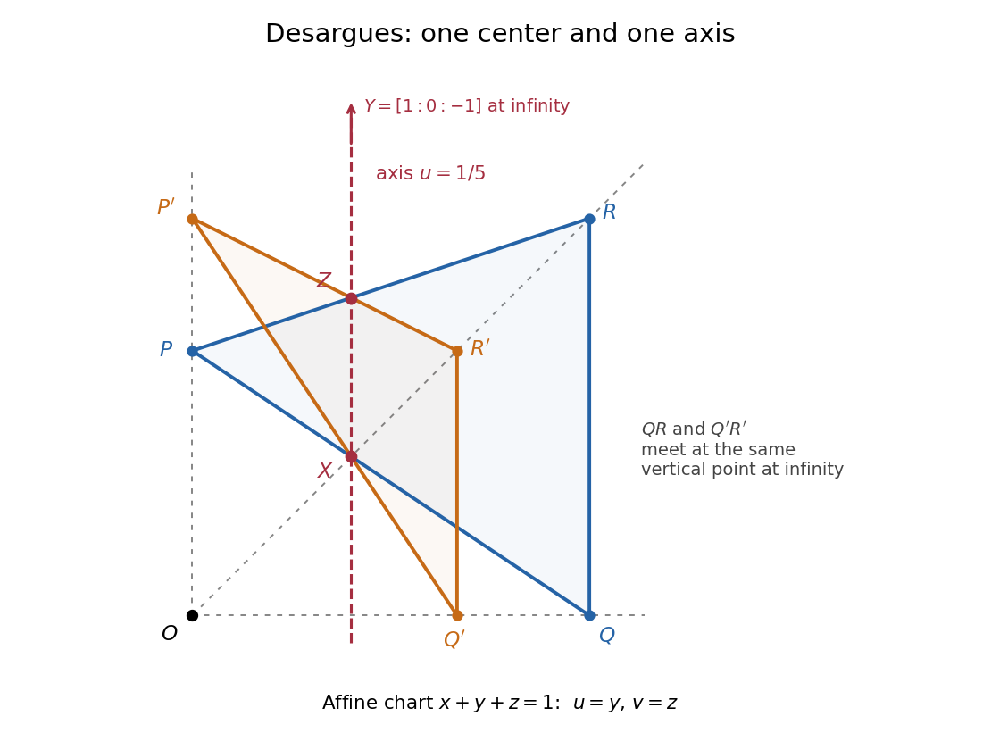

<h1 id="3/b/ii/solution">Solution</h1>

↑ **Parent:** [Ii](../ii.md)

The corresponding side equations, computed using [projective joins and meets by cross products](../../../../../projective-joins-and-meets-by-cross-products.md), are

$$
\begin{aligned}
PQ&:x-y-2z=0,&P'Q'&:x-2y-z=0,\\
QR&:x-y+z=0,&Q'R'&:x-2y+z=0,\\
RP&:x+2y-2z=0,&R'P'&:x-z=0.
\end{aligned}
$$

Subtracting the two equations in each row and substituting back gives the three [projective points](../../../../../projective-point.md)

$$
\boxed{X=[3:1:1],\qquad Y=[1:0:-1],\qquad Z=[2:1:2].}
$$

For example, the first pair forces $y=z$ and $x=3z$; the second pair forces $y=0$ and $x=-z$; the last pair forces $x=z=2y$. All three satisfy

$$
\boxed{x-4y+z=0,}
$$

since $3-4+1=0$, $1-0-1=0$, and $2-4+2=0$. The coefficient vector is nonzero, so this is a [projective line](../../../../../projective-line.md). Thus **the corresponding-side intersections are [collinear](../../../../../collinearity.md)**, explicitly confirming [Desargues's theorem](../../../../../desargues-s-theorem.md).

The diagram uses the [affine chart](../../../../../affine-chart-of-a-variety.md) $x+y+z\ne0$ with coordinates $u=y/(x+y+z)$ and $v=z/(x+y+z)$. Here the center $O$ is finite, the axis is $u=1/5$, and $Y$ lies on the [projective line at infinity](../../../../../projective-line-at-infinity.md). The apparent parallelism of $QR$ and $Q'R'$ records their common vertical point at infinity, which also belongs to the axis.

**[Figure 1](#3/b/ii/image-desargues-s-theorem-three-connectors-meet-at-o-and-three-side-intersections-lie-on-one-projective-line). Desargues's theorem: three connectors meet at O and three side intersections lie on one projective line**. Original drawing in the affine chart x+y+z=1. Blue and orange triangles are in perspectivity from O. Two side intersections X and Z lie on the red vertical axis; the third intersection Y is its vertical point at infinity.

## ↑ Ancestors (13)

1. [Ii](../ii.md)
2. [B](../../b.md)
3. [3](../../../3.md)
4. [2017](../../../../2017-split.md)
5. [Past exam of the short options course of the University of Oxford](../../../../split.md)
6. [Short options course of the University of Oxford](../../../../../short-options-course-of-the-university-of-oxford.md)
7. [Year 2 of the mathematics course of the University of Oxford](../../../../../year-2-of-the-mathematics-course-of-the-university-of-oxford.md)
8. [Mathematics course of the University of Oxford](../../../../../mathematics-course-of-the-university-of-oxford.md)
9. [Undergraduate course of the University of Oxford](../../../../../undergraduate-course-of-the-university-of-oxford.md)
10. [Course of the University of Oxford](../../../../../course-of-the-university-of-oxford.md)
11. [University of Oxford](../../../../../university-of-oxford-split.md)
12. [List of universities](../../../../../list-of-universities.md)
13. [Codex Wiki](../../../../../split.md)
