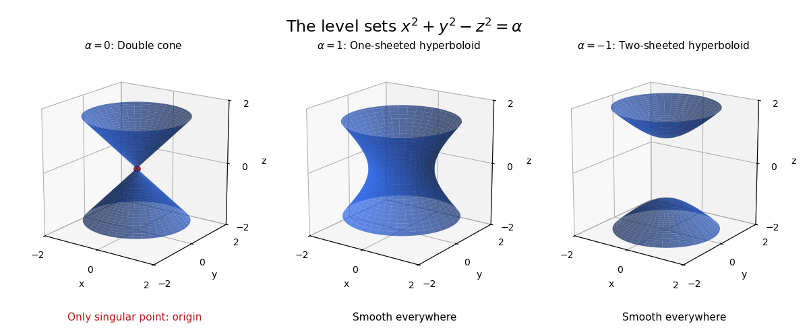

<h1 id="4/c/solution">Solution</h1>

↑ **Parent:** [C](../c.md)

Writing the coordinates as $(x,y,z)$, the level equation is $x^2+y^2-z^2=\alpha$. Therefore:

- **$\alpha=0$: a circular double cone**, $x^2+y^2=z^2$. Its vertex at the origin is the sole singular point; every other point is a smooth surface point.
- **$\alpha=1$: a one-sheeted [hyperboloid](../../../../hyperboloid.md)**, with horizontal radius $\sqrt{1+z^2}$. It is smooth everywhere.
- **$\alpha=-1$: a two-sheeted [hyperboloid](../../../../hyperboloid.md)**, $z=\pm\sqrt{1+x^2+y^2}$. Both sheets are smooth everywhere, including their tips $(0,0,\pm1)$.

The cone vertex is an instance of the [double cone singularity](../../../../double-cone-singularity.md). The tips of the two-sheeted hyperboloid are regular because the [gradient](../../../../gradient.md) $(2x,2y,-2z)$ is nonzero there.

**[Figure 2](#4/c/image-quadratic-level-surfaces-a-singular-double-cone-and-two-smooth-hyperboloids). Quadratic level surfaces: a singular double cone and two smooth hyperboloids**. Original surface plots for levels zero, one and minus one. The red point marks the cone vertex, the only failure of the submanifold condition. The displayed hyperboloid tips are regular.

## ↑ Ancestors (12)

1. [C](../c.md)
2. [4](../../4.md)
3. [2017](../../../2017-split.md)
4. [Past exam of the short options course of the University of Oxford](../../../split.md)
5. [Short options course of the University of Oxford](../../../../short-options-course-of-the-university-of-oxford.md)
6. [Year 2 of the mathematics course of the University of Oxford](../../../../year-2-of-the-mathematics-course-of-the-university-of-oxford.md)
7. [Mathematics course of the University of Oxford](../../../../mathematics-course-of-the-university-of-oxford.md)
8. [Undergraduate course of the University of Oxford](../../../../undergraduate-course-of-the-university-of-oxford.md)
9. [Course of the University of Oxford](../../../../course-of-the-university-of-oxford.md)
10. [University of Oxford](../../../../university-of-oxford-split.md)
11. [List of universities](../../../../list-of-universities.md)
12. [Codex Wiki](../../../../split.md)
