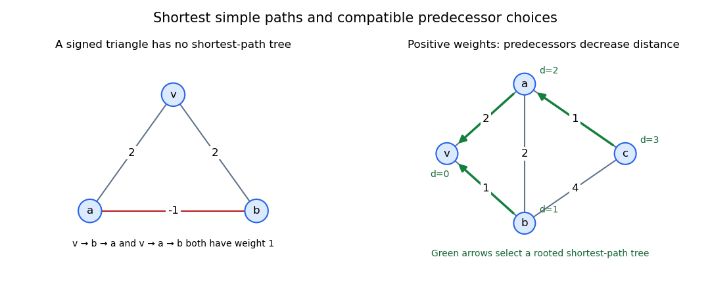

<h1 id="7/d/ii/solution">Solution</h1>

↑ **Parent:** [Ii](../ii.md)

The unique root-to-$u$ path in $T$ is the reversal of its predecessor chain. Every edge satisfies $w(e_z)=d(z)-d(p(z))$. Summing along that chain telescopes to

$$
w(P^T_{vu})=d(u)-d(v)=d(u),
$$

since $d(v)=0$ for positive weights. Thus the tree path is a shortest $vu$-path in $G$ for every $u$, and **$T$ is a [shortest-path tree](../../../../../shortest-path-tree.md) rooted at $v$**.

**[Figure 3](#7/d/ii/image-negative-weights-obstruct-a-shortest-path-tree-positive-predecessors-decrease-distance). Negative weights obstruct a shortest-path tree; positive predecessors decrease distance**. Original examples. In the left triangle, the two individually shortest root paths require all three edges. In the right graph, selected predecessors point strictly toward smaller root distances and therefore form a tree.

## ↑ Ancestors (13)

1. [Ii](../ii.md)
2. [D](../../d.md)
3. [7](../../../7.md)
4. [2017](../../../../2017-split.md)
5. [Past exam of the short options course of the University of Oxford](../../../../split.md)
6. [Short options course of the University of Oxford](../../../../../short-options-course-of-the-university-of-oxford.md)
7. [Year 2 of the mathematics course of the University of Oxford](../../../../../year-2-of-the-mathematics-course-of-the-university-of-oxford.md)
8. [Mathematics course of the University of Oxford](../../../../../mathematics-course-of-the-university-of-oxford.md)
9. [Undergraduate course of the University of Oxford](../../../../../undergraduate-course-of-the-university-of-oxford.md)
10. [Course of the University of Oxford](../../../../../course-of-the-university-of-oxford.md)
11. [University of Oxford](../../../../../university-of-oxford-split.md)
12. [List of universities](../../../../../list-of-universities.md)
13. [Codex Wiki](../../../../../split.md)
