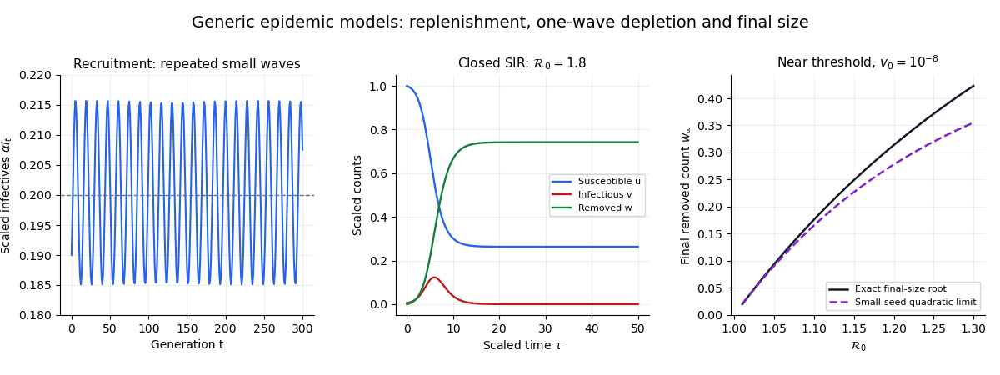

<h1 id="9/b/iii/solution">Solution</h1>

↑ **Parent:** [Iii](../iii.md)

Divide the susceptible equation by the removed equation, or differentiate the resulting invariant directly, to get $du/dw=-\mathcal R_0u$. The initial data give the [SIR susceptible-recovered identity](../../../../../sir-susceptible-recovered-identity.md)

$$
u=e^{-\mathcal R_0w}.
$$

Population conservation then gives $v=1+v_0-w-e^{-\mathcal R_0w}$. Since $w'=v$, the [Taylor expansion](../../../../../taylor-expansion.md) for small $\mathcal R_0w$ yields

$$
\boxed{\frac{dw}{d\tau}\approx v_0+(\mathcal R_0-1)w-\frac12\mathcal R_0^2w^2.}
$$

At the end of the outbreak, the infectious count approaches zero. The positive root of the quadratic approximation is

$$
w_* =\frac{\mathcal R_0-1+\sqrt{(\mathcal R_0-1)^2+2\mathcal R_0^2v_0}}{\mathcal R_0^2}.
$$

For $\mathcal R_0>1$ and a seed satisfying $\mathcal R_0^2v_0\ll(\mathcal R_0-1)^2$, this reduces to

$$
\boxed{w_1\approx\frac{2(\mathcal R_0-1)}{\mathcal R_0^2}.}
$$

The truncation also requires $\mathcal R_0w_1\ll1$, hence a near-threshold regime $0<\mathcal R_0-1\ll1$. The seed must be small but positive: setting it identically to zero gives no epidemic. This is the [near-threshold SIR final-size expansion](../../../../../near-threshold-sir-final-size-expansion.md), and the physical removed count is $S_0w_1$.

**[Figure 4](#9/b/iii/image-replenishment-permits-repeated-waves-the-closed-sir-model-has-a-final-size-relation). Replenishment permits repeated waves; the closed SIR model has a final-size relation**. Original generic model calculations. The left panel shows a positive trajectory of the discrete recruitment model. The middle panel shows a closed SIR outbreak. The right compares the exact closed-model final-size root with its small-seed quadratic approximation near threshold.

## ↑ Ancestors (13)

1. [Iii](../iii.md)
2. [B](../../b.md)
3. [9](../../../9.md)
4. [2017](../../../../2017-split.md)
5. [Past exam of the short options course of the University of Oxford](../../../../split.md)
6. [Short options course of the University of Oxford](../../../../../short-options-course-of-the-university-of-oxford.md)
7. [Year 2 of the mathematics course of the University of Oxford](../../../../../year-2-of-the-mathematics-course-of-the-university-of-oxford.md)
8. [Mathematics course of the University of Oxford](../../../../../mathematics-course-of-the-university-of-oxford.md)
9. [Undergraduate course of the University of Oxford](../../../../../undergraduate-course-of-the-university-of-oxford.md)
10. [Course of the University of Oxford](../../../../../course-of-the-university-of-oxford.md)
11. [University of Oxford](../../../../../university-of-oxford-split.md)
12. [List of universities](../../../../../list-of-universities.md)
13. [Codex Wiki](../../../../../split.md)
