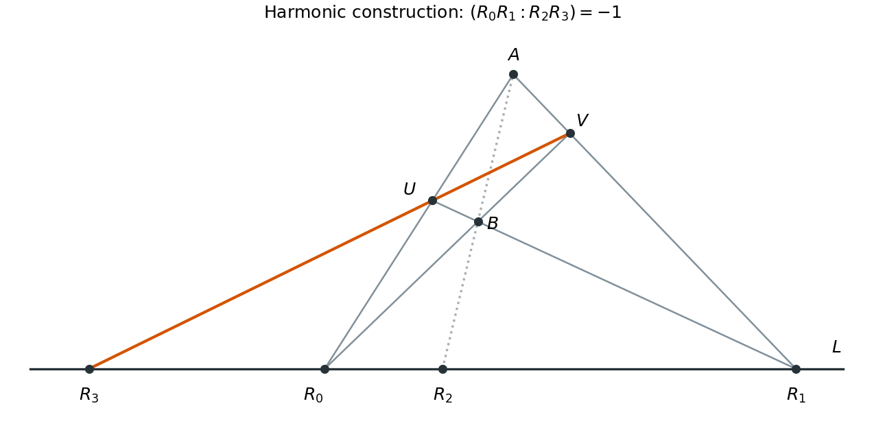
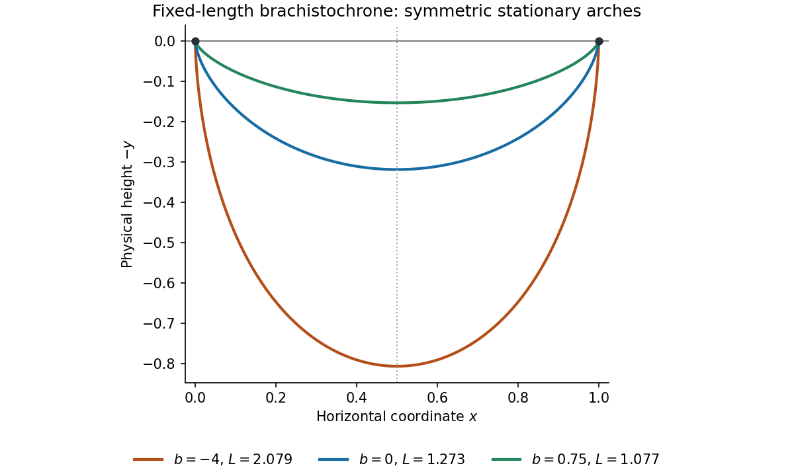
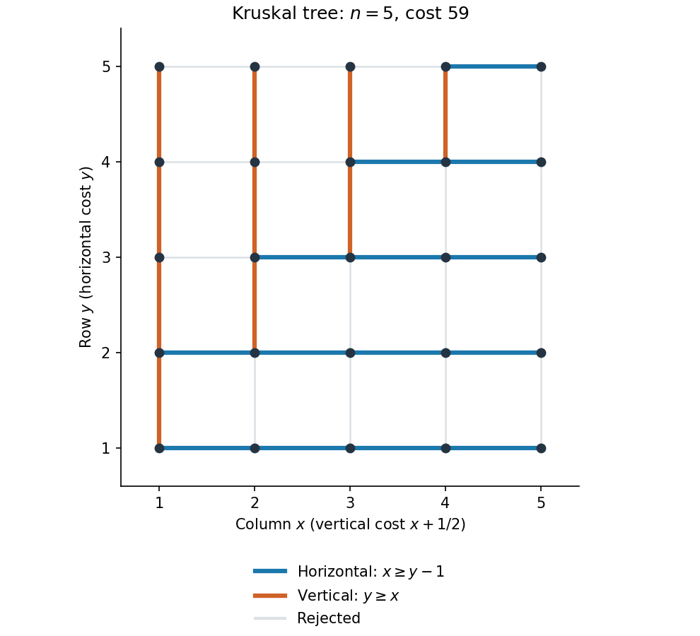
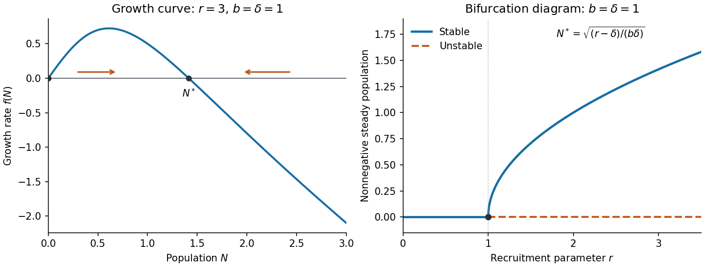

# 2021

↑ **Parent:** [Past exam of the short options course of the University of Oxford](../past-exam-of-the-short-options-course-of-the-university-of-oxford.md)

Source: [released examination PDF, bundle pages 9–17, paper pages 1–9](https://www.whatdotheyknow.com/request/bsc_mathematics_part_a_examinati/response/2820674/attach/3/FOI%20202410%20944%20Data.pdf#page=9). Solutions follow every option of the 17 June 2021 Short Options paper. The [fixed-length brachistochrone between equal-height endpoints](../calculus-of-variations.md#fixed-length-brachistochrone-between-equal-height-endpoints), [shortest-path tree](../shortest-path-problem.md#shortest-path-tree) and discrete [population dynamics](../mathematical-biology.md#population-dynamics) answers explain the domain qualifications needed for the literal printed claims.

**Table of contents**

- [1](#1)
  - [a](#1/a)
    - [i](#1/a/i)
      - [Solution](#1/a/i/solution)
    - [ii](#1/a/ii)
      - [Solution](#1/a/ii/solution)
    - [iii](#1/a/iii)
      - [Solution](#1/a/iii/solution)
    - [iv](#1/a/iv)
      - [Solution](#1/a/iv/solution)
  - [b](#1/b)
    - [i](#1/b/i)
      - [Solution](#1/b/i/solution)
    - [ii](#1/b/ii)
      - [Solution](#1/b/ii/solution)
  - [c](#1/c)
    - [Solution](#1/c/solution)
  - [d](#1/d)
    - [Solution](#1/d/solution)
- [2](#2)
  - [a](#2/a)
    - [Solution](#2/a/solution)
  - [b](#2/b)
    - [Solution](#2/b/solution)
  - [c](#2/c)
    - [Solution](#2/c/solution)
  - [d](#2/d)
    - [Solution](#2/d/solution)
  - [e](#2/e)
    - [Solution](#2/e/solution)
- [3](#3)
  - [a](#3/a)
    - [i](#3/a/i)
      - [Solution](#3/a/i/solution)
    - [ii](#3/a/ii)
      - [Solution](#3/a/ii/solution)
  - [b](#3/b)
    - [Solution](#3/b/solution)
  - [c](#3/c)
    - [i](#3/c/i)
      - [Solution](#3/c/i/solution)
    - [ii](#3/c/ii)
      - [Solution](#3/c/ii/solution)
- [4](#4)
  - [a](#4/a)
    - [i](#4/a/i)
      - [Solution](#4/a/i/solution)
    - [ii](#4/a/ii)
      - [Solution](#4/a/ii/solution)
  - [b](#4/b)
    - [Solution](#4/b/solution)
  - [c](#4/c)
    - [i](#4/c/i)
      - [Solution](#4/c/i/solution)
    - [ii](#4/c/ii)
      - [Solution](#4/c/ii/solution)
- [5](#5)
  - [a](#5/a)
    - [i](#5/a/i)
      - [1](#5/a/i/1)
        - [Solution](#5/a/i/1/solution)
      - [2](#5/a/i/2)
        - [Solution](#5/a/i/2/solution)
      - [3](#5/a/i/3)
        - [Solution](#5/a/i/3/solution)
    - [ii](#5/a/ii)
      - [Solution](#5/a/ii/solution)
  - [b](#5/b)
    - [i](#5/b/i)
      - [Solution](#5/b/i/solution)
    - [ii](#5/b/ii)
      - [Solution](#5/b/ii/solution)
  - [c](#5/c)
    - [i](#5/c/i)
      - [Solution](#5/c/i/solution)
    - [ii](#5/c/ii)
      - [Solution](#5/c/ii/solution)
- [6](#6)
  - [a](#6/a)
    - [Solution](#6/a/solution)
  - [b](#6/b)
    - [Solution](#6/b/solution)
  - [c](#6/c)
    - [Solution](#6/c/solution)
  - [d](#6/d)
    - [Solution](#6/d/solution)
- [7](#7)
  - [a](#7/a)
    - [Solution](#7/a/solution)
    - [1](#7/a/1)
      - [Solution](#7/a/1/solution)
    - [2](#7/a/2)
      - [Solution](#7/a/2/solution)
  - [b](#7/b)
    - [Solution](#7/b/solution)
  - [c](#7/c)
    - [i](#7/c/i)
      - [Solution](#7/c/i/solution)
    - [ii](#7/c/ii)
      - [Solution](#7/c/ii/solution)
    - [iii](#7/c/iii)
      - [Solution](#7/c/iii/solution)
- [8](#8)
  - [a](#8/a)
    - [i](#8/a/i)
      - [Solution](#8/a/i/solution)
    - [ii](#8/a/ii)
      - [Solution](#8/a/ii/solution)
  - [b](#8/b)
    - [i](#8/b/i)
      - [Solution](#8/b/i/solution)
    - [ii](#8/b/ii)
      - [Solution](#8/b/ii/solution)
    - [iii](#8/b/iii)
      - [Solution](#8/b/iii/solution)
  - [c](#8/c)
    - [i](#8/c/i)
      - [Solution](#8/c/i/solution)
    - [ii](#8/c/ii)
      - [Solution](#8/c/ii/solution)
- [9](#9)
  - [a](#9/a)
    - [i](#9/a/i)
      - [Solution](#9/a/i/solution)
    - [ii](#9/a/ii)
      - [Solution](#9/a/ii/solution)
    - [iii](#9/a/iii)
      - [Solution](#9/a/iii/solution)
    - [iv](#9/a/iv)
      - [Solution](#9/a/iv/solution)
    - [v](#9/a/v)
      - [Solution](#9/a/v/solution)
  - [b](#9/b)
    - [i](#9/b/i)
      - [Solution](#9/b/i/solution)
    - [ii](#9/b/ii)
      - [Solution](#9/b/ii/solution)
    - [iii](#9/b/iii)
      - [Solution](#9/b/iii/solution)

## 1

↑ **Parent:** [2021](2021.md)

<h3 id="1/a">a</h3>

↑ **Parent:** [1](#1)

<h4 id="1/a/i">i</h4>

↑ **Parent:** [A](#1/a)

<h5 id="1/a/i/solution">Solution</h5>

↑ **Parent:** [I](#1/a/i)

**No.** Take $P=2$, $Q=9$. The [Jacobi symbol](../number-theory.md#jacobi-symbol) is

$$
\left(\frac29\right)=\left(\frac23\right)^2=(-1)^2=1,
$$

but the squares modulo $3$ are $0,1$. A square root of $2$ modulo $9$ would reduce to one modulo $3$, which is impossible. A [Jacobi symbol](../number-theory.md#jacobi-symbol) of $1$ records a product of local signs; it does not assert that every local sign is positive, or that a [quadratic congruence](../modular-arithmetic.md#quadratic-congruence) is soluble.

<h4 id="1/a/ii">ii</h4>

↑ **Parent:** [A](#1/a)

<h5 id="1/a/ii/solution">Solution</h5>

↑ **Parent:** [Ii](#1/a/ii)

Factor $Q=\prod_i p_i$ and $Q'=\prod_j q_j$, retaining repeated [prime factors](../prime-number.md#prime-factor). If $P$ has a common [prime factor](../prime-number.md#prime-factor) with $QQ'$, it has one with at least one of $Q,Q'$, and both sides of the desired equality are zero. Otherwise the definition of the [Jacobi symbol](../number-theory.md#jacobi-symbol) gives

$$
\boxed{\left(\frac P{QQ'}\right)=\prod_i\left(\frac P{p_i}\right)\prod_j\left(\frac P{q_j}\right)=\left(\frac P Q\right)\left(\frac P{Q'}\right).}
$$

An empty product is $1$, so the argument includes either denominator being $1$.

<h4 id="1/a/iii">iii</h4>

↑ **Parent:** [A](#1/a)

<h5 id="1/a/iii/solution">Solution</h5>

↑ **Parent:** [Iii](#1/a/iii)

For a [prime number](../prime-number.md) $p$, [multiplicativity of the Legendre symbol](../quadratic-residue.md#multiplicativity-of-the-legendre-symbol) says $(PP'/p)=(P/p)(P'/p)$, including the case of a zero factor. Therefore, writing $Q=\prod_i p_i$ with repetitions,

$$
\boxed{\left(\frac{PP'}Q\right)=\prod_i\left(\frac{PP'}{p_i}\right)=\prod_i\left(\frac P{p_i}\right)\prod_i\left(\frac{P'}{p_i}\right)=\left(\frac P Q\right)\left(\frac{P'}Q\right).}
$$

This product definition still agrees with the stipulated zero when the numerator and denominator are not [coprime](../divisibility.md#coprime-integers). For $Q=1$ all three symbols are $1$.

<h4 id="1/a/iv">iv</h4>

↑ **Parent:** [A](#1/a)

<h5 id="1/a/iv/solution">Solution</h5>

↑ **Parent:** [Iv](#1/a/iv)

If $P\equiv P'\pmod Q$, then $P\equiv P'\pmod p$ for each [prime factor](../prime-number.md#prime-factor) $p$ of $Q$. The [Legendre symbol](../quadratic-residue.md#legendre-symbol) depends only on the numerator's [residue class](../modular-arithmetic.md#residue-class), so the corresponding factors agree. Also $\gcd(P,Q)=\gcd(P',Q)$, covering the zero cases. Multiplying gives

$$
\boxed{\left(\frac P Q\right)=\left(\frac{P'}Q\right).}
$$

The convention for denominator $1$ gives the same conclusion there.

<h3 id="1/b">b</h3>

↑ **Parent:** [1](#1)

<h4 id="1/b/i">i</h4>

↑ **Parent:** [B](#1/b)

<h5 id="1/b/i/solution">Solution</h5>

↑ **Parent:** [I](#1/b/i)

The supplementary law for the [Legendre symbol](../quadratic-residue.md#legendre-symbol) is $(-1/p)=(-1)^{(p-1)/2}$ for odd [prime numbers](../prime-number.md) $p$. For odd integers $a,b$,

$$
\frac{ab-1}{2}=\frac{a-1}{2}+\frac{b-1}{2}+\frac{(a-1)(b-1)}2,
$$

and the last term is even. [Induction](../foundations-of-mathematics.md#mathematical-induction) over the [prime factors](../prime-number.md#prime-factor) of $Q$ therefore gives $\sum_i(p_i-1)/2\equiv(Q-1)/2\pmod2$. Consequently

$$
\boxed{\left(\frac{-1}Q\right)=\prod_i(-1)^{(p_i-1)/2}=(-1)^{(Q-1)/2}.}
$$

For $Q=1$ the exponent is zero.

<h4 id="1/b/ii">ii</h4>

↑ **Parent:** [B](#1/b)

<h5 id="1/b/ii/solution">Solution</h5>

↑ **Parent:** [Ii](#1/b/ii)

The second supplementary law for the [Legendre symbol](../quadratic-residue.md#legendre-symbol) is $(2/p)=(-1)^{(p^2-1)/8}$. To multiply these signs, observe that for odd $a,b$,

$$
\frac{a^2b^2-1}{8}-\frac{a^2-1}{8}-\frac{b^2-1}{8}=\frac{(a^2-1)(b^2-1)}8.
$$

Both factors in the numerator are divisible by $8$, so the right side is even. Applying this identity repeatedly to the [prime factorization](../prime-number.md#fundamental-theorem-of-arithmetic) gives

$$
\boxed{\left(\frac2Q\right)=\prod_i(-1)^{(p_i^2-1)/8}=(-1)^{(Q^2-1)/8}.}
$$

Again the convention at $Q=1$ agrees.

<h3 id="1/c">c</h3>

↑ **Parent:** [1](#1)

<h4 id="1/c/solution">Solution</h4>

↑ **Parent:** [C](#1/c)

Write $P=\prod_i p_i$, $Q=\prod_j q_j$, counting repetitions. Since $P,Q$ are [coprime](../divisibility.md#coprime-integers), every pair $p_i,q_j$ consists of distinct odd [prime numbers](../prime-number.md). [Quadratic reciprocity](../number-theory.md#quadratic-reciprocity) for the [Legendre symbol](../quadratic-residue.md#legendre-symbol) gives

$$
\left(\frac{p_i}{q_j}\right)=(-1)^{((p_i-1)/2)((q_j-1)/2)}\left(\frac{q_j}{p_i}\right).
$$

Multiplying over all $i,j$ and using [multiplicativity of the Jacobi symbol](../number-theory.md#multiplicativity-of-the-jacobi-symbol) yields the sign exponent

$$
\left(\sum_i\frac{p_i-1}{2}\right)\left(\sum_j\frac{q_j-1}{2}\right)\equiv\frac{P-1}{2}\frac{Q-1}{2}\pmod2,
$$

by the odd-product parity identity proved in (b)(i). Thus the [Jacobi reciprocity law](../number-theory.md#jacobi-reciprocity-law) is

$$
\boxed{\left(\frac P Q\right)=(-1)^{(P-1)(Q-1)/4}\left(\frac Q P\right).}
$$

If either integer is $1$, its factorization is empty and both sides equal $1$.

<h3 id="1/d">d</h3>

↑ **Parent:** [1](#1)

<h4 id="1/d/solution">Solution</h4>

↑ **Parent:** [D](#1/d)

Complete the square to obtain the equivalent [quadratic congruence](../modular-arithmetic.md#quadratic-congruence)

$$
(x+3)^2\equiv1111\pmod{8093}.
$$

Here $\gcd(1111,8093)=1$: the [Euclidean algorithm](../number-theory.md#euclidean-algorithm) has successive nonzero remainders $316,163,153,10,3,1$. If this [modular congruence](../modular-arithmetic.md#modular-congruence) had a solution, the [Jacobi symbol](../number-theory.md#jacobi-symbol) $(1111/8093)$ would be $1$, since a square [coprime](../divisibility.md#coprime-integers) to an odd modulus has [Legendre symbol](../quadratic-residue.md#legendre-symbol) $1$ at every [prime factor](../prime-number.md#prime-factor). Calculate instead, using [Jacobi reciprocity](../number-theory.md#jacobi-reciprocity-law) and reduction of numerators,

$$
\begin{aligned}
\left(\frac{1111}{8093}\right)
&=\left(\frac{8093}{1111}\right)&& (8093\equiv1\pmod4)\\
&=\left(\frac{316}{1111}\right)&& (8093=7\cdot1111+316)\\
&=\left(\frac4{1111}\right)\left(\frac{79}{1111}\right)=\left(\frac{79}{1111}\right)\\
&=-\left(\frac{1111}{79}\right)&& (79\equiv1111\equiv3\pmod4)\\
&=-\left(\frac5{79}\right)&& (1111=14\cdot79+5)\\
&=-\left(\frac{79}5\right)=-\left(\frac45\right)=-1.
\end{aligned}
$$

Therefore **there is no solution**. This obstruction does not require a separate primality test for $8093$; the [Jacobi symbol](../number-theory.md#jacobi-symbol) suffices.

## 2

↑ **Parent:** [2021](2021.md)

<h3 id="2/a">a</h3>

↑ **Parent:** [2](#2)

<h4 id="2/a/solution">Solution</h4>

↑ **Parent:** [A](#2/a)

Let $|G|=p^2$. The allowed [center of a group](../group-theory.md#center-of-a-group) theorem gives $|Z(G)|>1$. By [Lagrange's theorem](../group-theory.md#lagrange-s-theorem) its order is $p$ or $p^2$. In the first case $G/Z(G)$ has order $p$ and is a [cyclic group](../group.md#cyclic-group). A [cyclic quotient by the center](../group-theory.md#cyclic-quotient-by-the-center) forces $G$ to be [Abelian](../group.md#abelian-group): if $G/Z(G)=\langle gZ(G)\rangle$, write arbitrary elements as $g^az,g^bw$ with $z,w\in Z(G)$, and commute them directly. Hence in every case

$$
\boxed{|G|=p^2\ \Longrightarrow\ G\text{ is abelian}.}
$$

For two examples at prime-cube order, take the [dihedral group](../finite-group-theory.md#dihedral-group) of a square, $\langle r,s\mid r^4=s^2=1,\ srs=r^{-1}\rangle$, and the [quaternion group](../finite-group-theory.md#quaternion-group) $Q_8=\{\pm1,\pm i,\pm j,\pm k\}$. Both have order $8=2^3$. They are nonabelian because $sr\ne rs$ and $ij=k\ne-k=ji$, respectively. They are distinct examples even up to [group isomorphism](../algebra.md#group-isomorphism): the [dihedral group](../finite-group-theory.md#dihedral-group) has five elements of order two and the [quaternion group](../finite-group-theory.md#quaternion-group) has only one. The request asks for two examples; it does not require the prime to be arbitrary.

<h3 id="2/b">b</h3>

↑ **Parent:** [2](#2)

<h4 id="2/b/solution">Solution</h4>

↑ **Parent:** [B](#2/b)

Write $|G|=pq$ with $p<q$. The [Sylow theorems](../finite-group-theory.md#sylow-theorems) give $n_q\mid p$ and $n_q\equiv1\pmod q$. Since $p<q$, necessarily $n_q=1$. Its unique [Sylow subgroup](../finite-group-theory.md#sylow-subgroup) $N$ is a [normal subgroup](../group-theory.md#normal-subgroup) and has prime order $q$, so

$$
\boxed{N\cong C_q\trianglelefteq G.}
$$

A [Sylow subgroup](../finite-group-theory.md#sylow-subgroup) $H\cong C_p$ has trivial intersection with $N$, and $|NH|=|N||H|=pq$, so $NH=G$. Thus

$$
\boxed{G\cong C_q\rtimes C_p.}
$$

The [semidirect product](../group-theory.md#semidirect-product) action is a [group homomorphism](../group-theory.md#group-homomorphism) $C_p\to\operatorname{Aut}(C_q)\cong C_{q-1}$. If the action is trivial, $G\cong C_{pq}$ by the [Chinese remainder theorem](../mathematics.md#chinese-remainder-theorem); if it is nontrivial, $p\mid q-1$. In particular $G$ has both a cyclic normal subgroup and a cyclic quotient, making it a [metacyclic group](../group-theory.md#metacyclic-group) and hence a [solvable group](../group-theory.md#solvable-group).

<h3 id="2/c">c</h3>

↑ **Parent:** [2](#2)

<h4 id="2/c/solution">Solution</h4>

↑ **Parent:** [C](#2/c)

The [Abelian group criterion for a product of two prime squares](../finite-group-theory.md#abelian-group-criterion-for-a-product-of-two-prime-squares) applies because $11<19$ and $11\nmid19^2-1=360$. Here its [Sylow theorems](../finite-group-theory.md#sylow-theorems) proof is especially short:

$$
n_{19}\mid121,\quad n_{19}\equiv1\pmod{19};\qquad n_{11}\mid361,\quad n_{11}\equiv1\pmod{11}.
$$

The candidates for $n_{19}$ are $1,11,121$, of which only $1$ has the required remainder. The candidates for $n_{11}$ are $1,19,361$, again leaving only $1$. Thus both [Sylow subgroups](../finite-group-theory.md#sylow-subgroup) $P,Q$ are [normal subgroups](../group-theory.md#normal-subgroup). Their [group commutators](../group.md#group-commutator) lie in $P\cap Q=\{1\}$, and $PQ=G$, so $G\cong P\times Q$. Both factors are [abelian groups of prime-square order](../group.md#abelian-group-of-prime-square-order) by (a).

The [Fundamental theorem of finitely generated abelian groups](../group.md#fundamental-theorem-of-finitely-generated-abelian-groups) gives precisely

$$
\boxed{\begin{gathered}
C_{121}\times C_{361},\qquad C_{121}\times C_{19}\times C_{19},\\
C_{11}\times C_{11}\times C_{361},\qquad C_{11}\times C_{11}\times C_{19}\times C_{19}.
\end{gathered}}
$$

These four [groups](../group.md) are pairwise nonisomorphic: their characteristic [Sylow subgroups](../finite-group-theory.md#sylow-subgroup) differ in whether they contain an element of order $11^2$ or $19^2$. The first is also the [cyclic group](../group.md#cyclic-group) $C_{43681}$.

<h3 id="2/d">d</h3>

↑ **Parent:** [2](#2)

<h4 id="2/d/solution">Solution</h4>

↑ **Parent:** [D](#2/d)

Apply the [Abelian group criterion for a product of two prime squares](../finite-group-theory.md#abelian-group-criterion-for-a-product-of-two-prime-squares) with the smaller and larger primes in their correct order. For $p<11$, all such [groups](../group.md) are [Abelian](../group.md#abelian-group) exactly when $p\nmid11^2-1=120$. Of the primes $2,3,5,7$, only $7$ qualifies. For $p>11$, the criterion is $11\nmid p^2-1$, equivalently $p\not\equiv\pm1\pmod{11}$. Therefore the exact answer is

$$
\boxed{p=7\quad\text{or}\quad p>11\text{ prime with }p\not\equiv1,10\pmod{11}.}
$$

Equivalently, among the stipulated primes $p\ne11$, exclude $2,3,5$ and the residue classes $\pm1$ modulo $11$.

For completeness, the necessity in that criterion supplies actual counterexamples at every excluded prime. If $\ell<q$ and $\ell\mid q^2-1$, the [multiplicative group of a finite field is cyclic](../algebra.md#multiplicative-group-of-a-finite-field-is-cyclic), so choose $\alpha\in\mathbb F_{q^2}^{\times}$ of order $\ell$. Let a generator of $C_{\ell^2}$ act on the additive [group](../group.md) of $\mathbb F_{q^2}$ by multiplication by $\alpha$. This defines a nontrivial [group action](../group-action.md), hence a nonabelian [semidirect product](../group-theory.md#semidirect-product) of order $\ell^2q^2$. Use $(\ell,q)=(p,11)$ for $p=2,3,5$, and $(\ell,q)=(11,p)$ for $p\equiv\pm1\pmod{11}$ with $p>11$. Thus no excluded prime can be restored to the answer.

<h3 id="2/e">e</h3>

↑ **Parent:** [2](#2)

<h4 id="2/e/solution">Solution</h4>

↑ **Parent:** [E](#2/e)

Take **$p=5$**. The unit $3$ modulo $121$ has order $5$, because

$$
3^5=243\equiv1\pmod{121},\qquad3\not\equiv1\pmod{121}.
$$

Let a generator $b$ of $C_{25}$ act on $C_{121}=\langle a\rangle$ by $a\mapsto a^3$. The action is well defined since its order $5$ divides $25$. The [semidirect product](../group-theory.md#semidirect-product)

$$
\boxed{G=C_{121}\rtimes C_{25}=\langle a,b\mid a^{121}=b^{25}=1,\ bab^{-1}=a^3\rangle}
$$

has order $121\cdot25=11^2 5^2$. Its construction as a [semidirect product](../group-theory.md#semidirect-product) ensures that $a$ retains order $121$. Since $a^3\ne a$, the [groups](../group.md) generated by $a$ and $b$ do not commute, so $G$ is nonabelian.

## 3

↑ **Parent:** [2021](2021.md)

<h3 id="3/a">a</h3>

↑ **Parent:** [3](#3)

<h4 id="3/a/i">i</h4>

↑ **Parent:** [A](#3/a)

<h5 id="3/a/i/solution">Solution</h5>

↑ **Parent:** [I](#3/a/i)

A [projective transformation](../projective-space.md#projective-linear-transformation) of $\mathbb P(\mathbb F^{n+1})$ is induced by an invertible [linear map](../vector-space.md#linear-map) $A:\mathbb F^{n+1}\to\mathbb F^{n+1}$:

$$
\boxed{\tau([v])=[Av],\qquad A\in\operatorname{GL}_{n+1}(\mathbb F).}
$$

This is well defined because replacing $v$ by a nonzero scalar multiple does not change $[Av]$. Multiplying $A$ by a nonzero scalar also leaves $\tau$ unchanged. Conversely these are precisely the transformations in the [projective linear group](../group-theory.md#projective-linear-group) $\operatorname{PGL}_{n+1}(\mathbb F)$. No field automorphism is included in this definition.

<h4 id="3/a/ii">ii</h4>

↑ **Parent:** [A](#3/a)

<h5 id="3/a/ii/solution">Solution</h5>

↑ **Parent:** [Ii](#3/a/ii)

Choose nonzero vectors $p_i\in\mathbb F^2$ representing $P_i$, and write $[u,v]=\det(u,v)$. Use the [cross-ratio](../group-theory.md#cross-ratio) convention

$$
\boxed{(P_0P_1:P_2P_3)=\frac{[p_0,p_2][p_1,p_3]}{[p_0,p_3][p_1,p_2]}.}
$$

Distinctness makes the denominator nonzero. Every rescaling of a representative occurs once in numerator and denominator, so the value depends only on the [projective points](../projective-space.md#projective-point). Swapping both pairs simply exchanges the numerator's factors and the denominator's factors:

$$
(P_1P_0:P_3P_2)=\frac{[p_1,p_3][p_0,p_2]}{[p_1,p_2][p_0,p_3]}=(P_0P_1:P_2P_3).
$$

Under an invertible [linear map](../vector-space.md#linear-map) $A$, $[Au,Av]=\det(A)[u,v]$. Two factors of $\det(A)$ occur above and below the fraction, proving [projective transformation](../projective-space.md#projective-linear-transformation) invariance.

Finally choose [homogeneous coordinates](../projective-space.md#homogeneous-coordinate) making $P_0=[1:0]$, $P_1=[0:1]$, $P_2=[1:1]$. This normalization exists by the allowed theorem about a [projective frame](../projective-space.md#projective-frame). A point distinct from $P_0$ is uniquely $[t:1]$, and the displayed [cross-ratio](../group-theory.md#cross-ratio) is $t$. Thus equality of the two [cross-ratios](../group-theory.md#cross-ratio) forces equal coordinates and

$$
\boxed{P_3=Q.}
$$

This also shows that for fixed first three distinct points the fourth point is determined by its [cross-ratio](../group-theory.md#cross-ratio).

<h3 id="3/b">b</h3>

↑ **Parent:** [3](#3)

<h4 id="3/b/solution">Solution</h4>

↑ **Parent:** [B](#3/b)

Conjugate by a [projective transformation](../projective-space.md#projective-linear-transformation) sending $P$ to $[1:0]$ and $Q$ to $[0:1]$. A matrix representing the conjugated transformation must have zero diagonal, since its first column represents $[0:1]$ and its second represents $[1:0]$. Therefore it has the form

$$
A=\begin{pmatrix}0&a\\b&0\end{pmatrix},\qquad ab\ne0.
$$

Its square is $abI$, a nonzero scalar matrix, which induces the identity on the [projective line](../finite-group-theory.md#projective-line). Conjugating back proves

$$
\boxed{\tau^2=\operatorname{id}.}
$$

For the requested explicit [involution](../group-theory.md#involution), take

$$
\boxed{\tau([x:y])=[y:x].}
$$

More generally $[x:y]\mapsto[ay:bx]$ works whenever $ab\ne0$.

<h3 id="3/c">c</h3>

↑ **Parent:** [3](#3)

<h4 id="3/c/i">i</h4>

↑ **Parent:** [C](#3/c)

<h5 id="3/c/i/solution">Solution</h5>

↑ **Parent:** [I](#3/c/i)

The four points form a [projective frame](../projective-space.md#projective-frame): no three are collinear. By the allowed uniqueness theorem and [cross-ratio](../group-theory.md#cross-ratio) invariance, use

$$
P_0=[1:0:0],\quad P_1=[0:1:0],\quad P_2=[0:0:1],\quad P_3=[1:1:1].
$$

Intersecting the indicated [projective lines](../finite-group-theory.md#projective-line) gives

$$
Q_0=[1:0:1],\qquad Q_1=[1:1:0],\qquad Q_2=[0:1:1].
$$

A point of $Q_0Q_2$ has coordinates $[a:b:a+b]$. Intersecting with $P_0P_1$, whose equation is $z=0$, gives $Q_3=[1:-1:0]$. On that line use its first two [homogeneous coordinates](../projective-space.md#homogeneous-coordinate). The [cross-ratio](../group-theory.md#cross-ratio) from (a)(ii) is

$$
\boxed{(P_0P_1:Q_3Q_1)=\frac{(-1)(-1)}{(1)(-1)}=-1.}
$$

The [characteristic of a field](../algebra.md#characteristic-of-a-field) being zero ensures that $Q_3\ne Q_1$. The construction is the diagonal-point property of a [complete quadrangle](../projective-space.md#complete-quadrangle), producing [harmonic conjugate points](../group-theory.md#harmonic-conjugate-points).

<h4 id="3/c/ii">ii</h4>

↑ **Parent:** [C](#3/c)

<h5 id="3/c/ii/solution">Solution</h5>

↑ **Parent:** [Ii](#3/c/ii)

Choose a point $A$ off $L$, then a point $B$ on $AR_2$ distinct from $A,R_2$. Put

$$
P_0=R_0,\quad P_1=R_1,\quad P_2=A,\quad P_3=B.
$$

These four points form a [projective frame](../projective-space.md#projective-frame): $A,B$ lie off $L$, and $AB=AR_2$ meets $L$ at neither $R_0$ nor $R_1$. Form, using only joins and intersections,

$$
U=R_0A\cap R_1B,\qquad V=R_0B\cap R_1A,\qquad \boxed{R_3=UV\cap L.}
$$

Here the point called $Q_1$ in (i) is $R_2$, while $Q_3$ is $R_3$. Thus (i) gives $(R_0R_1:R_3R_2)=-1$. Interchanging the last two arguments reciprocates the [cross-ratio](../group-theory.md#cross-ratio), so

$$
\boxed{(R_0R_1:R_2R_3)=(-1)^{-1}=-1.}
$$

All auxiliary choices are possible over a [field](../algebra.md#field) of characteristic zero, which is infinite. Uniqueness from (a)(ii) shows that the final point is independent of those choices. The picture uses an affine chart in which every relevant intersection is finite; parallel-line exceptions in another chart are ordinary intersections on the [projective line at infinity](../projective-space.md#projective-line-at-infinity).

**[Figure 1](#3/c/ii/image-construction-of-harmonic-conjugate-points-by-joins-and-intersections). Construction of harmonic conjugate points by joins and intersections**.

## 4

↑ **Parent:** [2021](2021.md)

<h3 id="4/a">a</h3>

↑ **Parent:** [4](#4)

<h4 id="4/a/i">i</h4>

↑ **Parent:** [A](#4/a)

<h5 id="4/a/i/solution">Solution</h5>

↑ **Parent:** [I](#4/a/i)

Take $\Omega=\mathbb R^2$ and

$$
\boxed{F(s,t)=(e^s\cos t,e^s\sin t).}
$$

Its [Jacobian matrix](../multivariable-calculus.md#jacobian-matrix) and [determinant](../multilinear-algebra.md#determinant) are

$$
DF_{(s,t)}=e^s\begin{pmatrix}\cos t&-\sin t\\\sin t&\cos t\end{pmatrix},\qquad \det DF_{(s,t)}=e^{2s}>0.
$$

Thus its [total derivative](../calculus.md#total-derivative) is invertible everywhere, and the [inverse function theorem](../multivariable-calculus.md#inverse-function-theorem) makes it locally invertible. But $F(s,t+2\pi)=F(s,t)$, so it is not [injective](../algebra.md#injective-function) and has no global inverse on its image. The domain is open and [connected](../geometry-and-topology.md#connected-space) as required.

<h4 id="4/a/ii">ii</h4>

↑ **Parent:** [A](#4/a)

<h5 id="4/a/ii/solution">Solution</h5>

↑ **Parent:** [Ii](#4/a/ii)

**No.** On $\Omega=\mathbb R^2$ let

$$
\boxed{F(s,t)=(s^3,t).}
$$

It is a [bijection](../function.md#bijection) onto $\mathbb R^2$, with inverse $(u,v)\mapsto(\sqrt[3]u,v)$. Nevertheless $DF_{(s,t)}=\operatorname{diag}(3s^2,1)$ is singular whenever $s=0$. Set-theoretic invertibility, even together with a continuous inverse, does not force invertibility of the [total derivative](../calculus.md#total-derivative). If the inverse were assumed differentiable, the [chain rule](../calculus.md#chain-rule) applied to $F^{-1}\circ F$ would force both derivatives to be invertible; that stronger assumption is absent here.

<h3 id="4/b">b</h3>

↑ **Parent:** [4](#4)

<h4 id="4/b/solution">Solution</h4>

↑ **Parent:** [B](#4/b)

Fix $x\in U$. Since $U$ is open, choose an open [ball](../topological-analysis.md#ball-mathematics) $B(x,\varepsilon)\subset U$. For any $y$ in this ball the segment $x+t(y-x)$ remains in it. For each coordinate $G_j$, the [chain rule](../calculus.md#chain-rule) gives

$$
\frac d{dt}G_j(x+t(y-x))=DG_j{}_{x+t(y-x)}(y-x)=0.
$$

The ordinary [mean value theorem](../calculus.md#mean-value-theorem) therefore gives $G_j(y)=G_j(x)$ for every coordinate, hence $G(y)=G(x)$. Thus $G$ is a [locally constant function](../calculus.md#locally-constant-function).

For each $z\in\mathbb R^m$, its [preimage](../set-theory.md#preimage) is a union of such open balls, so $G^{-1}(\{z\})$ is open in $\mathbb R^n$. Its complement in $U$ is the union of the other fibers and is also open. If $U$ is nonempty and [connected](../geometry-and-topology.md#connected-space), the nonempty fiber through any chosen point is both open and closed in $U$, and must be all of $U$. Therefore

$$
\boxed{DG\equiv0\quad\Longrightarrow\quad G\text{ locally constant, and constant on connected }U.}
$$

The empty-domain case is vacuous. Notice that continuity of $DG$ was never needed.

<h3 id="4/c">c</h3>

↑ **Parent:** [4](#4)

<h4 id="4/c/i">i</h4>

↑ **Parent:** [C](#4/c)

<h5 id="4/c/i/solution">Solution</h5>

↑ **Parent:** [I](#4/c/i)

Write $a=\partial_1f_1=\partial_2f_2$ and $b=\partial_2f_1=-\partial_1f_2$. The [Cauchy-Riemann equations](../analysis.md#cauchy-riemann-equations) give

$$
DF_x=\begin{pmatrix}a&b\\-b&a\end{pmatrix},\qquad \det DF_x=a^2+b^2.
$$

Consequently

$$
\boxed{DF_x\text{ is invertible exactly when }(\partial_1f_1(x),\partial_2f_1(x))\ne(0,0).}
$$

Equivalently, it is singular exactly when all four [partial derivatives](../multivariable-calculus.md#partial-derivative) vanish. The sum of squares is over $\mathbb R$, so no cancellation is possible.

<h4 id="4/c/ii">ii</h4>

↑ **Parent:** [C](#4/c)

<h5 id="4/c/ii/solution">Solution</h5>

↑ **Parent:** [Ii](#4/c/ii)

Suppose $DF_x$ were invertible at some $x\in\Omega$. The [inverse function theorem](../multivariable-calculus.md#inverse-function-theorem) supplies a neighborhood $V$ of $x$ for which $F(V)$ is a nonempty open subset of $\mathbb R^2$. But $F(V)\subset M$, and a one-dimensional [embedded submanifold](../smooth-manifold.md#embedded-submanifold) of $\mathbb R^2$ has empty interior. To see this last assertion, a [slice chart for an embedded submanifold](../smooth-manifold.md#slice-chart-for-an-embedded-submanifold) takes $M$ locally into a coordinate line; a coordinate line cannot contain an open plane neighborhood, and a chart preserves openness. This is a contradiction.

Thus $DF_x$ is singular everywhere. Part (c)(i) strengthens singularity to $DF_x=0$ everywhere. By (b) and [connectedness](../geometry-and-topology.md#connected-space) of $\Omega$,

$$
\boxed{F\text{ is constant}.}
$$

The special form of the [Jacobian matrix](../multivariable-calculus.md#jacobian-matrix) is essential: an arbitrary differentiable map can have nonconstant image in a curve with derivative of rank one.

## 5

↑ **Parent:** [2021](2021.md)

<h3 id="5/a">a</h3>

↑ **Parent:** [5](#5)

<h4 id="5/a/i">i</h4>

↑ **Parent:** [A](#5/a)

<h5 id="5/a/i/1">1</h5>

↑ **Parent:** [I](#5/a/i)

<h6 id="5/a/i/1/solution">Solution</h6>

↑ **Parent:** [1](#5/a/i/1)

**Every $a\in\mathbb R$ works.** Translation preserves a [smooth function](../analysis.md#smooth-function), and the [support of a function](../function.md#support) becomes the compact interval $[a-1,a+1]$. Hence $\phi(\,\cdot-a)\in C_c^\infty(\mathbb R)$, the [space of test functions](../distribution-theory.md#space-of-test-functions).

<h5 id="5/a/i/2">2</h5>

↑ **Parent:** [I](#5/a/i)

<h6 id="5/a/i/2/solution">Solution</h6>

↑ **Parent:** [2](#5/a/i/2)

**Exactly $a\ne0$ works.** For nonzero $a$, composition with $x\mapsto ax$ preserves smoothness, and the [support of a function](../function.md#support) is $[-1/|a|,1/|a|]$, which is compact. For $a=0$ the result is the strictly positive constant $\phi(0)$ on all of $\mathbb R$, so it lacks [compact support](../function.md#compact-support) and is not a [test function](../distribution-theory.md#test-function).

<h5 id="5/a/i/3">3</h5>

↑ **Parent:** [I](#5/a/i)

<h6 id="5/a/i/3/solution">Solution</h6>

↑ **Parent:** [3](#5/a/i/3)

**Exactly $|a|>1$ works.** Composition with the [hyperbolic tangent](../calculus.md#hyperbolic-tangent) is smooth for every $a$. If $|a|>1$, set $R=\operatorname{arctanh}(1/|a|)$. For $|x|\ge R$, $|a\tanh x|\ge1$, so the result vanishes; it is therefore a [test function](../distribution-theory.md#test-function) with [support of a function](../function.md#support) $[-R,R]$.

If $|a|\le1$, every finite $x$ satisfies $|a\tanh x|<1$. The given positivity makes $\phi(|a|\tanh x)>0$ for every $x$, so its support is all of $\mathbb R$. In particular $|a|=1$ is excluded even though the function tends to zero at infinity: decay is not [compact support](../function.md#compact-support).

<h4 id="5/a/ii">ii</h4>

↑ **Parent:** [A](#5/a)

<h5 id="5/a/ii/solution">Solution</h5>

↑ **Parent:** [Ii](#5/a/ii)

Multiplication of a [distribution](../distribution-theory.md#distribution-mathematical-analysis) by a [smooth function](../analysis.md#smooth-function) is defined by moving that function onto the [test function](../distribution-theory.md#test-function). The [Dirac delta multiplication identity](../distribution-theory.md#dirac-delta-multiplication-identity) gives

$$
\boxed{\langle x^2\delta,\phi\rangle=\langle\delta,x^2\phi\rangle=(x^2\phi(x))\big|_{x=0}=0.}
$$

In fact $x^2\delta$ is the zero [distribution](../distribution-theory.md#distribution-mathematical-analysis), independently of the special positivity assumptions on $\phi$.

<h3 id="5/b">b</h3>

↑ **Parent:** [5](#5)

<h4 id="5/b/i">i</h4>

↑ **Parent:** [B](#5/b)

<h5 id="5/b/i/solution">Solution</h5>

↑ **Parent:** [I](#5/b/i)

Write $F_j(p)=\mathcal Lf_j(p)$, using the square-root branch positive on real $p>0$. Integrating the differential equation and using boundedness at zero gives

$$
xf_1(x)=\int_0^x tf_0(t)\,dt.
$$

The integration constant is zero since $xf_1(x)\to0$. Continuity of $f_0$ then shows $f_1(x)=O(x)$, so $f_1$ extends continuously with $f_1(0)=0$.

The [Laplace transform of a derivative](../integral-transform.md#laplace-transform-of-a-derivative) and [differentiation under the integral sign](../analysis.md#differentiation-under-the-integral-sign) give

$$
-pF_1'(p)=-F_0'(p),\qquad F_1'(p)=\frac{F_0'(p)}p=-\frac1{(p^2+1)^{3/2}}.
$$

Integrating and using $F_1(p)\to0$ as real $p\to\infty$ fixes the constant:

$$
\boxed{F_1(p)=1-\frac p{\sqrt{p^2+1}}.}
$$

The [initial value theorem for Laplace transforms](../integral-transform.md#initial-value-theorem-for-laplace-transforms) gives $f_0(0)=\lim_{p\to\infty}pF_0(p)=1$. It is tempting to apply the derivative rule immediately to $f_0$, but its stated regularity is only continuity. To justify that step, define $h(x)=1-\int_0^x f_1(t)\,dt$. Then

$$
\mathcal Lh(p)=\frac{1-F_1(p)}p=\frac1{\sqrt{p^2+1}}=F_0(p).
$$

Uniqueness of the [Laplace transform](../integral-transform.md#laplace-transform) gives $h=f_0$, and hence $f_0$ is continuously differentiable and

$$
\boxed{f_1=-f_0'.}
$$

<h4 id="5/b/ii">ii</h4>

↑ **Parent:** [B](#5/b)

<h5 id="5/b/ii/solution">Solution</h5>

↑ **Parent:** [Ii](#5/b/ii)

Use the causal [convolution](../fourier-analysis.md#convolution) $(f_0*f_1)(x)=\int_0^x f_0(t)f_1(x-t)\,dt$. The [convolution theorem for Laplace transforms](../integral-transform.md#convolution-theorem-for-laplace-transforms) and (i) give

$$
\mathcal L(f_0*f_1)(p)=F_0(p)F_1(p)=\frac1{\sqrt{p^2+1}}-\frac p{p^2+1}.
$$

Since $\mathcal L(\cos x)=p/(p^2+1)$, uniqueness of the [Laplace transform](../integral-transform.md#laplace-transform) yields

$$
\boxed{(f_0*f_1)(x)=f_0(x)-\cos x,\qquad x\ge0.}
$$

At $x=0$ the right side is $1-1=0$, agreeing with the empty [convolution](../fourier-analysis.md#convolution) integral. Identification of $f_0$ as a [Bessel function](../bessel-function.md) is unnecessary.

<h3 id="5/c">c</h3>

↑ **Parent:** [5](#5)

<h4 id="5/c/i">i</h4>

↑ **Parent:** [C](#5/c)

<h5 id="5/c/i/solution">Solution</h5>

↑ **Parent:** [I](#5/c/i)

Use the [Fourier transform](../fourier-transform.md) convention $\widehat u(s,t)=\int_{\mathbb R}e^{-isx}u(x,t)\,dx$. Then $\widehat{u_{xx}}=-s^2\widehat u$ and $\widehat{xu}=i\partial_s\widehat u$, so

$$
\widehat{\partial_x(xu)}=is(i\partial_s\widehat u)=-s\partial_s\widehat u.
$$

Thus the transformed [partial differential equation](../partial-differential-equation.md) and [initial condition](../differential-equation.md#initial-condition) are

$$
\boxed{\partial_t\widehat u+s\partial_s\widehat u=-s^2\widehat u,\qquad\widehat u(s,0)=1.}
$$

The last equality is the [Fourier transform](../fourier-transform.md) of the [Dirac delta distribution](../distribution-theory.md#dirac-delta-function). The two terms in $\partial_x(xu)=u+xu_x$ must be transformed together; dropping $u$ would give the wrong equation.

<h4 id="5/c/ii">ii</h4>

↑ **Parent:** [C](#5/c)

<h5 id="5/c/ii/solution">Solution</h5>

↑ **Parent:** [Ii](#5/c/ii)

Substitute $\widehat u=e^{-b(t)s^2}$ into the transformed [partial differential equation](../partial-differential-equation.md). Comparing coefficients gives $b'=1-2b$, $b(0)=0$, whence

$$
\boxed{b(t)=\frac{1-e^{-2t}}2,\qquad\widehat u(s,t)=\exp\!\left[-\frac{1-e^{-2t}}2s^2\right].}
$$

The stated Gaussian [Fourier transform](../fourier-transform.md) pair, with its inverse factor $1/(2\pi)$, gives

$$
\boxed{u(x,t)=\frac{1}{\sqrt{2\pi(1-e^{-2t})}}\exp\!\left[-\frac{x^2}{2(1-e^{-2t})}\right],\qquad t>0.}
$$

This is a [normal distribution](../probability-distribution.md#normal-distribution) density with mean zero and [variance](../variance.md) $1-e^{-2t}$. Its total integral is one. As $t\downarrow0$ it converges to $\delta$ in the sense of [distributions](../distribution-theory.md#distribution-mathematical-analysis), while as $t\to\infty$ it tends to the standard [normal distribution](../probability-distribution.md#normal-distribution) density. This is the transition density from zero of the [Ornstein-Uhlenbeck process](../gaussian-process.md#ornstein-uhlenbeck-process) with drift $-x$ and diffusion coefficient $\sqrt2$.

## 6

↑ **Parent:** [2021](2021.md)

<h3 id="6/a">a</h3>

↑ **Parent:** [6](#6)

<h4 id="6/a/solution">Solution</h4>

↑ **Parent:** [A](#6/a)

Let $g>0$ be the gravitational acceleration, and let $y$ denote positive downward depth. For a frictionless particle released from rest, [conservation of energy](../mathematical-physics.md#conservation-of-energy) gives $v^2=2gy$. The [arc length](../riemannian-geometry.md#arc-length) element of $(x,-y(x))$ is $ds=\sqrt{1+y'^2}\,dx$, so the [travel time](../dispersion-relation.md#travel-time) and length are

$$
T[y]=\frac1{\sqrt{2g}}\int_0^1\frac{\sqrt{1+y'^2}}{\sqrt y}\,dx,\qquad S[y]=\int_0^1\sqrt{1+y'^2}\,dx.
$$

For a finite-time single arch, require $y>0$ in $0<x<1$, $y(0)=y(1)=0$, and interpret the endpoint integrals improperly. At a regular constrained minimizer with $S[y]=L$, the [Lagrange multiplier](../mathematical-optimization.md#lagrange-multiplier) rule for an [isoperimetric constraint](../analysis.md#isoperimetric-constraint) makes $\sqrt{2g}\,T+\lambda(S-L)$ stationary. Dropping the constant $-\lambda L$ gives

$$
\boxed{I[y]=\int_0^1(y^{-1/2}+\lambda)\sqrt{1+y'^2}\,dx,\qquad y(0)=y(1)=0.}
$$

For $L>1$ the constraint is regular under interior [variations](../calculus-of-variations.md#variation): if its first variation vanished for every compactly supported variation, the [Euler-Lagrange equation](../analysis.md#euler-lagrange-equation) for $S$ would force $y'$ constant, hence $y\equiv0$ and $S=1$, a contradiction. Thus the multiplier is justified for a nondegenerate arch.

**The printed case $L=1$ is degenerate.** Since $\sqrt{1+y'^2}\ge1$, equality of the length with the horizontal separation forces $y'=0$ and $y=0$. A particle initially at rest then has no tangential gravitational acceleration and cannot complete the trip. Its [travel time](../dispersion-relation.md#travel-time) is infinite. The finite-time calculation therefore concerns $L>1$, with endpoint regularity qualified below.

<h3 id="6/b">b</h3>

↑ **Parent:** [6](#6)

<h4 id="6/b/solution">Solution</h4>

↑ **Parent:** [B](#6/b)

Set $A(y)=y^{-1/2}+\lambda$ and $F(y,y')=A(y)\sqrt{1+y'^2}$. Since there is no explicit $x$ dependence, the [Beltrami identity](../analysis.md#beltrami-identity) says $F-y'F_{y'}$ is constant along a stationary curve. One can verify it directly:

$$
\frac d{dx}(F-y'F_{y'})=y'\left(F_y-\frac d{dx}F_{y'}\right)=0
$$

by the [Euler-Lagrange equation](../analysis.md#euler-lagrange-equation). Here $F_{y'}=A(y)y'/\sqrt{1+y'^2}$, so

$$
\boxed{H=F-y'F_{y'}=\frac{y^{-1/2}+\lambda}{\sqrt{1+y'^2}}\quad\text{is constant}.}
$$

This identity applies on the open arch where $y>0$. The constant is finite by evaluating at any interior point. Near an endpoint $A(y)>0$, hence $H>0$ everywhere on such an arch. Thus also $A(y)>0$ throughout it.

<h3 id="6/c">c</h3>

↑ **Parent:** [6](#6)

<h4 id="6/c/solution">Solution</h4>

↑ **Parent:** [C](#6/c)

With $H>0$, set

$$
s=\sin(\phi/2),\qquad y^{-1/2}+\lambda=\frac Hs,\qquad c=H^2>0,\qquad b=\frac\lambda H.
$$

Then the [first integral](../differential-equation.md#first-integral) gives $1/\sqrt{1+y'^2}=s$. On the descending and ascending halves of the physical track choose respectively $0<\phi<\pi$ and $\pi<\phi<2\pi$, so that $y'=\cot(\phi/2)$. Solving for $y$ gives

$$
\boxed{y(\phi)=\frac{\sin^2(\phi/2)}{c(1-b\sin(\phi/2))^2}.}
$$

The unsquared equation requires $1-bs>0$. At $s=1$ this says **$b<1$**; it is not permissible to retain other values merely because the displayed formula for $y$ has a squared denominator.

For completeness, the [Euler-Lagrange equation](../analysis.md#euler-lagrange-equation) also gives $y''=(A'(y)/A(y))(1+y'^2)<0$. Thus $y'$ decreases through zero exactly once, so the chosen parameter runs through the whole single arch without an extra branch. Differentiating the formula for $y$ and dividing by $y'=\cot(\phi/2)$ gives, continuously also at $\phi=\pi$,

$$
\frac{dx}{d\phi}=\frac{\sin^2(\phi/2)}{c(1-b\sin(\phi/2))^3}.
$$

Using $x(0)=0$ yields

$$
\boxed{x(\phi)=\frac1c\int_0^\phi\frac{\sin^2(u/2)}{(1-b\sin(u/2))^3}\,du.}
$$

Since $\sqrt{1+y'^2}=1/\sin(\phi/2)$, the [arc length](../riemannian-geometry.md#arc-length) is obtained by cancelling one factor of $\sin(\phi/2)$ in $dx/d\phi$. The conditions $x(2\pi)=1$ and $S=L$ become

$$
\boxed{\begin{aligned}
c&=\int_0^{2\pi}\frac{\sin^2(u/2)}{(1-b\sin(u/2))^3}\,du,\\
L&=\frac{\displaystyle\int_0^{2\pi}\frac{\sin(u/2)}{(1-b\sin(u/2))^3}\,du}{\displaystyle\int_0^{2\pi}\frac{\sin^2(u/2)}{(1-b\sin(u/2))^3}\,du}.
\end{aligned}}
$$

These determine a unique parameter pair for each $L>1$. To see uniqueness, regard $L$ as the [expected value](../expected-value.md) of $1/s$ under a [probability density function](../continuous-probability-distribution.md#probability-density-function) proportional to $s^2/(1-bs)^3$ on $0<u<2\pi$. [Differentiation under the integral sign](../analysis.md#differentiation-under-the-integral-sign) gives the [covariance](../variance.md#covariance) identity

$$
\frac{dL}{db}=3\operatorname{Cov}\!\left(\frac1s,\frac{s}{1-bs}\right)<0.
$$

The first argument decreases with $s$ and the second increases. The strict sign follows by applying $(f(s)-f(t))(g(s)-g(t))<0$ to two independent unequal values and averaging; the integrable endpoint singularity of $1/s$ causes no problem. As $b\uparrow1$, the weight concentrates at $s=1$, so $L\downarrow1$. As $b=-k\to-\infty$, endpoint estimates give numerator $\sim2/k^2$ and denominator $\sim4\log k/k^3$, so $L\sim k/(2\log k)\to\infty$. Continuity then covers every $L>1$. At $b=0$ one recovers the [cycloid](../topology.md#cycloid) and $L=4/\pi$.

**Smoothness qualification.** Near $\phi=0$,

$$
x\sim\frac{\phi^3}{12c},\qquad y\sim\frac{\phi^2}{4c},\qquad y'\to+\infty,
$$

and the other endpoint has $y'\to-\infty$. These are smooth graphs on $0<x<1$, not $C^1$ graphs on the closed interval. Indeed a finite endpoint slope would make the conserved $H$ diverge as $y\to0$. The [travel time](../dispersion-relation.md#travel-time) remains finite because

$$
T=\frac1{\sqrt{2gc}}\int_0^{2\pi}\frac{d\phi}{(1-b\sin(\phi/2))^2}<\infty\qquad(b<1).
$$

Thus the printed phrase “smooth solution” must be understood on the interior, with improper endpoint limits. The variational calculation supplies necessary stationary arches; it does not by itself prove global minimality in every larger class of tracks.

<h3 id="6/d">d</h3>

↑ **Parent:** [6](#6)

<h4 id="6/d/solution">Solution</h4>

↑ **Parent:** [D](#6/d)

Put $f(\phi)=dx/d\phi$. Since $\sin((2\pi-\phi)/2)=\sin(\phi/2)$, both $f(2\pi-\phi)=f(\phi)$ and $y(2\pi-\phi)=y(\phi)$. Using $x(2\pi)=1$ in the integral for $x$ gives

$$
\boxed{x(2\pi-\phi)=1-x(\phi),\qquad y(2\pi-\phi)=y(\phi).}
$$

Hence the physical track $(x,-y)$ is symmetric about $x=1/2$, with $x(\pi)=1/2$. For $0<\phi<2\pi$, $dx/d\phi>0$, and

$$
\frac{dy}{d\phi}=\frac{\sin(\phi/2)\cos(\phi/2)}{c(1-b\sin(\phi/2))^3}
$$

is positive before $\pi$ and negative after $\pi$. Therefore the **physical height $-y$ has its unique minimum at $x=1/2$**, with

$$
\boxed{y_{\max}=\frac1{c(1-b)^2},\qquad (x,\text{height})_{\min}=\left(\frac12,-\frac1{c(1-b)^2}\right).}
$$

The depth $y$ has a maximum there. This proves the intended claim for every finite-time member $L>1$; $L=1$ has the degeneracy described in (a).

**[Figure 2](#6/d/image-stationary-brachistochrone-arches-at-several-fixed-lengths-with-vertical-endpoint-tangents). Stationary brachistochrone arches at several fixed lengths, with vertical endpoint tangents**.

## 7

↑ **Parent:** [2021](2021.md)

<h3 id="7/a">a</h3>

↑ **Parent:** [7](#7)

<h4 id="7/a/solution">Solution</h4>

↑ **Parent:** [A](#7/a)

For a finite [connected graph](../graph.md#connected-graph), a [spanning tree](../tree-graph-theory.md#spanning-tree) contains every [graph vertex](../graph.md#vertex-graph-theory) and is connected and acyclic. A [minimum spanning tree](../tree-graph-theory.md#minimum-spanning-tree) minimizes $\sum_{e\in E(T)}w(e)$ over all such [trees](../tree-graph-theory.md). A [shortest-path tree](../shortest-path-problem.md#shortest-path-tree) rooted at $v$ is a [spanning tree](../tree-graph-theory.md#spanning-tree) whose unique $v$-to-$u$ [graph path](../graph-theory.md#path-in-a-graph) has length $d_G(v,u)$ for every [graph vertex](../graph.md#vertex-graph-theory) $u$. Here the [weighted path length](../graph-theory.md#weighted-path-length) is the sum of its [edge](../graph-theory.md#edge-of-a-graph) weights. The two optimizations generally differ, as (b) shows. Connectedness is needed for either spanning-tree object to exist.

For the grid, [Kruskal's algorithm](../tree-graph-theory.md#kruskal-s-algorithm) examines [edges](../graph-theory.md#edge-of-a-graph) in nondecreasing order of weight and accepts an [edge](../graph-theory.md#edge-of-a-graph) exactly when it joins two different components of the current [forest](../tree-graph-theory.md#forest). The weights are encountered in the order

$$
1,\ \frac32,\ 2,\ \frac52,\ 3,\ \frac72,\ldots.
$$

The horizontal and vertical acceptance rules are detailed in the two numbered subanswers. Together they produce

$$
\boxed{\begin{aligned}
E(T)={}&\{(x,y)(x+1,y):1\le x<n,\ 1\le y\le n,\ x\ge y-1\}\\
&\cup\{(x,y)(x,y+1):1\le x\le n,\ 1\le y<n,\ y\ge x\}.
\end{aligned}}
$$

There are $(n-1)(n+2)/2$ horizontal and $n(n-1)/2$ vertical [edges](../graph-theory.md#edge-of-a-graph), totaling $n^2-1$. Every accepted [edge](../graph-theory.md#edge-of-a-graph) attaches a previously isolated [graph vertex](../graph.md#vertex-graph-theory) to the component already built, so the result is connected and acyclic. The correctness theorem for [Kruskal's algorithm](../tree-graph-theory.md#kruskal-s-algorithm), which follows from the [minimum spanning tree cut property](../tree-graph-theory.md#minimum-spanning-tree-cut-property), proves minimality. Its total cost is

$$
\boxed{w(T)=\left[\frac{n(n+1)(n+2)}6-1\right]+\frac{n(n-1)(2n+5)}{12}=\frac{(n-1)(4n^2+13n+12)}{12}.}
$$

For $n=1$ the [tree](../tree-graph-theory.md) has one [graph vertex](../graph.md#vertex-graph-theory), no [edges](../graph-theory.md#edge-of-a-graph) and cost zero. The source's numbered items specify the two [edge](../graph-theory.md#edge-of-a-graph) types; the following subanswers record their contributions to the algorithm.

**[Figure 3](#7/a/image-kruskal-spanning-tree-of-the-weighted-grid-with-accepted-horizontal-and-vertical-edges-highlighted). Kruskal spanning tree of the weighted grid, with accepted horizontal and vertical edges highlighted**.

<h4 id="7/a/1">1</h4>

↑ **Parent:** [A](#7/a)

<h5 id="7/a/1/solution">Solution</h5>

↑ **Parent:** [1](#7/a/1)

At weight $y$ the [edges](../graph-theory.md#edge-of-a-graph) considered are precisely the horizontal [edges](../graph-theory.md#edge-of-a-graph) in row $y$. For $y=1$ all $n$ [graph vertices](../graph.md#vertex-graph-theory) in that row are isolated, so all $n-1$ [edges](../graph-theory.md#edge-of-a-graph) are accepted. For $y\ge2$, the first $y-1$ [graph vertices](../graph.md#vertex-graph-theory) in that row already belong to the one component built by earlier stages, because vertical columns $1,\ldots,y-1$ have already been processed. The other [graph vertices](../graph.md#vertex-graph-theory) are isolated. Thus the [edges](../graph-theory.md#edge-of-a-graph) with $x<y-1$ would create a [graph cycle](../graph-theory.md#cycle-in-a-graph), and all the [edges](../graph-theory.md#edge-of-a-graph) with $x\ge y-1$ are accepted, successively attaching the remaining [graph vertices](../graph.md#vertex-graph-theory). The rule is

$$
\boxed{(x,y)(x+1,y)\text{ is accepted exactly when }x\ge y-1.}
$$

The selected [edges](../graph-theory.md#edge-of-a-graph) of equal weight have no cycles after the existing component is contracted, so tie ordering does not affect this conclusion. Their combined contribution to the [minimum spanning tree](../tree-graph-theory.md#minimum-spanning-tree) cost is

$$
(n-1)+\sum_{y=2}^n y(n-y+1)=\frac{n(n+1)(n+2)}6-1.
$$

<h4 id="7/a/2">2</h4>

↑ **Parent:** [A](#7/a)

<h5 id="7/a/2/solution">Solution</h5>

↑ **Parent:** [2](#7/a/2)

At weight $x+1/2$, column $x$ is considered just after horizontal row $x$. At this point its first $x$ [graph vertices](../graph.md#vertex-graph-theory) already lie in the component built so far, while [graph vertices](../graph.md#vertex-graph-theory) above them in that column are isolated. Consequently vertical [edges](../graph-theory.md#edge-of-a-graph) with $y<x$ create a [graph cycle](../graph-theory.md#cycle-in-a-graph), while those with $y\ge x$ attach the isolated [graph vertices](../graph.md#vertex-graph-theory) in a chain:

$$
\boxed{(x,y)(x,y+1)\text{ is accepted exactly when }y\ge x.}
$$

Together with the horizontal rule this gives an [induction](../foundations-of-mathematics.md#mathematical-induction) on the alternating row and column stages and justifies the component description used in both numbered answers. The vertical contribution to the [minimum spanning tree](../tree-graph-theory.md#minimum-spanning-tree) cost is

$$
\sum_{x=1}^{n-1}\left(x+\frac12\right)(n-x)=\frac{n(n-1)(2n+5)}{12}.
$$

<h3 id="7/b">b</h3>

↑ **Parent:** [7](#7)

<h4 id="7/b/solution">Solution</h4>

↑ **Parent:** [B](#7/b)

Use a triangle with [graph vertices](../graph.md#vertex-graph-theory) $v,a,b$ and [edge](../graph-theory.md#edge-of-a-graph) weights

$$
w(va)=2,\qquad w(ab)=3,\qquad w(vb)=4.
$$

Its unique [minimum spanning tree](../tree-graph-theory.md#minimum-spanning-tree) is $\{va,ab\}$, of cost $5$, because the other two spanning-tree costs are $6,7$. In this [tree](../tree-graph-theory.md) the $v$-to-$b$ [graph path](../graph-theory.md#path-in-a-graph) has length $2+3=5$, whereas the [edge](../graph-theory.md#edge-of-a-graph) $vb$ gives length $4$ in the original [graph](../graph.md). Therefore

$$
\boxed{T_{\mathrm{MST}}=\{va,ab\}\ne T_{\mathrm{shortest}}=\{va,vb\}.}
$$

Since the [minimum spanning tree](../tree-graph-theory.md#minimum-spanning-tree) is unique, none is a [shortest-path tree](../shortest-path-problem.md#shortest-path-tree) rooted at $v$.

<h3 id="7/c">c</h3>

↑ **Parent:** [7](#7)

<h4 id="7/c/i">i</h4>

↑ **Parent:** [C](#7/c)

<h5 id="7/c/i/solution">Solution</h5>

↑ **Parent:** [I](#7/c/i)

Assume throughout (c) that the [graph](../graph.md) is finite and connected, as needed for the asserted spanning [trees](../tree-graph-theory.md). List its [edge](../graph-theory.md#edge-of-a-graph) weights as $w_1<\cdots<w_m$. The stated separation implies $w_{j+1}>2w_j$, so for every $k$,

$$
\sum_{j<k}w_j<w_k\sum_{r=1}^{k-1}2^{-r}<w_k.
$$

Thus the weights form a [superincreasing sequence](../sequence-and-series.md#superincreasing-sequence). If $A,B$ are distinct [edge](../graph-theory.md#edge-of-a-graph) sets, let $e$ be the heaviest [edge](../graph-theory.md#edge-of-a-graph) in their [symmetric difference](../set.md#symmetric-difference). Suppose $e\in A$. All other uncancelled [edges](../graph-theory.md#edge-of-a-graph) are lighter, so

$$
\sum_{a\in A}w(a)-\sum_{b\in B}w(b)\ge w(e)-\sum_{w(f)<w(e)}w(f)>0.
$$

Therefore different [edge](../graph-theory.md#edge-of-a-graph) sets have different total costs. In particular all distinct [spanning trees](../tree-graph-theory.md#spanning-tree) have different costs. Since a finite [connected graph](../graph.md#connected-graph) has at least one [spanning tree](../tree-graph-theory.md#spanning-tree) and only finitely many choices,

$$
\boxed{\text{the minimum spanning tree exists and is unique}.}
$$

This domination of every collection of smaller [edges](../graph-theory.md#edge-of-a-graph) will also be used in (iii).

<h4 id="7/c/ii">ii</h4>

↑ **Parent:** [C](#7/c)

<h5 id="7/c/ii/solution">Solution</h5>

↑ **Parent:** [Ii](#7/c/ii)

By (i), two simple [graph paths](../graph-theory.md#path-in-a-graph) with different [edge](../graph-theory.md#edge-of-a-graph) sets have different lengths. In particular two distinct simple [graph paths](../graph-theory.md#path-in-a-graph) from the fixed root $v$ to the same [graph vertex](../graph.md#vertex-graph-theory) $u$ have different [edge](../graph-theory.md#edge-of-a-graph) sets, so there is a **unique shortest [graph path](../graph-theory.md#path-in-a-graph) from $v$ to each $u$**. Positive weights ensure that a shortest walk has no repeated [graph vertex](../graph.md#vertex-graph-theory): removing a [graph cycle](../graph-theory.md#cycle-in-a-graph) strictly reduces its length.

For each $u\ne v$, take the final [edge](../graph-theory.md#edge-of-a-graph) of its unique shortest [graph path](../graph-theory.md#path-in-a-graph). Every initial segment of a shortest [graph path](../graph-theory.md#path-in-a-graph) is itself shortest, since replacing it by a shorter one would shorten the whole route. Thus these [edges](../graph-theory.md#edge-of-a-graph) agree with the [graph paths](../graph-theory.md#path-in-a-graph)' unique predecessors. Following a predecessor strictly decreases $d_G(v,u)$, so no predecessor [graph cycle](../graph-theory.md#cycle-in-a-graph) is possible, and all [graph vertices](../graph.md#vertex-graph-theory) eventually connect to $v$. They form a [shortest-path tree](../shortest-path-problem.md#shortest-path-tree). Every other such [tree](../tree-graph-theory.md) would have to use the same unique root-to-vertex [graph paths](../graph-theory.md#path-in-a-graph), proving

$$
\boxed{\text{the shortest-path tree rooted at }v\text{ is unique}.}
$$

**Literal wording qualification.** “Any two paths” needs a convention. Reversing an undirected [graph path](../graph-theory.md#path-in-a-graph) preserves its [edge](../graph-theory.md#edge-of-a-graph) set and length; distinct zero-edge [graph paths](../graph-theory.md#path-in-a-graph) at different [graph vertices](../graph.md#vertex-graph-theory) also have length zero. Thus the unrestricted statement is false if these count as different [graph paths](../graph-theory.md#path-in-a-graph). The proved edge-set assertion, and in particular uniqueness for [graph paths](../graph-theory.md#path-in-a-graph) with the same ordered endpoints, is exactly what is needed for the deduction. Arbitrary walks are not included.

<h4 id="7/c/iii">iii</h4>

↑ **Parent:** [C](#7/c)

<h5 id="7/c/iii/solution">Solution</h5>

↑ **Parent:** [Iii](#7/c/iii)

Let $T$ be the unique [minimum spanning tree](../tree-graph-theory.md#minimum-spanning-tree). If $e=ab$ is an [edge](../graph-theory.md#edge-of-a-graph) outside $T$, adding it creates a unique [graph cycle](../graph-theory.md#cycle-in-a-graph) consisting of $e$ and the [tree](../tree-graph-theory.md) [graph path](../graph-theory.md#path-in-a-graph) $P_T(a,b)$. Every [edge](../graph-theory.md#edge-of-a-graph) $f$ on that [graph path](../graph-theory.md#path-in-a-graph) has $w(f)<w(e)$: otherwise the distinct weights would give $w(f)>w(e)$, and replacing $f$ by $e$ would produce a cheaper [spanning tree](../tree-graph-theory.md#spanning-tree). This is the [minimum spanning tree cycle property](../tree-graph-theory.md#minimum-spanning-tree-cycle-property) in exchange form.

By the domination inequality in (i), it follows more strongly that

$$
\boxed{w(P_T(a,b))<w(e).}
$$

Now consider any simple [graph path](../graph-theory.md#path-in-a-graph) $P$ from $v$ to $u$ that is not the [tree](../tree-graph-theory.md) [graph path](../graph-theory.md#path-in-a-graph). It must use an [edge](../graph-theory.md#edge-of-a-graph) outside $T$. Replace every such [edge](../graph-theory.md#edge-of-a-graph) by the corresponding [tree](../tree-graph-theory.md) [graph path](../graph-theory.md#path-in-a-graph). Each replacement strictly reduces length and produces a walk entirely in $T$. Removing any repeated-vertex excursions leaves the unique [tree](../tree-graph-theory.md) [graph path](../graph-theory.md#path-in-a-graph) $P_T(v,u)$ and can only reduce length further. Therefore

$$
w(P_T(v,u))<w(P).
$$

So every root-to-vertex [graph path](../graph-theory.md#path-in-a-graph) in $T$ is the unique shortest [graph path](../graph-theory.md#path-in-a-graph) in $G$, and

$$
\boxed{T_{\mathrm{MST}}=T_{\mathrm{shortest},v}.}
$$

The argument works for every choice of root $v$.

## 8

↑ **Parent:** [2021](2021.md)

<h3 id="8/a">a</h3>

↑ **Parent:** [8](#8)

<h4 id="8/a/i">i</h4>

↑ **Parent:** [A](#8/a)

<h5 id="8/a/i/solution">Solution</h5>

↑ **Parent:** [I](#8/a/i)

Differentiate the [worldline](../special-relativity.md#world-line) with respect to $\theta$:

$$
\frac{dt}{d\theta}=\sqrt2T\cos\theta>0,\qquad \frac{dx}{d\theta}=-\sqrt2cT\kappa\sin\theta,\qquad\frac1c\frac{dx}{dt}=-\kappa\tan\theta.
$$

Since $|\tan\theta|\le1$ and $0<\kappa<1$, this is a future-directed [timelike curve](../special-relativity.md#timelike-curve). The [proper time](../special-relativity.md#proper-time) element satisfies $c^2d\tau^2=c^2dt^2-dx^2$, hence

$$
\frac{d\tau}{d\theta}=\sqrt2T\sqrt{\cos^2\theta-\kappa^2\sin^2\theta}.
$$

Alice's total [proper time](../special-relativity.md#proper-time) is therefore

$$
\boxed{\tau_A=2\sqrt2T\int_0^{\pi/4}\sqrt{1-(1+\kappa^2)\sin^2\theta}\,d\theta.}
$$

This definite integral is an exact answer; it is an [elliptic integral of the second kind](../complex-analysis.md#elliptic-integral-of-the-second-kind). In notation $E(\alpha\mid m)=\int_0^\alpha\sqrt{1-m\sin^2u}\,du$, it is $2\sqrt2T E(\pi/4\mid1+\kappa^2)$. Although this parameter exceeds one, the integrand is real on the stated interval because its minimum squared value is $(1-\kappa^2)/2>0$.

The endpoint events have $(t,x)=(0,0)$ and $(2T,0)$. Sam stays at $x=0$ in his [inertial frame](../mathematical-physics.md#inertial-frame), so his elapsed [proper time](../special-relativity.md#proper-time) is $2T$. For $\kappa>0$, the integrand is strictly less than $\cos\theta$ except at $\theta=0$, and $\tau_A<2T$.

<h4 id="8/a/ii">ii</h4>

↑ **Parent:** [A](#8/a)

<h5 id="8/a/ii/solution">Solution</h5>

↑ **Parent:** [Ii](#8/a/ii)

On the fixed parameter interval the integrand tends to $\cos\theta$ as $\kappa\to0$ and is bounded by $\cos\theta$. The [dominated convergence theorem](../measure-theory.md#dominated-convergence-theorem), or [uniform convergence](../sequence-and-series.md#uniform-convergence) here, gives

$$
\boxed{\lim_{\kappa\to0}\tau_A=2\sqrt2T\int_0^{\pi/4}\cos\theta\,d\theta=2T.}
$$

This equals Sam's time between departure and reunion. Physically, $dx/dt=-c\kappa\tan\theta$ tends uniformly to zero, so Alice's [worldline](../special-relativity.md#world-line) approaches Sam's, and the [time dilation](../special-relativity.md#time-dilation) disappears.

<h3 id="8/b">b</h3>

↑ **Parent:** [8](#8)

<h4 id="8/b/i">i</h4>

↑ **Parent:** [B](#8/b)

<h5 id="8/b/i/solution">Solution</h5>

↑ **Parent:** [I](#8/b/i)

In the common $ct,x_1$ plane, multiplication of the two [Lorentz boost](../special-relativity.md#lorentz-boost) matrices gives

$$
\begin{pmatrix}\cosh\theta&\sinh\theta\\\sinh\theta&\cosh\theta\end{pmatrix}
\begin{pmatrix}\cosh\theta'&\sinh\theta'\\\sinh\theta'&\cosh\theta'\end{pmatrix}
=\begin{pmatrix}\cosh(\theta+\theta')&\sinh(\theta+\theta')\\\sinh(\theta+\theta')&\cosh(\theta+\theta')\end{pmatrix}.
$$

This follows from the addition identities for [hyperbolic sine](../calculus.md#hyperbolic-sine) and [hyperbolic cosine](../calculus.md#hyperbolic-cosine). The transverse coordinates are unchanged by both transformations. Consequently the [rapidity](../special-relativity.md#rapidity) of $\overline O$ relative to $O$ is

$$
\boxed{\theta''=\theta+\theta'.}
$$

The signed rapidities add because both boosts use the same spatial axis and the stated matrix convention.

<h4 id="8/b/ii">ii</h4>

↑ **Parent:** [B](#8/b)

<h5 id="8/b/ii/solution">Solution</h5>

↑ **Parent:** [Ii](#8/b/ii)

By definition $v/c=\tanh\theta$ and $v'/c=\tanh\theta'$. Using the addition identity for the [hyperbolic tangent](../calculus.md#hyperbolic-tangent) and the [rapidity](../special-relativity.md#rapidity) sum from (i),

$$
\frac{v''}c=\tanh(\theta+\theta')=\frac{v/c+v'/c}{1+vv'/c^2}.
$$

Thus the [velocity-addition formula](../special-relativity.md#velocity-addition-formula) is

$$
\boxed{v''=\frac{v+v'}{1+vv'/c^2}=\frac{c^2(v+v')}{c^2+vv'}.}
$$

The denominator is positive for the permitted subluminal signed velocities. For the nonnegative speeds in (iii), the composite is also nonnegative and remains below $c$.

<h4 id="8/b/iii">iii</h4>

↑ **Parent:** [B](#8/b)

<h5 id="8/b/iii/solution">Solution</h5>

↑ **Parent:** [Iii](#8/b/iii)

When both speeds are much smaller than $c$, expand the denominator of the [velocity-addition formula](../special-relativity.md#velocity-addition-formula):

$$
v''=(v+v')\left[1-\frac{vv'}{c^2}+O\!\left(\frac{v^2v'^2}{c^4}\right)\right],\qquad\boxed{v''\simeq v+v'.}
$$

This is the [Galilean transformation](../special-relativity.md#galilean-transformation) limit. For $0\le\beta=v/c<1$ and $0\le\beta'=v'/c<1$,

$$
1-\frac{v''}c=\frac{(1-\beta)(1-\beta')}{1+\beta\beta'}>0.
$$

If both $v,v'\to c$ from below, the right side tends to zero, so

$$
\boxed{v''\to c\text{ from below}.}
$$

No sum of these subluminal speeds exceeds the [speed of light](../special-relativity.md#speed-of-light).

<h3 id="8/c">c</h3>

↑ **Parent:** [8](#8)

<h4 id="8/c/i">i</h4>

↑ **Parent:** [C](#8/c)

<h5 id="8/c/i/solution">Solution</h5>

↑ **Parent:** [I](#8/c/i)

Let $V>0$ be the observer's speed, so its laboratory velocity is $-V\mathbf e_x$. The particle's laboratory speed along $+y$ follows from the [energy–momentum relation](../special-relativity.md#energy-momentum-relation):

$$
u=c\sqrt{1-\frac{m^2c^4}{E^2}},\qquad q=\frac uc\in(0,1).
$$

Here $E>mc^2$ because the massive particle is moving. Boosting to the observer's frame with velocity $-V$ gives, by the [relativistic velocity-addition formula](../special-relativity.md#velocity-addition-formula),

$$
u'_x=V,\qquad u'_y=\frac u\gamma,\qquad \gamma=(1-V^2/c^2)^{-1/2}.
$$

Equivalently its [four-momentum](../special-relativity.md#four-momentum) has $p'_x=\gamma VE/c^2$, $p'_y=p_y$. Thus $\tan\phi=u/(\gamma V)$. Solving this equation, rather than using the Galilean transverse velocity, yields

$$
\boxed{V=\frac{u}{\sqrt{\tan^2\phi+u^2/c^2}}=\frac{c q\cos\phi}{\sqrt{\sin^2\phi+q^2\cos^2\phi}}.}
$$

For a strictly moving observer, $0<\phi<\pi/2$. At $\phi=\pi/2$ the limiting observer speed is zero; as $\phi\downarrow0$ it tends to $c$. The direction of the observer's velocity remains negative $x$; the displayed $V$ is its positive magnitude.

<h4 id="8/c/ii">ii</h4>

↑ **Parent:** [C](#8/c)

<h5 id="8/c/ii/solution">Solution</h5>

↑ **Parent:** [Ii](#8/c/ii)

For a [photon](../quantum-mechanics.md#photon), $m=0$ and $u=c$, so the result from (i) reduces to

$$
\boxed{V=c\cos\phi,\qquad \boldsymbol v_O=-c\cos\phi\,\mathbf e_x.}
$$

This is [relativistic aberration](../mathematical-physics.md#relativistic-aberration) for a photon initially transverse to the boost. It also follows directly from $p'_x=\gamma VE/c^2$ and $E'=\gamma E$: the observed direction cosine is $cp'_x/E'=V/c$. The transverse observed speed is $c/\gamma=c\sin\phi$, and the total photon speed is still $c$. If desired the observed photon energy is $E'=E/\sin\phi$ for $0<\phi\le\pi/2$.

## 9

↑ **Parent:** [2021](2021.md)

<h3 id="9/a">a</h3>

↑ **Parent:** [9](#9)

<h4 id="9/a/i">i</h4>

↑ **Parent:** [A](#9/a)

<h5 id="9/a/i/solution">Solution</h5>

↑ **Parent:** [I](#9/a/i)

The per-capita net growth rate is $r/(1+bN^2)-\delta$. Thus **$r$ is the low-density per-capita birth or recruitment rate**, **$\delta$ is the constant per-capita death or removal rate**, and **$b$ controls density-dependent suppression of recruitment**. Both $r$ and $\delta$ have units of inverse time; $b$ has units of inverse population squared. The population scale $b^{-1/2}$ halves the recruitment rate from its low-density value. Larger $b$ makes suppression important at smaller population sizes. These are interpretations of this phenomenological [population dynamics](../mathematical-biology.md#population-dynamics) model, rather than independently specified biological mechanisms.

<h4 id="9/a/ii">ii</h4>

↑ **Parent:** [A](#9/a)

<h5 id="9/a/ii/solution">Solution</h5>

↑ **Parent:** [Ii](#9/a/ii)

Write $f(N)=N[r/(1+bN^2)-\delta]$. A [steady state](../dynamical-systems.md#steady-state) is a nonnegative zero of $f$. If $r<\delta$, the bracket is strictly negative for every $N\ge0$, so only $N=0$ exists. If $r>\delta$, there are exactly two nonnegative [steady states](../dynamical-systems.md#steady-state),

$$
\boxed{N=0,\qquad N^*=\sqrt{\frac{r-\delta}{b\delta}}.}
$$

For an autonomous scalar [ordinary differential equation](../differential-equation.md#ordinary-differential-equation), a [steady state](../dynamical-systems.md#steady-state) with $f'<0$ is locally asymptotically stable, while one with $f'>0$ is unstable. Here

$$
f'(N)=\frac{r(1-bN^2)}{(1+bN^2)^2}-\delta,\qquad f'(0)=r-\delta.
$$

At the positive [steady state](../dynamical-systems.md#steady-state), use $1+b(N^*)^2=r/\delta$ to obtain

$$
\boxed{f'(N^*)=-\frac{2\delta(r-\delta)}r<0.}
$$

Therefore zero is **stable for $r<\delta$ and unstable for $r>\delta$**, whereas the positive [steady state](../dynamical-systems.md#steady-state) is **stable whenever it exists**. At the omitted equality $r=\delta$, $f(N)=-\delta bN^3/(1+bN^2)$; zero is nonhyperbolic but still attracts every nonnegative initial state.

<h4 id="9/a/iii">iii</h4>

↑ **Parent:** [A](#9/a)

<h5 id="9/a/iii/solution">Solution</h5>

↑ **Parent:** [Iii](#9/a/iii)

Linearizing at the positive [steady state](../dynamical-systems.md#steady-state) gives $n'=f'(N^*)n$, so a small displacement decays as $n(t)=n(0)e^{-t/\tau}$. The [recovery time of a stable equilibrium](../dynamical-systems.md#recovery-time-of-a-stable-equilibrium) is therefore

$$
\boxed{\tau=-\frac1{f'(N^*)}=\frac r{2\delta(r-\delta)}.}
$$

As $\delta\uparrow r$ with $r,b$ fixed, $N^*\to0$ and $\tau\to\infty$. Thus the equilibrium population approaches extinction and recovers increasingly slowly after small perturbations. This is [critical slowing down](../bifurcation-theory.md#critical-slowing-down). Exactly at the threshold the leading equation is $N'\sim-rbN^3$, which gives algebraic decay $N(t)\sim(2rb t)^{-1/2}$ instead of exponential recovery.

<h4 id="9/a/iv">iv</h4>

↑ **Parent:** [A](#9/a)

<h5 id="9/a/iv/solution">Solution</h5>

↑ **Parent:** [Iv](#9/a/iv)

For $r>\delta$, the sign of $f(N)$ is positive on $0<N<N^*$ and negative on $N>N^*$. Its graph passes through $0,N^*$, has positive initial slope $r-\delta$, and eventually behaves like $-\delta N$. The [phase line](../dynamical-systems.md#phase-line) therefore points toward $N^*$ from both sides.

The vector field is continuously differentiable, so solutions are unique. No positive solution crosses either equilibrium; one starting below $N^*$ increases and stays below it, and one starting above it decreases and stays above it. These bounded solutions exist for all forward time and have a limit. By continuity of $f$, any such limit must be a zero of $f$: otherwise the derivative would stay bounded away from zero near the limit. The increasing solution is bounded below by its strictly positive initial value, excluding zero; the decreasing one stays above $N^*$. Consequently

$$
\boxed{N(0)>0\quad\Longrightarrow\quad N(t)\longrightarrow N^*.}
$$

The solution starting exactly at $N^*$ is constant. The zero initial condition remains at zero, which is why positivity is stipulated.

**[Figure 4](#9/a/iv/image-population-growth-curve-and-nonnegative-steady-state-bifurcation-diagram). Population growth curve and nonnegative steady-state bifurcation diagram**.

<h4 id="9/a/v">v</h4>

↑ **Parent:** [A](#9/a)

<h5 id="9/a/v/solution">Solution</h5>

↑ **Parent:** [V](#9/a/v)

The nonnegative [bifurcation diagram](../bifurcation-theory.md#bifurcation-diagram) has the branch $N=0$ for every $r>0$, stable for $r<\delta$ and unstable for $r>\delta$. At $r=\delta$ the stable positive branch emerges:

$$
\boxed{N^*(r)=\sqrt{\frac{r-\delta}{b\delta}},\qquad r>\delta.}
$$

The figure in (iv) uses solid curves for stable [steady states](../dynamical-systems.md#steady-state) and a dashed curve for the unstable zero branch. At the meeting point the zero [steady state](../dynamical-systems.md#steady-state) is nonhyperbolic and attracts from the nonnegative side. If the equation is formally extended to negative $N$, there is also the symmetric branch $-N^*$, giving a [supercritical pitchfork bifurcation](../bifurcation-theory.md#supercritical-pitchfork-bifurcation); its negative half is omitted in the biological diagram. This qualification avoids calling the single nonnegative square-root branch a full pitchfork by itself.

<h3 id="9/b">b</h3>

↑ **Parent:** [9](#9)

<h4 id="9/b/i">i</h4>

↑ **Parent:** [B](#9/b)

<h5 id="9/b/i/solution">Solution</h5>

↑ **Parent:** [I](#9/b/i)

At a constant [steady state](../dynamical-systems.md#steady-state) $N_t=N$, the discrete equation reduces to

$$
N\left[\frac r{1+bN^2}-(\delta+1)\right]=0.
$$

Write $s=\delta+1>1$. For $r<s$, no nonzero real root is possible, so **zero is the only real steady state**. For $r>s$ the real roots are

$$
\boxed{N=0,\qquad N=\pm\sqrt{\frac{r-s}{bs}}.}
$$

Thus there is **exactly one strictly positive steady state**, $N^*=\sqrt{(r-s)/(bs)}$. There are three real steady states in total, two of them nonnegative. At $r=s$ the only one is zero. This distinction keeps the positive-population statement separate from the count over all real numbers.

<h4 id="9/b/ii">ii</h4>

↑ **Parent:** [B](#9/b)

<h5 id="9/b/ii/solution">Solution</h5>

↑ **Parent:** [Ii](#9/b/ii)

Let $f(X,Y)=X[r/(1+bY^2)-\delta]$. At the positive [steady state](../dynamical-systems.md#steady-state), $1+b(N^*)^2=r/s$, where $s=\delta+1$. The two [partial derivatives](../multivariable-calculus.md#partial-derivative) are

$$
f_X(N^*,N^*)=1,\qquad f_Y(N^*,N^*)=-\frac{2rb(N^*)^2}{(1+b(N^*)^2)^2}=-\frac{2s(r-s)}r.
$$

The first-order [Taylor expansion](../calculus.md#taylor-expansion) with $N_t=N^*+n_t$ therefore gives

$$
\boxed{n_{t+1}-n_t+a n_{t-1}=0,\qquad a=\frac{2s(r-s)}r=\frac{2(r-(\delta+1))(\delta+1)}r.}
$$

Equivalently, the [linearization](../algebra.md#linearization) on $(n_t,n_{t-1})$ has matrix $\begin{pmatrix}1&-a\\1&0\end{pmatrix}$ and [characteristic polynomial](../linear-operator-theory.md#characteristic-polynomial) $\mu^2-\mu+a$.

<h4 id="9/b/iii">iii</h4>

↑ **Parent:** [B](#9/b)

<h5 id="9/b/iii/solution">Solution</h5>

↑ **Parent:** [Iii](#9/b/iii)

For $r>s$, $a>0$. When $0<a\le1/4$, the roots of $\mu^2-\mu+a$ are real and lie strictly between zero and one. When $a>1/4$, they are a complex-conjugate pair of modulus $\sqrt a$. Thus the positive [steady state](../dynamical-systems.md#steady-state) is linearly asymptotically stable exactly when $0<a<1$, and unstable when $a>1$. Since $a=2s-2s^2/r$ increases strictly with $r$, the crossing occurs at

$$
\boxed{a=1,\qquad r_c=\frac{2s^2}{2s-1}=\frac{2(\delta+1)^2}{2\delta+1}.}
$$

At the crossing,

$$
\mu_\pm=\frac{1\pm i\sqrt3}{2}=e^{\pm i\pi/3},\qquad \boxed{n_t=A\cos(\pi t/3)+B\sin(\pi t/3).}
$$

Every nonzero real linearized perturbation has period six. This establishes the intended **linear stability threshold and linearized period six**.

**The nonlinear period-six claim in the printed paper does not follow, and is false as a local bifurcating-branch claim for this map.** One can check this directly rather than infer a nonlinear period from the [eigenvalues](../linear-operator-theory.md#eigenvalue). At $r=r_c$ normalize $N_t=N^*(1+u)$, $N_{t-1}=N^*(1+v)$. The exact planar map is

$$
F(u,v)=\left((1+u)\left[\frac{2s^2}{2s-1+(1+v)^2}-(s-1)\right]-1,\ u\right).
$$

Its cubic [Taylor expansion](../calculus.md#taylor-expansion) is

$$
F(u,v)=\left(u-v-uv+\frac{2-s}{2s}v^2+\frac{2-s}{2s}uv^2+\frac{s-1}{s^2}v^3,\ u\right)+O(\|(u,v)\|^4).
$$

Here is a concrete check of the sixfold return. Put $z=(u,v)^T$, $Q=u^2-uv+v^2$, and

$$
K=\begin{pmatrix}1&-2\\2&-1\end{pmatrix},\qquad K^2=-3I,\qquad \alpha=-\frac{3s^2-3s+1}{s^2},\qquad\beta=-\frac{5s^2-6s+2}{2s^2}.
$$

Composing the displayed cubic expansion six times cancels all quadratic terms and gives

$$
F^6(z)-z=Q(\alpha I+\beta K)z+O(\|z\|^4).
$$

In particular

$$
\boxed{Q(F^6(z))-Q(z)=-\frac{2(3s^2-3s+1)}{s^2}Q(z)^2+O(\|z\|^5).}
$$

The quartic coefficient is strictly negative. Hence, sufficiently near the equilibrium, every nonzero point has smaller $Q$ after six iterations: the critical nonlinear map has no nearby nontrivial period-six orbit, and the equilibrium itself is locally attracting despite its neutral [linearization](../algebra.md#linearization).

One can also rule out a branch of small period-six orbits on either side of the crossing. Normalize about the positive equilibrium at each nearby $r$, and put $\eta=a-1$. The derivative of the sixth power of $\begin{pmatrix}1&-a\\1&0\end{pmatrix}$ at $a=1$ is $3I+K$. Smooth dependence on $r$ therefore gives

$$
F_\eta^6(z)-z=\big[(3\eta+\alpha Q)I+(\eta+\beta Q)K\big]z+o\big((|\eta|+\|z\|^2)\|z\|\big).
$$

The leading matrix has [determinant](../multilinear-algebra.md#determinant) $(3\eta+\alpha Q)^2+3(\eta+\beta Q)^2$. Both terms could vanish with $Q>0$ only if $\alpha=3\beta$, but

$$
\alpha-3\beta=\frac{(3s-2)^2}{2s^2}>0.
$$

Thus its norm on nonzero $z$ is bounded below by a positive constant times $(|\eta|+\|z\|^2)\|z\|$, and the smaller remainder cannot cancel it. There is no nearby nonzero solution of $F_\eta^6(z)=z$. The [eigenvalues](../linear-operator-theory.md#eigenvalue) satisfy the nonresonance conditions through order four, their moduli cross outward with increasing $r$, and the cubic radial coefficient is negative. The standard [Neimark–Sacker bifurcation](../bifurcation-theory.md#neimark-sacker-bifurcation) theorem therefore gives a supercritical invariant closed curve. Its rotation is near the linear resonance $1/6$; it is not a local branch of exact period-six orbits.

Finally, the discrete population map does not preserve nonnegativity for arbitrary large lagged populations: $r/(1+bN_{t-1}^2)-\delta$ can be negative. The positive-equilibrium stability conclusions above are local and do not assume a global positivity property that the formula lacks.

## ↑ Ancestors (9)

1. [Past exam of the short options course of the University of Oxford](../past-exam-of-the-short-options-course-of-the-university-of-oxford.md)
2. [Short options course of the University of Oxford](../university-of-oxford.md#short-options-course-of-the-university-of-oxford)
3. [Year 2 of the mathematics course of the University of Oxford](../university-of-oxford.md#year-2-of-the-mathematics-course-of-the-university-of-oxford)
4. [Mathematics course of the University of Oxford](../university-of-oxford.md#mathematics-course-of-the-university-of-oxford)
5. [Undergraduate course of the University of Oxford](../university-of-oxford.md#undergraduate-course-of-the-university-of-oxford)
6. [Course of the University of Oxford](../university-of-oxford.md#course-of-the-university-of-oxford)
7. [University of Oxford](../university-of-oxford.md)
8. [List of universities](../README.md#list-of-universities)
9. [Codex Wiki](../README.md)
