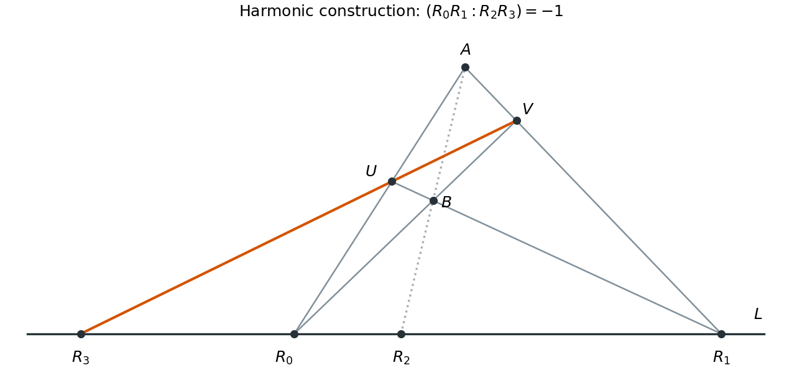

<h1 id="3/c/ii/solution">Solution</h1>

↑ **Parent:** [Ii](../ii.md)

Choose a point $A$ off $L$, then a point $B$ on $AR_2$ distinct from $A,R_2$. Put

$$
P_0=R_0,\quad P_1=R_1,\quad P_2=A,\quad P_3=B.
$$

These four points form a [projective frame](../../../../../projective-frame.md): $A,B$ lie off $L$, and $AB=AR_2$ meets $L$ at neither $R_0$ nor $R_1$. Form, using only joins and intersections,

$$
U=R_0A\cap R_1B,\qquad V=R_0B\cap R_1A,\qquad \boxed{R_3=UV\cap L.}
$$

Here the point called $Q_1$ in (i) is $R_2$, while $Q_3$ is $R_3$. Thus (i) gives $(R_0R_1:R_3R_2)=-1$. Interchanging the last two arguments reciprocates the [cross-ratio](../../../../../cross-ratio.md), so

$$
\boxed{(R_0R_1:R_2R_3)=(-1)^{-1}=-1.}
$$

All auxiliary choices are possible over a [field](../../../../../field.md) of characteristic zero, which is infinite. Uniqueness from (a)(ii) shows that the final point is independent of those choices. The picture uses an affine chart in which every relevant intersection is finite; parallel-line exceptions in another chart are ordinary intersections on the [projective line at infinity](../../../../../projective-line-at-infinity.md).

**[Figure 1](#3/c/ii/image-construction-of-harmonic-conjugate-points-by-joins-and-intersections). Construction of harmonic conjugate points by joins and intersections**.

## ↑ Ancestors (13)

1. [Ii](../ii.md)
2. [C](../../c.md)
3. [3](../../../3.md)
4. [2021](../../../../2021-split.md)
5. [Past exam of the short options course of the University of Oxford](../../../../split.md)
6. [Short options course of the University of Oxford](../../../../../short-options-course-of-the-university-of-oxford.md)
7. [Year 2 of the mathematics course of the University of Oxford](../../../../../year-2-of-the-mathematics-course-of-the-university-of-oxford.md)
8. [Mathematics course of the University of Oxford](../../../../../mathematics-course-of-the-university-of-oxford.md)
9. [Undergraduate course of the University of Oxford](../../../../../undergraduate-course-of-the-university-of-oxford.md)
10. [Course of the University of Oxford](../../../../../course-of-the-university-of-oxford.md)
11. [University of Oxford](../../../../../university-of-oxford-split.md)
12. [List of universities](../../../../../list-of-universities.md)
13. [Codex Wiki](../../../../../split.md)
