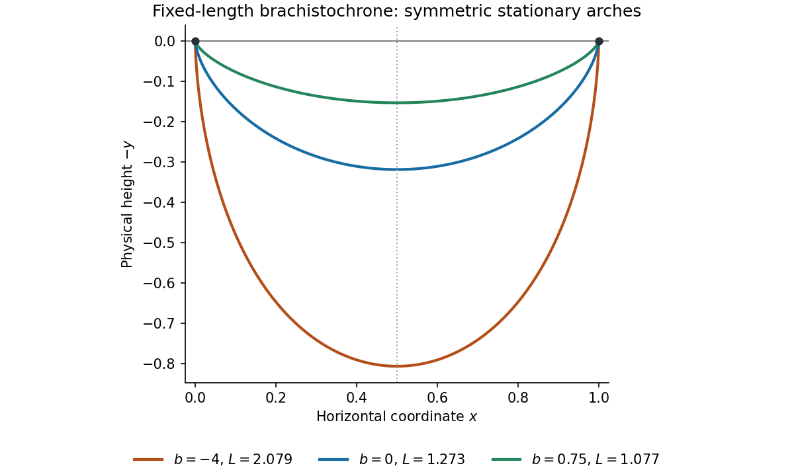

<h1 id="6/d/solution">Solution</h1>

↑ **Parent:** [D](../d.md)

Put $f(\phi)=dx/d\phi$. Since $\sin((2\pi-\phi)/2)=\sin(\phi/2)$, both $f(2\pi-\phi)=f(\phi)$ and $y(2\pi-\phi)=y(\phi)$. Using $x(2\pi)=1$ in the integral for $x$ gives

$$
\boxed{x(2\pi-\phi)=1-x(\phi),\qquad y(2\pi-\phi)=y(\phi).}
$$

Hence the physical track $(x,-y)$ is symmetric about $x=1/2$, with $x(\pi)=1/2$. For $0<\phi<2\pi$, $dx/d\phi>0$, and

$$
\frac{dy}{d\phi}=\frac{\sin(\phi/2)\cos(\phi/2)}{c(1-b\sin(\phi/2))^3}
$$

is positive before $\pi$ and negative after $\pi$. Therefore the **physical height $-y$ has its unique minimum at $x=1/2$**, with

$$
\boxed{y_{\max}=\frac1{c(1-b)^2},\qquad (x,\text{height})_{\min}=\left(\frac12,-\frac1{c(1-b)^2}\right).}
$$

The depth $y$ has a maximum there. This proves the intended claim for every finite-time member $L>1$; $L=1$ has the degeneracy described in (a).

**[Figure 2](#6/d/image-stationary-brachistochrone-arches-at-several-fixed-lengths-with-vertical-endpoint-tangents). Stationary brachistochrone arches at several fixed lengths, with vertical endpoint tangents**.

## ↑ Ancestors (12)

1. [D](../d.md)
2. [6](../../6.md)
3. [2021](../../../2021-split.md)
4. [Past exam of the short options course of the University of Oxford](../../../split.md)
5. [Short options course of the University of Oxford](../../../../short-options-course-of-the-university-of-oxford.md)
6. [Year 2 of the mathematics course of the University of Oxford](../../../../year-2-of-the-mathematics-course-of-the-university-of-oxford.md)
7. [Mathematics course of the University of Oxford](../../../../mathematics-course-of-the-university-of-oxford.md)
8. [Undergraduate course of the University of Oxford](../../../../undergraduate-course-of-the-university-of-oxford.md)
9. [Course of the University of Oxford](../../../../course-of-the-university-of-oxford.md)
10. [University of Oxford](../../../../university-of-oxford-split.md)
11. [List of universities](../../../../list-of-universities.md)
12. [Codex Wiki](../../../../split.md)
