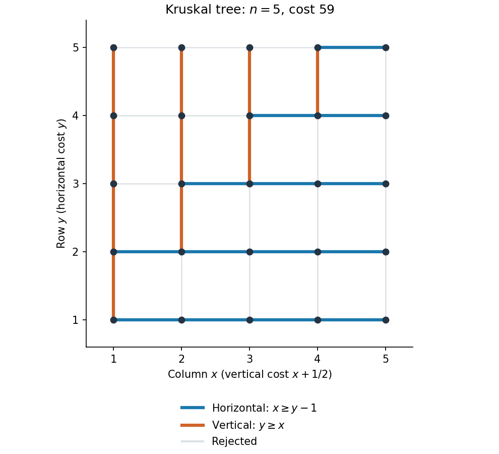

<h1 id="7/a/solution">Solution</h1>

↑ **Parent:** [A](../a.md)

For a finite [connected graph](../../../../connected-graph.md), a [spanning tree](../../../../spanning-tree.md) contains every [graph vertex](../../../../vertex-graph-theory.md) and is connected and acyclic. A [minimum spanning tree](../../../../minimum-spanning-tree.md) minimizes $\sum_{e\in E(T)}w(e)$ over all such [trees](../../../../tree-graph-theory-split.md). A [shortest-path tree](../../../../shortest-path-tree.md) rooted at $v$ is a [spanning tree](../../../../spanning-tree.md) whose unique $v$-to-$u$ [graph path](../../../../path-in-a-graph.md) has length $d_G(v,u)$ for every [graph vertex](../../../../vertex-graph-theory.md) $u$. Here the [weighted path length](../../../../weighted-path-length.md) is the sum of its [edge](../../../../edge-of-a-graph.md) weights. The two optimizations generally differ, as (b) shows. Connectedness is needed for either spanning-tree object to exist.

For the grid, [Kruskal's algorithm](../../../../kruskal-s-algorithm.md) examines [edges](../../../../edge-of-a-graph.md) in nondecreasing order of weight and accepts an [edge](../../../../edge-of-a-graph.md) exactly when it joins two different components of the current [forest](../../../../forest.md). The weights are encountered in the order

$$
1,\ \frac32,\ 2,\ \frac52,\ 3,\ \frac72,\ldots.
$$

The horizontal and vertical acceptance rules are detailed in the two numbered subanswers. Together they produce

$$
\boxed{\begin{aligned}
E(T)={}&\{(x,y)(x+1,y):1\le x<n,\ 1\le y\le n,\ x\ge y-1\}\\
&\cup\{(x,y)(x,y+1):1\le x\le n,\ 1\le y<n,\ y\ge x\}.
\end{aligned}}
$$

There are $(n-1)(n+2)/2$ horizontal and $n(n-1)/2$ vertical [edges](../../../../edge-of-a-graph.md), totaling $n^2-1$. Every accepted [edge](../../../../edge-of-a-graph.md) attaches a previously isolated [graph vertex](../../../../vertex-graph-theory.md) to the component already built, so the result is connected and acyclic. The correctness theorem for [Kruskal's algorithm](../../../../kruskal-s-algorithm.md), which follows from the [minimum spanning tree cut property](../../../../minimum-spanning-tree-cut-property.md), proves minimality. Its total cost is

$$
\boxed{w(T)=\left[\frac{n(n+1)(n+2)}6-1\right]+\frac{n(n-1)(2n+5)}{12}=\frac{(n-1)(4n^2+13n+12)}{12}.}
$$

For $n=1$ the [tree](../../../../tree-graph-theory-split.md) has one [graph vertex](../../../../vertex-graph-theory.md), no [edges](../../../../edge-of-a-graph.md) and cost zero. The source's numbered items specify the two [edge](../../../../edge-of-a-graph.md) types; the following subanswers record their contributions to the algorithm.

**[Figure 3](#7/a/image-kruskal-spanning-tree-of-the-weighted-grid-with-accepted-horizontal-and-vertical-edges-highlighted). Kruskal spanning tree of the weighted grid, with accepted horizontal and vertical edges highlighted**.

## ↑ Ancestors (12)

1. [A](../a.md)
2. [7](../../7.md)
3. [2021](../../../2021-split.md)
4. [Past exam of the short options course of the University of Oxford](../../../split.md)
5. [Short options course of the University of Oxford](../../../../short-options-course-of-the-university-of-oxford.md)
6. [Year 2 of the mathematics course of the University of Oxford](../../../../year-2-of-the-mathematics-course-of-the-university-of-oxford.md)
7. [Mathematics course of the University of Oxford](../../../../mathematics-course-of-the-university-of-oxford.md)
8. [Undergraduate course of the University of Oxford](../../../../undergraduate-course-of-the-university-of-oxford.md)
9. [Course of the University of Oxford](../../../../course-of-the-university-of-oxford.md)
10. [University of Oxford](../../../../university-of-oxford-split.md)
11. [List of universities](../../../../list-of-universities.md)
12. [Codex Wiki](../../../../split.md)
