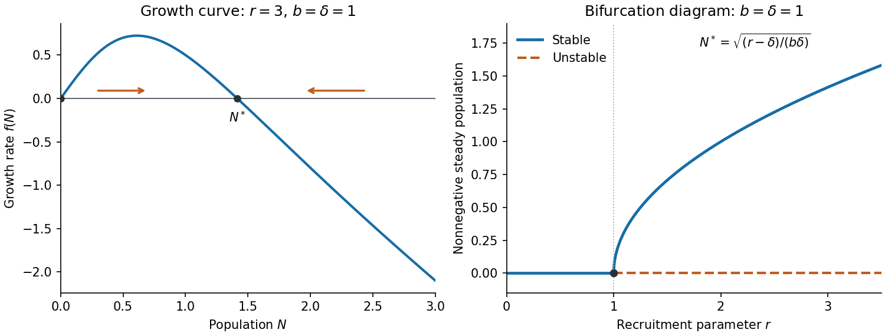

<h1 id="9/a/iv/solution">Solution</h1>

↑ **Parent:** [Iv](../iv.md)

For $r>\delta$, the sign of $f(N)$ is positive on $0<N<N^*$ and negative on $N>N^*$. Its graph passes through $0,N^*$, has positive initial slope $r-\delta$, and eventually behaves like $-\delta N$. The [phase line](../../../../../phase-line.md) therefore points toward $N^*$ from both sides.

The vector field is continuously differentiable, so solutions are unique. No positive solution crosses either equilibrium; one starting below $N^*$ increases and stays below it, and one starting above it decreases and stays above it. These bounded solutions exist for all forward time and have a limit. By continuity of $f$, any such limit must be a zero of $f$: otherwise the derivative would stay bounded away from zero near the limit. The increasing solution is bounded below by its strictly positive initial value, excluding zero; the decreasing one stays above $N^*$. Consequently

$$
\boxed{N(0)>0\quad\Longrightarrow\quad N(t)\longrightarrow N^*.}
$$

The solution starting exactly at $N^*$ is constant. The zero initial condition remains at zero, which is why positivity is stipulated.

**[Figure 4](#9/a/iv/image-population-growth-curve-and-nonnegative-steady-state-bifurcation-diagram). Population growth curve and nonnegative steady-state bifurcation diagram**.

## ↑ Ancestors (13)

1. [Iv](../iv.md)
2. [A](../../a.md)
3. [9](../../../9.md)
4. [2021](../../../../2021-split.md)
5. [Past exam of the short options course of the University of Oxford](../../../../split.md)
6. [Short options course of the University of Oxford](../../../../../short-options-course-of-the-university-of-oxford.md)
7. [Year 2 of the mathematics course of the University of Oxford](../../../../../year-2-of-the-mathematics-course-of-the-university-of-oxford.md)
8. [Mathematics course of the University of Oxford](../../../../../mathematics-course-of-the-university-of-oxford.md)
9. [Undergraduate course of the University of Oxford](../../../../../undergraduate-course-of-the-university-of-oxford.md)
10. [Course of the University of Oxford](../../../../../course-of-the-university-of-oxford.md)
11. [University of Oxford](../../../../../university-of-oxford-split.md)
12. [List of universities](../../../../../list-of-universities.md)
13. [Codex Wiki](../../../../../split.md)
