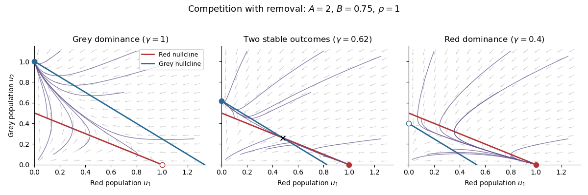
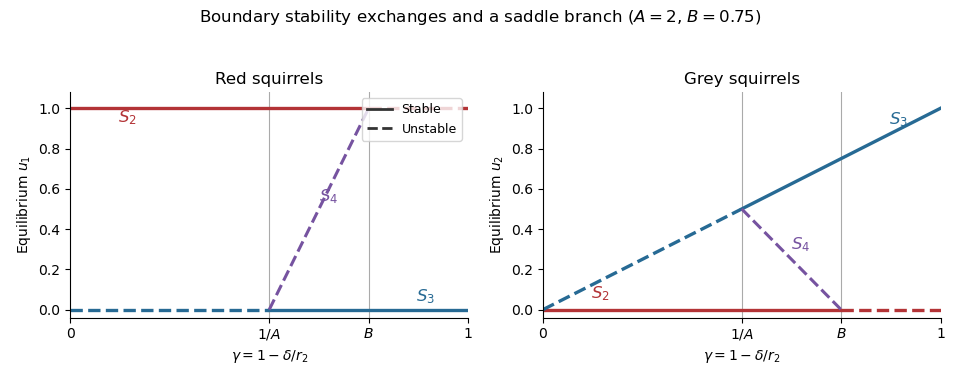

# 2023

↑ **Parent:** [Past exam of the short options course of the University of Oxford](../past-exam-of-the-short-options-course-of-the-university-of-oxford.md)

Source: [released examination PDF, pages 28–38](https://www.whatdotheyknow.com/request/bsc_mathematics_part_a_examinati/response/2820674/attach/3/FOI%20202410%20944%20Data.pdf#page=28). Solutions follow the numbering of the 21 June 2023 Short Options paper.

**Table of contents**

- [1](#1)
  - [a](#1/a)
    - [i](#1/a/i)
      - [Solution](#1/a/i/solution)
    - [ii](#1/a/ii)
      - [Solution](#1/a/ii/solution)
  - [b](#1/b)
    - [i](#1/b/i)
      - [Solution](#1/b/i/solution)
    - [ii](#1/b/ii)
      - [Solution](#1/b/ii/solution)
    - [iii](#1/b/iii)
      - [Solution](#1/b/iii/solution)
  - [c](#1/c)
    - [i](#1/c/i)
      - [Solution](#1/c/i/solution)
    - [ii](#1/c/ii)
      - [Solution](#1/c/ii/solution)
- [2](#2)
  - [a](#2/a)
    - [Solution](#2/a/solution)
  - [b](#2/b)
    - [Solution](#2/b/solution)
  - [c](#2/c)
    - [i](#2/c/i)
      - [Solution](#2/c/i/solution)
    - [ii](#2/c/ii)
      - [Solution](#2/c/ii/solution)
  - [d](#2/d)
    - [Solution](#2/d/solution)
- [3](#3)
  - [a](#3/a)
    - [Solution](#3/a/solution)
  - [b](#3/b)
    - [Solution](#3/b/solution)
  - [c](#3/c)
    - [Solution](#3/c/solution)
  - [d](#3/d)
    - [Solution](#3/d/solution)
- [4](#4)
  - [a](#4/a)
    - [Solution](#4/a/solution)
  - [b](#4/b)
    - [i](#4/b/i)
      - [Solution](#4/b/i/solution)
    - [ii](#4/b/ii)
      - [Solution](#4/b/ii/solution)
  - [c](#4/c)
    - [i](#4/c/i)
      - [Solution](#4/c/i/solution)
    - [ii](#4/c/ii)
      - [Solution](#4/c/ii/solution)
    - [iii](#4/c/iii)
      - [Solution](#4/c/iii/solution)
- [5](#5)
  - [a](#5/a)
    - [Solution](#5/a/solution)
  - [b](#5/b)
    - [i](#5/b/i)
      - [Solution](#5/b/i/solution)
    - [ii](#5/b/ii)
      - [Solution](#5/b/ii/solution)
  - [c](#5/c)
    - [i](#5/c/i)
      - [Solution](#5/c/i/solution)
    - [ii](#5/c/ii)
      - [Solution](#5/c/ii/solution)
    - [iii](#5/c/iii)
      - [Solution](#5/c/iii/solution)
- [6](#6)
  - [a](#6/a)
    - [Solution](#6/a/solution)
  - [b](#6/b)
    - [Solution](#6/b/solution)
  - [c](#6/c)
    - [Solution](#6/c/solution)
- [7](#7)
  - [a](#7/a)
    - [i](#7/a/i)
      - [Solution](#7/a/i/solution)
    - [ii](#7/a/ii)
      - [Solution](#7/a/ii/solution)
    - [iii](#7/a/iii)
      - [Solution](#7/a/iii/solution)
    - [iv](#7/a/iv)
      - [Solution](#7/a/iv/solution)
  - [b](#7/b)
    - [i](#7/b/i)
      - [Solution](#7/b/i/solution)
    - [ii](#7/b/ii)
      - [Solution](#7/b/ii/solution)
    - [iii](#7/b/iii)
      - [Solution](#7/b/iii/solution)
- [8](#8)
  - [a](#8/a)
    - [i](#8/a/i)
      - [Solution](#8/a/i/solution)
    - [ii](#8/a/ii)
      - [Solution](#8/a/ii/solution)
  - [b](#8/b)
    - [i](#8/b/i)
      - [Solution](#8/b/i/solution)
    - [ii](#8/b/ii)
      - [Solution](#8/b/ii/solution)
    - [iii](#8/b/iii)
      - [Solution](#8/b/iii/solution)
  - [c](#8/c)
    - [Solution](#8/c/solution)
- [9](#9)
  - [a](#9/a)
    - [i](#9/a/i)
      - [Solution](#9/a/i/solution)
    - [ii](#9/a/ii)
      - [Solution](#9/a/ii/solution)
    - [iii](#9/a/iii)
      - [Solution](#9/a/iii/solution)
  - [b](#9/b)
    - [i](#9/b/i)
      - [Solution](#9/b/i/solution)
    - [ii](#9/b/ii)
      - [Solution](#9/b/ii/solution)
    - [iii](#9/b/iii)
      - [Solution](#9/b/iii/solution)
  - [c](#9/c)
    - [i](#9/c/i)
      - [Solution](#9/c/i/solution)
    - [ii](#9/c/ii)
      - [Solution](#9/c/ii/solution)

## 1

↑ **Parent:** [2023](2023.md)

<h3 id="1/a">a</h3>

↑ **Parent:** [1](#1)

<h4 id="1/a/i">i</h4>

↑ **Parent:** [A](#1/a)

<h5 id="1/a/i/solution">Solution</h5>

↑ **Parent:** [I](#1/a/i)

The multiplicative [group](../group.md) $\mathbb F_p^\times$ is a [cyclic group](../group.md#cyclic-group) of order $p-1$, so choose a [primitive root](../number-theory.md#primitive-root-modulo-n) $g$. Every nonzero residue is uniquely $g^j$, with $j$ taken modulo $p-1$. The condition becomes $(p-1)\mid kj$. Writing $d=\gcd(k,p-1)$, its solutions are $j=0,(p-1)/d,\ldots,(d-1)(p-1)/d$. Zero is not a solution. Therefore the number is

$$
\boxed{\gcd(k,p-1)}.
$$

This includes $p=2$. The [cyclic group](../group.md#cyclic-group) argument gives the exact count, whereas the bound of $k$ roots for a nonzero degree-$k$ [polynomial](../polynomial.md) over a [field](../algebra.md#field) would only give an upper bound.

<h4 id="1/a/ii">ii</h4>

↑ **Parent:** [A](#1/a)

<h5 id="1/a/ii/solution">Solution</h5>

↑ **Parent:** [Ii](#1/a/ii)

If $p\mid n$, the [field](../algebra.md#field) property forces $x=0$, giving exactly one solution. Otherwise, if $x_0$ is any solution, multiplication by $x_0$ is a [bijection](../function.md#bijection) from the solutions of $z^k=1$ to those of $x^k=n$. Part (i) therefore gives

$$
\boxed{\begin{cases}1,&p\mid n,\\0\text{ or }\gcd(k,p-1),&p\nmid n.\end{cases}}
$$

The two possibilities in the second line distinguish an empty fiber from a [coset](../group-theory.md#coset) of the [kernel](../kernel-of-a-linear-map.md) of the power [group homomorphism](../group-theory.md#group-homomorphism) on $\mathbb F_p^\times$.

<h3 id="1/b">b</h3>

↑ **Parent:** [1](#1)

<h4 id="1/b/i">i</h4>

↑ **Parent:** [B](#1/b)

<h5 id="1/b/i/solution">Solution</h5>

↑ **Parent:** [I](#1/b/i)

For $p>3$, [quadratic reciprocity](../number-theory.md#quadratic-reciprocity) gives

$$
\left(\frac3p\right)=(-1)^{(p-1)/2}\left(\frac p3\right).
$$

The second [Legendre symbol](../quadratic-residue.md#legendre-symbol) is $1$ when $p\equiv1\pmod3$ and $-1$ when $p\equiv2\pmod3$. Combining it with the sign determined by $p\pmod4$ shows that a [quadratic residue](../quadratic-residue.md) occurs precisely for

$$
\boxed{p\equiv1\text{ or }11\pmod{12}}.
$$

<h4 id="1/b/ii">ii</h4>

↑ **Parent:** [B](#1/b)

<h5 id="1/b/ii/solution">Solution</h5>

↑ **Parent:** [Ii](#1/b/ii)

For odd $p\ne5$, [quadratic reciprocity](../number-theory.md#quadratic-reciprocity) has no sign factor because $5\equiv1\pmod4$:

$$
\left(\frac5p\right)=\left(\frac p5\right).
$$

The nonzero squares modulo $5$ are $1,4$, so the answer for odd primes is $p\equiv1,4\pmod5$. The excluded-prime wording also allows $p=2$, where $5\equiv1$ has a square root. Thus the full answer is

$$
\boxed{p=2\quad\text{or}\quad p\equiv1,4\pmod5}.
$$

<h4 id="1/b/iii">iii</h4>

↑ **Parent:** [B](#1/b)

<h5 id="1/b/iii/solution">Solution</h5>

↑ **Parent:** [Iii](#1/b/iii)

The primes $2,5$ both work, with the zero residue as a solution. For every other prime, [multiplicativity of the Legendre symbol](../quadratic-residue.md#multiplicativity-of-the-legendre-symbol) and [quadratic reciprocity](../number-theory.md#quadratic-reciprocity) give

$$
\left(\frac{10}p\right)=\left(\frac2p\right)\left(\frac5p\right)=(-1)^{(p^2-1)/8}\left(\frac p5\right).
$$

The first factor is positive for $p\equiv1,7\pmod8$; the second is positive for $p\equiv1,4\pmod5$. They must have the same sign. The [Chinese remainder theorem](../mathematics.md#chinese-remainder-theorem) therefore yields

$$
\boxed{p=2,5\quad\text{or}\quad p\equiv1,3,9,13,27,31,37,39\pmod{40}}.
$$

<h3 id="1/c">c</h3>

↑ **Parent:** [1](#1)

<h4 id="1/c/i">i</h4>

↑ **Parent:** [C](#1/c)

<h5 id="1/c/i/solution">Solution</h5>

↑ **Parent:** [I](#1/c/i)

Let $a$ be a root modulo $p^j$. Every lift to a residue modulo $p^{j+1}$ is uniquely $a+tp^j$ with $t\pmod p$. The [polynomial](../polynomial.md) expansion gives

$$
f(a+tp^j)\equiv f(a)+tp^jf'(a)\pmod{p^{j+1}}.
$$

Because $a\pmod p$ is a root and there are no common roots of $f$ and $f'$, $f'(a)$ is nonzero modulo $p$. Thus precisely one $t$ solves

$$
\frac{f(a)}{p^j}+t f'(a)\equiv0\pmod p.
$$

Every root at one level therefore has exactly one lift, and every root at the next level reduces to a root at the previous level. [Induction](../foundations-of-mathematics.md#mathematical-induction) proves equality of the counts from $p$ to $p^l$. This is [simple-root Hensel lifting by successive residues](../non-archimedean-analysis.md#simple-root-hensel-lifting-by-successive-residues) at finite precision; completeness is unnecessary for this finite-level assertion.

<h4 id="1/c/ii">ii</h4>

↑ **Parent:** [C](#1/c)

<h5 id="1/c/ii/solution">Solution</h5>

↑ **Parent:** [Ii](#1/c/ii)

For $f(x)=x^2-n$, a root modulo the odd prime $p$ is nonzero because $p\nmid n$. Its derivative $2x$ is therefore nonzero modulo $p$. Part (i) gives exactly one lift of each root. A nonzero [quadratic residue](../quadratic-residue.md) modulo an odd prime has two distinct roots, $x$ and $-x$; a nonresidue has none. Hence

$$
\boxed{\#\{x\pmod{p^l}:x^2\equiv n\}=1+\left(\frac np\right)\in\{0,2\}}.
$$

## 2

↑ **Parent:** [2023](2023.md)

<h3 id="2/a">a</h3>

↑ **Parent:** [2](#2)

<h4 id="2/a/solution">Solution</h4>

↑ **Parent:** [A](#2/a)

A [group presentation](../geometric-group-theory.md#group-presentation) $\langle X\mid R\rangle$ denotes the quotient $F(X)/\langle\!\langle R\rangle\!\rangle$ of the [free group](../geometric-group-theory.md#free-group) on the generator symbols by the [normal closure](../group-theory.md#normal-closure) of the relator words. The symbols generate the quotient, and each relator becomes the identity. The phrase also asserts that no additional relations are imposed except consequences of these relators and the [group axioms](../group.md#group-axioms). Equivalently, an assignment of the generators to a [group](../group.md) extends to a [group homomorphism](../group-theory.md#group-homomorphism) from the presented [group](../group.md) exactly when all relators evaluate to the identity; this is the [universal property of a group presentation](../geometric-group-theory.md#universal-property-of-a-group-presentation).

<h3 id="2/b">b</h3>

↑ **Parent:** [2](#2)

<h4 id="2/b/solution">Solution</h4>

↑ **Parent:** [B](#2/b)

Multiplication, followed by [induction](../foundations-of-mathematics.md#mathematical-induction) and inversion for negative powers, gives

$$
\boxed{T^n=\begin{pmatrix}1&n\\0&1\end{pmatrix}},\qquad
T^nX=\begin{pmatrix}a+nc&b+nd\\c&d\end{pmatrix}.
$$

If $c\ne0$, apply [Euclidean division](../integer.md#euclidean-division) to write $a=q|c|+r$ with $0\leq r<|c|$. Choose $n=-q\operatorname{sgn}(c)$, so $a+nc=r$. This is one step of the [Euclidean algorithm](../number-theory.md#euclidean-algorithm) implemented by a determinant-one row operation.

<h3 id="2/c">c</h3>

↑ **Parent:** [2](#2)

<h4 id="2/c/i">i</h4>

↑ **Parent:** [C](#2/c)

<h5 id="2/c/i/solution">Solution</h5>

↑ **Parent:** [I](#2/c/i)

After the reduction in part (b), multiply by $S$. The new bottom-left entry is $r$, whose absolute value is strictly smaller than the previous $|c|$:

$$
S T^nX=\begin{pmatrix}-c&-d\\r&b+nd\end{pmatrix}.
$$

Repeated [Euclidean division](../integer.md#euclidean-division) must terminate because the nonnegative integers $|c|$ decrease strictly until zero. Thus a word $W$ in $S,T$ and their inverses gives a [matrix](../vector-space.md#matrix) with bottom-left entry zero. Its determinant is one, so the diagonal entries are equal and are either both $1$ or both $-1$:

$$
WX=\begin{pmatrix}\varepsilon&b_0\\0&\varepsilon\end{pmatrix}=\varepsilon I\,T^{\varepsilon b_0},\qquad\varepsilon\in\{1,-1\}.
$$

Since $S^2=-I$, this final [matrix](../vector-space.md#matrix) belongs to $\langle S,T\rangle$. So does $W^{-1}$, proving

$$
\boxed{SL(2,\mathbb Z)=\langle S,T\rangle}.
$$

<h4 id="2/c/ii">ii</h4>

↑ **Parent:** [C](#2/c)

<h5 id="2/c/ii/solution">Solution</h5>

↑ **Parent:** [Ii](#2/c/ii)

The identity $T=S^{-1}(ST)$ shows that $S,ST$ generate the same [group](../group.md). Direct multiplication gives

$$
S^2=-I,\qquad ST=\begin{pmatrix}0&-1\\1&1\end{pmatrix},\qquad(ST)^3=-I.
$$

Consequently their images $\bar S,\overline{ST}$ in the [quotient group](../group-theory.md#quotient-group) $PSL(2,\mathbb Z)$ satisfy $\bar S^2=1$ and $\overline{ST}^{\,3}=1$. The [universal property of a group presentation](../geometric-group-theory.md#universal-property-of-a-group-presentation) gives a [group homomorphism](../group-theory.md#group-homomorphism) taking $u\mapsto\bar S$, $v\mapsto\overline{ST}$ from the stated presentation. It is [surjective](../algebra.md#surjective-function) because these images generate the target. Injectivity is not needed here.

<h3 id="2/d">d</h3>

↑ **Parent:** [2](#2)

<h4 id="2/d/solution">Solution</h4>

↑ **Parent:** [D](#2/d)

Suppose $N$ were a [normal subgroup](../group-theory.md#normal-subgroup) of index $m$ and put $Q=SL(2,\mathbb F_p)/N$. The supplied reduction map and part (c) show that $Q$ is generated by the images $s,t$ of $S,ST$. Their orders divide $4$ and $6$, respectively, because $S^4=I$ and $(ST)^6=I$. By [Lagrange's theorem](../group-theory.md#lagrange-s-theorem), their orders also divide $|Q|=m$. Since $\gcd(m,6)=1$, both $\gcd(m,4)$ and $\gcd(m,6)$ equal one. Thus $s=t=1$, forcing $Q$ to be trivial and $m=1$, a contradiction. **No such normal subgroup exists for $m>1$.**

## 3

↑ **Parent:** [2023](2023.md)

<h3 id="3/a">a</h3>

↑ **Parent:** [3](#3)

<h4 id="3/a/solution">Solution</h4>

↑ **Parent:** [A](#3/a)

A [projective conic](../projective-space.md#projective-conic) in $\mathbb P^2(\mathbb C)$ is the zero locus of a nonzero homogeneous quadratic [polynomial](../polynomial.md), up to nonzero scaling of that [polynomial](../polynomial.md). Under an invertible linear change of homogeneous coordinates, its [symmetric matrix](../linear-algebra.md#symmetric-matrix) has rank $3$, $2$, or $1$. Over $\mathbb C$, the corresponding forms are a nonsingular conic such as $XZ-Y^2=0$, two distinct lines such as $XY=0$, or a double line $X^2=0$. In the last case the repeated factor records multiplicity, even though the underlying point set is one line.

A [projective line](../finite-group-theory.md#projective-line) is the projectivization of a two-dimensional [linear subspace](../vector-space.md#vector-subspace) of $\mathbb C^3$, equivalently the zero locus of one nonzero linear form. For two such subspaces $U,W$, the [dimension formula for a sum of subspaces](../vector-space.md#dimension-formula-for-a-sum-of-subspaces) gives $\dim(U\cap W)\geq2+2-3=1$. A nonzero vector in the intersection therefore supplies a common projective point. Distinct lines have exactly one such point.

<h3 id="3/b">b</h3>

↑ **Parent:** [3](#3)

<h4 id="3/b/solution">Solution</h4>

↑ **Parent:** [B](#3/b)

Use coefficient coordinates $[a:b:c]$ on $\mathbb P(V)$. A nonzero binary quadratic has a repeated linear factor precisely when its [discriminant](../polynomial.md#discriminant) vanishes, so

$$
\boxed{C=\{[a:b:c]:b^2-4ac=0\}}.
$$

Its [gradient](../multivariable-calculus.md#gradient) is $(-4c,2b,-4a)$, which cannot vanish at a projective point. Therefore $C$ is a nonsingular [projective conic](../projective-space.md#projective-conic). The parametrization $[\alpha:\beta]\mapsto[\alpha^2:2\alpha\beta:\beta^2]$ identifies it as a degree-two [Veronese map](../projective-space.md#veronese-map).

<h3 id="3/c">c</h3>

↑ **Parent:** [3](#3)

<h4 id="3/c/solution">Solution</h4>

↑ **Parent:** [C](#3/c)

Assume $L\ne0$. The quadratics divisible by $L$ form $L\cdot\operatorname{span}\{x,y\}$, a two-dimensional [linear subspace](../vector-space.md#vector-subspace); their projectivization is a [projective line](../finite-group-theory.md#projective-line). Evaluating at the projective zero $[-\beta:\alpha]$ of $L$ gives its equation

$$
\boxed{\beta^2a-\alpha\beta b+\alpha^2c=0}.
$$

At the point $[L^2]=[\alpha^2:2\alpha\beta:\beta^2]$ of $C$, the tangent equation obtained from the [gradient](../multivariable-calculus.md#gradient) of $b^2-4ac$ is $-4\beta^2a+4\alpha\beta b-4\alpha^2c=0$. It is exactly the same line, establishing tangency.

<h3 id="3/d">d</h3>

↑ **Parent:** [3](#3)

<h4 id="3/d/solution">Solution</h4>

↑ **Parent:** [D](#3/d)

The [fundamental theorem of algebra](../algebra.md#fundamental-theorem-of-algebra) factors $q(x,1)$ into linear factors over $\mathbb C$; homogenizing supplies factors of $y$ if the degree is less than three. Thus every nonzero homogeneous cubic is $cL_1L_2L_3$ for linear forms $L_i$, with $c\ne0$ absorbed into one factor.

For pairwise nonproportional factors, part (c) assigns three distinct tangent lines $\ell_i=\mathbb P(L_i\cdot\operatorname{span}\{x,y\})$ to $C$. Their pairwise intersections are $[L_1L_2]$, $[L_1L_3]$, and $[L_2L_3]$. There cannot be a common point of all three: a nonzero quadratic cannot be divisible by three pairwise nonproportional linear factors, by [unique factorization](../algebra.md#unique-factorization-in-an-integral-domain). Hence the three lines form a triangle circumscribed about $C$.

## 4

↑ **Parent:** [2023](2023.md)

<h3 id="4/a">a</h3>

↑ **Parent:** [4](#4)

<h4 id="4/a/solution">Solution</h4>

↑ **Parent:** [A](#4/a)

For the [operator norm](../continuous-dual-space.md#operator-norm), [submultiplicativity](../banach-algebra.md#submultiplicativity) bounds the remainder of the [matrix exponential](../linear-operator-theory.md#matrix-exponential) by

$$
\|\exp A-I-A\|\leq\sum_{j=2}^\infty\frac{\|A\|^j}{j!}=e^{\|A\|}-1-\|A\|=O(\|A\|^2).
$$

Therefore $\|\exp A-\exp0-A\|/\|A\|\to0$. This is precisely [Fréchet differentiability](../multivariable-calculus.md#frechet-differentiability) at zero, with

$$
\boxed{D\exp(0)[H]=H}.
$$

<h3 id="4/b">b</h3>

↑ **Parent:** [4](#4)

<h4 id="4/b/i">i</h4>

↑ **Parent:** [B](#4/b)

<h5 id="4/b/i/solution">Solution</h5>

↑ **Parent:** [I](#4/b/i)

The curve-based [tangent space](../tangent-vector.md#tangent-space) at $x$ consists of velocities $\gamma'(0)$ of smooth curves $\gamma:(-\varepsilon,\varepsilon)\to M$ satisfying $\gamma(0)=x$. For an arbitrary subset these velocities need not form a [vector space](../vector-space.md); for a smooth [submanifold](../differential-geometry.md#submanifold) they do, and this is its usual [tangent space](../tangent-vector.md#tangent-space). This definition suffices for the direct computation at the identity.

<h4 id="4/b/ii">ii</h4>

↑ **Parent:** [B](#4/b)

<h5 id="4/b/ii/solution">Solution</h5>

↑ **Parent:** [Ii](#4/b/ii)

If $Q(t)$ is a smooth curve of [orthogonal matrices](../linear-algebra.md#orthogonal-matrix) with $Q(0)=I$, differentiating $Q(t)^TQ(t)=I$ gives $Q'(0)^T+Q'(0)=0$. Thus each tangent velocity is a [skew-symmetric matrix](../linear-algebra.md#skew-symmetric-matrix).

Conversely, if $A^T=-A$, the curve $Q(t)=\exp(tA)$ satisfies

$$
Q(t)^TQ(t)=\exp(-tA)\exp(tA)=I,
$$

using commutation of $-tA$ and $tA$. By part (a), $Q'(0)=A$. Both inclusions prove

$$
\boxed{T_IO(n)=\{A:A^T=-A\}=\mathcal A}.
$$

<h3 id="4/c">c</h3>

↑ **Parent:** [4](#4)

<h4 id="4/c/i">i</h4>

↑ **Parent:** [C](#4/c)

<h5 id="4/c/i/solution">Solution</h5>

↑ **Parent:** [I](#4/c/i)

The [matrix exponential](../linear-operator-theory.md#matrix-exponential) is smooth, and part (a) identifies its derivative at zero as the identity. The [inverse function theorem](../multivariable-calculus.md#inverse-function-theorem) therefore gives a local [diffeomorphism](../geometry-and-topology.md#diffeomorphism) from an open neighborhood $U_0$ of zero onto a neighborhood of $I$. Choose a sufficiently small [operator norm](../continuous-dual-space.md#operator-norm) ball $U\subset U_0$ and let $V=\exp U$. This is again a [diffeomorphism](../geometry-and-topology.md#diffeomorphism) onto an open set, since it is a restriction of the original one.

The ball $U$ is preserved by $A\mapsto A^T$ and $A\mapsto-A$. Since $(\exp A)^T=\exp(A^T)$ and $(\exp A)^{-1}=\exp(-A)$, $V$ is preserved by adjoint and inversion. For its local inverse $L$, injectivity also gives

$$
\boxed{L(Q^T)=L(Q)^T,\qquad L(Q^{-1})=-L(Q)}\qquad(Q\in V).
$$

<h4 id="4/c/ii">ii</h4>

↑ **Parent:** [C](#4/c)

<h5 id="4/c/ii/solution">Solution</h5>

↑ **Parent:** [Ii](#4/c/ii)

Part (b) already shows $\exp(U\cap\mathcal A)\subset V\cap O(n)$. Conversely, if $Q\in V\cap O(n)$ and $A=L(Q)\in U$, then

$$
\exp(A^T)=Q^T=Q^{-1}=\exp(-A).
$$

Both $A^T$ and $-A$ lie in $U$, where the [matrix exponential](../linear-operator-theory.md#matrix-exponential) is injective. Therefore $A^T=-A$, proving the reverse inclusion. The restricted map is a [bijection](../function.md#bijection), indeed a [diffeomorphism](../geometry-and-topology.md#diffeomorphism) between these local sets.

<h4 id="4/c/iii">iii</h4>

↑ **Parent:** [C](#4/c)

<h5 id="4/c/iii/solution">Solution</h5>

↑ **Parent:** [Iii](#4/c/iii)

The linear map $\pi(A)=(A+A^T)/2$ is the [projection](../vector-space.md#projection-linear-algebra) onto the space $\mathcal S$ of [symmetric matrices](../linear-algebra.md#symmetric-matrix), with kernel $\mathcal A$. Define $F=\pi\circ L$ on $V$. Since $DL$ is invertible everywhere on $V$ and $\pi$ is onto, $DF$ is onto everywhere. By part (ii),

$$
F^{-1}(0)=V\cap O(n).
$$

The [regular level set theorem](../differential-geometry.md#regular-level-set-theorem) makes this a [submanifold](../differential-geometry.md#submanifold) of codimension $\dim\mathcal S=n(n+1)/2$, and hence

$$
\boxed{\dim O(n)=n(n-1)/2}.
$$

This neighborhood is $V$ around $I$; the source's final occurrence of $U$ in this step is a neighborhood-label slip. For any $Q\in O(n)$, left multiplication by $Q$ is an invertible linear map of the ambient [matrix](../vector-space.md#matrix) space and carries $V\cap O(n)$ onto $QV\cap O(n)$. These translated charts establish the [submanifold](../differential-geometry.md#submanifold) property at every group element.

## 5

↑ **Parent:** [2023](2023.md)

<h3 id="5/a">a</h3>

↑ **Parent:** [5](#5)

<h4 id="5/a/solution">Solution</h4>

↑ **Parent:** [A](#5/a)

The [distributional derivative](../distribution-theory.md#distributional-derivative) is defined by $\langle F',\phi\rangle=-\langle F,\phi'\rangle$ for every [test function](../distribution-theory.md#test-function). For the [Heaviside function](../integral-transform.md#heaviside-step-function), compact support gives

$$
\langle\mathcal H',\phi\rangle=-\int_0^\infty\phi'(x)\,dx=\phi(0)=\langle\delta,\phi\rangle.
$$

Thus $\mathcal H'=\delta$. Splitting the integral for $|x|$ at zero and using [integration by parts](../calculus.md#integration-by-parts) gives its first derivative as the [sign function](../foundations-of-mathematics.md#sign-function). The jump of that function at zero is two, so

$$
\boxed{D|x|=\operatorname{sgn}(x),\qquad D^2|x|=2\delta}
$$

as [distributions](../distribution-theory.md#distribution-mathematical-analysis). The value assigned to the [sign function](../foundations-of-mathematics.md#sign-function) at the single point zero does not affect its associated [distribution](../distribution-theory.md#distribution-mathematical-analysis).

<h3 id="5/b">b</h3>

↑ **Parent:** [5](#5)

<h4 id="5/b/i">i</h4>

↑ **Parent:** [B](#5/b)

<h5 id="5/b/i/solution">Solution</h5>

↑ **Parent:** [I](#5/b/i)

For real $p>0$, substitute $t=px$ in the [Laplace transform](../integral-transform.md#laplace-transform):

$$
\int_0^\infty x^{a-1}e^{-px}\,dx=p^{-a}\int_0^\infty t^{a-1}e^{-t}\,dt=\boxed{\Gamma(a)p^{-a}}.
$$

The [Gamma function](../complex-analysis.md#gamma-function) integral is finite because $a>0$. For complex $p$, absolute convergence holds exactly when $\operatorname{Re}p>0$: the modulus of the integrand is $x^{a-1}e^{-(\operatorname{Re}p)x}$. On this half-plane the same answer holds with the branch $p^{-a}=\exp(-a\operatorname{Log}p)$ whose logarithm is real on the positive axis, by holomorphic continuation of the two sides.

If “exists” permits conditionally convergent ordinary improper integrals, there are additional boundary points when $0<a<1$: for $p=i\omega\ne0$, the [Dirichlet test](../sequence-and-series.md#dirichlet-test) gives convergence, with value $\Gamma(a)|\omega|^{-a}e^{-i\operatorname{sgn}(\omega)\pi a/2}$. For $a\geq1$ these boundary integrals do not converge in that sense. At $p=0$, and for $\operatorname{Re}p<0$, the integral diverges. Thus $\operatorname{Re}p>0$ is the [region of absolute convergence of a Laplace transform](../integral-transform.md#region-of-absolute-convergence-of-a-laplace-transform), with the stated conditional boundary qualification.

<h4 id="5/b/ii">ii</h4>

↑ **Parent:** [B](#5/b)

<h5 id="5/b/ii/solution">Solution</h5>

↑ **Parent:** [Ii](#5/b/ii)

The integral $I$ is the [convolution](../fourier-analysis.md#convolution) of the positive-half-line kernels $x^{a-1}$ and $x^{b-1}$. The [convolution theorem for Laplace transforms](../integral-transform.md#convolution-theorem-for-laplace-transforms) therefore gives, for $p>0$,

$$
\mathcal L I(p)=\Gamma(a)\Gamma(b)p^{-(a+b)}.
$$

On the other hand, the substitution $t=xu$ gives $I(x)=x^{a+b-1}B(a,b)$, where $B(a,b)=\int_0^1u^{a-1}(1-u)^{b-1}\,du$ is the [beta function](../complex-analysis.md#beta-function). Applying part (i) again yields $\mathcal L I(p)=B(a,b)\Gamma(a+b)p^{-(a+b)}$. Comparing the two expressions proves

$$
\boxed{B(a,b)=\frac{\Gamma(a)\Gamma(b)}{\Gamma(a+b)}}.
$$

All integrands used in the real-$p$ convolution argument are nonnegative, so [Tonelli's theorem](../measure-theory.md#tonelli-theorem) justifies the interchange; the endpoint singularities are integrable because $a,b>0$.

<h3 id="5/c">c</h3>

↑ **Parent:** [5](#5)

<h4 id="5/c/i">i</h4>

↑ **Parent:** [C](#5/c)

<h5 id="5/c/i/solution">Solution</h5>

↑ **Parent:** [I](#5/c/i)

Use the [Fourier transform](../fourier-transform.md) convention $\hat f(s)=\int_{\mathbb R}e^{-isx}f(x)\,dx$. First observe that $f(x)=(2\pi)^{-1/2}e^{-x^2/2}$ satisfies the differential equation, decay, and normalization, using the [Gaussian integral](../integral.md#gaussian-integral). The uniqueness allowed in the question identifies it with $f$. In particular it is a [Schwartz function](../fourier-analysis.md#schwartz-function), so the derivative and multiplication rules below are justified.

Taking the [Fourier transform](../fourier-transform.md) of the differential equation gives

$$
-s^2\hat f+\hat f+\hat f''=0.
$$

The [Riemann-Lebesgue lemma](../fourier-analysis.md#riemann-lebesgue-lemma) gives decay of $\hat f$. Every decaying solution $h$ of this equation is proportional to $e^{-s^2/2}$: setting $w=h'+sh$ gives $w'=sw$, and integration yields

$$
h(s)=e^{-s^2/2}\left(D+C\int_0^se^{t^2}\,dt\right).
$$

The term with $C\ne0$ grows like $Ce^{s^2/2}/(2s)$ as $s\to+\infty$, so decay forces $C=0$. Thus $\hat f=\lambda f$ for a scalar $\lambda$. This establishes proportionality before using [Fourier inversion](../fourier-analysis.md#fourier-inversion-theorem) to calculate the scalar.

<h4 id="5/c/ii">ii</h4>

↑ **Parent:** [C](#5/c)

<h5 id="5/c/ii/solution">Solution</h5>

↑ **Parent:** [Ii](#5/c/ii)

At zero, the [Fourier transform](../fourier-transform.md) is $\hat f(0)=\int f=1$, so $\lambda f(0)=1$. In particular $\lambda\ne0$ and $f(0)=1/\lambda$. The [Fourier inversion theorem](../fourier-analysis.md#fourier-inversion-theorem) at zero also gives

$$
f(0)=\frac1{2\pi}\int_{\mathbb R}\hat f(s)\,ds=\frac\lambda{2\pi}\int_{\mathbb R}f(s)\,ds=\frac\lambda{2\pi}.
$$

Equating the two values yields $\boxed{\lambda^2=2\pi}$. Since the explicit normalized [Gaussian function](../calculus.md#gaussian-function) in part (i) has $f(0)>0$, here $\lambda=\sqrt{2\pi}$.

<h4 id="5/c/iii">iii</h4>

↑ **Parent:** [C](#5/c)

<h5 id="5/c/iii/solution">Solution</h5>

↑ **Parent:** [Iii](#5/c/iii)

In the space of [tempered distributions](../fourier-analysis.md#tempered-distribution), this [Fourier transform](../fourier-transform.md) convention gives $\widehat1=2\pi\delta$ and $\widehat\delta=1$. Therefore

$$
\hat g=c+2\pi\delta,\qquad\lambda g=\lambda+\lambda c\delta.
$$

The constant [distribution](../distribution-theory.md#distribution-mathematical-analysis) and the [Dirac delta distribution](../distribution-theory.md#dirac-delta-function) are linearly independent: testing away from zero first determines the constant coefficient, and then testing at zero determines the delta coefficient. Hence $c=\lambda$ and $\lambda c=2\pi$, giving

$$
\boxed{(c,\lambda)=(\sqrt{2\pi},\sqrt{2\pi})\quad\text{or}\quad(-\sqrt{2\pi},-\sqrt{2\pi})}.
$$

## 6

↑ **Parent:** [2023](2023.md)

<h3 id="6/a">a</h3>

↑ **Parent:** [6](#6)

<h4 id="6/a/solution">Solution</h4>

↑ **Parent:** [A](#6/a)

Let $y$ be a smooth constrained [minimizer](../analysis.md#global-minimizer). For any smooth variation $h$ vanishing at the endpoints, use the normalized admissible curve $y_\varepsilon=(y+\varepsilon h)/\sqrt{J[y+\varepsilon h]}$. Since $J[y]=1$, differentiating at zero gives

$$
0=\left.\frac d{d\varepsilon}I[y_\varepsilon]\right|_0=2\int_0^1\left(xy'h'+\frac{k^2}x yh\right)dx-2I[y]\int_0^1xyh\,dx.
$$

In particular this holds for every compactly supported [test function](../distribution-theory.md#test-function) $h$ in $(0,1)$. [Integration by parts](../calculus.md#integration-by-parts) and the [fundamental lemma of the calculus of variations](../calculus-of-variations.md#fundamental-lemma-of-the-calculus-of-variations) give

$$
-(xy')'+\frac{k^2}x y=I[y]xy,
$$

which is the required [Bessel differential equation](../bessel-function.md#bessel-differential-equation) with $\boxed{\lambda=I[y]}$. The lemma used here says that a continuous function whose integral against every compactly supported smooth [test function](../distribution-theory.md#test-function) is zero must itself vanish. No multiplier-existence theorem is needed: the explicit normalization produces the variation directly.

The endpoint $0$ causes no divergent energy for these variations: smoothness and $y(0)=h(0)=0$ imply $y,h=O(x)$. Also $J[v]>0$ for every nonzero admissible $v$, and $v/\sqrt{J[v]}$ has unit $J$ and energy $I[v]/J[v]$. Thus minimizing $I$ with $J=1$ is equivalent to minimizing the scale-invariant [Rayleigh quotient](../linear-operator-theory.md#rayleigh-quotient) $I/J$. The zero function is excluded whenever this quotient is written.

<h3 id="6/b">b</h3>

↑ **Parent:** [6](#6)

<h4 id="6/b/solution">Solution</h4>

↑ **Parent:** [B](#6/b)

Set $t=\sqrt\lambda x$ and $w(t)=y(t/\sqrt\lambda)$. The [chain rule](../calculus.md#chain-rule) turns the equation into the parameter-one [Bessel differential equation](../bessel-function.md#bessel-differential-equation). By the regular-at-zero solution property supplied in the paper,

$$
y(x)=cJ_k(\sqrt\lambda x).
$$

For a nonzero solution, $c\ne0$, so $y(1)=0$ forces $J_k(\sqrt\lambda)=0$. Conversely, every positive zero $z$ supplies the admissible eigenfunction $J_k(zx)$ with eigenvalue $z^2$.

Here is a direct justification of the infimum characterization that does not assume a minimizer exists. Let $u(x)=J_k(z_{k,1}x)$ and choose its sign so that $u>0$ on $(0,1)$. The first positive zero exists by the oscillatory large-argument behavior of the [Bessel function of the first kind](../bessel-function.md#bessel-function-of-the-first-kind). At zero, its [Frobenius series for Bessel functions](../bessel-function.md#frobenius-series-for-bessel-functions) gives $u(x)=Cx^k(1+O(x^2))$. At one, its zero is simple by uniqueness for a regular second-order [ordinary differential equation](../differential-equation.md#ordinary-differential-equation). Expanding $y=u(y/u)$ and using the equation for $u$ gives the [Ground-state representation of a Sturm-Liouville energy](../sturm-liouville-theory.md#ground-state-representation-of-a-sturm-liouville-energy):

$$
I[y]-z_{k,1}^2J[y]=\int_0^1xu(x)^2\left(\frac d{dx}\frac{y(x)}{u(x)}\right)^2dx\geq0.
$$

For completeness, apply the identity first on $[\varepsilon,1-\varepsilon]$. The discarded boundary term is $[xu'y^2/u]$. It tends to zero at both ends: $xu'/u\to k$ and $y=O(x)$ at zero, while $u'/u=O((1-x)^{-1})$ and $y=O(1-x)$ at one. Taking $y=u$ achieves equality, so

$$
\boxed{z_{k,1}^2=\inf_{y\ne0,\ y(0)=y(1)=0}\frac{I[y]}{J[y]}}.
$$

The infimum is over the stated smooth admissible functions with finite energy; the equality also proves attainment by a multiple of $u$.

<h3 id="6/c">c</h3>

↑ **Parent:** [6](#6)

<h4 id="6/c/solution">Solution</h4>

↑ **Parent:** [C](#6/c)

The trial function $y=x(1-x)$ gives

$$
J[y]=\int_0^1x^3(1-x)^2dx=\frac1{60},\qquad
I[y]=\int_0^1x(1-2x)^2dx+k^2\int_0^1x(1-x)^2dx=\frac16+\frac{k^2}{12}.
$$

Its [Rayleigh quotient](../linear-operator-theory.md#rayleigh-quotient) is $5k^2+10$, yielding the upper bound. Conversely, $1/x\geq x$ on $(0,1)$ and the derivative energy is nonnegative, so $I[y]\geq k^2J[y]$ for every admissible $y$. Part (b) therefore gives

$$
\boxed{k\leq z_{k,1}\leq\sqrt{5k^2+10}}.
$$

## 7

↑ **Parent:** [2023](2023.md)

<h3 id="7/a">a</h3>

↑ **Parent:** [7](#7)

<h4 id="7/a/i">i</h4>

↑ **Parent:** [A](#7/a)

<h5 id="7/a/i/solution">Solution</h5>

↑ **Parent:** [I](#7/a/i)

A [spanning tree](../tree-graph-theory.md#spanning-tree) of the connected [graph](../graph.md) $G$ is a subgraph containing every [vertex](../graph.md#vertex-graph-theory), connected and without [cycles in a graph](../graph-theory.md#cycle-in-a-graph). Equivalently, between every pair of [vertices](../graph.md#vertex-graph-theory) it has exactly one [graph path](../graph-theory.md#path-in-a-graph). For a finite [graph](../graph.md) with $v$ vertices, it has $v-1$ edges.

<h4 id="7/a/ii">ii</h4>

↑ **Parent:** [A](#7/a)

<h5 id="7/a/ii/solution">Solution</h5>

↑ **Parent:** [Ii](#7/a/ii)

A [shortest-path tree](../shortest-path-problem.md#shortest-path-tree) rooted at $x$ is a [spanning tree](../tree-graph-theory.md#spanning-tree) $T$ such that, for every [vertex](../graph.md#vertex-graph-theory) $v$, the unique $xv$ [graph path](../graph-theory.md#path-in-a-graph) in $T$ has minimum total [edge](../graph-theory.md#edge-of-a-graph) length among all $xv$ [graph paths](../graph-theory.md#path-in-a-graph) in $G$. The objective is the sum of the lengths along each route, not the sum of all the tree's [edge](../graph-theory.md#edge-of-a-graph) lengths.

<h4 id="7/a/iii">iii</h4>

↑ **Parent:** [A](#7/a)

<h5 id="7/a/iii/solution">Solution</h5>

↑ **Parent:** [Iii](#7/a/iii)

For [Dijkstra's algorithm](../shortest-path-problem.md#dijkstra-algorithm), initialize $d(x)=0$ and $d(v)=\infty$ for other [vertices](../graph.md#vertex-graph-theory), with no predecessor initially. Repeatedly select an unfinalized vertex $u$ of least tentative distance, finalize it, and relax each [edge](../graph-theory.md#edge-of-a-graph) $uv$: if $d(u)+\ell(uv)<d(v)$, replace $d(v)$ by that value and set the predecessor of $v$ to $u$. Continue until all vertices are finalized. The predecessor edges form the [shortest-path tree](../shortest-path-problem.md#shortest-path-tree).

To justify finalization, consider a supposedly shorter route to the next selected vertex. Its first unfinalized vertex is preceded by a finalized one, whose relaxation would already have offered a tentative distance no greater than the length of that route's prefix. Nonnegative remaining lengths would contradict the selected vertex's minimal tentative label. Thus final labels are the true shortest distances. Strictly positive lengths also make predecessors have smaller distances, ruling out predecessor [cycles in a graph](../graph-theory.md#cycle-in-a-graph).

<h4 id="7/a/iv">iv</h4>

↑ **Parent:** [A](#7/a)

<h5 id="7/a/iv/solution">Solution</h5>

↑ **Parent:** [Iv](#7/a/iv)

Starting from $3$, the initial tentative distances to $0,1,2,4$ are $5,7,9,13$. Finalize $0$ next. Its edges improve these to $d(1)=5+1=6$, $d(2)=5+3=8$, and $d(4)=5+7=12$. No subsequent relaxation improves them. Hence one [shortest-path tree](../shortest-path-problem.md#shortest-path-tree) is

$$
\boxed{E(T)=\{\{3,0\},\{0,1\},\{0,2\},\{0,4\}\}},\qquad
\boxed{(d(0),d(1),d(2),d(3),d(4))=(5,6,8,0,12)}.
$$

These values follow either by completing [Dijkstra's algorithm](../shortest-path-problem.md#dijkstra-algorithm) in the order $3,0,1,2,4$, or by observing that any internal vertex $w$ on a simple route adds $4w-1$ to the direct-edge cost: only the internal vertex $0$ can reduce it.

<h3 id="7/b">b</h3>

↑ **Parent:** [7](#7)

<h4 id="7/b/i">i</h4>

↑ **Parent:** [B](#7/b)

<h5 id="7/b/i/solution">Solution</h5>

↑ **Parent:** [I](#7/b/i)

There is an index slip in the source: starting with $G_1$ and performing steps $1,\ldots,n$ produces the final graph $G_{n+1}$. Write $H$ for that final graph. The literal assertion for $G_n$ can fail: take a triangle with $\ell(xz)=3$, $\ell(xy)=2$, $\ell(yz)=1$. Before the final step the extra edge $yz$ remains; only the final deletion removes it.

The invariant is that $x$ and $y$ remain connected. Choose a simple $xy$ [graph path](../graph-theory.md#path-in-a-graph) $P$ in $H$. If an edge of $H$ did not lie in $P$, then at its processing time $P$ was still present and avoided that edge. The algorithm would therefore have deleted it, a contradiction. Thus every edge of $H$ lies in $P$. **The final graph is precisely an $xy$ path and possibly isolated vertices.**

<h4 id="7/b/ii">ii</h4>

↑ **Parent:** [B](#7/b)

<h5 id="7/b/ii/solution">Solution</h5>

↑ **Parent:** [Ii](#7/b/ii)

Let $b_*$ be the smallest threshold for which the edges of length at most $b_*$ connect $x$ to $y$. This is exactly the optimum value of the [bottleneck shortest path problem](../shortest-path-problem.md#bottleneck-shortest-path-problem). While any edge longer than $b_*$ is being processed, every edge of some threshold-$b_*$ route is still present, because shorter edges have not yet been processed. Thus all edges longer than $b_*$ are deleted. The final path from part (i) consequently has maximum edge length at most $b_*$. It cannot have a smaller maximum by the definition of $b_*$, proving optimality. Ties in edge ordering do not affect this argument.

<h4 id="7/b/iii">iii</h4>

↑ **Parent:** [B](#7/b)

<h5 id="7/b/iii/solution">Solution</h5>

↑ **Parent:** [Iii](#7/b/iii)

Take a [minimum spanning tree](../tree-graph-theory.md#minimum-spanning-tree) $T$, for example one constructed by [Kruskal's algorithm](../tree-graph-theory.md#kruskal-s-algorithm). Fix $v$ and let $e$ be a longest edge of the tree's unique $xv$ path. Deleting $e$ partitions $T$ into two components separating $x$ and $v$. Any alternative $xv$ path crosses this [graph cut](../graph.md#graph-cut). If all of its edges were shorter than $e$, a crossing edge $f$ would let us replace $e$ by $f$, producing a [spanning tree](../tree-graph-theory.md#spanning-tree) of smaller total length. This contradicts minimality of $T$.

Therefore every competing path has an edge at least as long as $e$, and the tree path solves the [bottleneck shortest path problem](../shortest-path-problem.md#bottleneck-shortest-path-problem). The same [minimum spanning tree](../tree-graph-theory.md#minimum-spanning-tree) works simultaneously for every $v$; this is the [minimax path property of a minimum spanning tree](../tree-graph-theory.md#minimax-path-property-of-a-minimum-spanning-tree).

## 8

↑ **Parent:** [2023](2023.md)

<h3 id="8/a">a</h3>

↑ **Parent:** [8](#8)

<h4 id="8/a/i">i</h4>

↑ **Parent:** [A](#8/a)

<h5 id="8/a/i/solution">Solution</h5>

↑ **Parent:** [I](#8/a/i)

Use the [Minkowski metric](../special-relativity.md#minkowski-metric) $\eta=\operatorname{diag}(1,-1,-1,-1)$ and coordinates $x^0=ct$. At a point, a smooth path is timelike if its tangent $\dot x$ is a [timelike vector](../general-relativity.md#timelike-vector), here meaning $\eta_{ab}\dot x^a\dot x^b>0$. It is lightlike if its tangent is a [null vector](../special-relativity.md#null-vector): the same expression is zero and the tangent is nonzero. In these coordinates, a future-directed timelike tangent has spatial speed less than $c$; a lightlike tangent has speed $c$.

<h4 id="8/a/ii">ii</h4>

↑ **Parent:** [A](#8/a)

<h5 id="8/a/ii/solution">Solution</h5>

↑ **Parent:** [Ii](#8/a/ii)

For increasing parameter $s$ along a future-directed [timelike curve](../special-relativity.md#timelike-curve), the elapsed [proper time](../special-relativity.md#proper-time) is

$$
\boxed{\Delta\tau=\frac1c\int_{s_1}^{s_2}\sqrt{\eta_{ab}\frac{dx^a}{ds}\frac{dx^b}{ds}}\,ds}
$$

or $\int\sqrt{1-|\boldsymbol v|^2/c^2}\,dt$ when coordinate time is the parameter. A [Lorentz transformation](../special-relativity.md#lorentz-transformation) satisfies $L^T\eta L=\eta$, so replacing $\dot x$ by $L\dot{\tilde x}$ leaves the expression under the square root unchanged. Hence the integral is invariant. A monotone change of path parameter also leaves it unchanged by the ordinary substitution rule.

<h3 id="8/b">b</h3>

↑ **Parent:** [8](#8)

<h4 id="8/b/i">i</h4>

↑ **Parent:** [B](#8/b)

<h5 id="8/b/i/solution">Solution</h5>

↑ **Parent:** [I](#8/b/i)

For the collinear boosts specified in the question, multiplication of the two $2$-by-$2$ blocks and the hyperbolic addition formulas give

$$
\begin{pmatrix}\cosh\theta&\sinh\theta\\\sinh\theta&\cosh\theta\end{pmatrix}
\begin{pmatrix}\cosh\theta'&\sinh\theta'\\\sinh\theta'&\cosh\theta'\end{pmatrix}
=\begin{pmatrix}\cosh(\theta+\theta')&\sinh(\theta+\theta')\\\sinh(\theta+\theta')&\cosh(\theta+\theta')\end{pmatrix}.
$$

Thus the resulting [rapidity](../special-relativity.md#rapidity) is $\boxed{\theta''=\theta+\theta'}$. Collinearity matters: boosts in different spatial directions do not in general combine into a pure boost of this form.

<h4 id="8/b/ii">ii</h4>

↑ **Parent:** [B](#8/b)

<h5 id="8/b/ii/solution">Solution</h5>

↑ **Parent:** [Ii](#8/b/ii)

Using $v/c=\tanh\theta$ and the [hyperbolic tangent](../calculus.md#hyperbolic-tangent) addition identity,

$$
\frac{v''}{c}=\tanh(\theta+\theta')=\frac{v/c+v'/c}{1+vv'/c^2}.
$$

Consequently the [relativistic velocity addition](../special-relativity.md#velocity-addition-formula) rule is

$$
\boxed{v''=\frac{v+v'}{1+vv'/c^2}=\frac{c^2(v+v')}{c^2+vv'}}.
$$

<h4 id="8/b/iii">iii</h4>

↑ **Parent:** [B](#8/b)

<h5 id="8/b/iii/solution">Solution</h5>

↑ **Parent:** [Iii](#8/b/iii)

When $0\leq v,v'\ll c$, expand the denominator:

$$
v''=v+v'-\frac{vv'(v+v')}{c^2}+O\!\left(\frac{v^2v'^2(v+v')}{c^4}\right).
$$

The leading term is ordinary [Galilean velocity addition](../special-relativity.md#galilean-velocity-addition). When both $v,v'\to c$ from below, the exact formula instead gives $\boxed{v''\to c}$, rather than $2c$. Indeed, writing $a=v/c$, $b=v'/c$, we have $1-v''/c=(1-a)(1-b)/(1+ab)>0$ whenever $a,b<1$.

<h3 id="8/c">c</h3>

↑ **Parent:** [8](#8)

<h4 id="8/c/solution">Solution</h4>

↑ **Parent:** [C](#8/c)

The speed of one rocket in the other's rest frame is obtained by [relativistic velocity addition](../special-relativity.md#velocity-addition-formula):

$$
u=\frac{c/2-(-c/2)}{1-(c/2)(-c/2)/c^2}=\frac{4c}{5}.
$$

The [Lorentz factor](../special-relativity.md#lorentz-factor) is $\gamma=(1-u^2/c^2)^{-1/2}=5/3$. By [length contraction](../special-relativity.md#length-contraction), the spatial length measured at simultaneous times in that rocket's rest frame is

$$
\boxed{L=L_0/\gamma=3L_0/5}.
$$

This is the inertial-frame length measurement; a visual image assembled from light arriving at one instant is a different measurement.

## 9

↑ **Parent:** [2023](2023.md)

<h3 id="9/a">a</h3>

↑ **Parent:** [9](#9)

<h4 id="9/a/i">i</h4>

↑ **Parent:** [A](#9/a)

<h5 id="9/a/i/solution">Solution</h5>

↑ **Parent:** [I](#9/a/i)

The terms $r_iN_i$ give intrinsic per-capita population growth. The terms $-r_iN_i^2/K_i$ model intraspecific crowding in a [logistic equation](../differential-equation.md#logistic-differential-equation), while $-r_ib_{ij}N_iN_j/K_i$ model interspecific competition. Here $K_i$ is the single-species [carrying capacity](../mathematical-biology.md#carrying-capacity), and $b_{ij}$ measures the competitive effect of one unit of species $j$ relative to one unit of species $i$ in that species' crowding term. The last term $-\delta N_2$ is per-capita removal of grey squirrels: constant effort, rather than a constant number removed per unit time.

The intrinsic rates $r_1,r_2$ and removal rate $\delta$ have units of inverse time. The capacities $K_1,K_2$ have the same density units as the respective $N_i$; with both densities expressed in the same units, $b_{12},b_{21}$ are dimensionless. The two equations form a [Competitive Lotka-Volterra model](../mathematical-biology.md#competitive-lotka-volterra-model) with density regulation and harvesting.

<h4 id="9/a/ii">ii</h4>

↑ **Parent:** [A](#9/a)

<h5 id="9/a/ii/solution">Solution</h5>

↑ **Parent:** [Ii](#9/a/ii)

Since $dN_i/dt=K_ir_1\,du_i/d\tau$, division of the equations by $K_ir_1$ gives

$$
\frac{du_1}{d\tau}=u_1\left(1-u_1-\frac{b_{12}K_2}{K_1}u_2\right),\qquad
\frac{du_2}{d\tau}=\frac{r_2}{r_1}u_2\left(1-\frac\delta{r_2}-u_2-\frac{b_{21}K_1}{K_2}u_1\right).
$$

Thus the dimensionless parameters are

$$
\boxed{\alpha_{12}=b_{12}K_2/K_1,\quad\alpha_{21}=b_{21}K_1/K_2,\quad\rho=r_2/r_1,\quad\gamma=1-\delta/r_2}.
$$

Each is a ratio of quantities with matching units. In particular $\gamma$ can be negative even though every original model parameter is positive.

<h4 id="9/a/iii">iii</h4>

↑ **Parent:** [A](#9/a)

<h5 id="9/a/iii/solution">Solution</h5>

↑ **Parent:** [Iii](#9/a/iii)

The nonnegative quadrant is invariant because both right-hand sides have the corresponding population as a factor. There $u_2'\leq\rho\gamma u_2$. The differential inequality, or the [Gronwall inequality](../probability-and-statistics.md#gronwall-inequality), gives

$$
0\leq u_2(\tau)\leq u_2(0)e^{\rho\gamma\tau}\longrightarrow0\qquad(\gamma<0).
$$

Biologically $\gamma<0$ means $\delta>r_2$: per-capita removal exceeds even the grey squirrels' maximum uncrowded growth rate. Competition can only strengthen the decline.

<h3 id="9/b">b</h3>

↑ **Parent:** [9](#9)

<h4 id="9/b/i">i</h4>

↑ **Parent:** [B](#9/b)

<h5 id="9/b/i/solution">Solution</h5>

↑ **Parent:** [I](#9/b/i)

Abbreviate $A=\alpha_{12}$, $B=\alpha_{21}$. The coordinate factors immediately give the three boundary [equilibria](../dynamical-systems.md#equilibrium-point-of-a-dynamical-system) $S_1,S_2,S_3$. The [Jacobian matrix](../multivariable-calculus.md#jacobian-matrix) is

$$
J(u)=\begin{pmatrix}1-2u_1-Au_2&-Au_1\\-\rho Bu_2&\rho(\gamma-2u_2-Bu_1)\end{pmatrix}.
$$

At $S_1$, the [eigenvalues](../linear-operator-theory.md#eigenvalue) are $1,\rho\gamma>0$, so it is a repelling [equilibrium](../dynamical-systems.md#equilibrium-point-of-a-dynamical-system). At the other two points, triangularity gives

$$
\boxed{\begin{aligned}S_2:&\quad-1,\ \rho(\gamma-B),\\S_3:&\quad1-A\gamma,\ -\rho\gamma.\end{aligned}}
$$

Therefore $S_2$ is asymptotically stable for $\gamma<B$ and a [saddle point](../analysis.md#saddle-point) for $\gamma>B$; $S_3$ is asymptotically stable for $\gamma>1/A$ and a [saddle point](../analysis.md#saddle-point) for $\gamma<1/A$. Equality gives a zero [eigenvalue](../linear-operator-theory.md#eigenvalue), so linearization alone is inconclusive there.

For later use, the coexistence point is physically positive exactly when $B<\gamma<1/A$ if $AB<1$, or $1/A<\gamma<B$ if $AB>1$. Its stability is as supplied in the question. If $AB=1$ the displayed formula for $S_4$ does not apply: when also $\gamma=B=1/A$, the coincident non-axis [nullclines](../dynamical-systems.md#nullcline) give a whole segment of [equilibria](../dynamical-systems.md#equilibrium-point-of-a-dynamical-system).

<h4 id="9/b/ii">ii</h4>

↑ **Parent:** [B](#9/b)

<h5 id="9/b/ii/solution">Solution</h5>

↑ **Parent:** [Ii](#9/b/ii)

The non-axis [nullclines](../dynamical-systems.md#nullcline) are $u_1+Au_2=1$ and $Bu_1+u_2=1$. For $A>1$, $B<1$, the first has intercepts $(1,0),(0,1/A)$ and the second has $(1/B,0),(0,1)$. Their axis intercept order rules out a positive intersection. Below the first line $u_1$ increases and above it decreases; below the second $u_2$ increases and above it decreases. Thus $S_2$ is a [saddle point](../analysis.md#saddle-point) and $S_3=(0,1)$ is stable.

**[Figure 1](#9/b/ii/image-competition-nullclines-and-trajectories-as-grey-squirrel-removal-increases). Competition nullclines and trajectories as grey-squirrel removal increases**. Original dimensionless model plots with $A=2$, $B=0.75$, and $\rho=1$. The three panels illustrate grey dominance, bistability, and red dominance. Solid lines are the red and grey non-axis [nullclines](../dynamical-systems.md#nullcline); arrows and trajectories show the direction of motion.

For strictly positive initial populations, both coordinates stay positive and are bounded above by their individual [logistic equations](../differential-equation.md#logistic-differential-equation). There are no interior periodic orbits: the [Dulac function](../dynamical-systems.md#dulac-function) $1/(u_1u_2)$ makes the divergence of the multiplied vector field $-1/u_2-\rho/u_1<0$, so the [Bendixson-Dulac theorem](../dynamical-systems.md#bendixson-dulac-theorem) applies. The stable manifold of $S_2$ is the invariant red-only axis, and $S_1$ is repelling. The [phase portrait](../dynamical-systems.md#phase-portrait), or the [Poincaré-Bendixson theorem](../dynamical-systems.md#poincare-bendixson-theorem) with these boundary directions, therefore gives

$$
\boxed{(u_1,u_2)\longrightarrow(0,1)}.
$$

The qualification $u_2(0)>0$ matters: a grey population identically absent cannot drive extinction. In dimensional variables, positive grey presence leads to $N_1\to0$, $N_2\to K_2$ in this no-hunting case.

<h4 id="9/b/iii">iii</h4>

↑ **Parent:** [B](#9/b)

<h5 id="9/b/iii/solution">Solution</h5>

↑ **Parent:** [Iii](#9/b/iii)

Under $A>1$, $B<1$, $AB>1$, the thresholds are ordered $0<1/A<B<1$. As $\gamma$ decreases from one, $S_2$ first becomes stable at

$$
\boxed{\gamma_\mathrm{local}=B=\alpha_{21}}.
$$

For $1/A<\gamma<B$, both boundary equilibria are stable, and the positive coexistence point $S_4$ is a [saddle point](../analysis.md#saddle-point). Its stable manifold is the separatrix between their [basins of attraction](../dynamical-systems.md#basin-of-attraction). For every fixed $u_1(0)>0$, a sufficiently small positive $u_2(0)$ lies in the red-survival basin. To justify the quantifier beyond a neighborhood of $S_2$, start on the red-only axis: its [logistic equation](../differential-equation.md#logistic-differential-equation) approaches $S_2$. Continuous dependence over the finite time needed to enter a stable neighborhood shows that sufficiently small positive initial grey populations do so as well.

At the second threshold,

$$
\boxed{\gamma_\mathrm{global}=1/A=1/\alpha_{12}},
$$

$S_4$ meets $S_3$. For $0<\gamma<1/A$, $S_3$ is a [saddle point](../analysis.md#saddle-point), its stable manifold is the grey-only axis, and there is no positive coexistence [equilibrium](../dynamical-systems.md#equilibrium-point-of-a-dynamical-system). Boundedness and the same [Bendixson-Dulac theorem](../dynamical-systems.md#bendixson-dulac-theorem) argument rule out an interior cycle. Consequently every initial state with $u_1(0)>0$ and $u_2(0)\geq0$ approaches $S_2=(1,0)$. This is the removal regime that eliminates grey squirrels regardless of their initial abundance. At threshold equality linearization is nonhyperbolic; the strict parameter intervals above avoid inferring stability from a zero [eigenvalue](../linear-operator-theory.md#eigenvalue).

<h3 id="9/c">c</h3>

↑ **Parent:** [9](#9)

<h4 id="9/c/i">i</h4>

↑ **Parent:** [C](#9/c)

<h5 id="9/c/i/solution">Solution</h5>

↑ **Parent:** [I](#9/c/i)

Write $D=AB-1>0$. The physically nonnegative branches, omitting $S_1$, are

$$
\boxed{S_2=(1,0),\qquad S_3=(0,\gamma),\qquad S_4=\left(\frac{A\gamma-1}{D},\frac{B-\gamma}{D}\right)\quad(1/A\leq\gamma\leq B)}.
$$

On both [bifurcation diagrams](../bifurcation-theory.md#bifurcation-diagram), draw $S_2$ solid for $\gamma<B$ and dashed for $\gamma>B$; draw $S_3$ dashed for $\gamma<1/A$ and solid for $\gamma>1/A$. The coexistence branch $S_4$ is dashed throughout its interior because it is a [saddle point](../analysis.md#saddle-point). It connects $S_3$ at $\gamma=1/A$ to $S_2$ at $\gamma=B$, through two [transcritical bifurcations](../dynamical-systems.md#transcritical-bifurcation) when the branches are continued mathematically beyond the nonnegative quadrant.

**[Figure 2](#9/c/i/image-stable-boundary-populations-and-the-unstable-coexistence-threshold). Stable boundary populations and the unstable coexistence threshold**. Original [bifurcation diagrams](../bifurcation-theory.md#bifurcation-diagram) for $A=2$, $B=0.75$. Solid branches are asymptotically stable, dashed branches unstable. The physically admissible coexistence branch joins the grey-only branch at $\gamma=0.5$ to the red-only branch at $\gamma=0.75$.

<h4 id="9/c/ii">ii</h4>

↑ **Parent:** [C](#9/c)

<h5 id="9/c/ii/solution">Solution</h5>

↑ **Parent:** [Ii](#9/c/ii)

Since $\gamma=1-\delta/r_2$, increasing hunting effort moves leftward on these diagrams. The first stability threshold corresponds to

$$
\boxed{\delta_\mathrm{local}=r_2(1-\alpha_{21})}.
$$

Above this removal rate, a sufficiently small grey population can be eliminated while reds recover. Until the second threshold, however, the system is [bistable](../dynamical-systems.md#bistability): an initially large grey population can still win, so the history and initial abundances matter. The second threshold is

$$
\boxed{\delta_\mathrm{global}=r_2\left(1-\frac1{\alpha_{12}}\right)}.
$$

Above it, any positive red population recovers and the grey population tends to zero, regardless of its initial abundance in this deterministic model. This threshold is smaller than $r_2$, so competition from surviving reds can make eradication possible with less removal than would be necessary to suppress grey growth without competitors. If $\delta>r_2$, part (a)(iii) supplies the simpler competitor-independent extinction bound. These are model predictions about long-term dynamics; neither finite-time extinction nor uncertainty in ecological parameters is encoded in the equations.

## ↑ Ancestors (9)

1. [Past exam of the short options course of the University of Oxford](../past-exam-of-the-short-options-course-of-the-university-of-oxford.md)
2. [Short options course of the University of Oxford](../university-of-oxford.md#short-options-course-of-the-university-of-oxford)
3. [Year 2 of the mathematics course of the University of Oxford](../university-of-oxford.md#year-2-of-the-mathematics-course-of-the-university-of-oxford)
4. [Mathematics course of the University of Oxford](../university-of-oxford.md#mathematics-course-of-the-university-of-oxford)
5. [Undergraduate course of the University of Oxford](../university-of-oxford.md#undergraduate-course-of-the-university-of-oxford)
6. [Course of the University of Oxford](../university-of-oxford.md#course-of-the-university-of-oxford)
7. [University of Oxford](../university-of-oxford.md)
8. [List of universities](../README.md#list-of-universities)
9. [Codex Wiki](../README.md)
