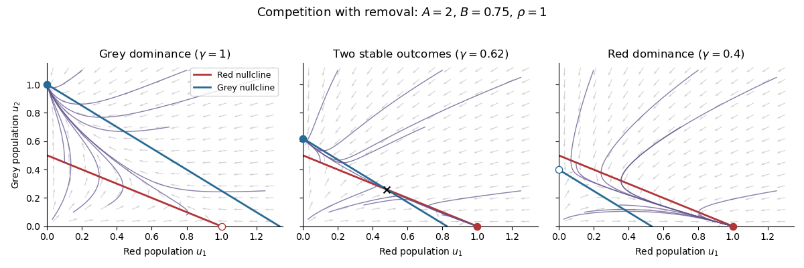

<h1 id="9/b/ii/solution">Solution</h1>

↑ **Parent:** [Ii](../ii.md)

The non-axis [nullclines](../../../../../nullcline.md) are $u_1+Au_2=1$ and $Bu_1+u_2=1$. For $A>1$, $B<1$, the first has intercepts $(1,0),(0,1/A)$ and the second has $(1/B,0),(0,1)$. Their axis intercept order rules out a positive intersection. Below the first line $u_1$ increases and above it decreases; below the second $u_2$ increases and above it decreases. Thus $S_2$ is a [saddle point](../../../../../saddle-point.md) and $S_3=(0,1)$ is stable.

**[Figure 1](#9/b/ii/image-competition-nullclines-and-trajectories-as-grey-squirrel-removal-increases). Competition nullclines and trajectories as grey-squirrel removal increases**. Original dimensionless model plots with $A=2$, $B=0.75$, and $\rho=1$. The three panels illustrate grey dominance, bistability, and red dominance. Solid lines are the red and grey non-axis [nullclines](../../../../../nullcline.md); arrows and trajectories show the direction of motion.

For strictly positive initial populations, both coordinates stay positive and are bounded above by their individual [logistic equations](../../../../../logistic-differential-equation.md). There are no interior periodic orbits: the [Dulac function](../../../../../dulac-function.md) $1/(u_1u_2)$ makes the divergence of the multiplied vector field $-1/u_2-\rho/u_1<0$, so the [Bendixson-Dulac theorem](../../../../../bendixson-dulac-theorem.md) applies. The stable manifold of $S_2$ is the invariant red-only axis, and $S_1$ is repelling. The [phase portrait](../../../../../phase-portrait.md), or the [Poincaré-Bendixson theorem](../../../../../poincare-bendixson-theorem.md) with these boundary directions, therefore gives

$$
\boxed{(u_1,u_2)\longrightarrow(0,1)}.
$$

The qualification $u_2(0)>0$ matters: a grey population identically absent cannot drive extinction. In dimensional variables, positive grey presence leads to $N_1\to0$, $N_2\to K_2$ in this no-hunting case.

## ↑ Ancestors (13)

1. [Ii](../ii.md)
2. [B](../../b.md)
3. [9](../../../9.md)
4. [2023](../../../../2023-split.md)
5. [Past exam of the short options course of the University of Oxford](../../../../split.md)
6. [Short options course of the University of Oxford](../../../../../short-options-course-of-the-university-of-oxford.md)
7. [Year 2 of the mathematics course of the University of Oxford](../../../../../year-2-of-the-mathematics-course-of-the-university-of-oxford.md)
8. [Mathematics course of the University of Oxford](../../../../../mathematics-course-of-the-university-of-oxford.md)
9. [Undergraduate course of the University of Oxford](../../../../../undergraduate-course-of-the-university-of-oxford.md)
10. [Course of the University of Oxford](../../../../../course-of-the-university-of-oxford.md)
11. [University of Oxford](../../../../../university-of-oxford-split.md)
12. [List of universities](../../../../../list-of-universities.md)
13. [Codex Wiki](../../../../../split.md)
