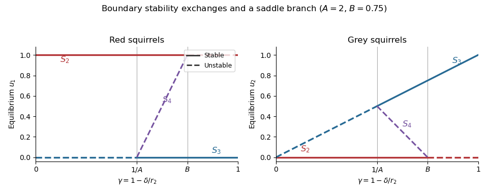

<h1 id="9/c/i/solution">Solution</h1>

↑ **Parent:** [I](../i.md)

Write $D=AB-1>0$. The physically nonnegative branches, omitting $S_1$, are

$$
\boxed{S_2=(1,0),\qquad S_3=(0,\gamma),\qquad S_4=\left(\frac{A\gamma-1}{D},\frac{B-\gamma}{D}\right)\quad(1/A\leq\gamma\leq B)}.
$$

On both [bifurcation diagrams](../../../../../bifurcation-diagram.md), draw $S_2$ solid for $\gamma<B$ and dashed for $\gamma>B$; draw $S_3$ dashed for $\gamma<1/A$ and solid for $\gamma>1/A$. The coexistence branch $S_4$ is dashed throughout its interior because it is a [saddle point](../../../../../saddle-point.md). It connects $S_3$ at $\gamma=1/A$ to $S_2$ at $\gamma=B$, through two [transcritical bifurcations](../../../../../transcritical-bifurcation.md) when the branches are continued mathematically beyond the nonnegative quadrant.

**[Figure 2](#9/c/i/image-stable-boundary-populations-and-the-unstable-coexistence-threshold). Stable boundary populations and the unstable coexistence threshold**. Original [bifurcation diagrams](../../../../../bifurcation-diagram.md) for $A=2$, $B=0.75$. Solid branches are asymptotically stable, dashed branches unstable. The physically admissible coexistence branch joins the grey-only branch at $\gamma=0.5$ to the red-only branch at $\gamma=0.75$.

## ↑ Ancestors (13)

1. [I](../i.md)
2. [C](../../c.md)
3. [9](../../../9.md)
4. [2023](../../../../2023-split.md)
5. [Past exam of the short options course of the University of Oxford](../../../../split.md)
6. [Short options course of the University of Oxford](../../../../../short-options-course-of-the-university-of-oxford.md)
7. [Year 2 of the mathematics course of the University of Oxford](../../../../../year-2-of-the-mathematics-course-of-the-university-of-oxford.md)
8. [Mathematics course of the University of Oxford](../../../../../mathematics-course-of-the-university-of-oxford.md)
9. [Undergraduate course of the University of Oxford](../../../../../undergraduate-course-of-the-university-of-oxford.md)
10. [Course of the University of Oxford](../../../../../course-of-the-university-of-oxford.md)
11. [University of Oxford](../../../../../university-of-oxford-split.md)
12. [List of universities](../../../../../list-of-universities.md)
13. [Codex Wiki](../../../../../split.md)
