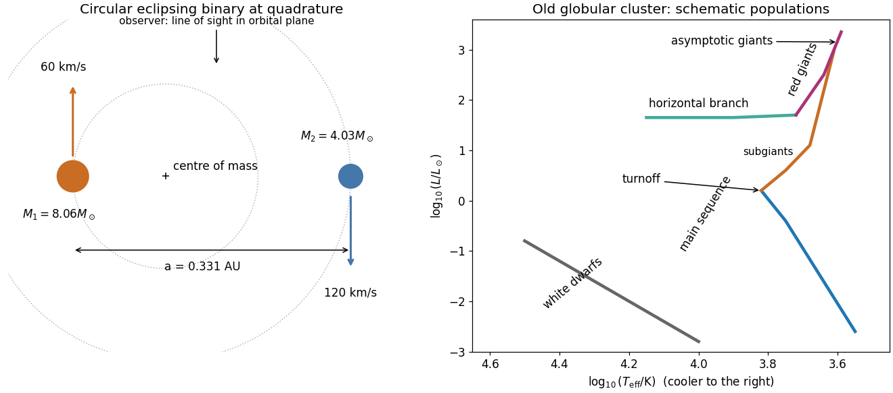
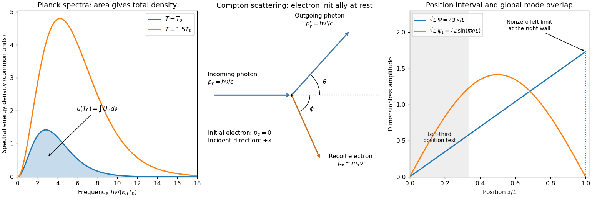

# 2019

↑ **Parent:** [Past exam of the short options paper of the physics Prelims of the University of Oxford](../past-exam-of-the-short-options-paper-of-the-physics-prelims-of-the-university-of-oxford.md)

Source paper: [https://www.whatdotheyknow.com/request/physics_preliminary_past_papers/response/2680788/attach/3/2018%202021%20Physics%20prelims.zip?cookie_passthrough=1](https://www.whatdotheyknow.com/request/physics_preliminary_past_papers/response/2680788/attach/3/2018%202021%20Physics%20prelims.zip?cookie_passthrough=1)

The cover dates this Prelims booklet to 18 June 2019, despite the archive member being filed under 2018/T. These solutions cover its three options independently of the separate Parts A/B booklet.

**Table of contents**

- [S1](#s1)
  - [1](#s1/1)
    - [a](#s1/1/a)
      - [Solution](#s1/1/a/solution)
    - [b](#s1/1/b)
      - [Solution](#s1/1/b/solution)
    - [c](#s1/1/c)
      - [Solution](#s1/1/c/solution)
    - [d](#s1/1/d)
      - [Solution](#s1/1/d/solution)
  - [2](#s1/2)
    - [a](#s1/2/a)
      - [Solution](#s1/2/a/solution)
    - [b](#s1/2/b)
      - [Solution](#s1/2/b/solution)
    - [c](#s1/2/c)
      - [Solution](#s1/2/c/solution)
    - [d](#s1/2/d)
      - [Solution](#s1/2/d/solution)
  - [3](#s1/3)
    - [a](#s1/3/a)
      - [Solution](#s1/3/a/solution)
    - [b](#s1/3/b)
      - [Solution](#s1/3/b/solution)
    - [c](#s1/3/c)
      - [Solution](#s1/3/c/solution)
    - [d](#s1/3/d)
      - [Solution](#s1/3/d/solution)
    - [e](#s1/3/e)
      - [Solution](#s1/3/e/solution)
- [S2](#s2)
  - [1](#s2/1)
    - [a](#s2/1/a)
      - [Solution](#s2/1/a/solution)
    - [b](#s2/1/b)
      - [Solution](#s2/1/b/solution)
    - [c](#s2/1/c)
      - [Solution](#s2/1/c/solution)
  - [2](#s2/2)
    - [a](#s2/2/a)
      - [Solution](#s2/2/a/solution)
    - [b](#s2/2/b)
      - [Solution](#s2/2/b/solution)
    - [c](#s2/2/c)
      - [Solution](#s2/2/c/solution)
  - [3](#s2/3)
    - [a](#s2/3/a)
      - [Solution](#s2/3/a/solution)
    - [b](#s2/3/b)
      - [Solution](#s2/3/b/solution)
    - [c](#s2/3/c)
      - [Solution](#s2/3/c/solution)
    - [d](#s2/3/d)
      - [Solution](#s2/3/d/solution)
- [S3](#s3)
  - [1](#s3/1)
    - [a](#s3/1/a)
      - [Solution](#s3/1/a/solution)
    - [b](#s3/1/b)
      - [Solution](#s3/1/b/solution)
    - [c](#s3/1/c)
      - [Solution](#s3/1/c/solution)
    - [d](#s3/1/d)
      - [Solution](#s3/1/d/solution)
    - [e](#s3/1/e)
      - [Solution](#s3/1/e/solution)
  - [2](#s3/2)
    - [a](#s3/2/a)
      - [Solution](#s3/2/a/solution)
    - [b](#s3/2/b)
      - [Solution](#s3/2/b/solution)
    - [c](#s3/2/c)
      - [Solution](#s3/2/c/solution)
    - [d](#s3/2/d)
      - [Solution](#s3/2/d/solution)
    - [e](#s3/2/e)
      - [Solution](#s3/2/e/solution)
  - [3](#s3/3)
    - [a](#s3/3/a)
      - [Solution](#s3/3/a/solution)
    - [b](#s3/3/b)
      - [Solution](#s3/3/b/solution)
    - [c](#s3/3/c)
      - [Solution](#s3/3/c/solution)
    - [d](#s3/3/d)
      - [Solution](#s3/3/d/solution)
    - [e](#s3/3/e)
      - [Solution](#s3/3/e/solution)

## S1

↑ **Parent:** [2019](2019.md)

<h3 id="s1/1">1</h3>

↑ **Parent:** [S1](#s1)

<h4 id="s1/1/a">a</h4>

↑ **Parent:** [1](#s1/1)

<h5 id="s1/1/a/solution">Solution</h5>

↑ **Parent:** [A](#s1/1/a)

A [complex derivative](../holomorphic-function.md#complex-derivative) computed along the real and imaginary directions gives $f'=u_x+iv_x=v_y-iu_y$. Equality yields the [Cauchy-Riemann equations](../analysis.md#cauchy-riemann-equations)

$$
\boxed{u_x=v_y,\qquad u_y=-v_x.}
$$

The [gradients](../multivariable-calculus.md#gradient) satisfy $\nabla u\cdot\nabla v=u_xv_x+u_yv_y=0$. Since a [gradient](../multivariable-calculus.md#gradient) is normal to a regular [level set](../topology.md#level-set), the two families meet at right angles by [orthogonality](../inner-product.md#orthogonal-vectors) wherever $f'\ne0$. At a [critical point](../analysis.md#critical-point) the regular-curve argument fails: for $f=z^2$ both [gradients](../multivariable-calculus.md#gradient) vanish at zero, so the assertion requires this qualification.

<h4 id="s1/1/b">b</h4>

↑ **Parent:** [1](#s1/1)

<h5 id="s1/1/b/solution">Solution</h5>

↑ **Parent:** [B](#s1/1/b)

Set $A=x^2-y^2$ and $B=2xy$. Direct [differentiation](../calculus.md#differentiation) gives

$$
u_{xx}=e^{-B}[(4y^2-4x^2)\sin A+(2-8xy)\cos A],\qquad
u_{yy}=e^{-B}[(4x^2-4y^2)\sin A+(8xy-2)\cos A].
$$

Their sum vanishes, proving that $u$ is a [harmonic function](../partial-differential-equation.md#harmonic-function). More generally the [Cauchy-Riemann equations](../analysis.md#cauchy-riemann-equations) give $u_{xx}+u_{yy}=v_{yx}-v_{xy}=0$ and $v_{xx}+v_{yy}=-u_{yx}+u_{xy}=0$; the [mixed partial derivatives](../multivariable-calculus.md#mixed-partial-derivative) commute because a [holomorphic function](../holomorphic-function.md) is smooth. Since $e^{iz^2}=e^{-B}(\cos A+i\sin A)$, a [harmonic conjugate](../partial-differential-equation.md#harmonic-conjugate) and the resulting [holomorphic function](../holomorphic-function.md) are

$$
\boxed{v=-e^{-2xy}\cos(x^2-y^2)+C,\qquad f(z)=-ie^{iz^2}+iC,\quad C\in\mathbb R.}
$$

These expressions also verify the [Cauchy-Riemann equations](../analysis.md#cauchy-riemann-equations) directly.

<h4 id="s1/1/c">c</h4>

↑ **Parent:** [1](#s1/1)

<h5 id="s1/1/c/solution">Solution</h5>

↑ **Parent:** [C](#s1/1/c)

The [chain rule](../calculus.md#chain-rule) in [polar coordinates](../multivariable-calculus.md#polar-coordinates) gives $u_r=u_x\cos\theta+u_y\sin\theta$ and $u_\theta=r(-u_x\sin\theta+u_y\cos\theta)$, with analogous expressions for $v$. Substituting the [Cauchy-Riemann equations](../analysis.md#cauchy-riemann-equations) gives

$$
\boxed{ru_r=v_\theta,\qquad rv_r=-u_\theta,\quad r>0.}
$$

The restriction excludes the coordinate singularity at the origin.

<h4 id="s1/1/d">d</h4>

↑ **Parent:** [1](#s1/1)

<h5 id="s1/1/d/solution">Solution</h5>

↑ **Parent:** [D](#s1/1/d)

Choose a continuous [branch of a multivalued function](../complex-analysis.md#branch-of-a-multivalued-function) of the [complex logarithm](../analysis.md#complex-logarithm) on a simply connected region avoiding zero. Then

$$
g=e^{-\theta}e^{i\ln r}=e^{i\operatorname{Log}z},\qquad
\boxed{g'(z)=\frac{i}{z}g(z).}
$$

Alternatively $u_r=-e^{-\theta}\sin(\ln r)/r=v_\theta/r$ and $v_r=e^{-\theta}\cos(\ln r)/r=-u_\theta/r$, verifying the [Cauchy-Riemann equations](../analysis.md#cauchy-riemann-equations). The [holomorphy](../holomorphic-function.md) is local to a chosen [branch of a multivalued function](../complex-analysis.md#branch-of-a-multivalued-function): increasing $\theta$ by $2\pi$ multiplies $g$ by $e^{-2\pi}$, so this is not a single-valued [holomorphic function](../holomorphic-function.md) on the whole punctured plane.

<h3 id="s1/2">2</h3>

↑ **Parent:** [S1](#s1)

<h4 id="s1/2/a">a</h4>

↑ **Parent:** [2](#s1/2)

<h5 id="s1/2/a/solution">Solution</h5>

↑ **Parent:** [A](#s1/2/a)

For $n\ge1$, $f=z^ne^{n/z}$ is [holomorphic](../holomorphic-function.md) at every finite nonzero point. At zero its [Laurent series](../analysis.md#laurent-series) has infinitely many negative powers, so zero is an [essential singularity](../isolated-singularity.md#essential-singularity). If the [Riemann sphere](../riemann-surfaces.md#riemann-sphere) is included, $f(1/w)=w^{-n}e^{nw}$ has a [pole](../isolated-singularity.md#pole) of order $n$ at $w=0$, so infinity is a [pole](../isolated-singularity.md#pole) of order $n$.

<h4 id="s1/2/b">b</h4>

↑ **Parent:** [2](#s1/2)

<h5 id="s1/2/b/solution">Solution</h5>

↑ **Parent:** [B](#s1/2/b)

Expanding the [exponential function](../calculus.md#exponential-function) produces the [Laurent series](../analysis.md#laurent-series)

$$
\boxed{f(z)=\sum_{k=0}^{\infty}\frac{n^k}{k!}z^{n-k},\qquad 0<|z|<\infty.}
$$

In particular its [residue](../analysis.md#residue) is $a_{-1}=n^{n+1}/(n+1)!$.

<h4 id="s1/2/c">c</h4>

↑ **Parent:** [2](#s1/2)

<h5 id="s1/2/c/solution">Solution</h5>

↑ **Parent:** [C](#s1/2/c)

For a positively oriented circle of any radius $R>0$, the [residue theorem](../analysis.md#residue-theorem) gives

$$
\boxed{\oint_{|z|=R}f(z)\,dz=2\pi i\frac{n^{n+1}}{(n+1)!}.}
$$

Only the $z^{-1}$ coefficient in the [Laurent series](../analysis.md#laurent-series) contributes. Reversing the [orientation](../algebraic-topology.md#orientation-of-a-simplex) changes the sign.

<h4 id="s1/2/d">d</h4>

↑ **Parent:** [2](#s1/2)

<h5 id="s1/2/d/solution">Solution</h5>

↑ **Parent:** [D](#s1/2/d)

If $f(z)=\sum a_jz^j$, then $f(-z)=\sum(-1)^ja_jz^j$ and its [residue](../analysis.md#residue) at zero is $-a_{-1}$. The circle $|z-1|=2$ encloses zero and no other finite [singularity](../complex-analysis.md#complex-singularity). Thus the [residue theorem](../analysis.md#residue-theorem) gives

$$
\boxed{\oint_{|z-1|=2}[f(z)-f(-z)]\,dz=4\pi i\frac{n^{n+1}}{(n+1)!}}
$$

for positive [orientation](../algebraic-topology.md#orientation-of-a-simplex).

<h3 id="s1/3">3</h3>

↑ **Parent:** [S1](#s1)

<h4 id="s1/3/a">a</h4>

↑ **Parent:** [3](#s1/3)

<h5 id="s1/3/a/solution">Solution</h5>

↑ **Parent:** [A](#s1/3/a)

[Cauchy's integral theorem](../complex-analysis.md#cauchy-s-integral-theorem) states that a [holomorphic function](../holomorphic-function.md) on a simply connected open region has zero [contour integral](../complex-analysis.md#contour-integral) around every closed piecewise smooth [contour](../complex-analysis.md#complex-integration-contour) in that region. More generally the same holds for a [contour](../complex-analysis.md#complex-integration-contour) homologous to zero in its domain of [holomorphy](../holomorphic-function.md). Having no singularity on the curve alone is insufficient: $1/z$ has a nonzero [contour integral](../complex-analysis.md#contour-integral) around the unit circle.

<h4 id="s1/3/b">b</h4>

↑ **Parent:** [3](#s1/3)

<h5 id="s1/3/b/solution">Solution</h5>

↑ **Parent:** [B](#s1/3/b)

Put $z=e^{i\theta}$, so $d\theta=dz/(iz)$, $\cos2\theta=(z^2+z^{-2})/2$ and $\cos^23\theta=(z^6+2+z^{-6})/4$. The [contour integral](../complex-analysis.md#contour-integral) is

$$
\frac1{4i}\oint_{|z|=1}\frac{z^8+2z^2+z^{-4}}{z(5z^2-2z^4-2)}\,dz.
$$

The enclosed [poles](../isolated-singularity.md#pole) are $0$ and $\pm1/\sqrt2$. For the rational function displayed without the prefactor $1/(4i)$, the [residue](../analysis.md#residue) at zero is $-21/8$ and the two other [residues](../analysis.md#residue) sum to $27/8$. Therefore the [residue theorem](../analysis.md#residue-theorem) gives

$$
\boxed{\int_0^{2\pi}\frac{\cos^23\theta}{5-4\cos2\theta}\,d\theta=\frac1{4i}(2\pi i)\frac34=\frac{3\pi}{8}.}
$$

A useful independent check is the [Fourier series](../fourier-series.md) $(5-4\cos\phi)^{-1}=\frac13[1+2\sum_{k\ge1}2^{-k}\cos k\phi]$; only its constant and third [Fourier coefficients](../fourier-series.md#fourier-coefficient) survive.

<h4 id="s1/3/c">c</h4>

↑ **Parent:** [3](#s1/3)

<h5 id="s1/3/c/solution">Solution</h5>

↑ **Parent:** [C](#s1/3/c)

The square root produces [branch points](../complex-analysis.md#branch-point) at $z=\pm1$, with local behaviour proportional to $(z\mp1)^{-1/2}$. One [branch cut](../analysis.md#branch-cut) can join them along $[-1,1]$. Another choice uses the two rays $(-\infty,-1]\cup[1,\infty)$. Each choice prevents a loop from enclosing just one [branch point](../complex-analysis.md#branch-point) within a single-valued domain. For the finite-segment choice fix $\sqrt{z^2-1}\sim z$ at infinity. Infinity is then a [pole](../isolated-singularity.md#pole) of order three, not a [branch point](../complex-analysis.md#branch-point), since

$$
f(z)=z^3+\frac12z+\frac{3}{8z}+O(z^{-3}).
$$

<h4 id="s1/3/d">d</h4>

↑ **Parent:** [3](#s1/3)

<h5 id="s1/3/d/solution">Solution</h5>

↑ **Parent:** [D](#s1/3/d)

Use the [branch cut](../analysis.md#branch-cut) $[-1,1]$ and the [branch of a multivalued function](../complex-analysis.md#branch-of-a-multivalued-function) normalized by $\sqrt{z^2-1}\sim z$. The [Laurent series](../analysis.md#laurent-series) from the preceding solution has $z^{-1}$ coefficient $3/8$. Consequently every sufficiently large positively oriented circle gives

$$
\boxed{\oint_{C_\infty}f(z)\,dz=\frac{3\pi i}{4}.}
$$

Although $f$ grows cubically, its other [Laurent series](../analysis.md#laurent-series) terms have zero [contour integral](../complex-analysis.md#contour-integral). Choosing the opposite [branch of a multivalued function](../complex-analysis.md#branch-of-a-multivalued-function) reverses the sign; neither the [branch of a multivalued function](../complex-analysis.md#branch-of-a-multivalued-function) nor the [orientation](../algebraic-topology.md#orientation-of-a-simplex) can be omitted from the answer.

<h4 id="s1/3/e">e</h4>

↑ **Parent:** [3](#s1/3)

<h5 id="s1/3/e/solution">Solution</h5>

↑ **Parent:** [E](#s1/3/e)

Shrink the positive outer [contour](../complex-analysis.md#complex-integration-contour) to the [branch cut](../analysis.md#branch-cut) $[-1,1]$. On its upper bank the chosen [branch of a multivalued function](../complex-analysis.md#branch-of-a-multivalued-function) has $\sqrt{x^2-1}=i\sqrt{1-x^2}$ and on the lower bank it has the negative of this value. The upper bank runs from $1$ to $-1$, and the lower bank runs from $-1$ to $1$. The endpoint circles contribute $O(\sqrt\epsilon)$ and vanish. Hence

$$
\frac{3\pi i}{4}=2i\int_{-1}^1\frac{x^4}{\sqrt{1-x^2}}\,dx,\qquad
\boxed{\int_{-1}^1\frac{x^4}{\sqrt{1-x^2}}\,dx=\frac{3\pi}{8}.}
$$

The [change of variables](../multivariable-calculus.md#change-of-variables-formula) $x=\sin t$ independently reduces the result to the [integral](../integral.md) of $\sin^4t$ over $[-\pi/2,\pi/2]$.

## S2

↑ **Parent:** [2019](2019.md)

<h3 id="s2/1">1</h3>

↑ **Parent:** [S2](#s2)

<h4 id="s2/1/a">a</h4>

↑ **Parent:** [1](#s2/1)

<h5 id="s2/1/a/solution">Solution</h5>

↑ **Parent:** [A](#s2/1/a)

[Kepler's third law](../mathematical-physics.md#kepler-s-third-law) for two [point masses](../classical-mechanics.md#point-mass) in a [Newtonian gravitational field](../newton-s-law-of-universal-gravitation.md#newtonian-gravitational-field) is

$$
\boxed{P^2=\frac{4\pi^2a^3}{G(M_1+M_2)}.}
$$

Here $a$ is the [semimajor axis](../celestial-mechanics.md#semi-major-axis) of their relative [orbit](../dynamical-systems.md#orbit-dynamical-system), $P$ the [orbital period](../celestial-mechanics.md#orbital-period) and $G$ the [gravitational constant](../newton-s-law-of-universal-gravitation.md#gravitational-constant). Equivalently $(P/\mathrm{yr})^2=(a/\mathrm{AU})^3/[(M_1+M_2)/M_\odot]$, to the accuracy with which these astronomical units normalize the [solar mass](../stellar-astrophysics.md#solar-mass).

<h4 id="s2/1/b">b</h4>

↑ **Parent:** [1](#s2/1)

<h5 id="s2/1/b/solution">Solution</h5>

↑ **Parent:** [B](#s2/1/b)

Assume a circular [orbit](../dynamical-systems.md#orbit-dynamical-system) and an [orbital inclination](../celestial-mechanics.md#orbital-inclination) $i\simeq90^\circ$, as appropriate for a simple [eclipsing binary](../stellar-astrophysics.md#eclipsing-binary) estimate. At quadrature the two [radial velocities](../euler-equations-for-an-inviscid-fluid.md#radial-velocity) are opposite and equal to the [orbital speeds](../celestial-mechanics.md#orbital-speed). The more massive component has the smaller amplitude. With the [centre of mass](../classical-mechanics.md#center-of-mass) as origin,

$$
a_1=\frac{K_1P}{2\pi},\quad a_2=\frac{K_2P}{2\pi},\quad a=a_1+a_2,\quad \frac{M_1}{M_2}=\frac{K_2}{K_1}=2.
$$

Thus $a_1=0.1103\,\mathrm{AU}$, $a_2=0.2206\,\mathrm{AU}$ and [Kepler's third law](../mathematical-physics.md#kepler-s-third-law) gives

$$
\boxed{a=0.3309\,\mathrm{AU},\quad M_1=8.06M_\odot,\quad M_2=4.03M_\odot.}
$$

The [orbital plane](../celestial-mechanics.md#orbital-plane) contains the observer's line of sight; at quadrature the two [velocities](../classical-mechanics.md#velocity) point towards and away from that observer, as labelled in the original schematic below. For an [elliptic orbit](../celestial-mechanics.md#elliptic-orbit), the measured amplitudes instead give $a\sin i=P(K_1+K_2)\sqrt{1-e^2}/(2\pi)$; the numerical answer requires the circular assumption.

**[Figure 1](#s2/1/b/image-binary-geometry-and-an-old-globular-cluster-hertzsprung-russell-diagram-both-panels-are-schematic). Binary geometry and an old globular-cluster Hertzsprung-Russell diagram; both panels are schematic**.

<h4 id="s2/1/c">c</h4>

↑ **Parent:** [1](#s2/1)

<h5 id="s2/1/c/solution">Solution</h5>

↑ **Parent:** [C](#s2/1/c)

Adopt the approximate [mass-luminosity relation](../stellar-structure.md#mass-luminosity-relation) $L/L_\odot\simeq(M/M_\odot)^3$ and equal available fuel fractions. The [main-sequence lifetime](../stellar-astrophysics.md#main-sequence-lifetime) then scales as $M/L$, giving

$$
\boxed{t_1\simeq1.54\times10^8\,\mathrm{yr},\qquad t_2\simeq6.16\times10^8\,\mathrm{yr}.}
$$

Using an exponent $3.5$ instead gives about $5.4\times10^7$ and $3.1\times10^8$ years; these are model-dependent estimates. At $r=3r_s=6GM/c^2$ the [Newtonian gravitational potential energy](../newton-s-law-of-universal-gravitation.md#newtonian-gravitational-potential-energy) released from infinity is $GMm/r=mc^2/6$. Half remains as [kinetic energy](../energy.md#kinetic-energy) in a circular [orbit](../dynamical-systems.md#orbit-dynamical-system), so the radiatable [binding energy](../energy.md#binding-energy) is $GMm/(2r)$:

$$
\boxed{\eta_{\rm Newtonian}=\frac1{12}\simeq8.3\%.}
$$

Using the whole [potential energy](../energy.md#potential-energy) loss would give $1/6$, which does not subtract the final [kinetic energy](../energy.md#kinetic-energy). A fully relativistic calculation for a nonrotating [black hole](../black-hole.md) gives $1-\sqrt{8/9}\simeq5.7\%$. When the surviving star exhausts [hydrogen burning](../stellar-astrophysics.md#hydrogen-burning), it expands off the [main sequence](../stellar-astrophysics.md#main-sequence) and can fill its [Roche lobe](../stellar-astrophysics.md#roche-lobe). [Binary mass transfer](../stellar-astrophysics.md#binary-mass-transfer) to the [black hole](../black-hole.md) can form an [accretion disk](../astrophysical-disk.md#accretion-disk) and an [X-ray binary](../stellar-astrophysics.md#x-ray-binary); unstable [binary mass transfer](../stellar-astrophysics.md#binary-mass-transfer) may instead produce a [common envelope](../stellar-astrophysics.md#common-envelope). This is conditional on the [binary star](../stellar-astrophysics.md#binary-star) remaining bound after the first remnant forms. The supplied [black hole](../black-hole.md) endpoint is an assumption, not a universal outcome for an isolated $8M_\odot$ star.

<h3 id="s2/2">2</h3>

↑ **Parent:** [S2](#s2)

<h4 id="s2/2/a">a</h4>

↑ **Parent:** [2](#s2/2)

<h5 id="s2/2/a/solution">Solution</h5>

↑ **Parent:** [A](#s2/2/a)

A thin spherical shell has outward [pressure force](../pressure.md#pressure-force) $-4\pi r^2(dP/dr)dr$ and inward [gravitational force](../physics.md#gravitational-force) $GM(r)\,4\pi r^2\rho(r)dr/r^2$. [Hydrostatic equilibrium](../statistical-physics.md#hydrostatic-equilibrium) requires

$$
\boxed{\frac{dP}{dr}=-\frac{GM(r)\rho(r)}{r^2},\qquad \frac{dM}{dr}=4\pi r^2\rho(r).}
$$

A uniform-[density](../fluid-mechanics.md#density) [solar model](../stellar-structure.md#solar-model) gives $M(r)=M_\odot(r/R_\odot)^3$, $\bar\rho=3M_\odot/(4\pi R_\odot^3)$, and after [integration](../integral.md) from $R_\odot$ to zero,

$$
P_c=\frac{3GM_\odot^2}{8\pi R_\odot^4}=1.34\times10^{14}\,\mathrm{Pa},\qquad
T_c=\frac{P_c\mu m_p}{\bar\rho k_B}=6.9\times10^6\,\mathrm K\quad(\mu=0.6).
$$

Thus the appropriate orders of magnitude are $10^{14}$–$10^{16}\,\mathrm{Pa}$ and $10^7\,\mathrm K$. The uniform-[density](../fluid-mechanics.md#density) approximation underestimates the actual [central pressure](../stellar-structure.md#central-pressure) because the Sun is centrally concentrated. [Radiation pressure](../pressure.md#radiation-pressure) is neglected in applying the [ideal gas law](../ideal-gas.md#ideal-gas-law).

<h4 id="s2/2/b">b</h4>

↑ **Parent:** [2](#s2/2)

<h5 id="s2/2/b/solution">Solution</h5>

↑ **Parent:** [B](#s2/2/b)

A [free-fall timescale](../newton-s-law-of-universal-gravitation.md#free-fall-timescale) estimate follows from $R/t^2\sim GM/R^2$:

$$
\boxed{t_{\rm dyn}\sim\sqrt{\frac{R_\odot^3}{GM_\odot}}\simeq1.6\times10^3\,\mathrm s.}
$$

Falling to a central [point mass](../classical-mechanics.md#point-mass) gives the more precise factor $\pi/(2\sqrt2)$, or $1.77\times10^3\,\mathrm s$; a distributed star changes an order-one coefficient. For any spherical [mass distribution](../classical-mechanics.md#mass-distribution) with radius $R$,

$$
|\Omega|=\int_0^M\frac{Gm}{r(m)}\,dm\ge\frac GR\int_0^M m\,dm=\frac{GM^2}{2R}.
$$

The inequality is strict for an extended star; equality is approached by a thin shell at $R$. For an [monatomic gas](../ideal-gas.md#monatomic-gas) the [virial theorem](../classical-mechanics.md#virial-theorem) is $2U+\Omega=0$, so half the [gravitational potential energy](../energy.md#gravitational-energy) released by contraction heats the star and half can be radiated. The [Kelvin-Helmholtz cooling time](../stellar-astrophysics.md#kelvin-helmholtz-cooling-time) is therefore of order

$$
\boxed{t_{\rm KH}\sim\frac{GM_\odot^2}{2R_\odot L_\odot}\simeq1.6\times10^7\,\mathrm{yr}.}
$$

A uniform-[density](../fluid-mechanics.md#density) model gives $3GM^2/(10RL)\simeq9.4\times10^6\,\mathrm{yr}$. The given bound fixes a scale, rather than an exact contraction history; both estimates are far shorter than the Sun's [main-sequence lifetime](../stellar-astrophysics.md#main-sequence-lifetime).

<h4 id="s2/2/c">c</h4>

↑ **Parent:** [2](#s2/2)

<h5 id="s2/2/c/solution">Solution</h5>

↑ **Parent:** [C](#s2/2/c)

The right panel of the figure in [solution](#s2/1/b/solution) has [luminosity](../astrophysics.md#luminosity) increasing upwards and [effective temperature](../stellar-structure.md#effective-temperature) decreasing to the right. An old [globular cluster](../galaxy.md#globular-cluster) contains a low-mass [main sequence](../stellar-astrophysics.md#main-sequence), a [main-sequence turnoff](../stellar-astrophysics.md#main-sequence-turnoff), [subgiants](../stellar-astrophysics.md#subgiant), a [red giant branch](../stellar-astrophysics.md#red-giant-branch), a [horizontal branch](../stellar-astrophysics.md#horizontal-branch), an [Asymptotic giant branch](../stellar-astrophysics.md#asymptotic-giant-branch) and a faint hot [white dwarf](../stellar-astrophysics.md#white-dwarf) sequence. Its high-mass [main sequence](../stellar-astrophysics.md#main-sequence) is absent because those stars have evolved.

If a fraction $f_c=0.1$ of the star participates in [hydrogen burning](../stellar-astrophysics.md#hydrogen-burning), with initial [hydrogen mass fraction](../stellar-astrophysics.md#hydrogen-mass-fraction) $X=0.7$, the available [nuclear binding energy](../atomic-nucleus.md#nuclear-binding-energy) is $0.007f_cXM c^2$. Assuming a roughly constant [luminosity](../astrophysics.md#luminosity) and coeval stars,

$$
\boxed{t\simeq\frac{0.007f_cX(0.8M_\odot)c^2}{1.6\times10^{26}\,\mathrm W}\simeq1.39\times10^{10}\,\mathrm{yr}.}
$$

Taking the quoted core fraction as hydrogen fuel itself, $f_cX=0.1$, gives $1.98\times10^{10}\,\mathrm{yr}$. Stating the fuel convention matters: burning the whole stellar mass overestimates the age by about an order of magnitude. Evolving [luminosity](../astrophysics.md#luminosity) and detailed [stellar structure](../stellar-structure.md) are needed for an accurate age.

<h3 id="s2/3">3</h3>

↑ **Parent:** [S2](#s2)

<h4 id="s2/3/a">a</h4>

↑ **Parent:** [3](#s2/3)

<h5 id="s2/3/a/solution">Solution</h5>

↑ **Parent:** [A](#s2/3/a)

The [Milky Way](../galaxy.md#milky-way) has a thin stellar [galactic disk](../galaxy.md#galactic-disk), radius roughly $15$–$20\,\mathrm{kpc}$ and scale height about $0.3\,\mathrm{kpc}$, containing gas, dust, young and old stars, [spiral arms](../galaxy.md#spiral-arm) and most current [star formation](../stellar-astrophysics.md#star-formation). Its stellar mass is a few $10^{10}M_\odot$. A thicker, older [galactic disk](../galaxy.md#galactic-disk) has scale height around $1\,\mathrm{kpc}$ and stellar mass of order $10^{10}M_\odot$, with little cold gas.

The central [galactic bulge](../galaxy.md#galactic-bulge) and bar extend a few thousand [parsecs](../astrophysics.md#parsec) and contain about $10^{10}M_\odot$, largely older stars. The central [supermassive black hole](../astrophysical-black-hole.md#supermassive-black-hole) has mass about $4\times10^6M_\odot$ and is negligible in the total galactic budget. A diffuse old metal-poor [stellar halo](../galaxy.md#stellar-halo), extending tens to over $100\,\mathrm{kpc}$, contains [globular clusters](../galaxy.md#globular-cluster) and roughly $10^9M_\odot$ in stars. An extended [dark matter halo](../large-scale-structure-of-the-universe.md#dark-matter-halo) reaches roughly $200\,\mathrm{kpc}$ and dominates the total mass, of order $10^{12}M_\odot$. These are approximate component scales; the gaseous [galactic halo](../galaxy.md#galactic-halo) also extends beyond the stellar [galactic disk](../galaxy.md#galactic-disk).

<h4 id="s2/3/b">b</h4>

↑ **Parent:** [3](#s2/3)

<h5 id="s2/3/b/solution">Solution</h5>

↑ **Parent:** [B](#s2/3/b)

Treat the [gravitational field](../physics.md#gravitational-field) as approximately spherical. The [circular orbit](../classical-mechanics.md#circular-orbit) condition gives

$$
\boxed{M(<8\,\mathrm{kpc})=\frac{v_c^2r}{G}=9.0\times10^{10}M_\odot,\qquad \Upsilon=\frac{M/M_\odot}{L/L_\odot}=4.50.}
$$

If every star had a representative mass $m$ and obeyed $L/L_\odot=(m/M_\odot)^3$, its [mass-to-light ratio](../galaxy.md#mass-to-light-ratio) would be $(m/M_\odot)^{-2}$, giving $\boxed{m\simeq0.47M_\odot}$. This is a one-mass estimate, not an actual average inferred uniquely from the data: a [galactic stellar mass function](../galaxy.md#galaxy-stellar-mass-function), stellar remnants, dust and nonstellar mass alter the relation. The flattening of the [galactic disk](../galaxy.md#galactic-disk) also changes the spherical conversion by an order-one factor.

<h4 id="s2/3/c">c</h4>

↑ **Parent:** [3](#s2/3)

<h5 id="s2/3/c/solution">Solution</h5>

↑ **Parent:** [C](#s2/3/c)

Assume an isotropic, stationary spherical [galaxy cluster](../large-scale-structure-of-the-universe.md#galaxy-cluster). Its three-dimensional [velocity dispersion](../galaxy.md#velocity-dispersion) obeys $\langle v^2\rangle=3\sigma_{\rm los}^2$. For a uniform sphere, the [virial theorem](../classical-mechanics.md#virial-theorem) gives $3M\sigma_{\rm los}^2=3GM^2/(5R)$, hence

$$
\boxed{M_{\rm dyn}\simeq\frac{5R\sigma_{\rm los}^2}{G}=9.4\times10^{14}M_\odot.}
$$

A different [density profile](../fluid-mechanics.md#density-profile) changes the coefficient, so $10^{15}M_\odot$ is the meaningful scale. For isothermal [X-ray](../electromagnetic-radiation.md#x-ray) gas in [hydrostatic equilibrium](../statistical-physics.md#hydrostatic-equilibrium),

$$
M(r)=-\frac{k_BTr}{G\mu m_p}\frac{d\ln\rho_g}{d\ln r}.
$$

Using $\mu=0.6$ and a representative slope $-d\ln\rho_g/d\ln r=2$–$3$ at $1\,\mathrm{Mpc}$ gives $M_X\simeq(1.3$–$1.9)\times10^{15}M_\odot$. The [temperature](../temperature.md) and extent alone cannot fix this coefficient without a [density profile](../fluid-mechanics.md#density-profile). The total [luminosity](../astrophysics.md#luminosity) is $5\times10^{12}L_\odot$, so the previously inferred [mass-to-light ratio](../galaxy.md#mass-to-light-ratio) gives

$$
\boxed{M_\star\simeq4.50(5\times10^{12})M_\odot=2.25\times10^{13}M_\odot.}
$$

<h4 id="s2/3/d">d</h4>

↑ **Parent:** [3](#s2/3)

<h5 id="s2/3/d/solution">Solution</h5>

↑ **Parent:** [D](#s2/3/d)

Three physically distinct contributions are unseen [dark matter](../cosmology.md#dark-matter), hot diffuse [intracluster gas](../large-scale-structure-of-the-universe.md#intracluster-medium) omitted from the summed stellar [mass](../classical-mechanics.md#mass), and faint stars or [stellar remnants](../stellar-astrophysics.md#stellar-remnant) missed by transferring the [Milky Way](../galaxy.md#milky-way) [mass-to-light ratio](../galaxy.md#mass-to-light-ratio) to the cluster. The first two are actual additional components; the third changes the inferred stellar budget. Departures from [virial equilibrium](../classical-mechanics.md#virial-equilibrium), [velocity anisotropy](../galaxy.md#velocity-anisotropy) or extra nonthermal [pressure](../pressure.md) can also bias the dynamical or [X-ray](../electromagnetic-radiation.md#x-ray) estimates, although they need not remove the discrepancy.

## S3

↑ **Parent:** [2019](2019.md)

<h3 id="s3/1">1</h3>

↑ **Parent:** [S3](#s3)

<h4 id="s3/1/a">a</h4>

↑ **Parent:** [1](#s3/1)

<h5 id="s3/1/a/solution">Solution</h5>

↑ **Parent:** [A](#s3/1/a)

A [blackbody](../astrophysics.md#blackbody) is an ideal body that absorbs all incident [electromagnetic radiation](../electromagnetic-radiation.md), at every [frequency](../wave.md#frequency) and direction. Its [absorptivity](../astrophysics.md#absorptivity) is one, so [Kirchhoff's law of thermal radiation](../astrophysics.md#kirchhoff-s-law-of-thermal-radiation) makes its equilibrium [emissivity](../heat.md#emissivity) one as well. At a specified [temperature](../temperature.md) its thermal [spectrum](../linear-operator-theory.md#spectrum-functional-analysis) is universal: it depends on [temperature](../temperature.md), not material or shape. This does not mean it looks black when hot; it can glow brightly while remaining a perfect absorber.

A small hole in a nearly isothermal opaque cavity approximates a [blackbody](../astrophysics.md#blackbody), because radiation entering the hole undergoes many interactions before it could escape. In [thermal equilibrium](../thermal-equilibrium.md) the cavity contains an approximately isotropic [Planck spectrum](../statistical-physics.md#blackbody-spectrum). The emitted [radiance](../radiometry.md#radiance) follows [Planck's law](../statistical-physics.md#planck-s-law), its integrated outward [radiant exitance](../radiometry.md#radiant-exitance) follows the [Stefan–Boltzmann law](../heat.md#stefan-boltzmann-law), and its wavelength peak follows [Wien's displacement law](../astrophysics.md#wien-s-displacement-law). A real surface can have wavelength- and direction-dependent [emissivity](../heat.md#emissivity) below this ideal limit.

<h4 id="s3/1/b">b</h4>

↑ **Parent:** [1](#s3/1)

<h5 id="s3/1/b/solution">Solution</h5>

↑ **Parent:** [B](#s3/1/b)

The constants are the [Planck constant](../quantum-mechanics.md#planck-constant) $h$, photon [frequency](../wave.md#frequency) $\nu$, [speed of light](../special-relativity.md#speed-of-light) $c$, [Boltzmann constant](../thermodynamics.md#boltzmann-constant) $k_B$ and absolute [temperature](../temperature.md) $T$. The supplied $U_\nu$ is a [spectral energy density](../statistical-physics.md#spectral-energy-density), with units $\mathrm{J\,m^{-3}\,Hz^{-1}}$. It describes equilibrium radiation per volume and frequency interval, rather than emitted [power](../energy.md#power) itself. For isotropic cavity radiation the corresponding surface [spectral radiant exitance](../radiometry.md#spectral-radiant-exitance) is $M_\nu=cU_\nu/4$.

At low [frequency](../wave.md#frequency) the curve rises as $\nu^2$; it has one positive maximum and an exponentially decaying high-frequency tail. The left panel below shades the area $u(T)=\int_0^\infty U_\nu\,d\nu$ under one curve. Put $x=h\nu/(k_BT)$; then

$$
U_\nu=\frac{8\pi(k_BT)^3}{h^2c^3}\frac{x^3}{e^x-1},\qquad d\nu=\frac{k_BT}{h}\,dx.
$$

The remaining dimensionless [integral](../integral.md) is independent of [temperature](../temperature.md), so

$$
\boxed{u(T)\propto T^4,\qquad M(T)=\frac c4u(T)=\sigma T^4.}
$$

Thus doubling [temperature](../temperature.md) doubles the characteristic frequency scale, raises the spectrum's height by eight and increases its area by sixteen. Total emitted [energy](../energy.md) also depends on emitting [area](../differential-geometry.md#surface-area) and elapsed time.

**[Figure 2](#s3/1/b/image-planck-spectral-energy-density-compton-scattering-geometry-and-square-well-state-amplitudes). Planck spectral energy density, Compton scattering geometry and square-well state amplitudes**.

<h4 id="s3/1/c">c</h4>

↑ **Parent:** [1](#s3/1)

<h5 id="s3/1/c/solution">Solution</h5>

↑ **Parent:** [C](#s3/1/c)

For $x=h\nu/(k_BT)\ll1$, the [Taylor expansion](../calculus.md#taylor-expansion) $e^x-1=x+O(x^2)$ gives the [Rayleigh-Jeans law](../astrophysics.md#rayleigh-jeans-law) for equilibrium radiation,

$$
\boxed{U_\nu\simeq\frac{8\pi k_BT\nu^2}{c^3}.}
$$

This is the classical limit: each electromagnetic mode has mean thermal [energy](../energy.md) approximately $k_BT$. Extending it to arbitrarily large [frequencies](../wave.md#frequency) would give a divergent integrated [energy density](../statistical-physics.md#energy-density), the [ultraviolet catastrophe](../astrophysics.md#ultraviolet-catastrophe).

For $x\gg1$, $e^x-1\simeq e^x$, giving the [Wien approximation](../astrophysics.md#wien-approximation)

$$
\boxed{U_\nu\simeq\frac{8\pi h\nu^3}{c^3}e^{-h\nu/(k_BT)}.}
$$

[Planck's quantum hypothesis](../statistical-physics.md#planck-s-quantum-hypothesis) assigns equally spaced mode energies $E_n=nh\nu$. When the spacing is small relative to $k_BT$, many levels are occupied and the classical approximation works. When $h\nu\gg k_BT$, exciting even one quantum is exponentially unlikely, suppressing the high-frequency tail. The single expression $\langle E\rangle=h\nu/(e^x-1)$ contains both limits. Comparing [temperature](../temperature.md) directly to $h\nu$ would be dimensionally incorrect; the low-temperature condition means $k_BT\ll h\nu$.

<h4 id="s3/1/d">d</h4>

↑ **Parent:** [1](#s3/1)

<h5 id="s3/1/d/solution">Solution</h5>

↑ **Parent:** [D](#s3/1/d)

First convert from a [spectral energy density](../statistical-physics.md#spectral-energy-density) per unit [frequency](../wave.md#frequency) to one per unit [wavelength](../wave-equation.md#wavelength), including the [Jacobian matrix and determinant](../multivariable-calculus.md#jacobian-matrix-and-determinant):

$$
U_\lambda=U_\nu\left|\frac{d\nu}{d\lambda}\right|=\frac{8\pi hc}{\lambda^5}\frac1{e^{hc/(\lambda k_BT)}-1}.
$$

Set $dU_\lambda/d\lambda=0$ and define $x=hc/(\lambda k_BT)$. The nonzero maximum satisfies $5(1-e^{-x})=x$, with numerical root $x=4.96511$. Consequently

$$
\boxed{\lambda_{\max}T=\frac{hc}{4.96511k_B}=2.89777\times10^{-3}\,\mathrm{m\,K}.}
$$

This is [Wien's displacement law](../astrophysics.md#wien-s-displacement-law). One must maximize the wavelength density, rather than find the frequency maximum and merely put $\lambda=c/\nu_{\max}$: the [frequency and wavelength peaks of Planck's law](../statistical-physics.md#frequency-and-wavelength-peaks-of-planck-s-law) are different because a spectral density changes under a change of coordinate.

<h4 id="s3/1/e">e</h4>

↑ **Parent:** [1](#s3/1)

<h5 id="s3/1/e/solution">Solution</h5>

↑ **Parent:** [E](#s3/1/e)

Using the stipulated $570\,\mathrm{nm}$ as a wavelength-density peak, [Wien's displacement law](../astrophysics.md#wien-s-displacement-law) gives

$$
\boxed{T_{\rm inferred}=\frac{0.002897}{570\times10^{-9}}\simeq5.08\times10^3\,\mathrm K.}
$$

This is a rough estimate from the supplied characteristic [wavelength](../wave-equation.md#wavelength), not an accurate measurement of the Sun's [effective temperature](../stellar-structure.md#effective-temperature). The Sun emits a broad, approximately thermal visible [spectrum](../linear-operator-theory.md#spectrum-functional-analysis) and appears white outside the atmosphere; its familiar yellow appearance does not identify a monochromatic thermal peak. A photospheric [effective temperature](../stellar-structure.md#effective-temperature) near $5770\,\mathrm K$ instead corresponds to a wavelength-density maximum near $502\,\mathrm{nm}$.[Statement that the Sun emits all visible colours and appears white](../physics-bibliography.md#sun-colouring-page-by-nasa-space-place)[Surface temperature approximately 5770 K](../physics-bibliography.md#solar-physics-facts-by-nasa-marshall)

The core must be much hotter to provide the [pressure](../pressure.md) required for [hydrostatic equilibrium](../statistical-physics.md#hydrostatic-equilibrium) and to sustain [nuclear fusion](../physics.md#nuclear-fusion). Outward [energy transport](../stellar-structure.md#energy-transport) through an opaque interior proceeds down a [temperature gradient](../heat.md#temperature-gradient), by [radiative diffusion](../astrophysics.md#radiative-diffusion) and then [convection](../convection.md) through much of the outer envelope. The observable [photosphere](../stellar-structure.md#photosphere) radiates to space at the temperature needed to carry the solar [luminosity](../astrophysics.md#luminosity), $L_\odot=4\pi R_\odot^2\sigma T_{\rm eff}^4$; it is not an unobstructed view of the hot core. The printed core estimate above $20$ million degrees is also too high for the present Sun: the standard central [temperature](../temperature.md) is about $1.56\times10^7\,\mathrm K$. This correction leaves the large core-to-surface contrast and its explanation intact.[Central temperature approximately 15,600,000 K](../physics-bibliography.md#solar-physics-facts-by-nasa-marshall)

<h3 id="s3/2">2</h3>

↑ **Parent:** [S3](#s3)

<h4 id="s3/2/a">a</h4>

↑ **Parent:** [2](#s3/2)

<h5 id="s3/2/a/solution">Solution</h5>

↑ **Parent:** [A](#s3/2/a)

[Compton scattering](../mathematical-physics.md#compton-scattering) transfers [energy](../energy.md) and [momentum](../momentum.md) from a photon to an electron. For an initially stationary, approximately free [electron](../physics.md#electron), a photon scattered through a nonzero angle generally has lower [frequency](../wave.md#frequency) and longer [wavelength](../wave-equation.md#wavelength); the recoiling electron carries the difference. The effect demonstrates the photon [momentum](../momentum.md) $p_\gamma=h\nu/c=h/\lambda$, beyond a purely elastic classical scattering description.

The middle panel of the figure in [solution](#s3/1/b/solution) shows the incident photon along $+x$, the outgoing photon at angle $\theta$ above that direction, and the recoiling [electron](../physics.md#electron) at deflection angle $\phi$ below it. Each arrow labels its particle and [momentum](../momentum.md); the initial electron is at rest at the interaction point. The scattered photon and electron have opposite transverse momentum components, while their forward components sum to the incident photon [momentum](../momentum.md).

<h4 id="s3/2/b">b</h4>

↑ **Parent:** [2](#s3/2)

<h5 id="s3/2/b/solution">Solution</h5>

↑ **Parent:** [B](#s3/2/b)

Take a stationary initial electron of [mass](../classical-mechanics.md#mass) $m_e$, a photon incident along $x$, and a nonrelativistic recoil [velocity](../classical-mechanics.md#velocity) of magnitude $v$. Choose $\theta$ above $x$ for the scattered photon and $\phi$ below $x$ for the electron. [Conservation of momentum](../momentum.md#momentum-conservation) gives

$$
\boxed{\frac{h\nu}{c}=\frac{h\nu'}{c}\cos\theta+m_ev\cos\phi,\qquad
0=\frac{h\nu'}c\sin\theta-m_ev\sin\phi.}
$$

The electron's unchanged rest [energy](../energy.md) cancels in [conservation of energy](../mathematical-physics.md#conservation-of-energy), leaving

$$
\boxed{h\nu=h\nu'+\frac12m_ev^2.}
$$

Equivalently use $h\nu/c=h/\lambda$ and $h\nu=hc/\lambda$. The [nonrelativistic limit](../special-relativity.md#nonrelativistic-limit) requires $v/c\ll1$, and treating the electron as free requires its binding [energy](../energy.md) to be negligible on the scale of the collision.

<h4 id="s3/2/c">c</h4>

↑ **Parent:** [2](#s3/2)

<h5 id="s3/2/c/solution">Solution</h5>

↑ **Parent:** [C](#s3/2/c)

For complete photon backscatter $\theta=\pi$, the electron recoils forward and [momentum conservation](../momentum.md#momentum-conservation) gives

$$
m_ev=h\left(\frac1\lambda+\frac1{\lambda'}\right).
$$

Combining this with [conservation of energy](../mathematical-physics.md#conservation-of-energy) and writing $\Delta\lambda=\lambda'-\lambda$ gives

$$
\frac{hc\Delta\lambda}{\lambda\lambda'}=\frac{h^2}{2m_e}\left(\frac1\lambda+\frac1{\lambda'}\right)^2,
\quad
\Delta\lambda=\frac{h}{2m_ec}\frac{(\lambda+\lambda')^2}{\lambda\lambda'}.
$$

For $\Delta\lambda\ll\lambda,\lambda'$, the final ratio is approximately four, so

$$
\boxed{\Delta\lambda\simeq\frac{2h}{m_ec}=2\lambda_C\simeq4.85\times10^{-12}\,\mathrm m.}
$$

Within the stated nonrelativistic equations the unsimplified relation is implicit and has higher-order recoil corrections; the displayed final approximation is all that the small-shift assumption supports. Exact relativistic [Compton recoil kinematics](../mathematical-physics.md#compton-recoil-kinematics) gives $\Delta\lambda=(h/m_ec)(1-\cos\theta)$, and therefore exactly $2\lambda_C$ at backscatter. Agreement at leading order does not make the nonrelativistic derivation exact at arbitrary photon [energy](../energy.md).

<h4 id="s3/2/d">d</h4>

↑ **Parent:** [2](#s3/2)

<h5 id="s3/2/d/solution">Solution</h5>

↑ **Parent:** [D](#s3/2/d)

The ordinary electron [Compton wavelength](../mathematical-physics.md#compton-wavelength) is

$$
\boxed{\lambda_C=\frac{h}{m_ec}=2.4263\times10^{-12}\,\mathrm m.}
$$

A photon of that [wavelength](../wave-equation.md#wavelength) has [energy](../energy.md) equal to the electron rest [energy](../energy.md), $hc/\lambda_C=m_ec^2$. It therefore sets the characteristic scale at which photon recoil cannot generally be treated nonrelativistically, and it sets the magnitude of the [Compton wavelength shift](../mathematical-physics.md#compton-wavelength-shift). The reduced [Compton wavelength](../mathematical-physics.md#compton-wavelength), $\bar\lambda_C=\hbar/(m_ec)=\lambda_C/(2\pi)$, is a related but different convention. Localization on this reduced scale needs momenta of order $m_ec$, so a nonrelativistic single-particle description becomes inadequate. Neither wavelength is a measured geometrical radius of the electron.

<h4 id="s3/2/e">e</h4>

↑ **Parent:** [2](#s3/2)

<h5 id="s3/2/e/solution">Solution</h5>

↑ **Parent:** [E](#s3/2/e)

Retain the backscattering geometry from part (c). With $\lambda=10\,\mathrm{nm}$, $\lambda'=\lambda+2\lambda_C$ differs from $\lambda$ by only $4.85\times10^{-4}$ of its value. [Momentum conservation](../momentum.md#momentum-conservation) gives

$$
v\simeq\frac{h}{m_e}\left(\frac1\lambda+\frac1{\lambda'}\right)\simeq\frac{2h}{m_e\lambda},\qquad
\boxed{v\simeq1.45\times10^5\,\mathrm{m\,s^{-1}},\quad\frac vc\simeq4.85\times10^{-4}.}
$$

The Lorentz-factor correction is of order $v^2/c^2\simeq2.4\times10^{-7}$, so the electron recoil is safely nonrelativistic. Its [kinetic energy](../energy.md#kinetic-energy) is only about $0.060\,\mathrm{eV}$, compared with incoming photon [energy](../energy.md) about $124\,\mathrm{eV}$. This validates the free-electron recoil approximation's relativistic aspect; actual binding or thermal motion in matter can require separate corrections. No larger recoil occurs at another scattering angle for the same initial photon.

<h3 id="s3/3">3</h3>

↑ **Parent:** [S3](#s3)

<h4 id="s3/3/a">a</h4>

↑ **Parent:** [3](#s3/3)

<h5 id="s3/3/a/solution">Solution</h5>

↑ **Parent:** [A](#s3/3/a)

Inside the [infinite square well](../quantum-mechanics.md#infinite-square-well), $V=0$, and the [time-independent Schrödinger equation](../mathematical-physics.md#time-independent-schrodinger-equation) is

$$
-\frac{\hbar^2}{2m}\frac{d^2\psi}{dx^2}=E\psi,\qquad\psi(0)=\psi(L)=0.
$$

For $E>0$, write $k^2=2mE/\hbar^2$ and $\psi=A\sin kx+B\cos kx$. The first [Dirichlet boundary condition](../differential-equation.md#dirichlet-boundary-condition) gives $B=0$, and the second requires $kL=n\pi$ for a nonzero state. The case $n=0$ is identically zero; negative $n$ only changes an overall [quantum phase](../quantum-system.md#quantum-phase). For $E=0$ a linear solution satisfying both walls is zero, and for $E<0$ the hyperbolic solutions likewise cannot satisfy both walls nontrivially.

[Wavefunction normalization](../wave-function.md#wavefunction-normalization), $\int_0^L|\psi|^2dx=1$, fixes $|A|=\sqrt{2/L}$. The orthonormal [energy eigenstates](../energy-eigenvalue.md#energy-eigenstate) and [energy eigenvalues](../energy-eigenvalue.md) are therefore

$$
\boxed{\psi_n(x)=\sqrt{\frac2L}\sin\frac{n\pi x}L,\qquad E_n=\frac{n^2\pi^2\hbar^2}{2mL^2},\qquad n=1,2,\ldots.}
$$

Each state vanishes outside the well. Its stationary time-dependent form is $\Psi_n(x,t)=\psi_n(x)e^{-iE_nt/\hbar}$. General states are normalized [superpositions](../vector-space.md#superposition-principle) of these modes, rather than additional single [energy eigenstates](../energy-eigenvalue.md#energy-eigenstate).

<h4 id="s3/3/b">b</h4>

↑ **Parent:** [3](#s3/3)

<h5 id="s3/3/b/solution">Solution</h5>

↑ **Parent:** [B](#s3/3/b)

Assume the given [wavefunction](../wave-function.md) is zero outside $[0,L]$. [Wavefunction normalization](../wave-function.md#wavefunction-normalization) requires

$$
1=\int_0^L|Nx|^2dx=|N|^2\frac{L^3}{3},\qquad
\boxed{|N|=\sqrt{\frac3{L^3}}.}
$$

An arbitrary overall [quantum phase](../quantum-system.md#quantum-phase) is unobservable, so choose the positive real representative $N=\sqrt3/L^{3/2}$.

The [linear ramp state in an infinite square well](../quantum-mechanics.md#linear-ramp-state-in-an-infinite-square-well) has a boundary subtlety: the limiting value at $L$ is $\sqrt{3/L}$, rather than zero. The function is still a normalized element of the well's [Hilbert space](../hilbert-space.md) $L^2(0,L)$, so [position measurement](../quantum-measurement.md#position-measurement) and energy-projection probabilities are meaningful. It is not in the domain of the Dirichlet [Hamiltonian](../hamiltonian-mechanics.md#hamiltonian), nor is it a finite-energy box state. Altering the value at the single endpoint does not cure its nonzero boundary trace; a physical finite-energy preparation must smooth the function to zero near the wall. The following probabilities refer to the supplied idealized state.

<h4 id="s3/3/c">c</h4>

↑ **Parent:** [3](#s3/3)

<h5 id="s3/3/c/solution">Solution</h5>

↑ **Parent:** [C](#s3/3/c)

Apply the position version of the [Born rule](../wave-function.md#born-rule) to the normalized [wavefunction](../wave-function.md):

$$
\boxed{\Pr(0\le x\le L/3)=\int_0^{L/3}|\Psi(x)|^2dx=\frac3{L^3}\left[\frac{x^3}{3}\right]_0^{L/3}=\frac1{27}\simeq0.0370.}
$$

The result is independent of $L$ because the state and the measurement interval scale together. Most [position probability](../wave-function.md#position-probability) lies towards the right wall, since the [probability density](../wave-function.md#probability-density) grows as $x^2$.

<h4 id="s3/3/d">d</h4>

↑ **Parent:** [3](#s3/3)

<h5 id="s3/3/d/solution">Solution</h5>

↑ **Parent:** [D](#s3/3/d)

An [energy measurement](../wave-function.md#energy-measurement) selects the [ground state](../quantum-mechanics.md#ground-state) with [probability](../probability-theory.md#probability) equal to the squared [inner product](../inner-product.md) with $\psi_1$. Using $N=\sqrt3/L^{3/2}$ and [integration by parts](../calculus.md#integration-by-parts),

$$
c_1=\int_0^L\psi_1(x)^*\Psi(x)\,dx=\frac{\sqrt6}{L^2}\int_0^Lx\sin\frac{\pi x}L\,dx
=\frac{\sqrt6}{\pi}.
$$

Thus

$$
\boxed{\Pr(E=E_1)=|c_1|^2=\frac6{\pi^2}\simeq0.6079.}
$$

The full [Fourier sine series](../fourier-series.md#fourier-sine-series) has $c_n=(-1)^{n+1}\sqrt6/(n\pi)$, so $\sum_n|c_n|^2=(6/\pi^2)\sum_n n^{-2}=1$, an independent [wavefunction normalization](../wave-function.md#wavefunction-normalization) check. However $E_n|c_n|^2=3\hbar^2/(mL^2)$ for every $n$, hence $\sum_nE_n|c_n|^2$ diverges. This explicitly verifies the infinite-[energy expectation](../quantum-measurement.md#energy-expectation) qualification in part (b), without invalidating the individual projection [probabilities](../probability-theory.md#probability).

<h4 id="s3/3/e">e</h4>

↑ **Parent:** [3](#s3/3)

<h5 id="s3/3/e/solution">Solution</h5>

↑ **Parent:** [E](#s3/3/e)

The two [probabilities](../probability-theory.md#probability) concern different [quantum measurements](../quantum-measurement.md), so there is no requirement that they match or that one bound the other. The spatial interval $[0,L/3]$ contains little of the state: its [probability density](../wave-function.md#probability-density) is smallest near zero and increases towards $L$. By contrast, the positive [ground state](../quantum-mechanics.md#ground-state) extends across the whole well. It has substantial same-sign overlap with the positive linear [wavefunction](../wave-function.md), with no cancellation between lobes in the overlap [integral](../integral.md). The right panel of the figure in [solution](#s3/1/b/solution) illustrates these two amplitudes and marks the small position interval.

Consequently a large global [ground-state probability](../quantum-mechanics.md#ground-state-probability) can coexist with a small probability of finding the particle in the left third. This is not because the [ground state](../quantum-mechanics.md#ground-state) is spatially confined to that third; a ground-state particle can be found throughout the well. In operator language the two events are projections onto a spatial subspace and onto one [energy eigenstate](../energy-eigenvalue.md#energy-eigenstate), respectively.

## ↑ Ancestors (9)

1. [Past exam of the short options paper of the physics Prelims of the University of Oxford](../past-exam-of-the-short-options-paper-of-the-physics-prelims-of-the-university-of-oxford.md)
2. [Short options paper of the physics Prelims of the University of Oxford](../university-of-oxford.md#short-options-paper-of-the-physics-prelims-of-the-university-of-oxford)
3. [Year 1 of the physics course of the University of Oxford](../university-of-oxford.md#year-1-of-the-physics-course-of-the-university-of-oxford)
4. [Physics course of the University of Oxford](../university-of-oxford.md#physics-course-of-the-university-of-oxford)
5. [Undergraduate course of the University of Oxford](../university-of-oxford.md#undergraduate-course-of-the-university-of-oxford)
6. [Course of the University of Oxford](../university-of-oxford.md#course-of-the-university-of-oxford)
7. [University of Oxford](../university-of-oxford.md)
8. [List of universities](../README.md#list-of-universities)
9. [Codex Wiki](../README.md)
