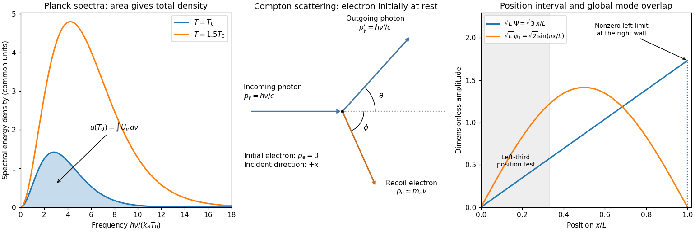

<h1 id="s3/1/b/solution">Solution</h1>

↑ **Parent:** [B](../b.md)

The constants are the [Planck constant](../../../../../planck-constant.md) $h$, photon [frequency](../../../../../frequency.md) $\nu$, [speed of light](../../../../../speed-of-light.md) $c$, [Boltzmann constant](../../../../../boltzmann-constant.md) $k_B$ and absolute [temperature](../../../../../temperature-split.md) $T$. The supplied $U_\nu$ is a [spectral energy density](../../../../../spectral-energy-density.md), with units $\mathrm{J\,m^{-3}\,Hz^{-1}}$. It describes equilibrium radiation per volume and frequency interval, rather than emitted [power](../../../../../power.md) itself. For isotropic cavity radiation the corresponding surface [spectral radiant exitance](../../../../../spectral-radiant-exitance.md) is $M_\nu=cU_\nu/4$.

At low [frequency](../../../../../frequency.md) the curve rises as $\nu^2$; it has one positive maximum and an exponentially decaying high-frequency tail. The left panel below shades the area $u(T)=\int_0^\infty U_\nu\,d\nu$ under one curve. Put $x=h\nu/(k_BT)$; then

$$
U_\nu=\frac{8\pi(k_BT)^3}{h^2c^3}\frac{x^3}{e^x-1},\qquad d\nu=\frac{k_BT}{h}\,dx.
$$

The remaining dimensionless [integral](../../../../../integral-split.md) is independent of [temperature](../../../../../temperature-split.md), so

$$
\boxed{u(T)\propto T^4,\qquad M(T)=\frac c4u(T)=\sigma T^4.}
$$

Thus doubling [temperature](../../../../../temperature-split.md) doubles the characteristic frequency scale, raises the spectrum's height by eight and increases its area by sixteen. Total emitted [energy](../../../../../energy-split.md) also depends on emitting [area](../../../../../surface-area.md) and elapsed time.

**[Figure 2](#s3/1/b/image-planck-spectral-energy-density-compton-scattering-geometry-and-square-well-state-amplitudes). Planck spectral energy density, Compton scattering geometry and square-well state amplitudes**.

## ↑ Ancestors (13)

1. [B](../b.md)
2. [1](../../1.md)
3. [S3](../../../s3.md)
4. [2019](../../../../2019-split.md)
5. [Past exam of the short options paper of the physics Prelims of the University of Oxford](../../../../split.md)
6. [Short options paper of the physics Prelims of the University of Oxford](../../../../../short-options-paper-of-the-physics-prelims-of-the-university-of-oxford.md)
7. [Year 1 of the physics course of the University of Oxford](../../../../../year-1-of-the-physics-course-of-the-university-of-oxford.md)
8. [Physics course of the University of Oxford](../../../../../physics-course-of-the-university-of-oxford.md)
9. [Undergraduate course of the University of Oxford](../../../../../undergraduate-course-of-the-university-of-oxford.md)
10. [Course of the University of Oxford](../../../../../course-of-the-university-of-oxford.md)
11. [University of Oxford](../../../../../university-of-oxford-split.md)
12. [List of universities](../../../../../list-of-universities.md)
13. [Codex Wiki](../../../../../split.md)

## ← Incoming links (2)

- [Solution](../../2/a/solution.md)
- [Solution](../../3/e/solution.md)
