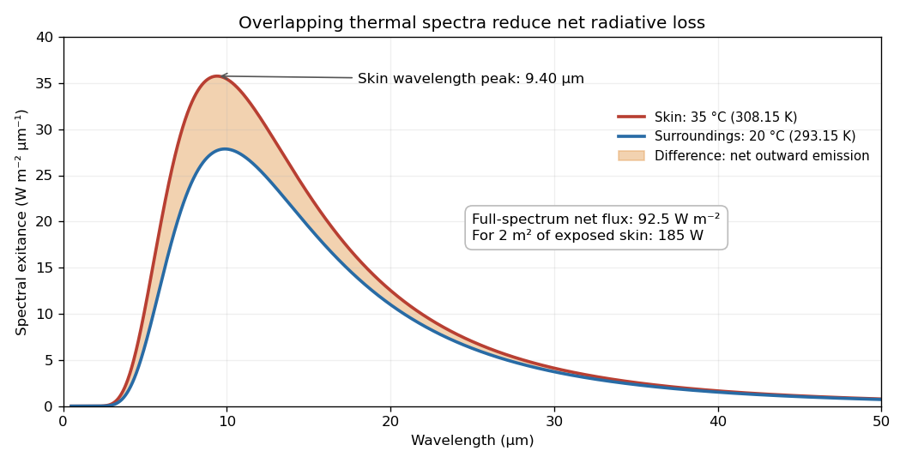

# 2021

↑ **Parent:** [Past exam of the short options paper of the physics Prelims of the University of Oxford](../past-exam-of-the-short-options-paper-of-the-physics-prelims-of-the-university-of-oxford.md)

Source paper: [public source PDF, pages 79–86](https://www.whatdotheyknow.com/request/oxford_physics_past_papers_2/response/2340696/attach/9/Physics%20Papers%202020.pdf?cookie_passthrough=1). The cover identifies the examination as 2021 despite the archive filename. Solutions cover all three options. The damaged source diagram leaves the numerical results in S02 1(b) and 1(d) incomplete.

**Table of contents**

- [S01](#s01)
  - [1](#s01/1)
    - [a](#s01/1/a)
      - [Solution](#s01/1/a/solution)
    - [b](#s01/1/b)
      - [Solution](#s01/1/b/solution)
    - [c](#s01/1/c)
      - [Solution](#s01/1/c/solution)
    - [d](#s01/1/d)
      - [Solution](#s01/1/d/solution)
  - [2](#s01/2)
    - [a](#s01/2/a)
      - [Solution](#s01/2/a/solution)
    - [b](#s01/2/b)
      - [Solution](#s01/2/b/solution)
    - [c](#s01/2/c)
      - [Solution](#s01/2/c/solution)
  - [3](#s01/3)
    - [a](#s01/3/a)
      - [Solution](#s01/3/a/solution)
    - [b](#s01/3/b)
      - [Solution](#s01/3/b/solution)
    - [c](#s01/3/c)
      - [Solution](#s01/3/c/solution)
    - [d](#s01/3/d)
      - [Solution](#s01/3/d/solution)
- [S02](#s02)
  - [1](#s02/1)
    - [a](#s02/1/a)
      - [Solution](#s02/1/a/solution)
    - [b](#s02/1/b)
      - [Solution](#s02/1/b/solution)
    - [c](#s02/1/c)
      - [Solution](#s02/1/c/solution)
    - [d](#s02/1/d)
      - [Solution](#s02/1/d/solution)
  - [2](#s02/2)
    - [a](#s02/2/a)
      - [Solution](#s02/2/a/solution)
    - [b](#s02/2/b)
      - [Solution](#s02/2/b/solution)
    - [c](#s02/2/c)
      - [Solution](#s02/2/c/solution)
  - [3](#s02/3)
    - [a](#s02/3/a)
      - [Solution](#s02/3/a/solution)
    - [b](#s02/3/b)
      - [Solution](#s02/3/b/solution)
    - [c](#s02/3/c)
      - [Solution](#s02/3/c/solution)
    - [d](#s02/3/d)
      - [Solution](#s02/3/d/solution)
- [S03](#s03)
  - [1](#s03/1)
    - [a](#s03/1/a)
      - [Solution](#s03/1/a/solution)
    - [b](#s03/1/b)
      - [Solution](#s03/1/b/solution)
    - [c](#s03/1/c)
      - [Solution](#s03/1/c/solution)
    - [d](#s03/1/d)
      - [Solution](#s03/1/d/solution)
    - [e](#s03/1/e)
      - [Solution](#s03/1/e/solution)
    - [f](#s03/1/f)
      - [Solution](#s03/1/f/solution)
    - [g](#s03/1/g)
      - [Solution](#s03/1/g/solution)
  - [2](#s03/2)
    - [a](#s03/2/a)
      - [Solution](#s03/2/a/solution)
    - [b](#s03/2/b)
      - [Solution](#s03/2/b/solution)
    - [c](#s03/2/c)
      - [Solution](#s03/2/c/solution)
    - [d](#s03/2/d)
      - [Solution](#s03/2/d/solution)
    - [e](#s03/2/e)
      - [Solution](#s03/2/e/solution)
  - [3](#s03/3)
    - [a](#s03/3/a)
      - [Solution](#s03/3/a/solution)
    - [b](#s03/3/b)
      - [Solution](#s03/3/b/solution)
    - [c](#s03/3/c)
      - [Solution](#s03/3/c/solution)
    - [d](#s03/3/d)
      - [Solution](#s03/3/d/solution)

## S01

↑ **Parent:** [2021](2021.md)

<h3 id="s01/1">1</h3>

↑ **Parent:** [S01](#s01)

<h4 id="s01/1/a">a</h4>

↑ **Parent:** [1](#s01/1)

<h5 id="s01/1/a/solution">Solution</h5>

↑ **Parent:** [A](#s01/1/a)

The apparent [singularity](../complex-analysis.md#complex-singularity) at zero cancels: the [Taylor series](../calculus.md#taylor-series) of the [sine](../geometry-and-topology.md#sine) gives

$$
\frac{\sin z}{z^2}-\frac1z=-\frac z6+\frac{z^3}{120}-\cdots.
$$

Thus zero is a [removable singularity](../isolated-singularity.md#removable-singularity), with extension $f(0)=1/2$. At $z=-2$, the other terms are [holomorphic](../holomorphic-function.md), whereas $(z+2)^{-1}$ has a [simple pole](../isolated-singularity.md#simple-pole). Therefore

$$
\boxed{z=0:\ \text{removable},\qquad z=-2:\ \text{simple pole with residue }1.}
$$

There are no other finite [singularities](../complex-analysis.md#complex-singularity). If “all” includes the point at infinity on the [Riemann sphere](../riemann-surfaces.md#riemann-sphere), it is an [essential singularity](../isolated-singularity.md#essential-singularity): $f(1/w)=w/(1+2w)+w^2\sin(1/w)-w$ has infinitely many negative powers in its [Laurent series](../analysis.md#laurent-series) at $w=0$.

<h4 id="s01/1/b">b</h4>

↑ **Parent:** [1](#s01/1)

<h5 id="s01/1/b/solution">Solution</h5>

↑ **Parent:** [B](#s01/1/b)

The [geometric series](../sequence-and-series.md#geometric-series) for $(2+z)^{-1}$ converges for $|z|<2$, while the cancelled [sine](../geometry-and-topology.md#sine) terms have an everywhere convergent [Taylor series](../calculus.md#taylor-series). Hence the requested [Laurent series](../analysis.md#laurent-series) has no negative powers:

$$
\boxed{f(z)=\sum_{n=0}^\infty\frac{(-1)^n z^n}{2^{n+1}}+\sum_{k=1}^\infty\frac{(-1)^k z^{2k-1}}{(2k+1)!},\qquad 0<|z|<2.}
$$

For example,

$$
f(z)=\frac12-\frac{5z}{12}+\frac{z^2}{8}-\frac{13z^3}{240}+\frac{z^4}{32}+O(z^5).
$$

The extension through zero also makes this a [Taylor series](../calculus.md#taylor-series). The [pole](../isolated-singularity.md#pole) at $-2$ fixes its [radius of convergence](../sequence-and-series.md#radius-of-convergence) at two.

<h4 id="s01/1/c">c</h4>

↑ **Parent:** [1](#s01/1)

<h5 id="s01/1/c/solution">Solution</h5>

↑ **Parent:** [C](#s01/1/c)

Assume positive, counterclockwise [orientation of a contour](../complex-analysis.md#orientation-of-a-contour). Factor the [polynomial](../polynomial.md) denominator as

$$
z^4-10z^2+1=\bigl(z^2-(5-2\sqrt6)\bigr)\bigl(z^2-(5+2\sqrt6)\bigr).
$$

Only $z=\pm(\sqrt3-\sqrt2)$ lie inside the [unit circle](../complex-analysis.md#complex-unit-circle). These are [simple poles](../isolated-singularity.md#simple-pole). Writing the denominator as $P(z)$, their [residues](../analysis.md#residue) are

$$
\frac{z}{P'(z)}=\frac1{4z^2-20}=-\frac1{8\sqrt6}.
$$

The [residue theorem](../analysis.md#residue-theorem) therefore gives

$$
\boxed{I=2\pi i\left(-\frac1{4\sqrt6}\right)=-\frac{\pi i}{2\sqrt6}.}
$$

Reversing [orientation of a contour](../complex-analysis.md#orientation-of-a-contour) changes the sign.

<h4 id="s01/1/d">d</h4>

↑ **Parent:** [1](#s01/1)

<h5 id="s01/1/d/solution">Solution</h5>

↑ **Parent:** [D](#s01/1/d)

Parametrize the positively oriented [unit circle](../complex-analysis.md#complex-unit-circle) by $z=e^{i\theta}$. Then $dz=iz\,d\theta$ and

$$
\frac{z^4-10z^2+1}{z^2}=2\cos(2\theta)-10=-4(2+\sin^2\theta).
$$

Consequently the [contour integral](../complex-analysis.md#contour-integral) already evaluated satisfies

$$
I=-\frac i4\int_0^{2\pi}\frac{d\theta}{2+\sin^2\theta},\qquad
\boxed{\int_0^{2\pi}\frac{d\theta}{2+\sin^2\theta}=4iI=\frac{2\pi}{\sqrt6}.}
$$

<h3 id="s01/2">2</h3>

↑ **Parent:** [S01](#s01)

<h4 id="s01/2/a">a</h4>

↑ **Parent:** [2](#s01/2)

<h5 id="s01/2/a/solution">Solution</h5>

↑ **Parent:** [A](#s01/2/a)

Let $f$ be [holomorphic](../holomorphic-function.md) on a neighbourhood of a positively oriented, piecewise smooth [simple closed curve](../geometry-and-topology.md#simple-closed-curve) and its interior except at finitely many [isolated singularities](../isolated-singularity.md) $a_j$ strictly inside. The [residue theorem](../analysis.md#residue-theorem) states

$$
\boxed{\oint_\Gamma f(z)\,dz=2\pi i\sum_j\operatorname{Res}(f,a_j).}
$$

The [residue](../analysis.md#residue) is the coefficient of $(z-a_j)^{-1}$ in the local [Laurent series](../analysis.md#laurent-series). No [singularity](../complex-analysis.md#complex-singularity) may lie on the [contour](../complex-analysis.md#complex-integration-contour). For more general closed [contours](../complex-analysis.md#complex-integration-contour), each [residue](../analysis.md#residue) is multiplied by the corresponding [winding number](../complex-analysis.md#winding-number).

<h4 id="s01/2/b">b</h4>

↑ **Parent:** [2](#s01/2)

<h5 id="s01/2/b/solution">Solution</h5>

↑ **Parent:** [B](#s01/2/b)

The [poles](../isolated-singularity.md#pole) are the four roots of $z^4=-1$. The upper [half-plane](../geometry-and-topology.md#half-plane) contains $a=e^{i\pi/4}$ and $b=e^{3i\pi/4}$, both enclosed when $R>1$. At a [simple pole](../isolated-singularity.md#simple-pole) $q$,

$$
\operatorname{Res}\left(\frac{z^2}{z^4+1},q\right)=\frac{q^2}{4q^3}=\frac1{4q}.
$$

The sum of the two [residues](../analysis.md#residue) is

$$
\frac14(e^{-i\pi/4}+e^{-3i\pi/4})=-\frac{i}{2\sqrt2}.
$$

The [residue theorem](../analysis.md#residue-theorem), with the real segment traversed from $-R$ to $R$ and the upper arc from $R$ to $-R$, yields

$$
\boxed{\oint_{\Gamma_R}\frac{z^2}{z^4+1}\,dz=\frac{\pi}{\sqrt2}.}
$$

<h4 id="s01/2/c">c</h4>

↑ **Parent:** [2](#s01/2)

<h5 id="s01/2/c/solution">Solution</h5>

↑ **Parent:** [C](#s01/2/c)

On the upper semicircular [contour](../complex-analysis.md#complex-integration-contour), $|z|=R$ and the [reverse triangle inequality](../topological-analysis.md#reverse-triangle-inequality) gives $|z^4+1|\ge R^4-1>0$. Its [arc length](../riemannian-geometry.md#arc-length) is $\pi R$, so the [estimation lemma](../complex-analysis.md#estimation-lemma) gives

$$
\boxed{\left|\int_{\gamma_R}\frac{z^2}{z^4+1}\,dz\right|\le\frac{\pi R^3}{R^4-1}\longrightarrow0.}
$$

The arc is open, so an ordinary integral sign is appropriate even though the source uses a closed-integral symbol there. Subtracting the vanishing arc contribution from the closed [contour integral](../complex-analysis.md#contour-integral) gives the real-line [improper integral](../real-analysis.md#improper-integral) $\pi/\sqrt2$. Its integrand is an [even function](../calculus.md#even-function), and its tail is $O(x^{-2})$, ensuring convergence. Thus

$$
\boxed{\int_0^\infty\frac{x^2}{x^4+1}\,dx=\frac{\pi}{2\sqrt2}.}
$$

<h3 id="s01/3">3</h3>

↑ **Parent:** [S01](#s01)

<h4 id="s01/3/a">a</h4>

↑ **Parent:** [3](#s01/3)

<h5 id="s01/3/a/solution">Solution</h5>

↑ **Parent:** [A](#s01/3/a)

Use the principal [complex square root](../complex-analysis.md#complex-square-root), $\sqrt z=\sqrt r\,e^{i\theta/2}$ with $-\pi<\theta<\pi$. For $F(z)=e^{z-\sqrt z}/z$, the local expansion on this [holomorphic branch](../complex-analysis.md#holomorphic-branch) is

$$
F(z)=\frac1z-\frac1{\sqrt z}+\frac32+O(\sqrt z).
$$

The fractional power prevents a single-valued [Laurent series](../analysis.md#laurent-series) in a punctured disc. In particular, zero is a [branch point](../complex-analysis.md#branch-point), not an [isolated singularity](../isolated-singularity.md) classified as a [pole](../isolated-singularity.md#pole). Merely observing that $zF(z)\to1$ on the slit plane would not establish a [simple pole](../isolated-singularity.md#simple-pole): $zF(z)$ does not extend as a [holomorphic function](../holomorphic-function.md) through a whole disc around zero.

The negative real half-line is a chosen [branch cut](../analysis.md#branch-cut). Its upper and lower boundary values differ because $\sqrt{-x+i0}=i\sqrt x$ and $\sqrt{-x-i0}=-i\sqrt x$ for $x>0$. Continuation once around zero changes the sign of the [complex square root](../complex-analysis.md#complex-square-root), and hence changes $F$ in general. Other [branch cuts](../analysis.md#branch-cut) are possible; this one defines the principal [holomorphic branch](../complex-analysis.md#holomorphic-branch).

<h4 id="s01/3/b">b</h4>

↑ **Parent:** [3](#s01/3)

<h5 id="s01/3/b/solution">Solution</h5>

↑ **Parent:** [B](#s01/3/b)

Excise a small disc about zero and a thin slit along the negative real axis, using the orientations shown in the source: $C_1$ upwards, $C_3$ towards zero above the slit, $C_4$ clockwise around zero, and $C_5$ away from zero below the slit. On the resulting region $F$ is a single-valued [holomorphic function](../holomorphic-function.md); zero lies in the excluded disc and there are no [poles](../isolated-singularity.md#pole) in the region. [Cauchy's integral theorem](../complex-analysis.md#cauchy-s-integral-theorem) gives

$$
\boxed{\int_{C_1}F\,dz+\int_{C_2}F\,dz+\int_{C_3}F\,dz+\int_{C_4}F\,dz+\int_{C_5}F\,dz+\int_{C_6}F\,dz=0.}
$$

Here the paths on the cut mean limiting paths from its two sides. Apply [Cauchy's integral theorem](../complex-analysis.md#cauchy-s-integral-theorem) before taking those limits, when the entire [contour](../complex-analysis.md#complex-integration-contour) lies inside the slit domain.

<h4 id="s01/3/c">c</h4>

↑ **Parent:** [3](#s01/3)

<h5 id="s01/3/c/solution">Solution</h5>

↑ **Parent:** [C](#s01/3/c)

For $x>0$, the upper and lower boundary values on the [branch cut](../analysis.md#branch-cut) are

$$
F(-x+i0)=-\frac{e^{-x-i\sqrt x}}x,\qquad F(-x-i0)=-\frac{e^{-x+i\sqrt x}}x.
$$

Write $x=A_R$ for the outer endpoint distance on the cut. The upper path runs from $x=A_R$ to $x=\epsilon$, while the lower path runs back from $\epsilon$ to $A_R$; in both cases $dz=-dx$. Therefore

$$
\int_{C_3}F\,dz=-\int_\epsilon^{A_R}\frac{e^{-x-i\sqrt x}}x\,dx,\qquad
\int_{C_5}F\,dz=\int_\epsilon^{A_R}\frac{e^{-x+i\sqrt x}}x\,dx,
$$

and

$$
\boxed{\int_{C_3}F\,dz+\int_{C_5}F\,dz=2i\int_\epsilon^{A_R}e^{-x}\frac{\sin\sqrt x}{x}\,dx.}
$$

The source's limits zero and infinity require $\epsilon\to0$ and $R\to\infty$; they are not an exact identity on a finite [contour](../complex-analysis.md#complex-integration-contour). For a concrete counterexample take $\epsilon=1/4$ and $A_R=1$: the finite real integral is at most $\int_{1/4}^1x^{-1/2}\,dx=1$, whereas the full-range integral is $\pi\operatorname{erf}(1/2)\simeq1.6352$, as evaluated in the next part. Near zero the combined integrand is $O(x^{-1/2})$, so the combined [improper integral](../real-analysis.md#improper-integral) converges, although the individual cut integrals have logarithmic divergences. At infinity the factor $e^{-x}$ ensures convergence. Consequently

$$
\boxed{\lim_{R\to\infty,\,\epsilon\to0}\left(\int_{C_3}F\,dz+\int_{C_5}F\,dz\right)=2i\int_0^\infty e^{-x}\frac{\sin\sqrt x}{x}\,dx.}
$$

<h4 id="s01/3/d">d</h4>

↑ **Parent:** [3](#s01/3)

<h5 id="s01/3/d/solution">Solution</h5>

↑ **Parent:** [D](#s01/3/d)

On the small clockwise [contour](../complex-analysis.md#complex-integration-contour) $z=\epsilon e^{i\theta}$, $\theta$ decreases from $\pi$ to $-\pi$. Uniformly on that arc, $e^{z-\sqrt z}=1+O(\sqrt\epsilon)$, and hence

$$
\int_{C_4}F(z)\,dz=i\int_\pi^{-\pi}\bigl(1+O(\sqrt\epsilon)\bigr)\,d\theta\longrightarrow-2\pi i.
$$

The large arcs also vanish. To make this precise for the displayed geometry, take them on the left semicircle $z=\gamma+Re^{i\theta}$, $\pi/2\le\theta\le3\pi/2$, split at the cut. On the principal [holomorphic branch](../complex-analysis.md#holomorphic-branch), $\operatorname{Re}\sqrt z\ge0$, $|z|\ge R-\gamma$, and $\operatorname{Re}z=\gamma+R\cos\theta$. The [estimation lemma](../complex-analysis.md#estimation-lemma) gives

$$
\left|\int_{C_2\cup C_6}F\,dz\right|\le\frac{Re^\gamma}{R-\gamma}\int_{\pi/2}^{3\pi/2}e^{R\cos\theta}\,d\theta=O(R^{-1}).
$$

For the last bound, symmetry and $\sin u\ge2u/\pi$ on $0\le u\le\pi/2$ imply that the angular integral is at most $\pi/R$. The exact choice of large arcs does not affect the limiting result. The vertical [improper integral](../real-analysis.md#improper-integral) converges absolutely because $e^{-\operatorname{Re}\sqrt{\gamma+iy}}/|\gamma+iy|$ decays as $O(e^{-c\sqrt{|y|}}/|y|)$.

Taking limits in the closed [contour integral](../complex-analysis.md#contour-integral) now yields $2\pi iJ+2iK-2\pi i=0$, where $K=\int_0^\infty e^{-x}\sin(\sqrt x)\,dx/x$. Thus

$$
\boxed{J=1-\frac1\pi\int_0^\infty e^{-x}\frac{\sin\sqrt x}{x}\,dx.}
$$

As an optional explicit evaluation, put $x=t^2$ and define $K(a)=2\int_0^\infty e^{-t^2}\sin(at)\,dt/t$. [Differentiation under the integral sign](../analysis.md#differentiation-under-the-integral-sign) and the [Gaussian integral](../integral.md#gaussian-integral) give $K'(a)=\sqrt\pi e^{-a^2/4}$ and $K(0)=0$. Therefore $K=K(1)=\pi\operatorname{erf}(1/2)$ and $J=\operatorname{erfc}(1/2)\simeq0.479500$ in terms of the [error function](../integral.md#error-function) and [complementary error function](../integral.md#complementary-error-function).

## S02

↑ **Parent:** [2021](2021.md)

<h3 id="s02/1">1</h3>

↑ **Parent:** [S02](#s02)

<h4 id="s02/1/a">a</h4>

↑ **Parent:** [1](#s02/1)

<h5 id="s02/1/a/solution">Solution</h5>

↑ **Parent:** [A](#s02/1/a)

The [astronomical magnitude](../astrophysics.md#astronomical-magnitude) convention is $m_1-m_2=-2.5\log_{10}(F_1/F_2)$, with both [fluxes](../mathematical-physics.md#flux) measured through the same [photometric passband](../astrophysics.md#photometric-passband). A five-unit [magnitude difference](../astrophysics.md#magnitude-difference) therefore corresponds to

$$
\boxed{\frac{F_b}{F_f}=10^{(6-1)/2.5}=100.}
$$

The brighter endpoint has one hundred times the visual [flux](../mathematical-physics.md#flux) of the fainter endpoint. Absolute [fluxes](../mathematical-physics.md#flux) require a [magnitude zero point](../astrophysics.md#magnitude-zero-point), which is not given.

<h4 id="s02/1/b">b</h4>

↑ **Parent:** [1](#s02/1)

<h5 id="s02/1/b/solution">Solution</h5>

↑ **Parent:** [B](#s02/1/b)

**TODO: numerical endpoints require the unreadable source diagram.** Let $\ell_{V,\max}$ and $\ell_{V,\min}$ be the maximum and minimum [main sequence](../stellar-astrophysics.md#main-sequence) visual [luminosities](../astrophysics.md#luminosity), in units of the [Sun](../stellar-astrophysics.md#sun)'s visual [luminosity](../astrophysics.md#luminosity). At a distance $d$, the [inverse-square law](../physics.md#inverse-square-law) and the [magnitude difference](../astrophysics.md#magnitude-difference) relation give

$$
m_V-m_{V,\odot}=-2.5\log_{10}\left[\ell_V\left(\frac{1\,\mathrm{AU}}d\right)^2\right].
$$

Thus, using $m_{V,\odot}=-26.77$,

$$
\boxed{d(\mathrm{pc})=\frac{10^{(m_V+26.77)/5}}{206264.806}\sqrt{\ell_V}.}
$$

At the naked-eye detection threshold $m_V=6$, the greatest distances for the intrinsically brightest and faintest [main sequence](../stellar-astrophysics.md#main-sequence) stars would respectively be

$$
\boxed{d_{\max}=17.36\sqrt{\ell_{V,\max}}\,\mathrm{pc},\qquad d_{\min}=17.36\sqrt{\ell_{V,\min}}\,\mathrm{pc}.}
$$

The historical $m_V=1$ endpoint is a brightness reference, not the visibility threshold: if that endpoint were intended instead, the corresponding coefficient would be $1.736$ rather than $17.36$.

The source [Hertzsprung-Russell diagram](../stellar-astrophysics.md#hertzsprung-russell-diagram) has lost the stellar loci and [luminosity](../astrophysics.md#luminosity) scale except for a surviving top tick; neither endpoint can be read reliably. If its scale was [bolometric luminosity](../astrophysics.md#luminosity) rather than visual [luminosity](../astrophysics.md#luminosity), [bolometric corrections](../astrophysics.md#bolometric-correction) would also be needed, especially for very hot and very cool stars. Equating the two [luminosity](../astrophysics.md#luminosity) ratios would then be an explicitly approximate assumption. These missing data are not replaced by invented endpoint values. [Interstellar extinction](../galaxy.md#interstellar-extinction) is neglected in the displayed distance relation.

<h4 id="s02/1/c">c</h4>

↑ **Parent:** [1](#s02/1)

<h5 id="s02/1/c/solution">Solution</h5>

↑ **Parent:** [C](#s02/1/c)

For spherical [hydrostatic equilibrium](../statistical-physics.md#hydrostatic-equilibrium), the [stellar structure equations](../stellar-structure.md#stellar-structure-equations) include

$$
\frac{dP}{dr}=-\frac{Gm(r)\rho(r)}{r^2},\qquad \frac{dm}{dr}=4\pi r^2\rho(r).
$$

Eliminate $\rho$ to obtain $dP/dm=-Gm/(4\pi r^4)$. Since $r(m)<R_\odot$ through the interior, integration gives

$$
P_c-P_s=\int_0^{M_\odot}\frac{Gm}{4\pi r(m)^4}\,dm>\frac{G}{4\pi R_\odot^4}\int_0^{M_\odot}m\,dm.
$$

With negligible surface [pressure](../pressure.md), this proves

$$
\boxed{P_{c,\odot}>\frac{GM_\odot^2}{8\pi R_\odot^4}\simeq4.48\times10^{13}\,\mathrm{Pa}.}
$$

This is a conservative lower bound; concentrating [mass](../classical-mechanics.md#mass) near the centre increases the required [pressure](../pressure.md).

For the [temperature](../temperature.md) inference assume predominantly [ideal gas](../ideal-gas.md) support, a nearly fully ionized hydrogen–helium mixture with [mean molecular weight](../ideal-gas.md#mean-molecular-weight) $\mu\simeq0.61$, and the hottest region at the centre. A rigorous scale estimate follows from the [stellar virial theorem](../stellar-structure.md#stellar-virial-theorem), rather than substituting the mean [mass density](../fluid-mechanics.md#density) for the unknown central [mass density](../fluid-mechanics.md#density). With negligible surface [pressure](../pressure.md),

$$
3\int P\,dV=-W,\qquad -W=\int_0^{M_\odot}\frac{Gm}{r(m)}\,dm>\frac{GM_\odot^2}{2R_\odot}.
$$

The [ideal gas law](../ideal-gas.md#ideal-gas-law) gives $\int P\,dV=k_B\int T\,dm/(\mu m_p)$. The mass-weighted mean [temperature](../temperature.md) consequently obeys

$$
\boxed{T_c\ge\langle T\rangle_M>\frac{\mu m_pGM_\odot}{6k_BR_\odot}\simeq2.35\times10^6\,\mathrm K.}
$$

This establishes several million [kelvin](../temperature.md#kelvin) under the stated physical assumptions. The central [pressure](../pressure.md) inequality alone does not give a central [temperature](../temperature.md) bound without an [equation of state](../pressure.md#equation-of-state) and information about [mass density](../fluid-mechanics.md#density) or an integrated argument.

<h4 id="s02/1/d">d</h4>

↑ **Parent:** [1](#s02/1)

<h5 id="s02/1/d/solution">Solution</h5>

↑ **Parent:** [D](#s02/1/d)

**TODO: the plotted location of Procyon B is missing from the damaged source diagram.** The [Stefan–Boltzmann law](../heat.md#stefan-boltzmann-law) would determine the [stellar radius](../stellar-astrophysics.md#stellar-radius) from its [effective temperature](../stellar-structure.md#effective-temperature) and [bolometric luminosity](../astrophysics.md#luminosity):

$$
\boxed{\frac{R_B}{R_\odot}=\left(\frac{L_B}{L_\odot}\right)^{1/2}\left(\frac{T_\odot}{T_B}\right)^2.}
$$

A visual [luminosity](../astrophysics.md#luminosity) alone must first be converted with the appropriate [bolometric correction](../astrophysics.md#bolometric-correction). [Procyon B](../stellar-astrophysics.md#procyon-b) is a [white dwarf](../stellar-astrophysics.md#white-dwarf), so its small [stellar radius](../stellar-astrophysics.md#stellar-radius) and hot surface place it below the [main sequence](../stellar-astrophysics.md#main-sequence), rather than among [giant stars](../stellar-astrophysics.md#giant-star) or [supergiants](../stellar-astrophysics.md#supergiant). This classification does not supply the missing numerical coordinates. A source-based numerical [stellar radius](../stellar-astrophysics.md#stellar-radius) cannot be claimed from the surviving image.[Abstract: the companion Procyon B is identified as a DQZ white dwarf](../physics-bibliography.md#hubble-space-telescope-astrometry-of-the-procyon-system)

<h3 id="s02/2">2</h3>

↑ **Parent:** [S02](#s02)

<h4 id="s02/2/a">a</h4>

↑ **Parent:** [2](#s02/2)

<h5 id="s02/2/a/solution">Solution</h5>

↑ **Parent:** [A](#s02/2/a)

The intact source figure gives [orbital period](../celestial-mechanics.md#orbital-period) $P=6.0\,\mathrm{yr}$, stellar [radial velocity](../euler-equations-for-an-inviscid-fluid.md#radial-velocity) semiamplitude $K=30.0\,\mathrm{m\,s^{-1}}$, and [orbital eccentricity](../celestial-mechanics.md#orbital-eccentricity) $e=0$. A planetary [exoplanet transit](../exoplanet.md#exoplanet-transit) implies a nearly edge-on orbit, so $\sin i\simeq1$. Adopt a [solar mass](../stellar-astrophysics.md#solar-mass) for the [Solar-type star](../stellar-astrophysics.md#solar-analog) and initially neglect the companion's [mass](../classical-mechanics.md#mass) relative to it.

For a circular solution of the [two-body problem](../celestial-mechanics.md#two-body-problem), the star's distance from the [centre of mass](../classical-mechanics.md#center-of-mass) is $a_*=aM_p/(M_*+M_p)$, and the measured semiamplitude is $K=2\pi a_*\sin i/P$. [Kepler's third law](../mathematical-physics.md#kepler-s-third-law) gives

$$
a^3=\frac{G(M_*+M_p)P^2}{4\pi^2},\qquad
\frac{M_p^3\sin^3 i}{(M_*+M_p)^2}=\frac{PK^3}{2\pi G}.
$$

Hence

$$
\boxed{a\simeq\left(\frac{GM_\odot P^2}{4\pi^2}\right)^{1/3}=3.30\,\mathrm{AU},\qquad
M_p\simeq K\left(\frac{P}{2\pi G}\right)^{1/3}M_\odot^{2/3}=3.64\times10^{27}\,\mathrm{kg}\simeq1.92M_J.}
$$

The inferred [binary mass ratio](../stellar-astrophysics.md#binary-mass-ratio) is only $0.00183$, validating the approximation. Since $e=0$, the star–planet separation is constant and equals the orbital [semimajor axis](../celestial-mechanics.md#semi-major-axis). Without the [exoplanet transit](../exoplanet.md#exoplanet-transit), [Doppler spectroscopy](../exoplanet.md#doppler-spectroscopy) would generally give only a minimum companion [mass](../classical-mechanics.md#mass) through $M_p\sin i$.

<h4 id="s02/2/b">b</h4>

↑ **Parent:** [2](#s02/2)

<h5 id="s02/2/b/solution">Solution</h5>

↑ **Parent:** [B](#s02/2/b)

Assume uniform reradiation over the planetary surface, unit thermal [emissivity](../heat.md#emissivity), and zero [Bond albedo](../exoplanet.md#bond-albedo). The planet absorbs over its projected disc and emits over its full sphere. [Radiative equilibrium](../heat.md#radiative-equilibrium) and the [Stefan–Boltzmann law](../heat.md#stefan-boltzmann-law) give

$$
\pi R_p^2\frac{L_\odot}{4\pi a^2}=4\pi R_p^2\sigma T_p^4,\qquad
T_p=T_\odot\sqrt{\frac{R_\odot}{2a}}.
$$

Using the liquid-water range $273.15\le T_p\le373.15\,\mathrm K$ as the crude thermal criterion gives

$$
\boxed{a_{\rm in}\simeq0.562\,\mathrm{AU},\qquad a_{\rm out}\simeq1.05\,\mathrm{AU}.}
$$

For nonzero [Bond albedo](../exoplanet.md#bond-albedo) $A_B$, both radii acquire the factor $\sqrt{1-A_B}$. For example $A_B=0.3$ gives approximately $0.470$ to $0.877\,\mathrm{AU}$. An airless planet need not have uniform surface [temperature](../temperature.md); inefficient heat redistribution makes the dayside hotter and the nightside colder, so a single equilibrium [temperature](../temperature.md) is an averaging approximation.

This simple [habitable zone](../exoplanet.md#circumstellar-habitable-zone) contains the Earth's orbit under the zero-[albedo](../geophysics.md#albedo) assumption, but also contains Venus's orbit, although its [greenhouse effect](../exoplanet.md#greenhouse-effect) produces an uninhabitably hot surface. Mars lies beyond the calculated outer boundary. These comparisons show the usefulness of the orbital scale and the limitations of a [temperature](../temperature.md)-only criterion. The stipulated airless model also omits the [atmospheric pressure](../pressure.md#atmospheric-pressure) needed for stable surface liquid water: this is an effective thermal window, not a sufficient habitability condition.

<h4 id="s02/2/c">c</h4>

↑ **Parent:** [2](#s02/2)

<h5 id="s02/2/c/solution">Solution</h5>

↑ **Parent:** [C](#s02/2/c)

**Transit photometry.** A planet crossing the stellar disc produces a periodic reduction in [flux](../mathematical-physics.md#flux), approximately $\delta=(R_p/R_*)^2$ for a small, dark planet away from the limb. The [orbital period](../celestial-mechanics.md#orbital-period) and [stellar radius](../stellar-astrophysics.md#stellar-radius) allow an inferred planetary [radius](../topology.md#radius), but not its [mass](../classical-mechanics.md#mass) by this method alone. The geometric [geometric transit probability](../exoplanet.md#geometric-transit-probability) is roughly $(R_*+R_p)/a$ for a circular orbit, so the method strongly favours close orbits and large planets. Small signals compete with instrumental noise and [stellar activity](../stellar-astrophysics.md#stellar-activity); eclipsing stellar binaries and blended sources can mimic a planetary [exoplanet transit](../exoplanet.md#exoplanet-transit), and long [orbital periods](../celestial-mechanics.md#orbital-period) require long observing baselines.

**Doppler spectroscopy.** Periodic shifts of stellar [spectral lines](../stellar-astrophysics.md#spectral-line) reveal the stellar [radial velocity](../euler-equations-for-an-inviscid-fluid.md#radial-velocity) caused by motion around the [centre of mass](../classical-mechanics.md#center-of-mass). For a light companion, $K\propto M_p\sin i\,P^{-1/3}M_*^{-2/3}/\sqrt{1-e^2}$, favouring massive, short-period companions and low-mass host stars. Unknown [orbital inclination](../celestial-mechanics.md#orbital-inclination) gives a minimum [mass](../classical-mechanics.md#mass); [stellar activity](../stellar-astrophysics.md#stellar-activity), line broadening, and instrumental calibration limit precision. Long [orbital periods](../celestial-mechanics.md#orbital-period) require years of measurements.

**Direct imaging.** Spatially resolved reflected light or thermal emission separates a planet from its host. The large star–planet brightness contrast and small [angular separation](../astronomy.md#angular-separation) demand starlight suppression and precise correction of optical aberrations. The method favours wide orbits around nearby stars, and young, hot, massive planets with stronger thermal emission. Translating brightness to [mass](../classical-mechanics.md#mass) depends on planetary cooling models and age; it is difficult to image an Earth analogue close to a bright star.

<h3 id="s02/3">3</h3>

↑ **Parent:** [S02](#s02)

<h4 id="s02/3/a">a</h4>

↑ **Parent:** [3](#s02/3)

<h5 id="s02/3/a/solution">Solution</h5>

↑ **Parent:** [A](#s02/3/a)

For the estimate implied by the supplied [Hubble constant](../cosmology.md#hubble-constant), use the low-[redshift](../optics.md#redshift) [Hubble law](../cosmology.md#hubble-s-law) $D\simeq cz/H_0$. Then

$$
D_L\simeq800\,\mathrm{Mpc},\qquad D_S\simeq2000\,\mathrm{Mpc},\qquad D_{LS}\simeq1200\,\mathrm{Mpc}.
$$

With $\theta_E=\pi/10800$ radians, inversion of the [Einstein angular radius](../gravitational-lensing.md#einstein-angular-radius) relation gives

$$
\boxed{M_E=\frac{c^2\theta_E^2}{4G}\frac{D_LD_S}{D_{LS}}\simeq5.89\times10^{14}M_\odot.}
$$

The corresponding projected [Einstein radius](../gravitational-lensing.md#einstein-radius) is $R_E=D_L\theta_E\simeq233\,\mathrm{kpc}$.

This is the projected enclosed [mass](../classical-mechanics.md#mass) of the [galaxy cluster](../large-scale-structure-of-the-universe.md#galaxy-cluster), including all matter, not just its stars. Strictly, the [gravitational lensing](../gravitational-lensing.md) formula uses [angular diameter distances](../cosmology.md#angular-diameter-distance), and at $z=0.5$ the low-[redshift](../optics.md#redshift) approximation is only an estimate. An exact value requires a specified cosmological expansion history and a consistent lens-to-source [angular diameter distance](../cosmology.md#angular-diameter-distance); it cannot be determined from $H_0$ alone. The later estimates use the same distance approximation consistently.

<h4 id="s02/3/b">b</h4>

↑ **Parent:** [3](#s02/3)

<h5 id="s02/3/b/solution">Solution</h5>

↑ **Parent:** [B](#s02/3/b)

Assume [virial equilibrium](../classical-mechanics.md#virial-equilibrium), structurally homologous [early-type galaxies](../galaxy.md#early-type-galaxy), a fixed relation between the measured central [velocity dispersion](../galaxy.md#velocity-dispersion) $\sigma_c$ and the global random stellar motions, and a constant total [mass-to-light ratio](../galaxy.md#mass-to-light-ratio) $\Upsilon$. The [virial theorem](../classical-mechanics.md#virial-theorem) gives $M=k_v\sigma_c^2R_e/G$, where the dimensionless structure factor $k_v$ is common to the sample. With $\mathcal I_e$ denoting mean **linear** [surface brightness](../astrophysics.md#surface-brightness) inside the [effective radius](../galaxy.md#effective-radius), $L=2\pi R_e^2\mathcal I_e$. Thus

$$
\boxed{R_e=\frac{k_v}{2\pi G\Upsilon}\frac{\sigma_c^2}{\mathcal I_e},\qquad \log R_e=2\log\sigma_c-\log\mathcal I_e+\mathrm{constant}.}
$$

The usual observed [fundamental plane of elliptical galaxies](../galaxy.md#fundamental-plane-elliptical-galaxies) has a tilt relative to these exponents because [mass-to-light ratio](../galaxy.md#mass-to-light-ratio) varies with [stellar population](../stellar-astrophysics.md#stellar-population), chemical composition, and [dark matter](../cosmology.md#dark-matter) fraction; structural and dynamical nonhomology can also change $k_v$.

**Printed convention.** The source places the logarithm of a value expressed in $\mathrm{mag\,arcsec^{-2}}$ in the empirical fit. This differs from the usual logarithm of linear [surface brightness](../astrophysics.md#surface-brightness). If $\mu_e$ is the quoted magnitude [surface brightness](../astrophysics.md#surface-brightness),

$$
\log_{10}\frac{\mathcal I_e}{L_{V,\odot}\,\mathrm{pc^{-2}}}=-0.4(\mu_e-M_{V,\odot}-21.572).
$$

A coefficient $-0.8$ on $\log\mathcal I_e$ therefore becomes $+0.32$ on $\mu_e$, with an adjusted intercept; it does **not** become $-0.8\log\mu_e$. For a concrete distinction, changing $\mu_e$ from 20 to 25 decreases linear [surface brightness](../astrophysics.md#surface-brightness) by a factor 100, so the linear-intensity fit changes $R_e$ by $100^{0.8}\simeq39.8$, whereas the literal printed logarithm changes it by $(25/20)^{-0.8}\simeq0.837$.

The following part evaluates the printed numerical fit literally and labels that convention. If the fit was intended for linear [surface brightness](../astrophysics.md#surface-brightness), its calibration must be specified; a conditional result for using the same coefficients with linear units is also given. No equality between these two conventions is assumed.

<h4 id="s02/3/c">c</h4>

↑ **Parent:** [3](#s02/3)

<h5 id="s02/3/c/solution">Solution</h5>

↑ **Parent:** [C](#s02/3/c)

Evaluate the source's printed logarithm using the numerical magnitude value 21.0, with base-ten [logarithms](../calculus.md#logarithm):

$$
\log_{10}\frac{R_e}{\mathrm{kpc}}=1.3\log_{10}(250)-0.8\log_{10}(21)-1.36=0.69955,
\qquad \boxed{R_e\simeq5.01\,\mathrm{kpc}.}
$$

This is the literal printed-fit convention identified above. Convert the mean visual [surface brightness](../astrophysics.md#surface-brightness) to a linear [luminosity](../astrophysics.md#luminosity) per projected [area](../differential-geometry.md#surface-area). At 10 [parsecs](../astrophysics.md#parsec), one square [arcsecond](../geometry-and-topology.md#arcsecond) subtends $100/(206264.806)^2\,\mathrm{pc^2}$. The definition of [absolute magnitude](../astrophysics.md#absolute-magnitude) consequently gives

$$
\frac{\mathcal I_e}{L_{V,\odot}\,\mathrm{pc^{-2}}}=10^{-0.4(\mu_e-M_{V,\odot}-21.572)}
=10^{-0.4(21.0-4.8-21.572)}\simeq140.9.
$$

The constant $21.572=5\log_{10}(206264.806)-5$ is the conversion between the angular and physical projected [area](../differential-geometry.md#surface-area). Since the [effective radius](../galaxy.md#effective-radius) encloses half the total [luminosity](../astrophysics.md#luminosity),

$$
\boxed{L_V=2\pi R_e^2\mathcal I_e\simeq2.22\times10^{10}L_{V,\odot}.}
$$

For the stipulated [stellar population](../stellar-astrophysics.md#stellar-population) of [Solar-type stars](../stellar-astrophysics.md#solar-analog), approximate the stellar [mass-to-light ratio](../galaxy.md#mass-to-light-ratio) by $M_\odot/L_{V,\odot}$. Summing 100 such galaxies then gives

$$
\boxed{M_{*,\mathrm{cluster}}\simeq100\frac{L_V}{L_{V,\odot}}M_\odot=2.22\times10^{12}M_\odot.}
$$

This assumes negligible [interstellar extinction](../galaxy.md#interstellar-extinction) and that the supplied [surface brightness](../astrophysics.md#surface-brightness) is an intrinsic or already corrected value; an observed cosmological [surface brightness](../astrophysics.md#surface-brightness) requires additional dimming and passband corrections before this conversion.

For comparison only, if the empirical coefficients and intercept were instead meant for $\log_{10}(\mathcal I_e/[L_{V,\odot}\,\mathrm{pc^{-2}}])$, substituting $140.9$ in that fit would give $R_e=1.09\,\mathrm{kpc}$, $L_V=1.06\times10^9L_{V,\odot}$, and $M_{*,\mathrm{cluster}}=1.06\times10^{11}M_\odot$. Those are conditional alternative results, not an unannounced correction of the printed units.

<h4 id="s02/3/d">d</h4>

↑ **Parent:** [3](#s02/3)

<h5 id="s02/3/d/solution">Solution</h5>

↑ **Parent:** [D](#s02/3/d)

The [gravitational lensing](../gravitational-lensing.md) [mass](../classical-mechanics.md#mass) includes [dark matter](../cosmology.md#dark-matter), hot intracluster gas, stars, and any other material in the projected aperture. Most is not stellar: in the literal convention above the stellar fraction is only $2.22\times10^{12}/(5.89\times10^{14})\simeq0.00376$.

Assume the cluster shares the cosmic [cosmic baryon fraction](../cosmology.md#cosmic-baryon-fraction), $f_b=\Omega_b/\Omega_m=1/6$, and compare the same aperture for all components. Then

$$
M_b\simeq\frac16M_E=9.82\times10^{13}M_\odot,\qquad
\boxed{M_{\rm gas}\simeq\frac16M_E-M_*\simeq9.60\times10^{13}M_\odot.}
$$

Neglecting stars entirely would give $9.82\times10^{13}M_\odot$. Thus the assumed hot gas dominates the [baryonic matter](../cosmology.md#baryonic-matter), and the remainder $M_{\rm DM}\simeq(5/6)M_E=4.91\times10^{14}M_\odot$ is [dark matter](../cosmology.md#dark-matter). The budget is consistent: stars are about $2.26\%$ of the inferred [baryonic matter](../cosmology.md#baryonic-matter), and all components sum to $M_E$.

For a thermal scale, take gas extent $R_g\simeq2R_E=465\,\mathrm{kpc}$ and mean particle [mass](../classical-mechanics.md#mass) $\mu m_p$ with $\mu\simeq0.61$ for ionized gas. A simple spherical [virial theorem](../classical-mechanics.md#virial-theorem) estimate with gas binding [energy](../energy.md) $W_g\sim-GM_EM_g/R_g$ and thermal [kinetic energy](../energy.md#kinetic-energy) $K_g=3M_gk_BT/(2\mu m_p)$ gives

$$
\boxed{T\sim\frac{\mu m_pGM_E}{3k_BR_g}\simeq1.34\times10^8\,\mathrm K,\qquad k_BT\sim12\,\mathrm{keV}.}
$$

This is the scale of a very hot, massive X-ray emitting [galaxy cluster](../large-scale-structure-of-the-universe.md#galaxy-cluster). The numerical prefactor depends on the radial [mass density](../fluid-mechanics.md#density) profile, gas distribution and boundary [pressure](../pressure.md); for example an isothermal-sphere estimate $k_BT\sim\mu m_pGM/(2R_g)$ gives about $2.0\times10^8\,\mathrm K$. Moreover $M_E$ is a projected aperture [mass](../classical-mechanics.md#mass) at $R_E$, whereas the estimate needs a spherical enclosed [mass](../classical-mechanics.md#mass) at $2R_E$; the given data do not determine that conversion. The quoted [temperature](../temperature.md) is therefore an order-of-magnitude estimate, not a uniquely measured value. Nor do the data determine the total gas [mass](../classical-mechanics.md#mass) outside the [Einstein ring](../gravitational-lensing.md#einstein-ring) without a profile. The gas budget above pertains to the matched aperture under the cosmic-fraction assumption.

## S03

↑ **Parent:** [2021](2021.md)

<h3 id="s03/1">1</h3>

↑ **Parent:** [S03](#s03)

<h4 id="s03/1/a">a</h4>

↑ **Parent:** [1](#s03/1)

<h5 id="s03/1/a/solution">Solution</h5>

↑ **Parent:** [A](#s03/1/a)

A [blackbody](../astrophysics.md#blackbody) absorbs all incident [electromagnetic radiation](../electromagnetic-radiation.md), at every [frequency](../wave.md#frequency), direction and polarization: its absorptivity is one. In [thermal equilibrium](../thermal-equilibrium.md), [Kirchhoff's law of thermal radiation](../astrophysics.md#kirchhoff-s-law-of-thermal-radiation) makes its [emissivity](../heat.md#emissivity) one as well. Its emitted [spectrum](../linear-operator-theory.md#spectrum-functional-analysis) depends only on its absolute [temperature](../temperature.md), through [Planck's law](../statistical-physics.md#planck-s-law), rather than on the material of its surface.

A small aperture in a large isothermal cavity approximates a [blackbody](../astrophysics.md#blackbody) because radiation entering it undergoes many reflections and is very unlikely to escape before absorption. The equilibrium [radiation field](../wave-equation.md#radiation-field) is isotropic and unpolarized. The total emitted [radiant exitance](../radiometry.md#radiant-exitance) is $\sigma T^4$ by the [Stefan–Boltzmann law](../heat.md#stefan-boltzmann-law); the peak of the wavelength [spectrum](../linear-operator-theory.md#spectrum-functional-analysis) shifts to shorter [wavelengths](../wave-equation.md#wavelength) as [temperature](../temperature.md) increases according to [Wien's displacement law](../astrophysics.md#wien-s-displacement-law). An ideal absorber can therefore glow brightly when hot: “black” describes absorption, not the absence of thermal emission.

<h4 id="s03/1/b">b</h4>

↑ **Parent:** [1](#s03/1)

<h5 id="s03/1/b/solution">Solution</h5>

↑ **Parent:** [B](#s03/1/b)

Here $h$ is the [Planck constant](../quantum-mechanics.md#planck-constant), $\nu$ is the radiation [frequency](../wave.md#frequency), $c$ is the [speed of light](../special-relativity.md#speed-of-light) in vacuum, $k_B$ is the [Boltzmann constant](../thermodynamics.md#boltzmann-constant), and $T$ is the absolute [temperature](../temperature.md) in [kelvin](../temperature.md#kelvin). The quantity $U_\nu$ is spectral [energy density](../statistical-physics.md#energy-density) per unit [frequency](../wave.md#frequency), so $U_\nu\,d\nu$ is [energy](../energy.md) per unit [volume](../geometry-and-topology.md#volume) in the interval $[\nu,\nu+d\nu]$, and $h\nu/(k_BT)$ is dimensionless.

<h4 id="s03/1/c">c</h4>

↑ **Parent:** [1](#s03/1)

<h5 id="s03/1/c/solution">Solution</h5>

↑ **Parent:** [C](#s03/1/c)

Put $x=h\nu/(k_BT)=hc/(\lambda k_BT)$. In the long-[wavelength](../wave-equation.md#wavelength) limit $x\ll1$, the [Taylor expansion](../calculus.md#taylor-expansion) $e^x-1=x+O(x^2)$ in [Planck's law](../statistical-physics.md#planck-s-law) gives the [Rayleigh-Jeans law](../astrophysics.md#rayleigh-jeans-law),

$$
\boxed{U_\nu\simeq\frac{8\pi k_BT}{c^3}\nu^2.}
$$

This is the classical [equipartition theorem](../canonical-ensemble.md#equipartition-theorem) result: each electromagnetic mode carries mean [energy](../energy.md) $k_BT$. Extending it to arbitrarily high [frequency](../wave.md#frequency) would make the total [energy density](../statistical-physics.md#energy-density) diverge, the [ultraviolet catastrophe](../astrophysics.md#ultraviolet-catastrophe).

In the short-[wavelength](../wave-equation.md#wavelength) limit $x\gg1$, $e^x-1\simeq e^x$, giving the [Wien approximation](../astrophysics.md#wien-approximation),

$$
\boxed{U_\nu\simeq\frac{8\pi h}{c^3}\nu^3e^{-h\nu/(k_BT)}.}
$$

Large [photon energies](../quantum-mechanics.md#photon-energy) are thermally suppressed, removing the classical high-[frequency](../wave.md#frequency) divergence.

If the requested “form” is expressed per unit [wavelength](../wave-equation.md#wavelength), the change of variables includes its [Jacobian determinant](../multivariable-calculus.md#jacobian-determinant): $U_\lambda=U_\nu|d\nu/d\lambda|=U_\nu c/\lambda^2$. Thus

$$
U_\lambda=\frac{8\pi hc}{\lambda^5}\frac1{e^{hc/(\lambda k_BT)}-1},\qquad
\boxed{U_\lambda\simeq\begin{cases}8\pi k_BT/\lambda^4,&x\ll1,\\8\pi hc\,e^{-x}/\lambda^5,&x\gg1.\end{cases}}
$$

Substituting $\nu=c/\lambda$ without the [Jacobian determinant](../multivariable-calculus.md#jacobian-determinant) would give an incorrect spectral density.

<h4 id="s03/1/d">d</h4>

↑ **Parent:** [1](#s03/1)

<h5 id="s03/1/d/solution">Solution</h5>

↑ **Parent:** [D](#s03/1/d)

Convert the skin [temperature](../temperature.md) to $T_s=308.15\,\mathrm K$. To locate the peak per unit [wavelength](../wave-equation.md#wavelength) in [Planck's law](../statistical-physics.md#planck-s-law), write $x=hc/(\lambda k_BT)$ and maximize $x^5/(e^x-1)$. Its positive stationary point obeys

$$
5(1-e^{-x})=x,\qquad x=4.965114\ldots.
$$

This gives [Wien's displacement law](../astrophysics.md#wien-s-displacement-law), $\lambda_{\max}T=2.89777\times10^{-3}\,\mathrm{m\,K}$. Hence

$$
\boxed{\lambda_{\max}=9.40\times10^{-6}\,\mathrm m\simeq9.4\,\mathrm{\mu m},}
$$

in the thermal [infrared](../optics.md#infrared). A peak per unit [frequency](../wave.md#frequency) would occur at a different spectral position; this answer uses the conventional wavelength peak.

<h4 id="s03/1/e">e</h4>

↑ **Parent:** [1](#s03/1)

<h5 id="s03/1/e/solution">Solution</h5>

↑ **Parent:** [E](#s03/1/e)

For an ideal [blackbody](../astrophysics.md#blackbody) surface completely surrounded by an isothermal environment, the [Stefan–Boltzmann law](../heat.md#stefan-boltzmann-law) gives emitted [power](../energy.md#power) $A\sigma T_s^4$ and absorbed [power](../energy.md#power) $A\sigma T_e^4$. The net outward [radiative heat transfer](../heat.md#radiative-heat-transfer) is therefore

$$
\boxed{P_{\rm net}=A\sigma(T_s^4-T_e^4)=2(5.670374419\times10^{-8})(308.15^4-293.15^4)\simeq185\,\mathrm W.}
$$

The gross emitted [power](../energy.md#power) is about $1022\,\mathrm W$, but about $837\,\mathrm W$ is absorbed back from the surroundings. The difference, rather than the emitted term alone, is the relevant [energy](../energy.md) loss.

**[Figure 1](#s03/1/e/image-skin-and-surroundings-emit-overlapping-thermal-spectra-their-difference-gives-the-net-radiative-loss). Skin and surroundings emit overlapping thermal spectra; their difference gives the net radiative loss**.

<h4 id="s03/1/f">f</h4>

↑ **Parent:** [1](#s03/1)

<h5 id="s03/1/f/solution">Solution</h5>

↑ **Parent:** [F](#s03/1/f)

If the [temperatures](../temperature.md), exposed [area](../differential-geometry.md#surface-area), and surroundings remain fixed, the net radiated [energy](../energy.md) over one day is

$$
\boxed{E=P_{\rm net}(86400\,\mathrm s)\simeq1.60\times10^7\,\mathrm J.}
$$

Using the supplied conversion gives

$$
\boxed{E\simeq3.82\times10^6\,\mathrm{cal}=3.82\times10^3\,\mathrm{kcal}.}
$$

A dietary Calorie is one [kilocalorie](../energy.md#kilocalorie), so the result is about 3820 dietary Calories, rather than 3.82 million dietary Calories.

<h4 id="s03/1/g">g</h4>

↑ **Parent:** [1](#s03/1)

<h5 id="s03/1/g/solution">Solution</h5>

↑ **Parent:** [G](#s03/1/g)

The estimate assumes the entire $2\,\mathrm{m^2}$ surface remains exposed at $35\,{}^\circ\mathrm C$ continuously. Clothing reduces direct exposure and presents a cooler outer emitting surface; the skin [temperature](../temperature.md) also varies across the body and decreases in cooler surroundings through changes in blood flow. Body posture and nearby surfaces reduce the effective exchange [area](../differential-geometry.md#surface-area), while blankets and warm surrounding surfaces reduce net [radiative heat transfer](../heat.md#radiative-heat-transfer). These effects make the full-area, constant-[temperature](../temperature.md) daily radiative estimate too large for ordinary clothed conditions.

The unit [emissivity](../heat.md#emissivity) approximation is already fairly good for skin in the thermal [infrared](../optics.md#infrared), so reducing [emissivity](../heat.md#emissivity) alone is not the main correction. Also, [convection](../convection.md), [thermal conduction](../heat.md#thermal-conduction), and evaporation are additional channels of [heat transfer](../heat.md#heat-transfer); their existence does not subtract from the calculated radiative term. The computed number is a simplified **radiative** loss, not a complete metabolic [energy](../energy.md) budget.

<h3 id="s03/2">2</h3>

↑ **Parent:** [S03](#s03)

<h4 id="s03/2/a">a</h4>

↑ **Parent:** [2](#s03/2)

<h5 id="s03/2/a/solution">Solution</h5>

↑ **Parent:** [A](#s03/2/a)

In the [photoelectric effect](../quantum-mechanics.md#photoelectric-effect), incident light ejects [electrons](../physics.md#electron) from a material when each absorbed [photon](../quantum-mechanics.md#photon) supplies sufficient [energy](../energy.md) to overcome its [work function](../quantum-mechanics.md#work-function) $W$. [Conservation of energy](../mathematical-physics.md#conservation-of-energy) gives the maximum emitted [kinetic energy](../energy.md#kinetic-energy),

$$
\boxed{K_{\max}=h\nu-W,\qquad \nu\ge\nu_0=W/h.}
$$

At fixed [frequency](../wave.md#frequency) above threshold, increasing light [intensity](../wave.md#intensity-physics) primarily increases the electron emission rate; it does not increase $K_{\max}$ in the single-[photon](../quantum-mechanics.md#photon) regime. Emission occurs without the long accumulation delay predicted for weak classical illumination.

Classical [electromagnetism](../electromagnetism.md) distributes incident [energy](../energy.md) continuously. By itself, that picture suggests that sufficiently intense or sufficiently long illumination could eject [electrons](../physics.md#electron) at any [frequency](../wave.md#frequency), and that emitted [electron](../physics.md#electron) [energies](../energy.md) should increase with light [intensity](../wave.md#intensity-physics). It does not account for the observed threshold [frequency](../wave.md#frequency) and the linear dependence of $K_{\max}$ on [frequency](../wave.md#frequency) with slope $h$. Quantized [photon absorption](../quantum-mechanics.md#photon-absorption) accounts for all three features.

<h4 id="s03/2/b">b</h4>

↑ **Parent:** [2](#s03/2)

<h5 id="s03/2/b/solution">Solution</h5>

↑ **Parent:** [B](#s03/2/b)

The incident [photon energy](../quantum-mechanics.md#photon-energy) is

$$
E_\gamma=\frac{hc}{\lambda}=\frac{1239.841984\,\mathrm{eV\,nm}}{456\,\mathrm{nm}}=2.71895\,\mathrm{eV}.
$$

Subtracting the [work function](../quantum-mechanics.md#work-function) gives $K_{\max}=0.768952\,\mathrm{eV}=1.2320\times10^{-19}\,\mathrm J$. This is much less than the electron rest [energy](../energy.md), so nonrelativistic [kinetic energy](../energy.md#kinetic-energy) is adequate:

$$
\boxed{v_{\max}=\sqrt{\frac{2K_{\max}}{m_e}}\simeq5.20\times10^5\,\mathrm{m\,s^{-1}}.}
$$

The magnitude of the retarding [stopping potential](../quantum-mechanics.md#stopping-potential) satisfies $eV_s=K_{\max}$, so

$$
\boxed{V_s\simeq0.769\,\mathrm V.}
$$

The collector must be negative relative to the emitting surface to retard the [electrons](../physics.md#electron); the quoted number is the magnitude. Contact-potential corrections are neglected.

<h4 id="s03/2/c">c</h4>

↑ **Parent:** [2](#s03/2)

<h5 id="s03/2/c/solution">Solution</h5>

↑ **Parent:** [C](#s03/2/c)

The incident [photon](../quantum-mechanics.md#photon) rate is $\dot N_\gamma=P/(hc/\lambda)\simeq2.30\times10^{15}\,\mathrm{s^{-1}}$. The stated [quantum efficiency](../optical-instrument.md#quantum-efficiency) is $\eta=0.005$, so the emitted [electron](../physics.md#electron) rate is $\eta\dot N_\gamma\simeq1.15\times10^{13}\,\mathrm{s^{-1}}$. If all emitted [electrons](../physics.md#electron) are collected, the [photocurrent](../optical-instrument.md#photocurrent) magnitude is

$$
\boxed{I=e\eta\frac{P\lambda}{hc}\simeq1.84\times10^{-6}\,\mathrm A=1.84\,\mathrm{\mu A}.}
$$

The light [power](../energy.md#power) controls the number of events; the [work function](../quantum-mechanics.md#work-function) already determined the [kinetic energy](../energy.md#kinetic-energy) per emitted [electron](../physics.md#electron) and should not be subtracted from the [photon energy](../quantum-mechanics.md#photon-energy) when counting incident [photons](../quantum-mechanics.md#photon). Incomplete collection would reduce the measured [photocurrent](../optical-instrument.md#photocurrent) below this value.

<h4 id="s03/2/d">d</h4>

↑ **Parent:** [2](#s03/2)

<h5 id="s03/2/d/solution">Solution</h5>

↑ **Parent:** [D](#s03/2/d)

An [electron](../physics.md#electron) accelerated from negligible initial [kinetic energy](../energy.md#kinetic-energy) through $V$ gains $eV$. The largest possible single [photon energy](../quantum-mechanics.md#photon-energy) in an X-ray tube is this entire [kinetic energy](../energy.md#kinetic-energy), so the [Duane-Hunt law](../electromagnetic-radiation.md#duane-hunt-law) gives

$$
\boxed{\lambda_{\min}=\frac{hc}{eV}=\frac{1239.841984\,\mathrm{eV\,nm}}{25000\,\mathrm{eV}}=0.0496\,\mathrm{nm}=4.96\times10^{-11}\,\mathrm m.}
$$

The massive anode can absorb the required recoil [momentum](../momentum.md) with negligible recoil [energy](../energy.md); most actual events produce lower-[energy](../energy.md) [bremsstrahlung](../electromagnetic-radiation.md#bremsstrahlung) [photons](../quantum-mechanics.md#photon). The acceleration [energy](../energy.md) $eV$ is valid without approximating the electron speed nonrelativistically.

<h4 id="s03/2/e">e</h4>

↑ **Parent:** [2](#s03/2)

<h5 id="s03/2/e/solution">Solution</h5>

↑ **Parent:** [E](#s03/2/e)

Work in the initial rest frame of the free [electron](../physics.md#electron). If it absorbed a [photon](../quantum-mechanics.md#photon) of positive [energy](../energy.md) $E_\gamma$, [conservation of momentum](../momentum.md#momentum-conservation) would give the final electron [momentum](../momentum.md) magnitude $p_f=E_\gamma/c$, while [conservation of energy](../mathematical-physics.md#conservation-of-energy) would give $E_f=m_ec^2+E_\gamma$. But the final [electron](../physics.md#electron) must obey the relativistic [energy–momentum relation](../special-relativity.md#energy-momentum-relation),

$$
E_f^2=m_e^2c^4+p_f^2c^2=m_e^2c^4+E_\gamma^2.
$$

Combining these statements gives

$$
(m_ec^2+E_\gamma)^2=m_e^2c^4+E_\gamma^2
\quad\Longrightarrow\quad 2m_ec^2E_\gamma=0,
$$

which contradicts $E_\gamma>0$. Thus

$$
\boxed{\text{An isolated free electron cannot absorb a single real photon.}}
$$

The initial rest frame always exists for an [electron](../physics.md#electron), so this excludes the process in every inertial frame. [Compton scattering](../mathematical-physics.md#compton-scattering) is allowed because an outgoing [photon](../quantum-mechanics.md#photon) carries additional [energy](../energy.md) and [momentum](../momentum.md). Absorption by an [electron](../physics.md#electron) bound in matter is also possible because the rest of the system can share recoil.

<h3 id="s03/3">3</h3>

↑ **Parent:** [S03](#s03)

<h4 id="s03/3/a">a</h4>

↑ **Parent:** [3](#s03/3)

<h5 id="s03/3/a/solution">Solution</h5>

↑ **Parent:** [A](#s03/3/a)

For a [particle on a circle](../quantum-mechanics.md#particle-in-a-ring), the tangential speed is $v=r\dot\phi$, the [moment of inertia](../rigid-body-dynamics.md#moment-of-inertia) is $I=mr^2$, and the [angular momentum](../momentum.md#angular-momentum) is $L=I\dot\phi=mrv$. Hence its [kinetic energy](../energy.md#kinetic-energy) is

$$
\boxed{K=\frac12mv^2=\frac12I\dot\phi^2=\frac{L^2}{2I}=\frac{L^2}{2mr^2}.}
$$

There is no [potential energy](../energy.md#potential-energy) variation along the circle in the stated model.

<h4 id="s03/3/b">b</h4>

↑ **Parent:** [3](#s03/3)

<h5 id="s03/3/b/solution">Solution</h5>

↑ **Parent:** [B](#s03/3/b)

Replacing $L$ by the [angular momentum operator](../angular-momentum-operator.md) gives the [Hamiltonian operator](../quantum-system.md#hamiltonian-quantum-mechanics)

$$
\hat H=\frac{\hat L^2}{2I}=-\frac{\hbar^2}{2I}\frac{\partial^2}{\partial\phi^2}.
$$

The time-dependent [Schrödinger equation](../mathematical-physics.md#schrodinger-equation) is therefore

$$
\boxed{i\hbar\frac{\partial\Psi}{\partial t}=-\frac{\hbar^2}{2mr^2}\frac{\partial^2\Psi}{\partial\phi^2}.}
$$

For a [stationary state](../quantum-system.md#stationary-state), separate variables as $\Psi(\phi,t)=\psi(\phi)T(t)$. Dividing by the product separates a function of $t$ from one of $\phi$:

$$
i\hbar\frac{\dot T}{T}=-\frac{\hbar^2}{2I}\frac{\psi''}{\psi}=E.
$$

Thus $T=e^{-iEt/\hbar}$ up to a constant, and the time-independent [Schrödinger equation](../mathematical-physics.md#schrodinger-equation) is $-\hbar^2\psi''/(2I)=E\psi$.

Diagonalize the commuting [angular momentum operator](../angular-momentum-operator.md) at the same time: $-i\hbar\psi'=\ell\psi$ has solutions $Ae^{i\ell\phi/\hbar}$. A [single-valued wavefunction](../wave-function.md#single-valued-wavefunction) requires $e^{2\pi i\ell/\hbar}=1$, hence $\ell=n\hbar$ with $n\in\mathbb Z$. Normalizing with the angular probability measure $d\phi$ gives

$$
\int_0^{2\pi}|A|^2\,d\phi=1,\qquad
\boxed{\psi_n(\phi)=\frac{e^{in\phi}}{\sqrt{2\pi}},\qquad
\Psi_n(\phi,t)=\frac{e^{in\phi-iE_nt/\hbar}}{\sqrt{2\pi}},\quad n\in\mathbb Z.}
$$

These form an [orthonormal basis](../inner-product.md#orthonormal-basis) under $\int_0^{2\pi}\psi_m^*\psi_n\,d\phi=\delta_{mn}$. The [periodic boundary conditions](../differential-equation.md#periodic-boundary-conditions) apply to both the [wavefunction](../wave-function.md) and its first [derivative](../calculus.md#derivative), ensuring the physical self-adjoint [Hamiltonian operator](../quantum-system.md#hamiltonian-quantum-mechanics). For probability per [arc length](../riemannian-geometry.md#arc-length) $ds=r\,d\phi$, the normalization instead reads $\psi_n=e^{in\phi}/\sqrt{2\pi r}$; the two conventions describe the same probabilities. General states are [superpositions](../vector-space.md#superposition-principle) of these [energy eigenstates](../energy-eigenvalue.md#energy-eigenstate).

<h4 id="s03/3/c">c</h4>

↑ **Parent:** [3](#s03/3)

<h5 id="s03/3/c/solution">Solution</h5>

↑ **Parent:** [C](#s03/3/c)

Applying the [Hamiltonian operator](../quantum-system.md#hamiltonian-quantum-mechanics) to $\psi_n$ gives $\psi_n''=-n^2\psi_n$, and therefore

$$
\boxed{E_n=\frac{\hbar^2n^2}{2I}=\frac{\hbar^2n^2}{2mr^2},\qquad n\in\mathbb Z.}
$$

The [ground state](../quantum-mechanics.md#ground-state) $n=0$ has zero [kinetic energy](../energy.md#kinetic-energy). Every positive [energy level](../quantum-mechanics.md#energy-level) is of [quantum degeneracy](../quantum-mechanics.md#degenerate-energy-levels) two, because $n$ and $-n$ correspond to opposite [angular momenta](../momentum.md#angular-momentum) with equal squared magnitude.

The confinement scale suggests a tangential [momentum](../momentum.md) scale $\hbar/r$ and thus an excitation [energy](../energy.md) scale $\hbar^2/(mr^2)$, consistent with the [Heisenberg uncertainty principle](../quantum-theory.md#heisenberg-uncertainty-relation). More precisely the [de Broglie wavelength](../wave-function.md#de-broglie-wavelength) must fit an integer number of times around the circumference: $2\pi r=|n|\lambda$, so $|p|=h/\lambda=|n|\hbar/r$. This explains both the $r^{-2}$ dependence and the $n^2$ sequence.

One must not infer a nonzero [ground-state energy](../quantum-mechanics.md#ground-state-energy) by applying $\Delta\phi\Delta L\ge\hbar/2$ naively. Angle is periodic and is not a globally canonical position operator on the circle. The uniform $n=0$ [wavefunction](../wave-function.md), with $\Delta L=0$, is a concrete counterexample to that naive inequality. The ordinary Cartesian [Heisenberg uncertainty principle](../quantum-theory.md#heisenberg-uncertainty-relation) is not violated by the zero-[angular momentum](../momentum.md#angular-momentum) state.

<h4 id="s03/3/d">d</h4>

↑ **Parent:** [3](#s03/3)

<h5 id="s03/3/d/solution">Solution</h5>

↑ **Parent:** [D](#s03/3/d)

The emitted [photon energy](../quantum-mechanics.md#photon-energy) is the difference of the two [energy levels](../quantum-mechanics.md#energy-level):

$$
\Delta E=E_3-E_2=\frac{(9-4)\hbar^2}{2mr^2}=\frac{5\hbar^2}{2mr^2}.
$$

Using $E_\gamma=hc/\lambda$ gives

$$
\boxed{\lambda=\frac{2hcmr^2}{5\hbar^2}=\frac{4\pi cmr^2}{5\hbar}.}
$$

No numerical [mass](../classical-mechanics.md#mass) or [radius](../topology.md#radius) is supplied, so this is the determinate result. It is the wavelength conditional on the transition occurring. An isolated [particle on a circle](../quantum-mechanics.md#particle-in-a-ring) with no coupling would remain in its [energy eigenstate](../energy-eigenvalue.md#energy-eigenstate); a charged particle coupled to [electromagnetic radiation](../electromagnetic-radiation.md) can emit subject to its transition [selection rules](../atomic-physics.md#selection-rule). The $3\to2$ change has $\Delta n=-1$, compatible with an electric-dipole angular factor for a charged ring particle.

## ↑ Ancestors (9)

1. [Past exam of the short options paper of the physics Prelims of the University of Oxford](../past-exam-of-the-short-options-paper-of-the-physics-prelims-of-the-university-of-oxford.md)
2. [Short options paper of the physics Prelims of the University of Oxford](../university-of-oxford.md#short-options-paper-of-the-physics-prelims-of-the-university-of-oxford)
3. [Year 1 of the physics course of the University of Oxford](../university-of-oxford.md#year-1-of-the-physics-course-of-the-university-of-oxford)
4. [Physics course of the University of Oxford](../university-of-oxford.md#physics-course-of-the-university-of-oxford)
5. [Undergraduate course of the University of Oxford](../university-of-oxford.md#undergraduate-course-of-the-university-of-oxford)
6. [Course of the University of Oxford](../university-of-oxford.md#course-of-the-university-of-oxford)
7. [University of Oxford](../university-of-oxford.md)
8. [List of universities](../README.md#list-of-universities)
9. [Codex Wiki](../README.md)
