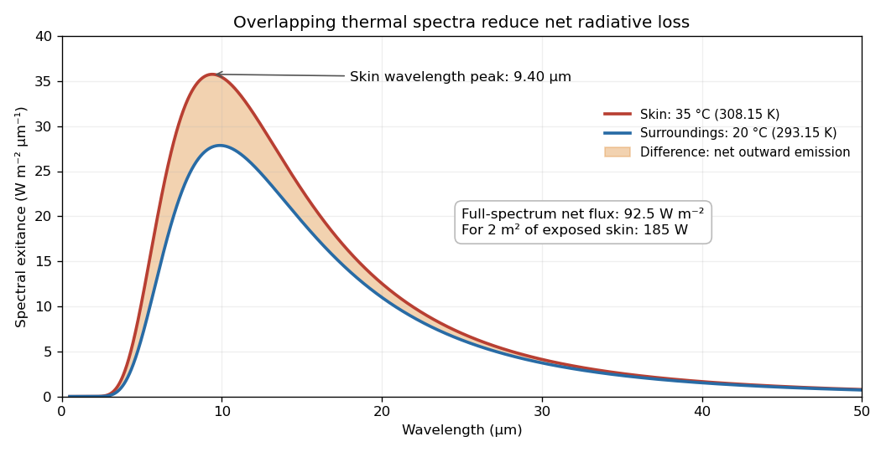

<h1 id="s03/1/e/solution">Solution</h1>

↑ **Parent:** [E](../e.md)

For an ideal [blackbody](../../../../../blackbody.md) surface completely surrounded by an isothermal environment, the [Stefan–Boltzmann law](../../../../../stefan-boltzmann-law.md) gives emitted [power](../../../../../power.md) $A\sigma T_s^4$ and absorbed [power](../../../../../power.md) $A\sigma T_e^4$. The net outward [radiative heat transfer](../../../../../radiative-heat-transfer.md) is therefore

$$
\boxed{P_{\rm net}=A\sigma(T_s^4-T_e^4)=2(5.670374419\times10^{-8})(308.15^4-293.15^4)\simeq185\,\mathrm W.}
$$

The gross emitted [power](../../../../../power.md) is about $1022\,\mathrm W$, but about $837\,\mathrm W$ is absorbed back from the surroundings. The difference, rather than the emitted term alone, is the relevant [energy](../../../../../energy-split.md) loss.

**[Figure 1](#s03/1/e/image-skin-and-surroundings-emit-overlapping-thermal-spectra-their-difference-gives-the-net-radiative-loss). Skin and surroundings emit overlapping thermal spectra; their difference gives the net radiative loss**.

## ↑ Ancestors (13)

1. [E](../e.md)
2. [1](../../1.md)
3. [S03](../../../s03.md)
4. [2021](../../../../2021-split.md)
5. [Past exam of the short options paper of the physics Prelims of the University of Oxford](../../../../split.md)
6. [Short options paper of the physics Prelims of the University of Oxford](../../../../../short-options-paper-of-the-physics-prelims-of-the-university-of-oxford.md)
7. [Year 1 of the physics course of the University of Oxford](../../../../../year-1-of-the-physics-course-of-the-university-of-oxford.md)
8. [Physics course of the University of Oxford](../../../../../physics-course-of-the-university-of-oxford.md)
9. [Undergraduate course of the University of Oxford](../../../../../undergraduate-course-of-the-university-of-oxford.md)
10. [Course of the University of Oxford](../../../../../course-of-the-university-of-oxford.md)
11. [University of Oxford](../../../../../university-of-oxford-split.md)
12. [List of universities](../../../../../list-of-universities.md)
13. [Codex Wiki](../../../../../split.md)
