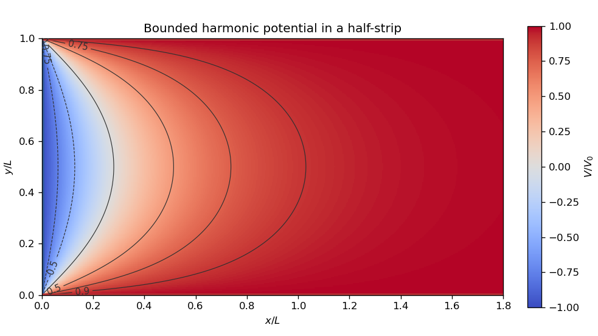

# 2022

↑ **Parent:** [Past exam of the short options paper of the physics Prelims of the University of Oxford](../past-exam-of-the-short-options-paper-of-the-physics-prelims-of-the-university-of-oxford.md)

Source: [https://www.whatdotheyknow.com/request/physics_preliminary_past_papers/response/2680788/attach/3/2018%202021%20Physics%20prelims.zip?cookie_passthrough=1](https://www.whatdotheyknow.com/request/physics_preliminary_past_papers/response/2680788/attach/3/2018%202021%20Physics%20prelims.zip?cookie_passthrough=1)

**Table of contents**

- [S01](#s01)
  - [1](#s01/1)
    - [Solution](#s01/1/solution)
  - [2](#s01/2)
    - [Solution](#s01/2/solution)
  - [3](#s01/3)
    - [Solution](#s01/3/solution)
- [S02](#s02)
  - [1](#s02/1)
    - [a](#s02/1/a)
      - [Solution](#s02/1/a/solution)
    - [b](#s02/1/b)
      - [Solution](#s02/1/b/solution)
    - [c](#s02/1/c)
      - [Solution](#s02/1/c/solution)
  - [2](#s02/2)
    - [a](#s02/2/a)
      - [Solution](#s02/2/a/solution)
    - [b](#s02/2/b)
      - [Solution](#s02/2/b/solution)
    - [c](#s02/2/c)
      - [Solution](#s02/2/c/solution)
  - [3](#s02/3)
    - [a](#s02/3/a)
      - [Solution](#s02/3/a/solution)
    - [b](#s02/3/b)
      - [Solution](#s02/3/b/solution)
    - [c](#s02/3/c)
      - [Solution](#s02/3/c/solution)
    - [d](#s02/3/d)
      - [Solution](#s02/3/d/solution)
- [S03](#s03)
  - [1](#s03/1)
    - [a](#s03/1/a)
      - [Solution](#s03/1/a/solution)
    - [b](#s03/1/b)
      - [Solution](#s03/1/b/solution)
    - [c](#s03/1/c)
      - [Solution](#s03/1/c/solution)
    - [d](#s03/1/d)
      - [Solution](#s03/1/d/solution)
    - [e](#s03/1/e)
      - [Solution](#s03/1/e/solution)
  - [2](#s03/2)
    - [a](#s03/2/a)
      - [Solution](#s03/2/a/solution)
    - [b](#s03/2/b)
      - [i](#s03/2/b/i)
        - [Solution](#s03/2/b/i/solution)
      - [ii](#s03/2/b/ii)
        - [Solution](#s03/2/b/ii/solution)
      - [iii](#s03/2/b/iii)
        - [Solution](#s03/2/b/iii/solution)
    - [c](#s03/2/c)
      - [Solution](#s03/2/c/solution)
    - [d](#s03/2/d)
      - [Solution](#s03/2/d/solution)
    - [e](#s03/2/e)
      - [Solution](#s03/2/e/solution)
    - [f](#s03/2/f)
      - [Solution](#s03/2/f/solution)
  - [3](#s03/3)
    - [a](#s03/3/a)
      - [Solution](#s03/3/a/solution)
    - [b](#s03/3/b)
      - [Solution](#s03/3/b/solution)
    - [c](#s03/3/c)
      - [Solution](#s03/3/c/solution)
    - [d](#s03/3/d)
      - [Solution](#s03/3/d/solution)
    - [e](#s03/3/e)
      - [Solution](#s03/3/e/solution)

## S01

↑ **Parent:** [2022](2022.md)

<h3 id="s01/1">1</h3>

↑ **Parent:** [S01](#s01)

<h4 id="s01/1/solution">Solution</h4>

↑ **Parent:** [1](#s01/1)

**Singularities.** The [complex exponential](../calculus.md#complex-exponential-function) factors as $F(z)=e^{z/2}e^{1/(2z)}$. The second factor has an [essential singularity](../isolated-singularity.md#essential-singularity) at zero, and multiplication by the nonvanishing [holomorphic function](../holomorphic-function.md) $e^{z/2}$ does not remove it. There are no other finite [singularities](../complex-analysis.md#complex-singularity). On the [Riemann sphere](../riemann-surfaces.md#riemann-sphere), infinity is also an [essential singularity](../isolated-singularity.md#essential-singularity), since $F(1/\zeta)=F(\zeta)$.

**Symmetry and integral formula.** The identity $F(1/z)=F(z)$ and uniqueness of the [Laurent series](../analysis.md#laurent-series) on $0<|z|<\infty$ give $F_{-k}=F_k$ for every integer $k$. The [Laurent coefficient](../analysis.md#laurent-coefficient) formula, on the positively oriented [unit circle](../complex-analysis.md#complex-unit-circle), gives

$$
F_k=\frac{1}{2\pi i}\oint_{|z|=1}F(z)z^{-k-1}\,dz
=\frac{1}{2\pi}\int_0^{2\pi}e^{\cos\theta}e^{-ik\theta}\,d\theta.
$$

The imaginary part vanishes by the substitution $\theta\mapsto2\pi-\theta$. Hence

$$
\boxed{F_k=F_{-k}=\frac{1}{2\pi}\int_0^{2\pi}e^{\cos\theta}\cos(k\theta)\,d\theta.}
$$

**Polynomial contour integral.** For an integer $n\geq0$ and integer $p$, the [binomial theorem](../binomial-coefficient.md#binomial-theorem) gives $(1+z^2)^n=\sum_{j=0}^n\binom nj z^{2j}$. The [residue theorem](../analysis.md#residue-theorem) selects $2j-n-p-1=-1$, that is $j=(n+p)/2$. Therefore the correct complete statement is

$$
\boxed{\frac{1}{2\pi i}\oint_{|z|=1}\frac{(1+z^2)^n}{z^{n+p+1}}\,dz=
\begin{cases}
\displaystyle\frac{n!}{((n-p)/2)!((n+p)/2)!},&n+p\text{ even and }|p|\leq n,\\
0,&\text{otherwise}.
\end{cases}}
$$

The printed nonnegative-integer condition alone misses $j\leq n$. For example $n=0,p=2$ satisfies that condition, but the integral is zero and the displayed factorial $(-1)!$ is undefined.

**Explicit coefficients.** Both [Taylor series](../calculus.md#taylor-series) in

$$
e^{z/2}e^{1/(2z)}=\sum_{r,s\geq0}\frac{z^{r-s}}{2^{r+s}r!s!}
$$

converge absolutely and uniformly on every compact annulus away from zero, so their product can be regrouped. For $k\geq0$, put $r=s+k$ and $s=m$. For arbitrary integer $k$, use the already proved symmetry:

$$
\boxed{F_k=\sum_{m=0}^\infty\frac{1}{2^{|k|+2m}m!(|k|+m)!}=I_{|k|}(1).}
$$

Here $I_j$ is a [modified Bessel function](../bessel-function.md#modified-bessel-function). The printed series is directly meaningful for $k\geq0$; for negative $k$ the absolute values, or an appropriately shifted lower summation limit, are essential.

<h3 id="s01/2">2</h3>

↑ **Parent:** [S01](#s01)

<h4 id="s01/2/solution">Solution</h4>

↑ **Parent:** [2](#s01/2)

**Conformality and analyticity.** Use the orientation-preserving convention for a [conformal map](../geometry-and-topology.md#conformal-map), with a continuously differentiable, nonzero differential. Its [Jacobian matrix](../multivariable-calculus.md#jacobian-matrix) must be a positive scale times a rotation,

$$
D(u,v)=\lambda\begin{pmatrix}\cos\phi&-\sin\phi\\\sin\phi&\cos\phi\end{pmatrix},\qquad\lambda>0.
$$

Thus $u_x=v_y$, $u_y=-v_x$, the [Cauchy-Riemann equations](../analysis.md#cauchy-riemann-equations); continuous partial derivatives then imply that $u+iv$ is a [holomorphic function](../holomorphic-function.md). If angle preservation is allowed to reverse orientation, the statement needs this qualification: $z\mapsto\bar z$ preserves unsigned angles but is an [anticonformal map](../geometry-and-topology.md#anticonformal-map) and is not a [holomorphic function](../holomorphic-function.md).

**The mapping.** Put $a=\pi/L$. The displayed components combine to give

$$
\boxed{w=\cosh(az),\qquad w'=a\sinh(az).}
$$

Its [derivative](../calculus.md#derivative) does not vanish in the open half-strip $x>0$, $0<y<L$, so it is a [conformal map](../geometry-and-topology.md#conformal-map) there. Also $\operatorname{Im}w=\sinh(ax)\sin(ay)>0$. The lower edge maps to $[1,\infty)$, the upper edge to $(-\infty,-1]$, and the vertical edge to $[-1,1]$. The open half-strip maps bijectively onto the [upper half-plane](../complex-analysis.md#upper-half-plane-complex-analysis). Indeed, $\cosh\zeta=\cosh\eta$ implies $\zeta=\pm\eta+2\pi i m$; the half-strip allows only equality. Surjectivity follows by solving $t+t^{-1}=2w$ and choosing the root $t=e^{az}$ with $|t|>1$ and $0<\arg t<\pi$. The two corners are boundary critical points, not interior failures of [conformality](../geometry-and-topology.md#conformality).

**Transformed boundary values.** A [conformal map](../geometry-and-topology.md#conformal-map) preserves [Laplace's equation](../partial-differential-equation.md#laplace-equation) up to a positive scale. Thus the transformed [Dirichlet problem](../analysis.md#dirichlet-problem) is to find a real [harmonic function](../partial-differential-equation.md#harmonic-function) $U(u,v)$ on $v>0$ with

$$
U(u,0)=\begin{cases}-V_0,&-1<u<1,\\V_0,&|u|>1.\end{cases}
$$

The conflicting values at the original corners are interpreted as one-sided edge limits.

**Logarithmic solution.** Choose the [complex logarithms](../analysis.md#complex-logarithm) of $w\pm1$ with arguments between zero and $\pi$ in the [upper half-plane](../complex-analysis.md#upper-half-plane-complex-analysis). A linear combination $F(w)=\alpha\log(w+1)+\beta\log(w-1)+\gamma$ is a complex-valued [harmonic function](../partial-differential-equation.md#harmonic-function), since it is a [holomorphic function](../holomorphic-function.md); the real physical potential must be a real or imaginary part. In particular, set

$$
\mathcal F(w)=V_0+\frac{2iV_0}{\pi}\bigl[\log(w-1)-\log(w+1)\bigr].
$$

Then

$$
U=\operatorname{Re}\mathcal F=V_0-\frac{2V_0}{\pi}\bigl[\arg(w-1)-\arg(w+1)\bigr].
$$

On the three real boundary intervals, the argument difference is respectively $0,\pi,0$, which gives the required values. This is the bounded [harmonic](../partial-differential-equation.md#harmonic-function) solution, with $U\to V_0$ at infinity; uniqueness holds in this bounded class by the [maximum principle](../partial-differential-equation.md#maximum-principle). Without a boundedness or far-field condition, the edge data alone do not give uniqueness: one may add $C\sinh(\pi x/L)\sin(\pi y/L)$.

**Back substitution.** Since

$$
\frac{w-1}{w+1}=\tanh^2(az/2),\qquad
\tanh(az/2)=\frac{\sinh(ax)+i\sin(ay)}{\cosh(ax)+\cos(ay)},
$$

the required continuous argument difference is $2\arctan[\sin(ay)/\sinh(ax)]$ in the open half-strip. Consequently

$$
\boxed{V(x,y)=V_0-\frac{4V_0}{\pi}\arctan\!\left(\frac{\sin(\pi y/L)}{\sinh(\pi x/L)}\right).}
$$

As $y\to0,L$ with $x>0$, the arctangent tends to zero; as $x\to0^+$ with $0<y<L$, it tends to $\pi/2$. These limits verify every open edge of the [Dirichlet problem](../analysis.md#dirichlet-problem).

**[Figure 1](#s01/2/image-the-bounded-harmonic-function-across-the-half-strip-with-contour-labels-giving-v-v-0). The bounded harmonic function across the half-strip, with contour labels giving $V/V_0$**.

<h3 id="s01/3">3</h3>

↑ **Parent:** [S01](#s01)

<h4 id="s01/3/solution">Solution</h4>

↑ **Parent:** [3](#s01/3)

**Singularities and cuts.** There are four [simple poles](../isolated-singularity.md#simple-pole) $z_j=e^{i(\pi/4+j\pi/2)}$, $j=0,1,2,3$, because the roots of $1+z^4$ are simple and do not coincide with $\pm1$. At $z=\pm1$, the local behavior is a nonzero constant times $(z\mp1)^{-1/2}$: these are square-root [branch points](../complex-analysis.md#branch-point). Infinity is not a [branch point](../complex-analysis.md#branch-point); on either branch $f(z)=O(z^{-5})$, so it extends there with a zero of order five. Three valid choices of [branch cuts](../analysis.md#branch-cut) are the segment $[-1,1]$, the two rays $(-\infty,-1]\cup[1,\infty)$ joined through infinity, or a semicircular arc joining $-1$ to $1$ and avoiding the [poles](../isolated-singularity.md#pole). A circuit about either endpoint changes the sign, while a circuit about both endpoints does not.

**Branch and residues.** On $\mathbb C\setminus[-1,1]$, let $s(z)=\sqrt{z^2-1}$ be the branch with $s(z)/z\to1$ at infinity, and define $\sqrt{1-z^2}=-is(z)$. Its upper boundary value on $(-1,1)$ is positive. The [residue](../analysis.md#residue) at a [simple pole](../isolated-singularity.md#simple-pole) $z_j$ is

$$
\operatorname{Res}(f,z_j)=\frac{i}{4z_j^3s(z_j)}.
$$

For fully explicit values, put

$$
A=\sqrt{\frac{\sqrt2-1}{2}},\qquad B=\sqrt{\frac{\sqrt2+1}{2}}.
$$

In counterclockwise order $z_0,z_1,z_2,z_3$, the values of $s$ are $A+iB,-A+iB,-A-iB,A-iB$. Since $A^2+B^2=\sqrt2$, substitution yields

$$
\boxed{\begin{aligned}
r_0=r_2&=\tfrac18\bigl[A-B-i(A+B)\bigr],\\
r_1=r_3&=\tfrac18\bigl[B-A-i(A+B)\bigr].
\end{aligned}}
$$

A [branch point](../complex-analysis.md#branch-point) has no ordinary [residue](../analysis.md#residue), since it has no single-valued [Laurent series](../analysis.md#laurent-series) on a punctured neighborhood. At infinity the [residue](../analysis.md#residue) is zero.

**Contour evaluation.** The original contour goes counterclockwise around a large circle and clockwise round the slit, with its upper lip directed to the right. The large-circle contribution is $O(R^{-4})$. Small endpoint arcs contribute $O(\epsilon^{1/2})$. The artificial slit extension from $1$ to $R$ has equal boundary values on both sides, so its contributions cancel. On $(-1,1)$ the two boundary values of $f$ are opposite. Thus, with $I$ denoting the requested real integral, the [residue theorem](../analysis.md#residue-theorem) gives

$$
2I=2\pi i\sum_{j=0}^3r_j,\qquad \sum_{j=0}^3r_j=-\frac{i}{2}(A+B).
$$

Therefore

$$
\boxed{I=\frac{\pi}{2}(A+B)=\frac{\pi}{2}\sqrt{1+\sqrt2}.}
$$

## S02

↑ **Parent:** [2022](2022.md)

<h3 id="s02/1">1</h3>

↑ **Parent:** [S02](#s02)

<h4 id="s02/1/a">a</h4>

↑ **Parent:** [1](#s02/1)

<h5 id="s02/1/a/solution">Solution</h5>

↑ **Parent:** [A](#s02/1/a)

Assume spherical [stars](../stellar-astrophysics.md#star), central eclipses, uniform disc [surface brightness](../astrophysics.md#surface-brightness), and negligible third light. Let $s$ denote the smaller [star](../stellar-astrophysics.md#star) and $\ell$ the larger one, with $r=R_s/R_\ell\leq1$ and $\ell_s=L_s/L_\ell$. Normalize the out-of-eclipse [flux](../mathematical-physics.md#flux) to one, and denote the deep and shallow fractional losses by $D$ and $d$. The graph gives approximately $F_{\rm out}\simeq0.98$, $F_{\rm deep}\simeq0.57$, $F_{\rm shallow}\simeq0.90$, so $D\simeq0.42$, $d\simeq0.08$; the last digits are graphical estimates.

At total occultation of the smaller [star](../stellar-astrophysics.md#star), the lost [flux](../mathematical-physics.md#flux) is $L_s/(L_s+L_\ell)$. At its central transit across the larger [star](../stellar-astrophysics.md#star), the lost [flux](../mathematical-physics.md#flux) is $r^2L_\ell/(L_s+L_\ell)$. There are two identifications:

- **Smaller star hidden at the deep eclipse.** Then $D=\ell_s/(1+\ell_s)$ and $d=r^2/(1+\ell_s)$, giving $\ell_s=D/(1-D)$ and $r=\sqrt{d/(1-D)}$. Thus $\boxed{R_s/R_\ell\simeq0.37,\quad L_s/L_\ell\simeq0.72}$. The smaller [star](../stellar-astrophysics.md#star) has the higher [surface brightness](../astrophysics.md#surface-brightness); the deep eclipse hides it and the shallow eclipse is its transit.
- **Smaller star hidden at the shallow eclipse.** Then $d=\ell_s/(1+\ell_s)$ and $D=r^2/(1+\ell_s)$, giving $\ell_s=d/(1-d)$ and $r=\sqrt{D/(1-d)}$. Thus $\boxed{R_s/R_\ell\simeq0.67,\quad L_s/L_\ell\simeq0.089}$. The smaller [star](../stellar-astrophysics.md#star) has the lower [surface brightness](../astrophysics.md#surface-brightness); the deep eclipse is its transit across the hotter, larger [star](../stellar-astrophysics.md#star).

These are ratios of [luminosities](../astrophysics.md#luminosity) in the observed band. Treating them as bolometric [luminosities](../astrophysics.md#luminosity) requires similar band corrections or an explicitly bolometric [light curve](../astrophysics.md#light-curve). [Limb darkening](../radiometry.md#limb-darkening) and finite exposure times limit the precision of these elementary estimates.

<h4 id="s02/1/b">b</h4>

↑ **Parent:** [1](#s02/1)

<h5 id="s02/1/b/solution">Solution</h5>

↑ **Parent:** [B](#s02/1/b)

The [Stefan–Boltzmann law](../heat.md#stefan-boltzmann-law) gives $L=4\pi R^2\sigma T_{\rm eff}^4$ for bolometric [luminosity](../astrophysics.md#luminosity). Hence

$$
\boxed{\frac{T_s}{T_\ell}=\left[\frac{L_s/L_\ell}{(R_s/R_\ell)^2}\right]^{1/4}.}
$$

With the central values above, this is approximately $1.51$ for the first geometry and $0.67$ for the second. If only one-band [luminosities](../astrophysics.md#luminosity) are measured, [bolometric corrections](../astrophysics.md#bolometric-correction) are needed before using this formula for [effective temperatures](../stellar-structure.md#effective-temperature).

Two direct methods are fitting the continuum [stellar spectrum](../stellar-astrophysics.md#stellar-spectrum) or several photometric colors to a [stellar atmosphere](../stellar-astrophysics.md#stellar-atmosphere) model, and measuring temperature-sensitive [absorption lines](../stellar-astrophysics.md#absorption-line) or line ratios in a [stellar spectrum](../stellar-astrophysics.md#stellar-spectrum). The former includes the approximate [black-body radiation](../statistical-physics.md#black-body-radiation) estimate $\lambda_{\max}T=b$ from [Wien's displacement law](../astrophysics.md#wien-s-displacement-law); the latter uses ionization and excitation populations. Observations during total eclipse or spectral disentangling help separate the two [stellar spectra](../stellar-astrophysics.md#stellar-spectrum).

For comparable composition and accessible fuel fractions, the [main-sequence lifetime](../stellar-astrophysics.md#main-sequence-lifetime) is proportional to available nuclear fuel divided by [luminosity](../astrophysics.md#luminosity), $t_{\rm MS}\propto M/L$. Estimate the masses from a calibrated [mass-luminosity relation](../stellar-structure.md#mass-luminosity-relation) $L\propto M^\alpha$ in the appropriate mass range. Then

$$
\boxed{\frac{t_s}{t_\ell}\simeq\frac{M_s/M_\ell}{L_s/L_\ell}=\left(\frac{L_s}{L_\ell}\right)^{1/\alpha-1}.}
$$

For illustration $\alpha=3.5$ gives about $1.27$ and $5.6$ for the two graphical [luminosity](../astrophysics.md#luminosity) ratios. The common [main sequence](../stellar-astrophysics.md#main-sequence) approximation is additional physics; eclipse depths alone do not determine masses or ages. A [main sequence](../stellar-astrophysics.md#main-sequence) consistency check would also favor the second geometry because ordinary [main-sequence stars](../stellar-astrophysics.md#main-sequence-star) have radius and [effective temperature](../stellar-structure.md#effective-temperature) increasing with mass.

<h4 id="s02/1/c">c</h4>

↑ **Parent:** [1](#s02/1)

<h5 id="s02/1/c/solution">Solution</h5>

↑ **Parent:** [C](#s02/1/c)

- A [main-sequence star](../stellar-astrophysics.md#main-sequence-star) is supported by [hydrostatic equilibrium](../statistical-physics.md#hydrostatic-equilibrium) and powered predominantly by hydrogen [nuclear fusion](../physics.md#nuclear-fusion) in its core. More massive [main-sequence stars](../stellar-astrophysics.md#main-sequence-star) are generally hotter and more luminous and consume their fuel faster.
- On the [red giant branch](../stellar-astrophysics.md#red-giant-branch), core hydrogen is exhausted. Hydrogen-shell [nuclear fusion](../physics.md#nuclear-fusion) surrounds an inert helium core; the envelope expands and cools while the [luminosity](../astrophysics.md#luminosity) rises. In low-mass [stars](../stellar-astrophysics.md#star) the contracting helium core becomes supported by [electron degeneracy pressure](../quantum-ideal-gas-statistics.md#electron-degeneracy-pressure) before helium ignition.
- A [horizontal-branch star](../stellar-astrophysics.md#horizontal-branch) has core helium [nuclear fusion](../physics.md#nuclear-fusion) and usually hydrogen-shell [nuclear fusion](../physics.md#nuclear-fusion). Its [luminosity](../astrophysics.md#luminosity) varies comparatively little across the branch, while envelope mass produces a wide range of [effective temperatures](../stellar-structure.md#effective-temperature). It follows helium ignition in a low-mass [red giant](../stellar-astrophysics.md#red-giant).
- A [white dwarf](../stellar-astrophysics.md#white-dwarf) is a compact exposed remnant, typically with a carbon-oxygen interior after ordinary low- or intermediate-mass [stellar evolution](../stellar-astrophysics.md#stellar-evolution). [Electron degeneracy pressure](../quantum-ideal-gas-statistics.md#electron-degeneracy-pressure) supports it; sustained core [nuclear fusion](../physics.md#nuclear-fusion) has ended. It can be hot yet faint because its radius is small, and it moves down its cooling sequence as it loses stored thermal energy.

<h3 id="s02/2">2</h3>

↑ **Parent:** [S02](#s02)

<h4 id="s02/2/a">a</h4>

↑ **Parent:** [2](#s02/2)

<h5 id="s02/2/a/solution">Solution</h5>

↑ **Parent:** [A](#s02/2/a)

Let $r$ be radial position, $\mathcal F=L/(4\pi r^2)$ the outward radiative energy [flux](../mathematical-physics.md#flux), and $P_r=aT^4/3$ the [radiation pressure](../pressure.md#radiation-pressure). A thin layer absorbs a fraction $\kappa\rho\,dr$ of an incident directed beam. Since a [photon](../quantum-mechanics.md#photon) carries [momentum](../momentum.md) $E/c$, the outward force per unit volume deposited by the [radiation](../physics.md#radiation) is $\kappa\rho\mathcal F/c$. Balance it against the [radiation pressure](../pressure.md#radiation-pressure) gradient:

$$
\frac{dP_r}{dr}=-\frac{\kappa\rho}{c}\mathcal F
=-\frac{\kappa\rho L}{4\pi r^2c}.
$$

Substituting $dP_r/dr=(4a/3)T^3dT/dr$ yields the [radiative diffusion](../astrophysics.md#radiative-diffusion) equation

$$
\boxed{L=-4\pi r^2\frac{4ac}{3\kappa\rho}T^3\frac{dT}{dr}.}
$$

The sign expresses outward energy [flux](../mathematical-physics.md#flux) down the [temperature](../temperature.md) gradient. The approximation assumes optically thick material and near local thermodynamic equilibrium, with an appropriate mean [opacity](../stellar-structure.md#opacity).

The printed attenuation law describes the loss from an incident beam; it is not generally the radial derivative of the net [luminosity](../astrophysics.md#luminosity), since absorption is accompanied by emission. For a concrete counterexample, in a steady envelope without local energy generation the net [luminosity](../astrophysics.md#luminosity) is constant even though $\kappa\rho>0$ and $dT/dr<0$. Applying $dL/dr=-\kappa\rho L$ to that net [luminosity](../astrophysics.md#luminosity) would contradict energy conservation. The local [momentum](../momentum.md) deposition argument supplies the physically correct derivation.

<h4 id="s02/2/b">b</h4>

↑ **Parent:** [2](#s02/2)

<h5 id="s02/2/b/solution">Solution</h5>

↑ **Parent:** [B](#s02/2/b)

Write $m(r)$ for enclosed mass. The [stellar hydrostatic equation](../stellar-structure.md#hydrostatic-pressure-support-equation) is $dP/dr=-Gm\rho/r^2$. If [radiation pressure](../pressure.md#radiation-pressure) dominates, compare it directly with the [radiative diffusion](../astrophysics.md#radiative-diffusion) result for $dP_r/dr$:

$$
\frac{\kappa\rho L}{4\pi r^2c}\simeq\frac{Gm\rho}{r^2},\qquad
\boxed{L\simeq\frac{4\pi Gc}{\kappa_{\rm th}}M\propto M.}
$$

This is the limiting [Eddington luminosity](../stellar-structure.md#eddington-luminosity) scaling, assuming fixed composition and electron-scattering [opacity](../stellar-structure.md#opacity).

If gas pressure dominates, use [stellar homology](../stellar-structure.md#stellar-homology): characteristic density $\rho\sim M/R_*^3$ and pressure $P\sim GM^2/R_*^4$. The [ideal gas law](../ideal-gas.md#ideal-gas-law) then gives

$$
T\sim\frac{\mu m_H}{k_B}\frac{GM}{R_*}.
$$

Estimating $|dT/dr|\sim T/R_*$ in [radiative diffusion](../astrophysics.md#radiative-diffusion) gives

$$
L\sim\frac{ac}{\kappa}\frac{R_*T^4}{\rho}
\propto\frac{\mu^4M^3}{\kappa}.
$$

Thus at fixed $\mu$ and constant electron-scattering [opacity](../stellar-structure.md#opacity), $\boxed{L\propto M^3}$. These are [stellar homology](../stellar-structure.md#stellar-homology) estimates for radiative [stars](../stellar-astrophysics.md#star), not exact relations valid for arbitrary composition and internal transport.

<h4 id="s02/2/c">c</h4>

↑ **Parent:** [2](#s02/2)

<h5 id="s02/2/c/solution">Solution</h5>

↑ **Parent:** [C](#s02/2/c)

The same gas-pressure [stellar homology](../stellar-structure.md#stellar-homology) estimates give $T\propto\mu M/R_*$ and $\rho\propto M/R_*^3$. With [Kramers' opacity law](../stellar-structure.md#kramers-opacity-law) $\kappa\propto\rho T^{-7/2}$, [radiative diffusion](../astrophysics.md#radiative-diffusion) gives

$$
L\propto\frac{R_*T^4}{\kappa\rho}
\propto\frac{R_*T^{15/2}}{\rho^2}
\propto\mu^{15/2}M^{11/2}R_*^{-1/2}.
$$

Consequently the claimed exponent five additionally requires the approximate low-mass [main-sequence mass-radius relation](../stellar-astrophysics.md#main-sequence-mass-radius-relation) $R_*\propto M$ and fixed composition:

$$
\boxed{R_*\propto M\quad\Longrightarrow\quad L\propto M^5.}
$$

The supplied [opacity](../stellar-structure.md#opacity) and pressure assumptions alone do not establish that [mass-radius relation](../exoplanet.md#mass-radius-relation). For example, a homologous fixed-radius family obeys those scaling assumptions but gives $L\propto M^{11/2}$, not $M^5$. More generally $R_*\propto M^q$ gives $L\propto M^{(11-q)/2}$. Very low-mass [stars](../stellar-astrophysics.md#star) can be convective, where this radiative model ceases to apply.

<h3 id="s02/3">3</h3>

↑ **Parent:** [S02](#s02)

<h4 id="s02/3/a">a</h4>

↑ **Parent:** [3](#s02/3)

<h5 id="s02/3/a/solution">Solution</h5>

↑ **Parent:** [A](#s02/3/a)

Use $\rho_r,\rho_m$ as energy per volume, as specified in the prose, and let $R$ have dimensions of length so that the positive curvature magnitude $k$ is dimensionless. The [Friedmann equation](../cosmology.md#friedmann-equations) for spatial curvature $-k$ is

$$
\boxed{H^2=\left(\frac{\dot R}{R}\right)^2=\frac{8\pi G}{3c^2}(\rho_r+\rho_m)+\frac{kc^2}{R^2}+\frac{\Lambda c^2}{3}.}
$$

For an energy density the [cosmological perfect-fluid continuity equation](../cosmology.md#cosmological-perfect-fluid-continuity-equation) is $\dot\rho+3H(\rho+P)=0$. Nonrelativistic matter has negligible pressure and [radiation](../physics.md#radiation) has $P_r=\rho_r/3$. Thus the four contributions to $H^2$ scale respectively as

$$
\boxed{R^{-4},\quad R^{-3},\quad R^{-2},\quad R^0.}
$$

For nonzero positive densities and $\Lambda>0$, the usual possible sequence is [radiation domination](../linear-cosmological-density-perturbation.md#radiation-domination), [matter domination](../linear-cosmological-density-perturbation.md#matter-domination), curvature domination, then [cosmological-constant domination](../cosmology.md#cosmological-constant-domination). A distinct era for each is not guaranteed: coefficients may cause curvature to be overtaken by the [cosmological constant](../cosmology.md#cosmological-constant) before it ever dominates. If $\Lambda=0$, curvature dominates asymptotically; negative $\Lambda$ does not give a late positive vacuum-dominated expansion.

The printed auxiliary relation $P_r=\rho_rc^2/3$ uses mass-density notation, in conflict with the stated energy-density definition. It is consistent if $\rho_r$ there is understood as energy density divided by $c^2$; in that convention the density term in the [Friedmann equation](../cosmology.md#friedmann-equations) is $8\pi G\rho/3$. The two conventions must not be mixed.

<h4 id="s02/3/b">b</h4>

↑ **Parent:** [3](#s02/3)

<h5 id="s02/3/b/solution">Solution</h5>

↑ **Parent:** [B](#s02/3/b)

In the prescribed matter-dominated approximation, neglect curvature, [radiation](../physics.md#radiation), and the [cosmological constant](../cosmology.md#cosmological-constant) throughout the calculation. The [Friedmann equation](../cosmology.md#friedmann-equations) and $\rho_m\propto R^{-3}$ give $\dot R\propto R^{-1/2}$, hence $R\propto t^{2/3}$ and $H=2/(3t)$. For $H_0=70\,\mathrm{km\,s^{-1}\,Mpc^{-1}}=2.269\times10^{-18}\,\mathrm{s^{-1}}$,

$$
\boxed{t_0=\frac{2}{3H_0}\simeq9.31\times10^9\ \mathrm{yr}.}
$$

The [particle horizon](../cosmology.md#particle-horizon) is a proper distance on a constant-time slice, not simply $ct$:

$$
r_p(t)=ct^{2/3}\int_0^t(t')^{-2/3}\,dt'=3ct.
$$

Therefore

$$
\boxed{r_p(t_0)=\frac{2c}{H_0}\simeq8.57\times10^3\ \mathrm{Mpc}\simeq27.9\times10^9\ \mathrm{light\ years}.}
$$

These are estimates within a spatially flat, matter-only model, rather than the measured age and [particle horizon](../cosmology.md#particle-horizon) of the actual late-time universe.

<h4 id="s02/3/c">c</h4>

↑ **Parent:** [3](#s02/3)

<h5 id="s02/3/c/solution">Solution</h5>

↑ **Parent:** [C](#s02/3/c)

Normalize the [scale factor](../cosmology.md#scale-factor-cosmology) to $a(t_0)=1$ and set $a_d=10^{-3}$. In the same matter-only model $a=(t/t_0)^{2/3}$, so

$$
\boxed{t_d=t_0a_d^{3/2}\simeq2.94\times10^5\ \mathrm{yr},\qquad
r_p(t_d)=3ct_d\simeq0.271\ \mathrm{Mpc}.}
$$

Its present proper size after expansion with the [scale factor](../cosmology.md#scale-factor-cosmology) is

$$
\boxed{r_{p,\mathrm{expanded}}=\frac{r_p(t_d)}{a_d}=\frac{2c}{H_0}\sqrt{a_d}\simeq271\ \mathrm{Mpc}.}
$$

The present [comoving distance](../cosmology.md#comoving-radial-distance) to decoupling is

$$
\chi_d=\int_{t_d}^{t_0}\frac{c\,dt}{a(t)}=\frac{2c}{H_0}(1-\sqrt{a_d})\simeq8295\ \mathrm{Mpc}.
$$

The [angular diameter distance](../cosmology.md#angular-diameter-distance) is $D_A=a_d\chi_d$, so the angular size of a transverse length equal to one [particle horizon](../cosmology.md#particle-horizon) radius is

$$
\boxed{\theta\simeq\frac{r_p(t_d)}{D_A}=\frac{\sqrt{a_d}}{1-\sqrt{a_d}}=\frac{1}{\sqrt{1000}-1}\simeq0.0327\ \mathrm{rad}\simeq1.87^\circ.}
$$

If “the horizon” denotes the diameter of the whole causally connected ball, its angular diameter is twice this, approximately $3.74^\circ$. The degree-scale conclusion is the same. Neglecting early [radiation](../physics.md#radiation) is an explicit approximation inherited from the question.

<h4 id="s02/3/d">d</h4>

↑ **Parent:** [3](#s02/3)

<h5 id="s02/3/d/solution">Solution</h5>

↑ **Parent:** [D](#s02/3/d)

The angle estimates the largest transverse region at decoupling that could have established causal contact after the big bang in the assumed decelerating model. The [cosmic microwave background](../cosmic-microwave-background.md) has nearly the same [temperature](../temperature.md) in directions separated by much larger angles. This is the [horizon problem](../cosmology.md#horizon-problem): those regions have no shared causal history in that simple model, yet their thermodynamic conditions are strikingly alike. The [particle horizon](../cosmology.md#particle-horizon) should be distinguished from the smaller [sound horizon](../cosmic-microwave-background-anisotropy.md#sound-horizon), which controls acoustic propagation in the primordial fluid.

An early epoch dominated by a sufficiently large positive effective [cosmological constant](../cosmology.md#cosmological-constant) gives $\ddot R>0$ and approximately $R\propto e^{Ht}$. During this [cosmic inflation](../cosmic-inflation.md), the comoving Hubble length $c/(RH)$ shrinks. A patch that was initially in causal contact can expand to contain the whole presently observable [cosmic microwave background](../cosmic-microwave-background.md) surface, while expansion suppresses spatial curvature. A finite period of [cosmic inflation](../cosmic-inflation.md) followed by reheating and the usual hot expansion therefore explains the uniformity without superluminal local signals. An eternally large unchanged [cosmological constant](../cosmology.md#cosmological-constant) would prevent the later matter-dominated history; an exit from [cosmic inflation](../cosmic-inflation.md) and reheating are required. Sufficient duration and a suitable pre-inflationary causal patch are part of this explanation.

## S03

↑ **Parent:** [2022](2022.md)

<h3 id="s03/1">1</h3>

↑ **Parent:** [S03](#s03)

<h4 id="s03/1/a">a</h4>

↑ **Parent:** [1](#s03/1)

<h5 id="s03/1/a/solution">Solution</h5>

↑ **Parent:** [A](#s03/1/a)

In the [double-slit experiment](../physical-optics.md#double-slit-experiment), each [photon](../quantum-mechanics.md#photon) is detected as a localized event carrying energy $h\nu$, while repeated events build the [interference](../physical-optics.md#interference-wave-propagation) pattern of coherent probability amplitudes from the two slits. Acquiring information that distinguishes the paths suppresses the [interference](../physical-optics.md#interference-wave-propagation); splitting the classical intensity into two incoherent alternatives would not reproduce the fringes.

Put one plate before each slit at normal incidence, with the same known [refractive index](../electromagnetic-wave.md#refractive-index) $n$ and illumination of vacuum [wavelength](../wave-equation.md#wavelength) $\lambda$. Relative to the plate-free reference, their thickness difference $\Delta d=d_1-d_2$ produces an [optical path difference](../physical-optics.md#optical-path-difference) $(n-1)\Delta d$ and a phase shift

$$
\Delta\phi=\frac{2\pi(n-1)\Delta d}{\lambda}.
$$

Observe the displacement of the full [interference fringe](../physical-optics.md#interference-fringe) pattern, or scan a controllable reference phase and estimate $\Delta\phi$. This compares the plates directly; a detectable phase displacement establishes unequal thickness under the common-material assumption. For fringe spacing $\lambda D/b$, the displacement is $-D(n-1)\Delta d/b$, where $b$ is slit separation and $D$ the screen distance, with sign set by the slit labeling.

A differential phase measurement can resolve a small difference sensitively and avoid determining two large absolute thicknesses. It does not guarantee a universally faster or more photon-efficient test: noise, coherence, alignment, and required accuracy matter. Moreover a null phase shift at one [wavelength](../wave-equation.md#wavelength) only implies

$$
\boxed{\Delta d=m\lambda/(n-1),\quad m\in\mathbb Z,}
$$

so equality requires a prior bound, a broadband or multiple-[wavelength](../wave-equation.md#wavelength) measurement, or continuously counting [interference fringes](../physical-optics.md#interference-fringe) as the plates are introduced. If the [refractive indices](../electromagnetic-wave.md#refractive-index) differ, this apparatus measures optical thickness difference rather than geometrical thickness difference.

<h4 id="s03/1/b">b</h4>

↑ **Parent:** [1](#s03/1)

<h5 id="s03/1/b/solution">Solution</h5>

↑ **Parent:** [B](#s03/1/b)

Take equal arm lengths, no plate, and coherent illumination. At a coated [beam splitter](../optical-instrument.md#beam-splitter), choose the real-amplitude convention where transmission has amplitude $1/\sqrt2$ and reflection has amplitude $+1/\sqrt2$ from one side and $-1/\sqrt2$ from the other; which reflection carries the minus sign is a basis convention. The two paths interfere constructively at detector 1 and destructively at detector 2 in the diagram's labeling. Thus

$$
\boxed{I_1/I_{\rm in}=1,\qquad I_2/I_{\rm in}=0.}
$$

For example, writing the [beam splitter](../optical-instrument.md#beam-splitter) as $B=2^{-1/2}\begin{pmatrix}1&-1\\1&1\end{pmatrix}$ and the two equal-reflection [mirrors](../optical-instrument.md#mirror) as $M=-\begin{pmatrix}0&1\\1&0\end{pmatrix}$, one obtains $BMB(1,0)^T=(0,-1)^T$. The first output component propagates downwards to detector 2; the nonzero second component propagates upwards to detector 1. The overall minus sign is an unobservable global phase. The redistribution is [interference](../physical-optics.md#interference-wave-propagation) of amplitudes, rather than two successive independent coin tosses.

<h4 id="s03/1/c">c</h4>

↑ **Parent:** [1](#s03/1)

<h5 id="s03/1/c/solution">Solution</h5>

↑ **Parent:** [C](#s03/1/c)

In the stated ordered propagation basis, a downward input is transmitted downward and reflected upward, giving the first column $(1,1)^T/\sqrt2$. An upward input is reflected downward with the opposite reflection phase and transmitted upward, giving the second column $(-1,1)^T/\sqrt2$. Therefore

$$
\boxed{B=\frac{1}{\sqrt2}\begin{pmatrix}1&-1\\1&1\end{pmatrix}.}
$$

Equal [mirror](../optical-instrument.md#mirror) reflection phases exchange the two directions. Choosing a phase of $\pi$ per reflection gives

$$
\boxed{M=-\begin{pmatrix}0&1\\1&0\end{pmatrix}.}
$$

Each path encounters one [mirror](../optical-instrument.md#mirror), so $M$ describes both arms together, not two successive reflections of each [photon](../quantum-mechanics.md#photon). Changing its common phase leaves all detection [probabilities](../probability-theory.md#probability) unchanged. Direct multiplication gives $B^\dagger B=M^\dagger M=I$, so both are [unitary matrices](../linear-operator-theory.md#unitary-matrix). They preserve the norm of a [quantum state](../quantum-system.md#quantum-state) and hence total [probability](../probability-theory.md#probability) for these lossless optical elements.

Ideal detectors are represented by measurement matrices, but detection itself is not unitary evolution within the two traveling modes. With $e_1=(1,0)^T$ and $e_2=(0,1)^T$, the [projective measurement](../quantum-measurement.md#projective-measurement) operators are

$$
\boxed{P_2=e_1e_1^\dagger=\begin{pmatrix}1&0\\0&0\end{pmatrix},\qquad
P_1=e_2e_2^\dagger=\begin{pmatrix}0&0\\0&1\end{pmatrix}.}
$$

They give [Born rule](../wave-function.md#born-rule) [probabilities](../probability-theory.md#probability) $\langle\psi|P_j|\psi\rangle$ and sum to $I$. An absorbing detector maps the incident [photon](../quantum-mechanics.md#photon) to an excited detector and vacuum field; a complete physical description includes those additional degrees of freedom.

<h4 id="s03/1/d">d</h4>

↑ **Parent:** [1](#s03/1)

<h5 id="s03/1/d/solution">Solution</h5>

↑ **Parent:** [D](#s03/1/d)

For a monochromatic [photon](../quantum-mechanics.md#photon) of vacuum [wavelength](../wave-equation.md#wavelength) $\lambda$, a plate of thickness $d$ replaces air by glass and adds phase $\phi=2\pi(n-1)d/\lambda$. Neglect losses and reflections, or assume antireflection coatings. Between the first [beam splitter](../optical-instrument.md#beam-splitter) and mirror 1, the affected arm is the second basis component, so $D_\phi=\operatorname{diag}(1,e^{i\phi})$. The successive [quantum states](../quantum-system.md#quantum-state), omitting common propagation phases, are

$$
\begin{aligned}
\binom10&\xrightarrow{B}\frac1{\sqrt2}\binom11
\xrightarrow{D_\phi}\frac1{\sqrt2}\binom1{e^{i\phi}}
\xrightarrow{M}-\frac1{\sqrt2}\binom{e^{i\phi}}1\\
&\xrightarrow{B}-\frac12\binom{e^{i\phi}-1}{e^{i\phi}+1}.
\end{aligned}
$$

The first output component feeds detector 2 and the second feeds detector 1, giving

$$
\boxed{p_2=\sin^2(\phi/2),\qquad p_1=\cos^2(\phi/2).}
$$

The imbalance gives $p_1-p_2=\cos\phi$. Thus the measured [probabilities](../probability-theory.md#probability) determine only $\phi$ up to $\phi\mapsto\pm\phi+2\pi m$, and hence only a corresponding family of thicknesses. There is no unique absolute thickness from this one measurement. The zero-plate limit recovers $p_1=1$, $p_2=0$.

<h4 id="s03/1/e">e</h4>

↑ **Parent:** [1](#s03/1)

<h5 id="s03/1/e/solution">Solution</h5>

↑ **Parent:** [E](#s03/1/e)

Adding a known phase $\pi/2$ in the same arm changes the observed phase to $\phi+\pi/2$. Combining measurements with and without that extra plate determines both quadratures. Explicitly, $p_1-p_2=\cos\phi$ and $p_1^{(\pi/2)}-p_2^{(\pi/2)}=\cos(\phi+\pi/2)=-\sin\phi$. Hence the ordered pair determines $\phi$ modulo $2\pi$, removing the sign ambiguity of a cosine alone.

It still leaves the integer fringe order undetermined:

$$
\boxed{d=\frac{\lambda}{2\pi(n-1)}\bigl(\phi_{\rm mod\,2\pi}+2\pi m\bigr),\qquad m\in\mathbb Z,\quad d\geq0.}
$$

Thus the thickness remains periodic with period $\lambda/(n-1)$. A known thickness interval shorter than this period, a suitable multiple-[wavelength](../wave-equation.md#wavelength) measurement, or continuous phase tracking supplies the missing information. If $n$ is unknown, a single [wavelength](../wave-equation.md#wavelength) only determines the excess optical thickness $(n-1)d$ modulo $\lambda$.

<h3 id="s03/2">2</h3>

↑ **Parent:** [S03](#s03)

<h4 id="s03/2/a">a</h4>

↑ **Parent:** [2](#s03/2)

<h5 id="s03/2/a/solution">Solution</h5>

↑ **Parent:** [A](#s03/2/a)

A [Stern-Gerlach experiment](../angular-momentum-operator.md#stern-gerlach-experiment) uses a nonuniform [magnetic field](../magnetic-field.md) to exert force $F_z\simeq\mu_z\,\partial_zB$ on a magnetic dipole. The two resolved beams reveal discrete projections of [spin](../angular-momentum-operator.md#spin), rather than a continuum of classical dipole orientations. For the ground-state [silver](../chemical-substance.md#silver) [chemical atom](../physics.md#atom-physics), filled shells contribute no net [angular momentum](../momentum.md#angular-momentum) and the outer $5s$ [electron](../physics.md#electron) has orbital [angular momentum](../momentum.md#angular-momentum) zero, leaving an effective [spin](../angular-momentum-operator.md#spin)-$1/2$ magnetic moment. This provides evidence for the electron's two-valued intrinsic [spin](../angular-momentum-operator.md#spin).

Neutral [silver](../chemical-substance.md#silver) [chemical atoms](../physics.md#atom-physics) can pass through the apparatus without the large charge-dependent [Lorentz force](../relativistic-electromagnetism.md#lorentz-force) that would deflect and broaden a free-[electron](../physics.md#electron) beam. Neutrality isolates the small magnetic-gradient force far more cleanly. The later parts use an ideal [spin](../angular-momentum-operator.md#spin) filter model; a literal free-[electron](../physics.md#electron) apparatus requires additional control of charge forces.

<h4 id="s03/2/b">b</h4>

↑ **Parent:** [2](#s03/2)

<h5 id="s03/2/b/i">i</h5>

↑ **Parent:** [B](#s03/2/b)

<h6 id="s03/2/b/i/solution">Solution</h6>

↑ **Parent:** [I](#s03/2/b/i)

A vertical [Stern-Gerlach spin measurement](../angular-momentum-operator.md#stern-gerlach-spin-measurement) is a $z$-[spin](../angular-momentum-operator.md#spin) measurement. The [Born rule](../wave-function.md#born-rule) gives

$$
\boxed{p(z+|\psi_+)=p(z+|\psi_-)=p(z-|\psi_+)=p(z-|\psi_-)=\tfrac12.}
$$

Thus this measurement cannot distinguish the two preparations, even by repeating the same measurement on many identically prepared copies: it discards their relative-phase difference in this basis.

<h5 id="s03/2/b/ii">ii</h5>

↑ **Parent:** [B](#s03/2/b)

<h6 id="s03/2/b/ii/solution">Solution</h6>

↑ **Parent:** [Ii](#s03/2/b/ii)

A horizontal [Stern-Gerlach spin measurement](../angular-momentum-operator.md#stern-gerlach-spin-measurement) measures $S_x$. The inputs are its orthogonal [eigenstates](../energy-eigenvalue.md#eigenstate), so

$$
\boxed{p(x+|\psi_+)=1,\quad p(x+|\psi_-)=0.}
$$

The output beam identifies the input with certainty in a single ideal measurement.

<h5 id="s03/2/b/iii">iii</h5>

↑ **Parent:** [B](#s03/2/b)

<h6 id="s03/2/b/iii/solution">Solution</h6>

↑ **Parent:** [Iii](#s03/2/b/iii)

For an axis halfway from $+z$ toward $+x$, let $|n+\rangle=\cos(\pi/8)|\uparrow\rangle+\sin(\pi/8)|\downarrow\rangle$. The [Born rule](../wave-function.md#born-rule) gives

$$
\boxed{p(n+|\psi_+)=\frac{1+1/\sqrt2}{2}\simeq0.854,\qquad
p(n+|\psi_-)=\frac{1-1/\sqrt2}{2}\simeq0.146.}
$$

The negative-outcome [probabilities](../probability-theory.md#probability) are complementary. Both outcomes can occur for both inputs, so one result cannot distinguish them perfectly. Repeated measurements on independently prepared copies distinguish their different statistics with arbitrarily high confidence. Reversing the diagonal direction exchanges the two numbers. This separates single-copy certainty from statistical distinguishability.

<h4 id="s03/2/c">c</h4>

↑ **Parent:** [2](#s03/2)

<h5 id="s03/2/c/solution">Solution</h5>

↑ **Parent:** [C](#s03/2/c)

For a normalized [quantum state](../quantum-system.md#quantum-state), $|\alpha|^2+|\beta|^2=1$, and the [Born rule](../wave-function.md#born-rule) gives $\boxed{p(z+)=|\alpha|^2,\ p(z-)=|\beta|^2}$. If the displayed coefficients are not normalized, divide both by $|\alpha|^2+|\beta|^2$. A [quantum superposition](../quantum-system.md#quantum-superposition) is a coherent linear combination: relative phase affects other [spin](../angular-momentum-operator.md#spin) measurements, unlike an incoherent statistical mixture with the same $z$-measurement [probabilities](../probability-theory.md#probability).

Every pure [qubit](../quantum-system.md#qubit) [quantum state](../quantum-system.md#quantum-state) is an [eigenstate](../energy-eigenvalue.md#eigenstate) of [spin](../angular-momentum-operator.md#spin) along some axis. Its [Bloch vector](../density-matrix.md#bloch-vector) is

$$
\mathbf n=(2\operatorname{Re}(\alpha^*\beta),\ 2\operatorname{Im}(\alpha^*\beta),\ |\alpha|^2-|\beta|^2).
$$

For real normalized $\alpha,\beta$, choose $\theta$ modulo $2\pi$ with $\alpha=\cos(\theta/2)$ and $\beta=\sin(\theta/2)$, allowing an irrelevant global sign. Then

$$
\boxed{\mathbf n=(2\alpha\beta,0,\alpha^2-\beta^2),\qquad
S_{\mathbf n}|\psi\rangle=\frac{\hbar}{2}|\psi\rangle.}
$$

Equivalently, $S_{\mathbf n}=(\hbar/2)\begin{pmatrix}\alpha^2-\beta^2&2\alpha\beta\\2\alpha\beta&\beta^2-\alpha^2\end{pmatrix}$. A [Stern-Gerlach spin measurement](../angular-momentum-operator.md#stern-gerlach-spin-measurement) on this axis yields its positive result with certainty, so the state is not a nontrivial [quantum superposition](../quantum-system.md#quantum-superposition) in that measurement basis.

<h4 id="s03/2/d">d</h4>

↑ **Parent:** [2](#s03/2)

<h5 id="s03/2/d/solution">Solution</h5>

↑ **Parent:** [D](#s03/2/d)

Send a beam through a vertical [Stern-Gerlach spin measurement](../angular-momentum-operator.md#stern-gerlach-spin-measurement) apparatus, spatially resolve its two [spin](../angular-momentum-operator.md#spin) components, and block the negative-$z$ beam. The transmitted particles are prepared in $\boxed{|\uparrow\rangle}$. For an initially unpolarized beam, half the intensity survives ideally. This is conditional [quantum state preparation](../quantum-circuit.md#quantum-state-preparation) by a [projective measurement](../quantum-measurement.md#projective-measurement) and filtering.

<h4 id="s03/2/e">e</h4>

↑ **Parent:** [2](#s03/2)

<h5 id="s03/2/e/solution">Solution</h5>

↑ **Parent:** [E](#s03/2/e)

The first [Stern-Gerlach spin measurement](../angular-momentum-operator.md#stern-gerlach-spin-measurement) transmits $x+$ with [probability](../probability-theory.md#probability) $|\langle x+|\uparrow\rangle|^2=1/2$. The selected [quantum state](../quantum-system.md#quantum-state) $|x+\rangle$ then yields $z-$ with conditional [probability](../probability-theory.md#probability) $|\langle\downarrow|x+\rangle|^2=1/2$. Relative to the original beam,

$$
\boxed{p(x+\text{ then }z-)=\frac12\cdot\frac12=\frac14.}
$$

Among particles reaching the second apparatus, the negative-$z$ fraction is $1/2$; the requested fraction uses the original intensity and is $1/4$.

<h4 id="s03/2/f">f</h4>

↑ **Parent:** [2](#s03/2)

<h5 id="s03/2/f/solution">Solution</h5>

↑ **Parent:** [F](#s03/2/f)

Let $\theta_j=j\pi/N$ and retain the positive [spin](../angular-momentum-operator.md#spin) beam at every stage. The overlap of successive positive [eigenstates](../energy-eigenvalue.md#eigenstate) is

$$
\langle\psi_{\theta_j}^+|\psi_{\theta_{j-1}}^+\rangle
=\cos\!\left(\frac{\pi}{2N}\right).
$$

Thus the unconditional survival [probability](../probability-theory.md#probability), relative to the original intensity, is

$$
\boxed{p_N=\left[\cos^2\!\left(\frac{\pi}{2N}\right)\right]^N.}
$$

The last retained [quantum state](../quantum-system.md#quantum-state) is $|\psi_\pi^+\rangle=|\downarrow\rangle$, so its final negative-$z$ result is certain conditional on survival and adds no further factor. In particular $p_2=1/4$, $p_{10}\simeq0.7805$, and $p_{100}\simeq0.9756$. Since $\log\cos x=-x^2/2+O(x^4)$,

$$
\log p_N=-\frac{\pi^2}{4N}+O(N^{-3}),\qquad \boxed{\lim_{N\to\infty}p_N=1.}
$$

This is a changing-measurement-axis form of the [quantum Zeno effect](../quantum-measurement.md#quantum-zeno-effect): frequent selections steer the surviving [spin](../angular-momentum-operator.md#spin) through a continuous succession of nearby [eigenstates](../energy-eigenvalue.md#eigenstate).

<h3 id="s03/3">3</h3>

↑ **Parent:** [S03](#s03)

<h4 id="s03/3/a">a</h4>

↑ **Parent:** [3](#s03/3)

<h5 id="s03/3/a/solution">Solution</h5>

↑ **Parent:** [A](#s03/3/a)

A pure bipartite [quantum state](../quantum-system.md#quantum-state) is [entangled](../bell-state.md#entangled-state) if it cannot be written as a [tensor product](../multilinear-algebra.md#tensor-product) $|a\rangle\otimes|b\rangle$. More generally a mixed [quantum state](../quantum-system.md#quantum-state) is [entangled](../bell-state.md#entangled-state) if its [density matrix](../density-matrix.md) cannot be expressed as a convex mixture of product [density matrices](../density-matrix.md). Two applications are [quantum teleportation](../bell-state.md#quantum-teleportation), which transfers an unknown [qubit](../quantum-system.md#qubit) using a shared entangled pair plus classical communication, and [superdense coding](../bell-state.md#superdense-coding), which uses a shared entangled pair and transmission of one [qubit](../quantum-system.md#qubit) to communicate two classical bits. Neither permits faster-than-light communication.

<h4 id="s03/3/b">b</h4>

↑ **Parent:** [3](#s03/3)

<h5 id="s03/3/b/solution">Solution</h5>

↑ **Parent:** [B](#s03/3/b)

Measuring the first [qubit](../quantum-system.md#qubit) applies $P_0=|0\rangle\langle0|\otimes I$ or $P_1=|1\rangle\langle1|\otimes I$. The [Born rule](../wave-function.md#born-rule) gives

$$
\boxed{p_0=|\alpha|^2+|\beta|^2,\qquad p_1=|\gamma|^2+|\delta|^2=1-p_0.}
$$

The normalized conditional [quantum states](../quantum-system.md#quantum-state) are

$$
\boxed{|\psi_0\rangle=\frac{\alpha|00\rangle+\beta|01\rangle}{\sqrt{p_0}},\qquad
|\psi_1\rangle=\frac{\gamma|10\rangle+\delta|11\rangle}{\sqrt{p_1}}.}
$$

Each expression applies only when its denominator is nonzero; an impossible outcome has no defined conditional state.

<h4 id="s03/3/c">c</h4>

↑ **Parent:** [3](#s03/3)

<h5 id="s03/3/c/solution">Solution</h5>

↑ **Parent:** [C](#s03/3/c)

When $p_0,p_1>0$, the observed relative frequencies converge, for large sample size, to the conditional [probabilities](../probability-theory.md#probability)

$$
\frac{n_0}{n}\longrightarrow\frac{|\alpha|^2}{|\alpha|^2+|\beta|^2},\qquad
\frac{m_0}{m}\longrightarrow\frac{|\gamma|^2}{|\gamma|^2+|\delta|^2}.
$$

Equality says that the second binary outcome has the same distribution whichever first outcome occurred; this is [independence](../random-variable.md#independent-random-variables) of these two particular measurement results. Cross-multiplication gives

$$
|\alpha|^2(|\gamma|^2+|\delta|^2)=|\gamma|^2(|\alpha|^2+|\beta|^2),
\qquad\boxed{|\alpha\delta|=|\beta\gamma|.}
$$

For finite samples the two empirical fractions fluctuate; they are estimates, not exact deterministic equalities. If $p_0=0$ or $p_1=0$, the missing conditional fraction is undefined, but one outcome is constant, so the joint measurement results are independent and the displayed modulus identity still holds.

This criterion only addresses the computational-basis statistics. For example

$$
|\chi\rangle=\tfrac12(|00\rangle+|01\rangle+|10\rangle-|11\rangle)
$$

has all four joint [probabilities](../probability-theory.md#probability) equal to $1/4$, yet is maximally [entangled](../bell-state.md#entangled-state): its first-[qubit](../quantum-system.md#qubit) [density matrix](../density-matrix.md) is $I/2$ and $\alpha\delta=-1/4\ne1/4=\beta\gamma$. Moreover classical correlations of mixed separable states also exist, for example $\tfrac12|00\rangle\langle00|+\tfrac12|11\rangle\langle11|$. Correlations in a single basis alone neither certify nor exclude [quantum entanglement](../bell-state.md#entangled-state).

<h4 id="s03/3/d">d</h4>

↑ **Parent:** [3](#s03/3)

<h5 id="s03/3/d/solution">Solution</h5>

↑ **Parent:** [D](#s03/3/d)

Expand a normalized [product state](../bell-state.md#product-state) as

$$
(a|0\rangle+b|1\rangle)\otimes(c|0\rangle+d|1\rangle)
=ac|00\rangle+ad|01\rangle+bc|10\rangle+bd|11\rangle.
$$

Thus $\alpha=ac$, $\beta=ad$, $\gamma=bc$, $\delta=bd$, giving

$$
\boxed{\alpha\delta=abcd=\beta\gamma.}
$$

Conversely the nonzero coefficient matrix $C=\begin{pmatrix}\alpha&\beta\\\gamma&\delta\end{pmatrix}$ has determinant zero precisely when it has rank one, so the condition also suffices for a pure [two-qubit state](../quantum-system.md#two-qubit-state) to factor.

For any fixed pair of local measurement settings with operators $E_i,F_j$, the [Born rule](../wave-function.md#born-rule) factorizes:

$$
\boxed{p(i,j)=\langle a|E_i|a\rangle\langle b|F_j|b\rangle=p_A(i)p_B(j).}
$$

Hence a [product state](../bell-state.md#product-state) has independent local results in every pair of local bases. This assumes independent settings and local measurements; shared classical randomization of preparations or a subsequent joint interaction can generate correlations. A separable mixture is not necessarily a single [product state](../bell-state.md#product-state).

<h4 id="s03/3/e">e</h4>

↑ **Parent:** [3](#s03/3)

<h5 id="s03/3/e/solution">Solution</h5>

↑ **Parent:** [E](#s03/3/e)

Alice's outcome is random. Conditional on knowing it, Bob may assign a different [quantum state](../quantum-system.md#quantum-state), but without that classical record he sees the same [density matrix](../density-matrix.md). For the displayed pure [two-qubit state](../quantum-system.md#two-qubit-state), his reduced [density matrix](../density-matrix.md) before Alice's measurement is

$$
\rho_B=\begin{pmatrix}
|\alpha|^2+|\gamma|^2&\alpha\beta^*+\gamma\delta^*\\
\alpha^*\beta+\gamma^*\delta&|\beta|^2+|\delta|^2
\end{pmatrix}.
$$

After Alice's computational-basis measurement with the outcome unannounced, the weighted mixture $p_0\rho_{B|0}+p_1\rho_{B|1}$ is exactly this same matrix. More generally, for any local trace-preserving operation with measurement operators $K_a$,

$$
\rho'_B=\operatorname{Tr}_A\sum_a(K_a\otimes I)\rho_{AB}(K_a^\dagger\otimes I)
=\operatorname{Tr}_A\rho_{AB}=\rho_B,
\qquad\sum_aK_a^\dagger K_a=I.
$$

The equality follows from the cyclic property of the [partial trace](../quantum-theory.md#partial-trace) for operators acting on Alice's subsystem. Bob's every local outcome [probability](../probability-theory.md#probability) therefore remains unchanged. This is the [no-communication theorem](../bell-state.md#no-communication-theorem): $\boxed{\text{entanglement alone cannot send information faster than light}}$. Conditional state changes become usable correlations only when the classical outcomes are compared.

## ↑ Ancestors (9)

1. [Past exam of the short options paper of the physics Prelims of the University of Oxford](../past-exam-of-the-short-options-paper-of-the-physics-prelims-of-the-university-of-oxford.md)
2. [Short options paper of the physics Prelims of the University of Oxford](../university-of-oxford.md#short-options-paper-of-the-physics-prelims-of-the-university-of-oxford)
3. [Year 1 of the physics course of the University of Oxford](../university-of-oxford.md#year-1-of-the-physics-course-of-the-university-of-oxford)
4. [Physics course of the University of Oxford](../university-of-oxford.md#physics-course-of-the-university-of-oxford)
5. [Undergraduate course of the University of Oxford](../university-of-oxford.md#undergraduate-course-of-the-university-of-oxford)
6. [Course of the University of Oxford](../university-of-oxford.md#course-of-the-university-of-oxford)
7. [University of Oxford](../university-of-oxford.md)
8. [List of universities](../README.md#list-of-universities)
9. [Codex Wiki](../README.md)
