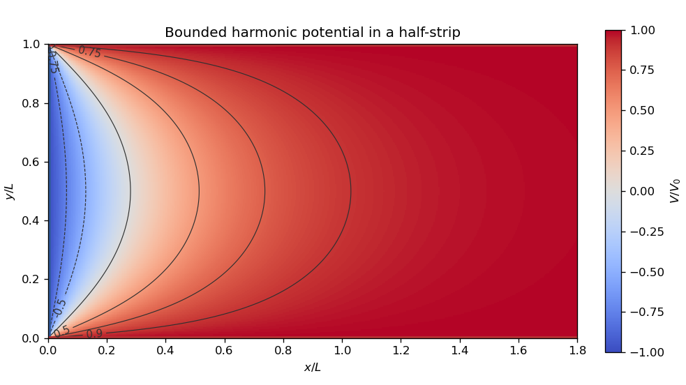

<h1 id="s01/2/solution">Solution</h1>

↑ **Parent:** [2](../2.md)

**Conformality and analyticity.** Use the orientation-preserving convention for a [conformal map](../../../../conformal-map.md), with a continuously differentiable, nonzero differential. Its [Jacobian matrix](../../../../jacobian-matrix.md) must be a positive scale times a rotation,

$$
D(u,v)=\lambda\begin{pmatrix}\cos\phi&-\sin\phi\\\sin\phi&\cos\phi\end{pmatrix},\qquad\lambda>0.
$$

Thus $u_x=v_y$, $u_y=-v_x$, the [Cauchy-Riemann equations](../../../../cauchy-riemann-equations.md); continuous partial derivatives then imply that $u+iv$ is a [holomorphic function](../../../../holomorphic-function-split.md). If angle preservation is allowed to reverse orientation, the statement needs this qualification: $z\mapsto\bar z$ preserves unsigned angles but is an [anticonformal map](../../../../anticonformal-map.md) and is not a [holomorphic function](../../../../holomorphic-function-split.md).

**The mapping.** Put $a=\pi/L$. The displayed components combine to give

$$
\boxed{w=\cosh(az),\qquad w'=a\sinh(az).}
$$

Its [derivative](../../../../derivative.md) does not vanish in the open half-strip $x>0$, $0<y<L$, so it is a [conformal map](../../../../conformal-map.md) there. Also $\operatorname{Im}w=\sinh(ax)\sin(ay)>0$. The lower edge maps to $[1,\infty)$, the upper edge to $(-\infty,-1]$, and the vertical edge to $[-1,1]$. The open half-strip maps bijectively onto the [upper half-plane](../../../../upper-half-plane-complex-analysis.md). Indeed, $\cosh\zeta=\cosh\eta$ implies $\zeta=\pm\eta+2\pi i m$; the half-strip allows only equality. Surjectivity follows by solving $t+t^{-1}=2w$ and choosing the root $t=e^{az}$ with $|t|>1$ and $0<\arg t<\pi$. The two corners are boundary critical points, not interior failures of [conformality](../../../../conformality.md).

**Transformed boundary values.** A [conformal map](../../../../conformal-map.md) preserves [Laplace's equation](../../../../laplace-equation.md) up to a positive scale. Thus the transformed [Dirichlet problem](../../../../dirichlet-problem.md) is to find a real [harmonic function](../../../../harmonic-function.md) $U(u,v)$ on $v>0$ with

$$
U(u,0)=\begin{cases}-V_0,&-1<u<1,\\V_0,&|u|>1.\end{cases}
$$

The conflicting values at the original corners are interpreted as one-sided edge limits.

**Logarithmic solution.** Choose the [complex logarithms](../../../../complex-logarithm.md) of $w\pm1$ with arguments between zero and $\pi$ in the [upper half-plane](../../../../upper-half-plane-complex-analysis.md). A linear combination $F(w)=\alpha\log(w+1)+\beta\log(w-1)+\gamma$ is a complex-valued [harmonic function](../../../../harmonic-function.md), since it is a [holomorphic function](../../../../holomorphic-function-split.md); the real physical potential must be a real or imaginary part. In particular, set

$$
\mathcal F(w)=V_0+\frac{2iV_0}{\pi}\bigl[\log(w-1)-\log(w+1)\bigr].
$$

Then

$$
U=\operatorname{Re}\mathcal F=V_0-\frac{2V_0}{\pi}\bigl[\arg(w-1)-\arg(w+1)\bigr].
$$

On the three real boundary intervals, the argument difference is respectively $0,\pi,0$, which gives the required values. This is the bounded [harmonic](../../../../harmonic-function.md) solution, with $U\to V_0$ at infinity; uniqueness holds in this bounded class by the [maximum principle](../../../../maximum-principle.md). Without a boundedness or far-field condition, the edge data alone do not give uniqueness: one may add $C\sinh(\pi x/L)\sin(\pi y/L)$.

**Back substitution.** Since

$$
\frac{w-1}{w+1}=\tanh^2(az/2),\qquad
\tanh(az/2)=\frac{\sinh(ax)+i\sin(ay)}{\cosh(ax)+\cos(ay)},
$$

the required continuous argument difference is $2\arctan[\sin(ay)/\sinh(ax)]$ in the open half-strip. Consequently

$$
\boxed{V(x,y)=V_0-\frac{4V_0}{\pi}\arctan\!\left(\frac{\sin(\pi y/L)}{\sinh(\pi x/L)}\right).}
$$

As $y\to0,L$ with $x>0$, the arctangent tends to zero; as $x\to0^+$ with $0<y<L$, it tends to $\pi/2$. These limits verify every open edge of the [Dirichlet problem](../../../../dirichlet-problem.md).

**[Figure 1](#s01/2/image-the-bounded-harmonic-function-across-the-half-strip-with-contour-labels-giving-v-v-0). The bounded harmonic function across the half-strip, with contour labels giving $V/V_0$**.

## ↑ Ancestors (12)

1. [2](../2.md)
2. [S01](../../s01.md)
3. [2022](../../../2022-split.md)
4. [Past exam of the short options paper of the physics Prelims of the University of Oxford](../../../split.md)
5. [Short options paper of the physics Prelims of the University of Oxford](../../../../short-options-paper-of-the-physics-prelims-of-the-university-of-oxford.md)
6. [Year 1 of the physics course of the University of Oxford](../../../../year-1-of-the-physics-course-of-the-university-of-oxford.md)
7. [Physics course of the University of Oxford](../../../../physics-course-of-the-university-of-oxford.md)
8. [Undergraduate course of the University of Oxford](../../../../undergraduate-course-of-the-university-of-oxford.md)
9. [Course of the University of Oxford](../../../../course-of-the-university-of-oxford.md)
10. [University of Oxford](../../../../university-of-oxford-split.md)
11. [List of universities](../../../../list-of-universities.md)
12. [Codex Wiki](../../../../split.md)
