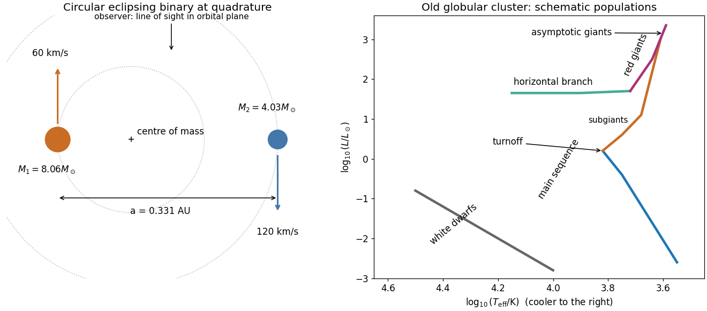
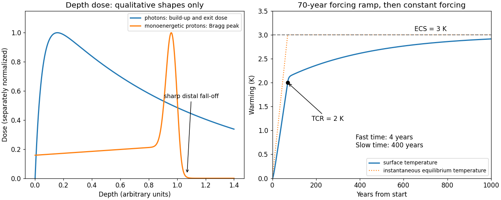
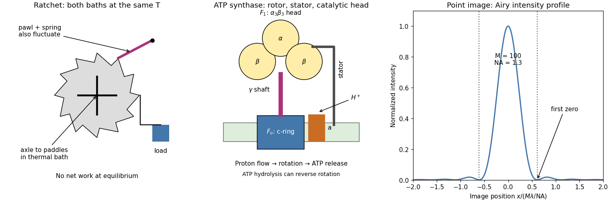

# 2019

↑ **Parent:** [Past exam of the short options paper shared by Parts A and B of the physics course of the University of Oxford](../past-exam-of-the-short-options-paper-shared-by-parts-a-and-b-of-the-physics-course-of-the-university-of-oxford.md)

Source paper: [https://www.whatdotheyknow.com/request/oxford_physics_past_papers_2/response/2340696/attach/7/Physics%20Papers%202018.pdf?cookie_passthrough=1#page=114](https://www.whatdotheyknow.com/request/oxford_physics_past_papers_2/response/2340696/attach/7/Physics%20Papers%202018.pdf?cookie_passthrough=1#page=114)

The dated cover identifies this as the 2019 shared Parts A/B booklet; the public bundle filename says 2018. Solutions cover every option. Numerical estimates use stated modelling assumptions.

**Table of contents**

- [S1](#s1)
  - [1](#s1/1)
    - [a](#s1/1/a)
      - [Solution](#s1/1/a/solution)
    - [b](#s1/1/b)
      - [Solution](#s1/1/b/solution)
    - [c](#s1/1/c)
      - [Solution](#s1/1/c/solution)
    - [d](#s1/1/d)
      - [Solution](#s1/1/d/solution)
  - [2](#s1/2)
    - [a](#s1/2/a)
      - [Solution](#s1/2/a/solution)
    - [b](#s1/2/b)
      - [Solution](#s1/2/b/solution)
    - [c](#s1/2/c)
      - [Solution](#s1/2/c/solution)
    - [d](#s1/2/d)
      - [Solution](#s1/2/d/solution)
  - [3](#s1/3)
    - [a](#s1/3/a)
      - [Solution](#s1/3/a/solution)
    - [b](#s1/3/b)
      - [Solution](#s1/3/b/solution)
    - [c](#s1/3/c)
      - [Solution](#s1/3/c/solution)
    - [d](#s1/3/d)
      - [Solution](#s1/3/d/solution)
    - [e](#s1/3/e)
      - [Solution](#s1/3/e/solution)
- [S2](#s2)
  - [1](#s2/1)
    - [a](#s2/1/a)
      - [Solution](#s2/1/a/solution)
    - [b](#s2/1/b)
      - [Solution](#s2/1/b/solution)
    - [c](#s2/1/c)
      - [Solution](#s2/1/c/solution)
  - [2](#s2/2)
    - [a](#s2/2/a)
      - [Solution](#s2/2/a/solution)
    - [b](#s2/2/b)
      - [Solution](#s2/2/b/solution)
    - [c](#s2/2/c)
      - [Solution](#s2/2/c/solution)
  - [3](#s2/3)
    - [a](#s2/3/a)
      - [Solution](#s2/3/a/solution)
    - [b](#s2/3/b)
      - [Solution](#s2/3/b/solution)
    - [c](#s2/3/c)
      - [Solution](#s2/3/c/solution)
    - [d](#s2/3/d)
      - [Solution](#s2/3/d/solution)
- [S7](#s7)
  - [1](#s7/1)
    - [a](#s7/1/a)
      - [Solution](#s7/1/a/solution)
    - [b](#s7/1/b)
      - [Solution](#s7/1/b/solution)
    - [c](#s7/1/c)
      - [Solution](#s7/1/c/solution)
    - [d](#s7/1/d)
      - [Solution](#s7/1/d/solution)
  - [2](#s7/2)
    - [a](#s7/2/a)
      - [Solution](#s7/2/a/solution)
    - [b](#s7/2/b)
      - [Solution](#s7/2/b/solution)
    - [c](#s7/2/c)
      - [Solution](#s7/2/c/solution)
    - [d](#s7/2/d)
      - [Solution](#s7/2/d/solution)
    - [e](#s7/2/e)
      - [Solution](#s7/2/e/solution)
  - [3](#s7/3)
    - [a](#s7/3/a)
      - [Solution](#s7/3/a/solution)
    - [b](#s7/3/b)
      - [Solution](#s7/3/b/solution)
    - [c](#s7/3/c)
      - [Solution](#s7/3/c/solution)
    - [d](#s7/3/d)
      - [Solution](#s7/3/d/solution)
- [S10](#s10)
  - [1](#s10/1)
    - [a](#s10/1/a)
      - [Solution](#s10/1/a/solution)
    - [b](#s10/1/b)
      - [Solution](#s10/1/b/solution)
    - [c](#s10/1/c)
      - [Solution](#s10/1/c/solution)
    - [d](#s10/1/d)
      - [Solution](#s10/1/d/solution)
  - [2](#s10/2)
    - [a](#s10/2/a)
      - [Solution](#s10/2/a/solution)
    - [b](#s10/2/b)
      - [Solution](#s10/2/b/solution)
    - [c](#s10/2/c)
      - [Solution](#s10/2/c/solution)
  - [3](#s10/3)
    - [a](#s10/3/a)
      - [Solution](#s10/3/a/solution)
    - [b](#s10/3/b)
      - [i](#s10/3/b/i)
        - [Solution](#s10/3/b/i/solution)
      - [ii](#s10/3/b/ii)
        - [Solution](#s10/3/b/ii/solution)
    - [c](#s10/3/c)
      - [Solution](#s10/3/c/solution)
- [S12](#s12)
  - [1](#s12/1)
    - [Solution](#s12/1/solution)
  - [2](#s12/2)
    - [a](#s12/2/a)
      - [Solution](#s12/2/a/solution)
    - [b](#s12/2/b)
      - [Solution](#s12/2/b/solution)
    - [c](#s12/2/c)
      - [Solution](#s12/2/c/solution)
  - [3](#s12/3)
    - [a](#s12/3/a)
      - [Solution](#s12/3/a/solution)
    - [b](#s12/3/b)
      - [Solution](#s12/3/b/solution)
    - [c](#s12/3/c)
      - [Solution](#s12/3/c/solution)
- [S14](#s14)
  - [1](#s14/1)
    - [Solution](#s14/1/solution)
  - [2](#s14/2)
    - [Solution](#s14/2/solution)
  - [3](#s14/3)
    - [Solution](#s14/3/solution)
  - [4](#s14/4)
    - [Solution](#s14/4/solution)
  - [5](#s14/5)
    - [Solution](#s14/5/solution)
- [S16](#s16)
  - [1](#s16/1)
    - [a](#s16/1/a)
      - [Solution](#s16/1/a/solution)
    - [b](#s16/1/b)
      - [Solution](#s16/1/b/solution)
    - [c](#s16/1/c)
      - [Solution](#s16/1/c/solution)
    - [d](#s16/1/d)
      - [Solution](#s16/1/d/solution)
  - [2](#s16/2)
    - [a](#s16/2/a)
      - [Solution](#s16/2/a/solution)
    - [b](#s16/2/b)
      - [Solution](#s16/2/b/solution)
    - [c](#s16/2/c)
      - [Solution](#s16/2/c/solution)
    - [d](#s16/2/d)
      - [Solution](#s16/2/d/solution)
  - [3](#s16/3)
    - [a](#s16/3/a)
      - [Solution](#s16/3/a/solution)
    - [b](#s16/3/b)
      - [Solution](#s16/3/b/solution)
    - [c](#s16/3/c)
      - [Solution](#s16/3/c/solution)
    - [d](#s16/3/d)
      - [Solution](#s16/3/d/solution)
- [S25](#s25)
  - [1](#s25/1)
    - [a](#s25/1/a)
      - [Solution](#s25/1/a/solution)
    - [b](#s25/1/b)
      - [Solution](#s25/1/b/solution)
    - [c](#s25/1/c)
      - [Solution](#s25/1/c/solution)
    - [d](#s25/1/d)
      - [Solution](#s25/1/d/solution)
  - [2](#s25/2)
    - [a](#s25/2/a)
      - [Solution](#s25/2/a/solution)
    - [b](#s25/2/b)
      - [Solution](#s25/2/b/solution)
    - [c](#s25/2/c)
      - [Solution](#s25/2/c/solution)
  - [3](#s25/3)
    - [a](#s25/3/a)
      - [Solution](#s25/3/a/solution)
    - [b](#s25/3/b)
      - [Solution](#s25/3/b/solution)
    - [c](#s25/3/c)
      - [Solution](#s25/3/c/solution)
    - [d](#s25/3/d)
      - [Solution](#s25/3/d/solution)
- [S30](#s30)
  - [1](#s30/1)
    - [a](#s30/1/a)
      - [Solution](#s30/1/a/solution)
    - [b](#s30/1/b)
      - [Solution](#s30/1/b/solution)
    - [c](#s30/1/c)
      - [Solution](#s30/1/c/solution)
      - [i](#s30/1/c/i)
        - [Solution](#s30/1/c/i/solution)
      - [ii](#s30/1/c/ii)
        - [Solution](#s30/1/c/ii/solution)
      - [iii](#s30/1/c/iii)
        - [Solution](#s30/1/c/iii/solution)
    - [d](#s30/1/d)
      - [Solution](#s30/1/d/solution)
  - [2](#s30/2)
    - [a](#s30/2/a)
      - [Solution](#s30/2/a/solution)
    - [b](#s30/2/b)
      - [Solution](#s30/2/b/solution)
    - [c](#s30/2/c)
      - [Solution](#s30/2/c/solution)
  - [3](#s30/3)
    - [a](#s30/3/a)
      - [Solution](#s30/3/a/solution)
    - [b](#s30/3/b)
      - [Solution](#s30/3/b/solution)
    - [c](#s30/3/c)
      - [Solution](#s30/3/c/solution)
- [S31](#s31)
  - [1](#s31/1)
    - [a](#s31/1/a)
      - [Solution](#s31/1/a/solution)
    - [b](#s31/1/b)
      - [Solution](#s31/1/b/solution)
    - [c](#s31/1/c)
      - [Solution](#s31/1/c/solution)
    - [d](#s31/1/d)
      - [Solution](#s31/1/d/solution)
  - [2](#s31/2)
    - [a](#s31/2/a)
      - [Solution](#s31/2/a/solution)
    - [b](#s31/2/b)
      - [Solution](#s31/2/b/solution)
    - [c](#s31/2/c)
      - [Solution](#s31/2/c/solution)
    - [d](#s31/2/d)
      - [Solution](#s31/2/d/solution)
    - [e](#s31/2/e)
      - [Solution](#s31/2/e/solution)
    - [f](#s31/2/f)
      - [Solution](#s31/2/f/solution)
  - [3](#s31/3)
    - [a](#s31/3/a)
      - [Solution](#s31/3/a/solution)
    - [b](#s31/3/b)
      - [Solution](#s31/3/b/solution)
    - [c](#s31/3/c)
      - [Solution](#s31/3/c/solution)
    - [d](#s31/3/d)
      - [Solution](#s31/3/d/solution)
    - [e](#s31/3/e)
      - [Solution](#s31/3/e/solution)

## S1

↑ **Parent:** [2019](2019.md)

<h3 id="s1/1">1</h3>

↑ **Parent:** [S1](#s1)

<h4 id="s1/1/a">a</h4>

↑ **Parent:** [1](#s1/1)

<h5 id="s1/1/a/solution">Solution</h5>

↑ **Parent:** [A](#s1/1/a)

A [complex derivative](../holomorphic-function.md#complex-derivative) computed along the real and imaginary directions gives $f'=u_x+iv_x=v_y-iu_y$. Equality yields the [Cauchy-Riemann equations](../analysis.md#cauchy-riemann-equations)

$$
\boxed{u_x=v_y,\qquad u_y=-v_x.}
$$

The [gradient](../multivariable-calculus.md#gradient)s satisfy $\nabla u\cdot\nabla v=u_xv_x+u_yv_y=0$. Since a [gradient](../multivariable-calculus.md#gradient) is normal to a regular [level set](../topology.md#level-set), the two families meet at right angles by [orthogonality](../inner-product.md#orthogonal-vectors) wherever $f'\ne0$. At a [critical point](../analysis.md#critical-point) the regular-curve argument fails: for $f=z^2$ both [gradient](../multivariable-calculus.md#gradient)s vanish at zero, so the assertion requires this qualification.

<h4 id="s1/1/b">b</h4>

↑ **Parent:** [1](#s1/1)

<h5 id="s1/1/b/solution">Solution</h5>

↑ **Parent:** [B](#s1/1/b)

Set $A=x^2-y^2$ and $B=2xy$. Direct [differentiation](../calculus.md#differentiation) gives

$$
u_{xx}=e^{-B}[(4y^2-4x^2)\sin A+(2-8xy)\cos A],\qquad
u_{yy}=e^{-B}[(4x^2-4y^2)\sin A+(8xy-2)\cos A].
$$

Their sum vanishes, proving that $u$ is a [harmonic function](../partial-differential-equation.md#harmonic-function). More generally the [Cauchy-Riemann equations](../analysis.md#cauchy-riemann-equations) give $u_{xx}+u_{yy}=v_{yx}-v_{xy}=0$ and $v_{xx}+v_{yy}=-u_{yx}+u_{xy}=0$; the [mixed partial derivatives](../multivariable-calculus.md#mixed-partial-derivative) commute because a [holomorphic function](../holomorphic-function.md) is smooth. Since $e^{iz^2}=e^{-B}(\cos A+i\sin A)$, a [harmonic conjugate](../partial-differential-equation.md#harmonic-conjugate) and the resulting [holomorphic function](../holomorphic-function.md) are

$$
\boxed{v=-e^{-2xy}\cos(x^2-y^2)+C,\qquad f(z)=-ie^{iz^2}+iC,\quad C\in\mathbb R.}
$$

These expressions also verify the [Cauchy-Riemann equations](../analysis.md#cauchy-riemann-equations) directly.

<h4 id="s1/1/c">c</h4>

↑ **Parent:** [1](#s1/1)

<h5 id="s1/1/c/solution">Solution</h5>

↑ **Parent:** [C](#s1/1/c)

The [chain rule](../calculus.md#chain-rule) in [polar coordinates](../multivariable-calculus.md#polar-coordinates) gives $u_r=u_x\cos\theta+u_y\sin\theta$ and $u_\theta=r(-u_x\sin\theta+u_y\cos\theta)$, with analogous expressions for $v$. Substituting the [Cauchy-Riemann equations](../analysis.md#cauchy-riemann-equations) gives

$$
\boxed{ru_r=v_\theta,\qquad rv_r=-u_\theta,\quad r>0.}
$$

The restriction excludes the coordinate singularity at the origin.

<h4 id="s1/1/d">d</h4>

↑ **Parent:** [1](#s1/1)

<h5 id="s1/1/d/solution">Solution</h5>

↑ **Parent:** [D](#s1/1/d)

Choose a continuous [branch of a multivalued function](../complex-analysis.md#branch-of-a-multivalued-function) of the [complex logarithm](../analysis.md#complex-logarithm) on a simply connected region avoiding zero. Then

$$
g=e^{-\theta}e^{i\ln r}=e^{i\operatorname{Log}z},\qquad
\boxed{g'(z)=\frac{i}{z}g(z).}
$$

Alternatively $u_r=-e^{-\theta}\sin(\ln r)/r=v_\theta/r$ and $v_r=e^{-\theta}\cos(\ln r)/r=-u_\theta/r$, verifying the [Cauchy-Riemann equations](../analysis.md#cauchy-riemann-equations). The [holomorphy](../holomorphic-function.md) is local to a chosen [branch of a multivalued function](../complex-analysis.md#branch-of-a-multivalued-function): increasing $\theta$ by $2\pi$ multiplies $g$ by $e^{-2\pi}$, so this is not a single-valued [holomorphic function](../holomorphic-function.md) on the whole punctured plane.

<h3 id="s1/2">2</h3>

↑ **Parent:** [S1](#s1)

<h4 id="s1/2/a">a</h4>

↑ **Parent:** [2](#s1/2)

<h5 id="s1/2/a/solution">Solution</h5>

↑ **Parent:** [A](#s1/2/a)

For $n\ge1$, $f=z^ne^{n/z}$ is [holomorphic](../holomorphic-function.md) at every finite nonzero point. At zero its [Laurent series](../analysis.md#laurent-series) has infinitely many negative powers, so zero is an [essential singularity](../isolated-singularity.md#essential-singularity). If the [Riemann sphere](../riemann-surfaces.md#riemann-sphere) is included, $f(1/w)=w^{-n}e^{nw}$ has a [pole](../isolated-singularity.md#pole) of order $n$ at $w=0$, so infinity is a [pole](../isolated-singularity.md#pole) of order $n$.

<h4 id="s1/2/b">b</h4>

↑ **Parent:** [2](#s1/2)

<h5 id="s1/2/b/solution">Solution</h5>

↑ **Parent:** [B](#s1/2/b)

Expanding the [exponential function](../calculus.md#exponential-function) produces the [Laurent series](../analysis.md#laurent-series)

$$
\boxed{f(z)=\sum_{k=0}^{\infty}\frac{n^k}{k!}z^{n-k},\qquad 0<|z|<\infty.}
$$

In particular its [residue](../analysis.md#residue) is $a_{-1}=n^{n+1}/(n+1)!$.

<h4 id="s1/2/c">c</h4>

↑ **Parent:** [2](#s1/2)

<h5 id="s1/2/c/solution">Solution</h5>

↑ **Parent:** [C](#s1/2/c)

For a positively oriented circle of any radius $R>0$, the [residue theorem](../analysis.md#residue-theorem) gives

$$
\boxed{\oint_{|z|=R}f(z)\,dz=2\pi i\frac{n^{n+1}}{(n+1)!}.}
$$

Only the $z^{-1}$ coefficient in the [Laurent series](../analysis.md#laurent-series) contributes. Reversing the [orientation](../algebraic-topology.md#orientation-of-a-simplex) changes the sign.

<h4 id="s1/2/d">d</h4>

↑ **Parent:** [2](#s1/2)

<h5 id="s1/2/d/solution">Solution</h5>

↑ **Parent:** [D](#s1/2/d)

If $f(z)=\sum a_jz^j$, then $f(-z)=\sum(-1)^ja_jz^j$ and its [residue](../analysis.md#residue) at zero is $-a_{-1}$. The circle $|z-1|=2$ encloses zero and no other finite [singularity](../complex-analysis.md#complex-singularity). Thus the [residue theorem](../analysis.md#residue-theorem) gives

$$
\boxed{\oint_{|z-1|=2}[f(z)-f(-z)]\,dz=4\pi i\frac{n^{n+1}}{(n+1)!}}
$$

for positive [orientation](../algebraic-topology.md#orientation-of-a-simplex).

<h3 id="s1/3">3</h3>

↑ **Parent:** [S1](#s1)

<h4 id="s1/3/a">a</h4>

↑ **Parent:** [3](#s1/3)

<h5 id="s1/3/a/solution">Solution</h5>

↑ **Parent:** [A](#s1/3/a)

[Cauchy's integral theorem](../complex-analysis.md#cauchy-s-integral-theorem) states that a [holomorphic function](../holomorphic-function.md) on a simply connected open region has zero [contour integral](../complex-analysis.md#contour-integral) around every closed piecewise smooth [contour](../complex-analysis.md#complex-integration-contour) in that region. More generally the same holds for a [contour](../complex-analysis.md#complex-integration-contour) homologous to zero in its domain of [holomorphy](../holomorphic-function.md). Having no singularity on the curve alone is insufficient: $1/z$ has a nonzero [contour integral](../complex-analysis.md#contour-integral) around the unit circle.

<h4 id="s1/3/b">b</h4>

↑ **Parent:** [3](#s1/3)

<h5 id="s1/3/b/solution">Solution</h5>

↑ **Parent:** [B](#s1/3/b)

Put $z=e^{i\theta}$, so $d\theta=dz/(iz)$, $\cos2\theta=(z^2+z^{-2})/2$ and $\cos^23\theta=(z^6+2+z^{-6})/4$. The [contour integral](../complex-analysis.md#contour-integral) is

$$
\frac1{4i}\oint_{|z|=1}\frac{z^8+2z^2+z^{-4}}{z(5z^2-2z^4-2)}\,dz.
$$

The enclosed [poles](../isolated-singularity.md#pole) are $0$ and $\pm1/\sqrt2$. For the rational function displayed without the prefactor $1/(4i)$, the [residue](../analysis.md#residue) at zero is $-21/8$ and the two other [residues](../analysis.md#residue) sum to $27/8$. Therefore the [residue theorem](../analysis.md#residue-theorem) gives

$$
\boxed{\int_0^{2\pi}\frac{\cos^23\theta}{5-4\cos2\theta}\,d\theta=\frac1{4i}(2\pi i)\frac34=\frac{3\pi}{8}.}
$$

A useful independent check is the [Fourier series](../fourier-series.md) $(5-4\cos\phi)^{-1}=\frac13[1+2\sum_{k\ge1}2^{-k}\cos k\phi]$; only its constant and third [Fourier coefficients](../fourier-series.md#fourier-coefficient) survive.

<h4 id="s1/3/c">c</h4>

↑ **Parent:** [3](#s1/3)

<h5 id="s1/3/c/solution">Solution</h5>

↑ **Parent:** [C](#s1/3/c)

The square root produces [branch points](../complex-analysis.md#branch-point) at $z=\pm1$, with local behaviour proportional to $(z\mp1)^{-1/2}$. One [branch cut](../analysis.md#branch-cut) can join them along $[-1,1]$. Another choice uses the two rays $(-\infty,-1]\cup[1,\infty)$. Each choice prevents a loop from enclosing just one [branch point](../complex-analysis.md#branch-point) within a single-valued domain. For the finite-segment choice fix $\sqrt{z^2-1}\sim z$ at infinity. Infinity is then a [pole](../isolated-singularity.md#pole) of order three, not a [branch point](../complex-analysis.md#branch-point), since

$$
f(z)=z^3+\frac12z+\frac{3}{8z}+O(z^{-3}).
$$

<h4 id="s1/3/d">d</h4>

↑ **Parent:** [3](#s1/3)

<h5 id="s1/3/d/solution">Solution</h5>

↑ **Parent:** [D](#s1/3/d)

Use the [branch cut](../analysis.md#branch-cut) $[-1,1]$ and the [branch of a multivalued function](../complex-analysis.md#branch-of-a-multivalued-function) normalized by $\sqrt{z^2-1}\sim z$. The [Laurent series](../analysis.md#laurent-series) from the preceding solution has $z^{-1}$ coefficient $3/8$. Consequently every sufficiently large positively oriented circle gives

$$
\boxed{\oint_{C_\infty}f(z)\,dz=\frac{3\pi i}{4}.}
$$

Although $f$ grows cubically, its other [Laurent series](../analysis.md#laurent-series) terms have zero [contour integral](../complex-analysis.md#contour-integral). Choosing the opposite [branch of a multivalued function](../complex-analysis.md#branch-of-a-multivalued-function) reverses the sign; neither the [branch of a multivalued function](../complex-analysis.md#branch-of-a-multivalued-function) nor the [orientation](../algebraic-topology.md#orientation-of-a-simplex) can be omitted from the answer.

<h4 id="s1/3/e">e</h4>

↑ **Parent:** [3](#s1/3)

<h5 id="s1/3/e/solution">Solution</h5>

↑ **Parent:** [E](#s1/3/e)

Shrink the positive outer [contour](../complex-analysis.md#complex-integration-contour) to the [branch cut](../analysis.md#branch-cut) $[-1,1]$. On its upper bank the chosen [branch of a multivalued function](../complex-analysis.md#branch-of-a-multivalued-function) has $\sqrt{x^2-1}=i\sqrt{1-x^2}$ and on the lower bank it has the negative of this value. The upper bank runs from $1$ to $-1$, and the lower bank runs from $-1$ to $1$. The endpoint circles contribute $O(\sqrt\epsilon)$ and vanish. Hence

$$
\frac{3\pi i}{4}=2i\int_{-1}^1\frac{x^4}{\sqrt{1-x^2}}\,dx,\qquad
\boxed{\int_{-1}^1\frac{x^4}{\sqrt{1-x^2}}\,dx=\frac{3\pi}{8}.}
$$

The [change of variables](../multivariable-calculus.md#change-of-variables-formula) $x=\sin t$ independently reduces the result to the [integral](../integral.md) of $\sin^4t$ over $[-\pi/2,\pi/2]$.

## S2

↑ **Parent:** [2019](2019.md)

<h3 id="s2/1">1</h3>

↑ **Parent:** [S2](#s2)

<h4 id="s2/1/a">a</h4>

↑ **Parent:** [1](#s2/1)

<h5 id="s2/1/a/solution">Solution</h5>

↑ **Parent:** [A](#s2/1/a)

[Kepler's third law](../mathematical-physics.md#kepler-s-third-law) for two [point masses](../classical-mechanics.md#point-mass) in a [Newtonian gravitational field](../newton-s-law-of-universal-gravitation.md#newtonian-gravitational-field) is

$$
\boxed{P^2=\frac{4\pi^2a^3}{G(M_1+M_2)}.}
$$

Here $a$ is the [semimajor axis](../celestial-mechanics.md#semi-major-axis) of their relative [orbit](../dynamical-systems.md#orbit-dynamical-system), $P$ the [orbital period](../celestial-mechanics.md#orbital-period) and $G$ the [gravitational constant](../newton-s-law-of-universal-gravitation.md#gravitational-constant). Equivalently $(P/\mathrm{yr})^2=(a/\mathrm{AU})^3/[(M_1+M_2)/M_\odot]$, to the accuracy with which these astronomical units normalize the [solar mass](../stellar-astrophysics.md#solar-mass).

<h4 id="s2/1/b">b</h4>

↑ **Parent:** [1](#s2/1)

<h5 id="s2/1/b/solution">Solution</h5>

↑ **Parent:** [B](#s2/1/b)

Assume a circular [orbit](../dynamical-systems.md#orbit-dynamical-system) and an [orbital inclination](../celestial-mechanics.md#orbital-inclination) $i\simeq90^\circ$, as appropriate for a simple [eclipsing binary](../stellar-astrophysics.md#eclipsing-binary) estimate. At quadrature the two [radial velocities](../euler-equations-for-an-inviscid-fluid.md#radial-velocity) are opposite and equal to the [orbital speeds](../celestial-mechanics.md#orbital-speed). The more massive component has the smaller amplitude. With the [centre of mass](../classical-mechanics.md#center-of-mass) as origin,

$$
a_1=\frac{K_1P}{2\pi},\quad a_2=\frac{K_2P}{2\pi},\quad a=a_1+a_2,\quad \frac{M_1}{M_2}=\frac{K_2}{K_1}=2.
$$

Thus $a_1=0.1103\,\mathrm{AU}$, $a_2=0.2206\,\mathrm{AU}$ and [Kepler's third law](../mathematical-physics.md#kepler-s-third-law) gives

$$
\boxed{a=0.3309\,\mathrm{AU},\quad M_1=8.06M_\odot,\quad M_2=4.03M_\odot.}
$$

The [orbital plane](../celestial-mechanics.md#orbital-plane) contains the observer's line of sight; at quadrature the two [velocities](../classical-mechanics.md#velocity) point towards and away from that observer, as labelled in the original schematic below. For an [elliptic orbit](../celestial-mechanics.md#elliptic-orbit), the measured amplitudes instead give $a\sin i=P(K_1+K_2)\sqrt{1-e^2}/(2\pi)$; the numerical answer requires the circular assumption.

**[Figure 1](#s2/1/b/image-binary-geometry-and-an-old-globular-cluster-hertzsprung-russell-diagram-both-panels-are-schematic). Binary geometry and an old globular-cluster Hertzsprung-Russell diagram; both panels are schematic**.

<h4 id="s2/1/c">c</h4>

↑ **Parent:** [1](#s2/1)

<h5 id="s2/1/c/solution">Solution</h5>

↑ **Parent:** [C](#s2/1/c)

Adopt the approximate [mass-luminosity relation](../stellar-structure.md#mass-luminosity-relation) $L/L_\odot\simeq(M/M_\odot)^3$ and equal available fuel fractions. The [main-sequence lifetime](../stellar-astrophysics.md#main-sequence-lifetime) then scales as $M/L$, giving

$$
\boxed{t_1\simeq1.54\times10^8\,\mathrm{yr},\qquad t_2\simeq6.16\times10^8\,\mathrm{yr}.}
$$

Using an exponent $3.5$ instead gives about $5.4\times10^7$ and $3.1\times10^8$ years; these are model-dependent estimates. At $r=3r_s=6GM/c^2$ the [Newtonian gravitational potential energy](../newton-s-law-of-universal-gravitation.md#newtonian-gravitational-potential-energy) released from infinity is $GMm/r=mc^2/6$. Half remains as [kinetic energy](../energy.md#kinetic-energy) in a circular [orbit](../dynamical-systems.md#orbit-dynamical-system), so the radiatable [binding energy](../energy.md#binding-energy) is $GMm/(2r)$:

$$
\boxed{\eta_{\rm Newtonian}=\frac1{12}\simeq8.3\%.}
$$

Using the whole [potential energy](../energy.md#potential-energy) loss would give $1/6$, which does not subtract the final [kinetic energy](../energy.md#kinetic-energy). A fully relativistic calculation for a nonrotating [black hole](../black-hole.md) gives $1-\sqrt{8/9}\simeq5.7\%$. When the surviving star exhausts [hydrogen burning](../stellar-astrophysics.md#hydrogen-burning), it expands off the [main sequence](../stellar-astrophysics.md#main-sequence) and can fill its [Roche lobe](../stellar-astrophysics.md#roche-lobe). [Binary mass transfer](../stellar-astrophysics.md#binary-mass-transfer) to the [black hole](../black-hole.md) can form an [accretion disk](../astrophysical-disk.md#accretion-disk) and an [X-ray binary](../stellar-astrophysics.md#x-ray-binary); unstable [binary mass transfer](../stellar-astrophysics.md#binary-mass-transfer) may instead produce a [common envelope](../stellar-astrophysics.md#common-envelope). This is conditional on the [binary star](../stellar-astrophysics.md#binary-star) remaining bound after the first remnant forms. The supplied [black hole](../black-hole.md) endpoint is an assumption, not a universal outcome for an isolated $8M_\odot$ star.

<h3 id="s2/2">2</h3>

↑ **Parent:** [S2](#s2)

<h4 id="s2/2/a">a</h4>

↑ **Parent:** [2](#s2/2)

<h5 id="s2/2/a/solution">Solution</h5>

↑ **Parent:** [A](#s2/2/a)

A thin spherical shell has outward [pressure force](../pressure.md#pressure-force) $-4\pi r^2(dP/dr)dr$ and inward [gravitational force](../physics.md#gravitational-force) $GM(r)\,4\pi r^2\rho(r)dr/r^2$. [Hydrostatic equilibrium](../statistical-physics.md#hydrostatic-equilibrium) requires

$$
\boxed{\frac{dP}{dr}=-\frac{GM(r)\rho(r)}{r^2},\qquad \frac{dM}{dr}=4\pi r^2\rho(r).}
$$

A uniform-[density](../fluid-mechanics.md#density) [solar model](../stellar-structure.md#solar-model) gives $M(r)=M_\odot(r/R_\odot)^3$, $\bar\rho=3M_\odot/(4\pi R_\odot^3)$, and after [integration](../integral.md) from $R_\odot$ to zero,

$$
P_c=\frac{3GM_\odot^2}{8\pi R_\odot^4}=1.34\times10^{14}\,\mathrm{Pa},\qquad
T_c=\frac{P_c\mu m_p}{\bar\rho k_B}=6.9\times10^6\,\mathrm K\quad(\mu=0.6).
$$

Thus the appropriate orders of magnitude are $10^{14}$–$10^{16}\,\mathrm{Pa}$ and $10^7\,\mathrm K$. The uniform-[density](../fluid-mechanics.md#density) approximation underestimates the actual [central pressure](../stellar-structure.md#central-pressure) because the Sun is centrally concentrated. [Radiation pressure](../pressure.md#radiation-pressure) is neglected in applying the [ideal gas law](../ideal-gas.md#ideal-gas-law).

<h4 id="s2/2/b">b</h4>

↑ **Parent:** [2](#s2/2)

<h5 id="s2/2/b/solution">Solution</h5>

↑ **Parent:** [B](#s2/2/b)

A [free-fall timescale](../newton-s-law-of-universal-gravitation.md#free-fall-timescale) estimate follows from $R/t^2\sim GM/R^2$:

$$
\boxed{t_{\rm dyn}\sim\sqrt{\frac{R_\odot^3}{GM_\odot}}\simeq1.6\times10^3\,\mathrm s.}
$$

Falling to a central [point mass](../classical-mechanics.md#point-mass) gives the more precise factor $\pi/(2\sqrt2)$, or $1.77\times10^3\,\mathrm s$; a distributed star changes an order-one coefficient. For any spherical [mass distribution](../classical-mechanics.md#mass-distribution) with radius $R$,

$$
|\Omega|=\int_0^M\frac{Gm}{r(m)}\,dm\ge\frac GR\int_0^M m\,dm=\frac{GM^2}{2R}.
$$

The inequality is strict for an extended star; equality is approached by a thin shell at $R$. For an [monatomic gas](../ideal-gas.md#monatomic-gas) the [virial theorem](../classical-mechanics.md#virial-theorem) is $2U+\Omega=0$, so half the [gravitational potential energy](../energy.md#gravitational-energy) released by contraction heats the star and half can be radiated. The [Kelvin-Helmholtz cooling time](../stellar-astrophysics.md#kelvin-helmholtz-cooling-time) is therefore of order

$$
\boxed{t_{\rm KH}\sim\frac{GM_\odot^2}{2R_\odot L_\odot}\simeq1.6\times10^7\,\mathrm{yr}.}
$$

A uniform-[density](../fluid-mechanics.md#density) model gives $3GM^2/(10RL)\simeq9.4\times10^6\,\mathrm{yr}$. The given bound fixes a scale, rather than an exact contraction history; both estimates are far shorter than the Sun's [main-sequence lifetime](../stellar-astrophysics.md#main-sequence-lifetime).

<h4 id="s2/2/c">c</h4>

↑ **Parent:** [2](#s2/2)

<h5 id="s2/2/c/solution">Solution</h5>

↑ **Parent:** [C](#s2/2/c)

The right panel of the figure in [solution](#s2/1/b/solution) has [luminosity](../astrophysics.md#luminosity) increasing upwards and [effective temperature](../stellar-structure.md#effective-temperature) decreasing to the right. An old [globular cluster](../galaxy.md#globular-cluster) contains a low-mass [main sequence](../stellar-astrophysics.md#main-sequence), a [main-sequence turnoff](../stellar-astrophysics.md#main-sequence-turnoff), [subgiants](../stellar-astrophysics.md#subgiant), a [red giant branch](../stellar-astrophysics.md#red-giant-branch), a [horizontal branch](../stellar-astrophysics.md#horizontal-branch), an [Asymptotic giant branch](../stellar-astrophysics.md#asymptotic-giant-branch) and a faint hot [white dwarf](../stellar-astrophysics.md#white-dwarf) sequence. Its high-mass [main sequence](../stellar-astrophysics.md#main-sequence) is absent because those stars have evolved.

If a fraction $f_c=0.1$ of the star participates in [hydrogen burning](../stellar-astrophysics.md#hydrogen-burning), with initial [hydrogen mass fraction](../stellar-astrophysics.md#hydrogen-mass-fraction) $X=0.7$, the available [nuclear binding energy](../atomic-nucleus.md#nuclear-binding-energy) is $0.007f_cXM c^2$. Assuming a roughly constant [luminosity](../astrophysics.md#luminosity) and coeval stars,

$$
\boxed{t\simeq\frac{0.007f_cX(0.8M_\odot)c^2}{1.6\times10^{26}\,\mathrm W}\simeq1.39\times10^{10}\,\mathrm{yr}.}
$$

Taking the quoted core fraction as hydrogen fuel itself, $f_cX=0.1$, gives $1.98\times10^{10}\,\mathrm{yr}$. Stating the fuel convention matters: burning the whole stellar mass overestimates the age by about an order of magnitude. Evolving [luminosity](../astrophysics.md#luminosity) and detailed [stellar structure](../stellar-structure.md) are needed for an accurate age.

<h3 id="s2/3">3</h3>

↑ **Parent:** [S2](#s2)

<h4 id="s2/3/a">a</h4>

↑ **Parent:** [3](#s2/3)

<h5 id="s2/3/a/solution">Solution</h5>

↑ **Parent:** [A](#s2/3/a)

The [Milky Way](../galaxy.md#milky-way) has a thin stellar [galactic disk](../galaxy.md#galactic-disk), radius roughly $15$–$20\,\mathrm{kpc}$ and scale height about $0.3\,\mathrm{kpc}$, containing gas, dust, young and old stars, [spiral arms](../galaxy.md#spiral-arm) and most current [star formation](../stellar-astrophysics.md#star-formation). Its stellar mass is a few $10^{10}M_\odot$. A thicker, older [galactic disk](../galaxy.md#galactic-disk) has scale height around $1\,\mathrm{kpc}$ and stellar mass of order $10^{10}M_\odot$, with little cold gas.

The central [galactic bulge](../galaxy.md#galactic-bulge) and bar extend a few thousand [parsecs](../astrophysics.md#parsec) and contain about $10^{10}M_\odot$, largely older stars. The central [supermassive black hole](../astrophysical-black-hole.md#supermassive-black-hole) has mass about $4\times10^6M_\odot$ and is negligible in the total galactic budget. A diffuse old metal-poor [stellar halo](../galaxy.md#stellar-halo), extending tens to over $100\,\mathrm{kpc}$, contains [globular clusters](../galaxy.md#globular-cluster) and roughly $10^9M_\odot$ in stars. An extended [dark matter halo](../large-scale-structure-of-the-universe.md#dark-matter-halo) reaches roughly $200\,\mathrm{kpc}$ and dominates the total mass, of order $10^{12}M_\odot$. These are approximate component scales; the gaseous [galactic halo](../galaxy.md#galactic-halo) also extends beyond the stellar [galactic disk](../galaxy.md#galactic-disk).

<h4 id="s2/3/b">b</h4>

↑ **Parent:** [3](#s2/3)

<h5 id="s2/3/b/solution">Solution</h5>

↑ **Parent:** [B](#s2/3/b)

Treat the [gravitational field](../physics.md#gravitational-field) as approximately spherical. The [circular orbit](../classical-mechanics.md#circular-orbit) condition gives

$$
\boxed{M(<8\,\mathrm{kpc})=\frac{v_c^2r}{G}=9.0\times10^{10}M_\odot,\qquad \Upsilon=\frac{M/M_\odot}{L/L_\odot}=4.50.}
$$

If every star had a representative mass $m$ and obeyed $L/L_\odot=(m/M_\odot)^3$, its [mass-to-light ratio](../galaxy.md#mass-to-light-ratio) would be $(m/M_\odot)^{-2}$, giving $\boxed{m\simeq0.47M_\odot}$. This is a one-mass estimate, not an actual average inferred uniquely from the data: a [galactic stellar mass function](../galaxy.md#galaxy-stellar-mass-function), stellar remnants, dust and nonstellar mass alter the relation. The flattening of the [galactic disk](../galaxy.md#galactic-disk) also changes the spherical conversion by an order-one factor.

<h4 id="s2/3/c">c</h4>

↑ **Parent:** [3](#s2/3)

<h5 id="s2/3/c/solution">Solution</h5>

↑ **Parent:** [C](#s2/3/c)

Assume an isotropic, stationary spherical [galaxy cluster](../large-scale-structure-of-the-universe.md#galaxy-cluster). Its three-dimensional [velocity dispersion](../galaxy.md#velocity-dispersion) obeys $\langle v^2\rangle=3\sigma_{\rm los}^2$. For a uniform sphere, the [virial theorem](../classical-mechanics.md#virial-theorem) gives $3M\sigma_{\rm los}^2=3GM^2/(5R)$, hence

$$
\boxed{M_{\rm dyn}\simeq\frac{5R\sigma_{\rm los}^2}{G}=9.4\times10^{14}M_\odot.}
$$

A different [density profile](../fluid-mechanics.md#density-profile) changes the coefficient, so $10^{15}M_\odot$ is the meaningful scale. For isothermal [X-ray](../electromagnetic-radiation.md#x-ray) gas in [hydrostatic equilibrium](../statistical-physics.md#hydrostatic-equilibrium),

$$
M(r)=-\frac{k_BTr}{G\mu m_p}\frac{d\ln\rho_g}{d\ln r}.
$$

Using $\mu=0.6$ and a representative slope $-d\ln\rho_g/d\ln r=2$–$3$ at $1\,\mathrm{Mpc}$ gives $M_X\simeq(1.3$–$1.9)\times10^{15}M_\odot$. The [temperature](../temperature.md) and extent alone cannot fix this coefficient without a [density profile](../fluid-mechanics.md#density-profile). The total [luminosity](../astrophysics.md#luminosity) is $5\times10^{12}L_\odot$, so the previously inferred [mass-to-light ratio](../galaxy.md#mass-to-light-ratio) gives

$$
\boxed{M_\star\simeq4.50(5\times10^{12})M_\odot=2.25\times10^{13}M_\odot.}
$$

<h4 id="s2/3/d">d</h4>

↑ **Parent:** [3](#s2/3)

<h5 id="s2/3/d/solution">Solution</h5>

↑ **Parent:** [D](#s2/3/d)

Three physically distinct contributions are unseen [dark matter](../cosmology.md#dark-matter), hot diffuse [intracluster gas](../large-scale-structure-of-the-universe.md#intracluster-medium) omitted from the summed stellar [mass](../classical-mechanics.md#mass), and faint stars or [stellar remnants](../stellar-astrophysics.md#stellar-remnant) missed by transferring the [Milky Way](../galaxy.md#milky-way) [mass-to-light ratio](../galaxy.md#mass-to-light-ratio) to the cluster. The first two are actual additional components; the third changes the inferred stellar budget. Departures from [virial equilibrium](../classical-mechanics.md#virial-equilibrium), [velocity anisotropy](../galaxy.md#velocity-anisotropy) or extra nonthermal [pressure](../pressure.md) can also bias the dynamical or [X-ray](../electromagnetic-radiation.md#x-ray) estimates, although they need not remove the discrepancy.

## S7

↑ **Parent:** [2019](2019.md)

<h3 id="s7/1">1</h3>

↑ **Parent:** [S7](#s7)

<h4 id="s7/1/a">a</h4>

↑ **Parent:** [1](#s7/1)

<h5 id="s7/1/a/solution">Solution</h5>

↑ **Parent:** [A](#s7/1/a)

Define the [canonical momentum](../hamiltonian-mechanics.md#canonical-momentum) $p_i=\partial L/\partial\dot q_i$ and the [energy function](../energy.md#energy-function) $E=\sum_i p_i\dot q_i-L$. Along an [Euler-Lagrange equation](../analysis.md#euler-lagrange-equation) solution,

$$
\frac{dE}{dt}=\sum_i\left(\dot p_i-\frac{\partial L}{\partial q_i}\right)\dot q_i-\frac{\partial L}{\partial t}=-\frac{\partial L}{\partial t}.
$$

Thus an autonomous [Lagrangian](../calculus-of-variations.md#lagrangian) has conserved $E$. For a [simple harmonic oscillator](../classical-mechanics.md#simple-harmonic-motion), $L=m\dot x^2/2-kx^2/2$ and $\boxed{E=m\dot x^2/2+kx^2/2}$ is constant. For ordinary time-independent mechanical coordinates this is the total [mechanical energy](../energy.md#mechanical-energy).

<h4 id="s7/1/b">b</h4>

↑ **Parent:** [1](#s7/1)

<h5 id="s7/1/b/solution">Solution</h5>

↑ **Parent:** [B](#s7/1/b)

The appropriate invariance is invariance of the [action](../lagrangian-mechanics.md#action) element $L\,dt$, including the change of the time measure. Under $\delta t=\lambda\phi$ and $\delta q_i=\lambda\psi_i$, [differentiation](../calculus.md#differentiation) of $q_i'(t')$ gives $\delta\dot q_i=\lambda(D_t\psi_i-\dot q_iD_t\phi)$. Therefore

$$
\frac{\delta(L\,dt)}{\lambda\,dt}=L_t\phi+\sum_iL_{q_i}\psi_i+\sum_i p_i(D_t\psi_i-\dot q_iD_t\phi)+L D_t\phi.
$$

Using the [Euler-Lagrange equations](../analysis.md#euler-lagrange-equation) and $D_tE=-L_t$, this becomes

$$
D_t\left[\sum_i p_i\psi_i-E\phi\right].
$$

An [action symmetry](../calculus-of-variations.md#action-symmetry) therefore yields the [Noether charge](../classical-field-theory.md#noether-charge)

$$
\boxed{Q=\sum_i p_i\psi_i+\left(L-\sum_i p_i\dot q_i\right)\phi,\qquad D_tQ=0.}
$$

For $\phi=0$ this reduces to the usual spatial form of [Noether's theorem](../calculus-of-variations.md#noether-conserved-quantity-for-a-mechanical-point-symmetry). The same on-shell calculation permits velocity-dependent generators when they define a legitimate variational [symmetry](../physics.md#symmetry-physics). Merely preserving the numerical value of $L$ is insufficient for transformations of time: the [Jacobian matrix and determinant](../multivariable-calculus.md#jacobian-matrix-and-determinant) $dt'/dt$ matters. If the [action](../lagrangian-mechanics.md#action) changes by a boundary term $\lambda D_tB$, the conserved quantity is $Q-B$.

<h4 id="s7/1/c">c</h4>

↑ **Parent:** [1](#s7/1)

<h5 id="s7/1/c/solution">Solution</h5>

↑ **Parent:** [C](#s7/1/c)

For a [central potential](../energy.md#central-potential) use $L=m|\dot{\mathbf r}|^2/2-V(|\mathbf r|)$. An infinitesimal [rotation](../riemannian-geometry.md#rotation-mathematics) about any constant unit [vector](../vector-space.md#vector) $\mathbf n$ has $\phi=0$ and $\boldsymbol\psi=\mathbf n\times\mathbf r$. [Noether's theorem](../calculus-of-variations.md#noether-conserved-quantity-for-a-mechanical-point-symmetry) gives $Q=m\dot{\mathbf r}\cdot(\mathbf n\times\mathbf r)=\mathbf n\cdot\mathbf L$, where $\mathbf L=\mathbf r\times m\dot{\mathbf r}$. Since $\mathbf n$ is arbitrary, every component of [angular momentum](../momentum.md#angular-momentum) is conserved. A [time-translation symmetry](../calculus-of-variations.md#time-translation-symmetry) has $\phi=1$, $\boldsymbol\psi=0$, giving $Q=-E$ and

$$
\boxed{\mathbf L=\mathbf r\times m\dot{\mathbf r},\qquad E=\frac12m|\dot{\mathbf r}|^2+V(r)}
$$

as conserved quantities.

<h4 id="s7/1/d">d</h4>

↑ **Parent:** [1](#s7/1)

<h5 id="s7/1/d/solution">Solution</h5>

↑ **Parent:** [D](#s7/1/d)

The orbiting planet produces a potential $V(r,\vartheta,\varphi-\Omega t)$. It has explicit time dependence and exerts an azimuthal [torque](../momentum.md#torque), so generally $\dot E=V_t$ and $\dot L_z=-V_\varphi$ are nonzero. Nevertheless a simultaneous [time-translation symmetry](../calculus-of-variations.md#time-translation-symmetry) $\delta t=\lambda$ and [rotation](../riemannian-geometry.md#rotation-mathematics) $\delta\varphi=\Omega\lambda$ leaves the [Lagrangian](../calculus-of-variations.md#lagrangian) and $dt$ unchanged. [Noether's theorem](../calculus-of-variations.md#noether-conserved-quantity-for-a-mechanical-point-symmetry) gives $Q=\Omega p_\varphi-E$ and hence

$$
\boxed{E_J=E-\Omega L_z=\text{constant}.}
$$

Equivalently $V_t=-\Omega V_\varphi$ implies $d(E-\Omega L_z)/dt=0$. This [Jacobi integral](../lagrangian-mechanics.md#jacobi-integral) assumes a rigidly rotating potential with constant $\Omega$ and negligible back-reaction from the [test particle](../classical-mechanics.md#test-particle).

<h3 id="s7/2">2</h3>

↑ **Parent:** [S7](#s7)

<h4 id="s7/2/a">a</h4>

↑ **Parent:** [2](#s7/2)

<h5 id="s7/2/a/solution">Solution</h5>

↑ **Parent:** [A](#s7/2/a)

Write the geometric [vector](../vector-space.md#vector) as $\mathbf V=\sum_iV_i'\mathbf e_i'(t)$. A rotating orthonormal basis obeys $\dot{\mathbf e}_i'=\boldsymbol\Omega\times\mathbf e_i'$. The [product rule](../calculus.md#product-rule) gives the transport identity

$$
\boxed{\left(\frac{d\mathbf V}{dt}\right)_{\rm inertial}=\left(\frac{d\mathbf V}{dt}\right)_{\rm rotating}+\boldsymbol\Omega\times\mathbf V.}
$$

Both terms must be expressed in the same basis before adding them. If $R(t)$ maps rotating components into inertial components, the precise component equation is $d(R\mathbf V')/dt=R(\dot{\mathbf V}'+\boldsymbol\Omega'\times\mathbf V')$. The printed expression suppresses this basis conversion.

<h4 id="s7/2/b">b</h4>

↑ **Parent:** [2](#s7/2)

<h5 id="s7/2/b/solution">Solution</h5>

↑ **Parent:** [B](#s7/2/b)

The inertial [Lagrangian](../calculus-of-variations.md#lagrangian) is $L=m|\dot{\mathbf r}|^2/2-U(\mathbf r,t)$. Put $\mathbf r=R(t)\mathbf r'$ and define $U'(\mathbf r',t)=U(R(t)\mathbf r',t)$. The transport identity and invariance of the [Euclidean norm](../normed-vector-space.md#euclidean-norm) under a [rotation](../riemannian-geometry.md#rotation-mathematics) give

$$
\boxed{L'=\frac m2|\dot{\mathbf r}'+\boldsymbol\Omega'\times\mathbf r'|^2-U'(\mathbf r',t).}
$$

Its expansion contains the ordinary [kinetic energy](../energy.md#kinetic-energy), $m\dot{\mathbf r}'\cdot(\boldsymbol\Omega'\times\mathbf r')$, and $m|\boldsymbol\Omega'\times\mathbf r'|^2/2$. These velocity and position terms generate the apparent forces in the rotating frame.

<h4 id="s7/2/c">c</h4>

↑ **Parent:** [2](#s7/2)

<h5 id="s7/2/c/solution">Solution</h5>

↑ **Parent:** [C](#s7/2/c)

Suppress primes on the angular [velocity](../classical-mechanics.md#velocity) while retaining rotating components. The [canonical momentum](../hamiltonian-mechanics.md#canonical-momentum) is $\partial L'/\partial\dot{\mathbf r}'=m(\dot{\mathbf r}'+\boldsymbol\Omega\times\mathbf r')$. Varying $L'$ with respect to position and applying the [Euler-Lagrange equations](../analysis.md#euler-lagrange-equation) gives

$$
\boxed{m\ddot{\mathbf r}'=-\nabla' U'-2m\boldsymbol\Omega\times\dot{\mathbf r}'-m\boldsymbol\Omega\times(\boldsymbol\Omega\times\mathbf r')-m\dot{\boldsymbol\Omega}\times\mathbf r'.}
$$

The terms are the physical [force](../force.md), the velocity-dependent [Coriolis force](../mathematical-physics.md#coriolis-force), the outward [centrifugal force](../mathematical-physics.md#centrifugal-force), and the [Euler force](../mathematical-physics.md#euler-force) caused by changing angular [velocity](../classical-mechanics.md#velocity). The common origin is inertial; an accelerating origin would introduce another translational apparent [force](../force.md).

<h4 id="s7/2/d">d</h4>

↑ **Parent:** [2](#s7/2)

<h5 id="s7/2/d/solution">Solution</h5>

↑ **Parent:** [D](#s7/2/d)

At [latitude](../astrophysics.md#geographical-latitude) $\ell$, the Earth's angular [velocity](../classical-mechanics.md#velocity) in east–north–up coordinates is $\boldsymbol\Omega=(0,\Omega\cos\ell,\Omega\sin\ell)$. Assume a small horizontal patch, constant $\Omega$, negligible vertical [velocity](../classical-mechanics.md#velocity), and a vertical constraint balancing effective [gravity](../physics.md#gravity). Absorb the steady [centrifugal force](../mathematical-physics.md#centrifugal-force) into that effective [gravity](../physics.md#gravity). With $f=2\Omega\sin\ell$ and physical horizontal [force](../force.md) per unit mass $F_x',F_y'$, the [Coriolis force](../mathematical-physics.md#coriolis-force) gives

$$
\boxed{\ddot x'=f\dot y'+F_x',\qquad\ddot y'=-f\dot x'+F_y',\quad A=D=0,\ B=f,\ C=-f.}
$$

Large-scale atmospheric and oceanic flows deflect to their right in the northern hemisphere and left in the southern hemisphere; their balance with a horizontal [pressure gradient](../fluid-mechanics.md#pressure-gradient) produces [geostrophic flow](../geophysical-fluid-dynamics.md#geostrophic-flow). A [Foucault pendulum](../simple-pendulum.md#foucault-pendulum) has an oscillation plane that precesses relative to the ground at angular rate $-\Omega\sin\ell$. Both effects vanish at the equator within this horizontal approximation.

<h4 id="s7/2/e">e</h4>

↑ **Parent:** [2](#s7/2)

<h5 id="s7/2/e/solution">Solution</h5>

↑ **Parent:** [E](#s7/2/e)

Let $m$ be the ice mass for which the stated drag coefficients are defined, $K=k_1+k_2$ and $f=2\Omega\sin\ell$. With stationary water, the steady horizontal ice equations are

$$
0=mf v_y+k_1v_{a,x}-Kv_x,\qquad0=-mf v_x+k_1v_{a,y}-Kv_y.
$$

The [linear system](../linear-algebra.md#system-of-linear-equations) gives

$$
v_y=\frac{k_1}{K^2+(mf)^2}\left(Kv_{a,y}-mf v_{a,x}\right).
$$

For fixed wind speed $V=10\,\mathrm{m\,s^{-1}}$, the [Cauchy-Schwarz inequality](../probability-and-statistics.md#cauchy-schwarz-inequality) minimizes this component when

$$
\boxed{\mathbf v_a=\frac{V}{\sqrt{K^2+(mf)^2}}(mf,-K),\qquad v_{y,\min}=-\frac{k_1V}{\sqrt{K^2+(mf)^2}}.}
$$

Thus the wind must blow towards a direction east of south by $\tan^{-1}(mf/K)$ in the northern hemisphere, west of south in the southern hemisphere, and due south at the equator. This compensates the [Coriolis force](../mathematical-physics.md#coriolis-force); at the optimum $v_x=0$ and the ice moves due south. If the drag coefficients are per unit mass, replace $K/m$ by the corresponding total drag rate. “Blows towards” avoids the opposite convention used when naming winds by their origin.

<h3 id="s7/3">3</h3>

↑ **Parent:** [S7](#s7)

<h4 id="s7/3/a">a</h4>

↑ **Parent:** [3](#s7/3)

<h5 id="s7/3/a/solution">Solution</h5>

↑ **Parent:** [A](#s7/3/a)

For a regular [Lagrangian](../calculus-of-variations.md#lagrangian), form the [canonical momenta](../hamiltonian-mechanics.md#canonical-momentum) $p_i=L_{\dot q_i}$, invert for $\dot q_i(\mathbf q,\mathbf p,t)$, and take the [Legendre transform](../convex-optimization.md#convex-conjugate) $H=\sum_ip_i\dot q_i-L$. On the upper cone let $s>0$ be distance along a generator from the apex and $\phi$ the [azimuth](../astrophysics.md#azimuth). Then the horizontal radius is $s\sin\theta$ and height is $s\cos\theta$, so

$$
L=\frac m2(\dot s^2+s^2\sin^2\theta\,\dot\phi^2)-mgs\cos\theta,
\quad p_s=m\dot s,\quad p_\phi=ms^2\sin^2\theta\,\dot\phi.
$$

Consequently

$$
\boxed{H=\frac{p_s^2}{2m}+\frac{p_\phi^2}{2ms^2\sin^2\theta}+mgs\cos\theta.}
$$

<h4 id="s7/3/b">b</h4>

↑ **Parent:** [3](#s7/3)

<h5 id="s7/3/b/solution">Solution</h5>

↑ **Parent:** [B](#s7/3/b)

To match the printed order $df/dt=\{H,f\}$, define the [Poisson bracket](../hamiltonian-mechanics.md#poisson-bracket) with the sign convention

$$
\boxed{\{F,G\}_{\rm paper}=\sum_i\left(F_{p_i}G_{q_i}-F_{q_i}G_{p_i}\right).}
$$

[Hamilton's equations](../hamiltonian-mechanics.md#hamilton-s-equations) imply $\dot f=\sum_i(f_{q_i}H_{p_i}-f_{p_i}H_{q_i})=\{H,f\}_{\rm paper}$. With the other common [Poisson bracket](../hamiltonian-mechanics.md#poisson-bracket) convention the correct statement is instead $\dot f=\{f,H\}_{\rm standard}$. For example $H=p^2/(2m)$, $f=q$ gives $\{H,q\}_{\rm standard}=-p/m$, contradicting the printed order unless its sign convention is adopted. Since $H_t=0$ and $\{H,H\}=0$, the [Hamiltonian](../hamiltonian-mechanics.md#hamiltonian) is conserved. Also $\dot p_\phi=-H_\phi=0$: this [canonical momentum](../hamiltonian-mechanics.md#canonical-momentum) is the axial [angular momentum](../momentum.md#angular-momentum).

<h4 id="s7/3/c">c</h4>

↑ **Parent:** [3](#s7/3)

<h5 id="s7/3/c/solution">Solution</h5>

↑ **Parent:** [C](#s7/3/c)

For fixed nonzero $l=p_\phi$, the radial [effective potential](../mathematical-physics.md#effective-potential) is $V_{\rm eff}(s)=l^2/(2ms^2\sin^2\theta)+mgs\cos\theta$. Its stationary point is

$$
\boxed{s_0^3=\frac{l^2}{m^2g\cos\theta\sin^2\theta},\qquad V_{\rm eff}''(s_0)=\frac{3mg\cos\theta}{s_0}>0.}
$$

The [equilibrium](../dynamical-systems.md#equilibrium-point-of-a-dynamical-system) is therefore stable. A [Taylor expansion](../calculus.md#taylor-expansion) with $x=s-s_0$ and $p_x=p_s$ gives

$$
H_{\rm eff}=\frac32mgs_0\cos\theta+\frac{p_x^2}{2m}+\frac{3mg\cos\theta}{2s_0}x^2+O(x^3).
$$

**Qualification:** the printed “any” $p_\phi$ excludes a regular interior [equilibrium](../dynamical-systems.md#equilibrium-point-of-a-dynamical-system) when $p_\phi=0$. In that case $V_{\rm eff}=mgs\cos\theta$ has no stationary point for $s>0$. Its minimum is the nonsmooth apex, where these coordinates and the smooth-cone dynamics fail.

<h4 id="s7/3/d">d</h4>

↑ **Parent:** [3](#s7/3)

<h5 id="s7/3/d/solution">Solution</h5>

↑ **Parent:** [D](#s7/3/d)

For $|x|\ll s_0$ the quadratic [Hamiltonian](../hamiltonian-mechanics.md#hamiltonian) describes a [simple harmonic oscillator](../classical-mechanics.md#simple-harmonic-motion) with

$$
\omega_s^2=\frac{3g\cos\theta}{s_0},\qquad
\omega_\phi^2=\frac{l^2}{m^2s_0^4\sin^4\theta}=\frac{g\cos\theta}{s_0\sin^2\theta},\qquad
\boxed{\frac{\omega_s}{|\omega_\phi|}=\sqrt3\sin\theta.}
$$

An exactly circular [orbit](../dynamical-systems.md#orbit-dynamical-system) closes for every nonzero $l$. A nonzero infinitesimal radial [oscillation](../wave.md#oscillation) closes at leading order precisely when $\sqrt3\sin\theta$ is rational. This condition concerns the cone angle: changing $s_0$ or $l$ cannot change the leading-order ratio. Thus there are no special nonzero $l$ values selecting closure for a fixed cone at this order.

At finite radial amplitude the system is equivalent, after unrolling the cone with planar angle $\chi=\phi\sin\theta$, to a planar [central force](../mathematical-physics.md#central-force) with potential proportional to $s$. Its angle advance per radial period changes continuously from $2\pi/\sqrt3$ near a circle towards $\pi$ at very large radial energy. Hence the physical advance changes from $2\pi/(\sqrt3\sin\theta)$ towards $\pi/\sin\theta$. This nonzero interval contains rational multiples of $2\pi$, so tuning a larger initial $|p_s|$ can produce closed [orbits](../dynamical-systems.md#orbit-dynamical-system) even when the small-amplitude ratio is irrational. Generic amplitudes still produce a [precessing orbit](../dynamical-systems.md#precessing-orbit); neither energy conservation nor increasing $|p_s|$ guarantees closure.

## S10

↑ **Parent:** [2019](2019.md)

<h3 id="s10/1">1</h3>

↑ **Parent:** [S10](#s10)

<h4 id="s10/1/a">a</h4>

↑ **Parent:** [1](#s10/1)

<h5 id="s10/1/a/solution">Solution</h5>

↑ **Parent:** [A](#s10/1/a)

After injection, the [radiopharmaceutical](../physics.md#radiopharmaceutical) circulates and accumulates according to its biological targeting and clearance. [Technetium-99m](../physics.md#technetium-99m) undergoes an isomeric [nuclear transition](../physics.md#nuclear-transition), producing approximately $140\,\mathrm{keV}$ [gamma rays](../quantum-mechanics.md#gamma-ray); its roughly six-hour [half-life](../analysis.md#half-life) permits useful counting with limited persistence. Some [photons](../quantum-mechanics.md#photon) undergo absorption or [Compton scattering](../mathematical-physics.md#compton-scattering) in the patient. A lead [collimator](../optical-instrument.md#collimator) in the [gamma camera](../physics.md#gamma-camera) accepts a narrow range of directions so the accepted event retains positional information.

An accepted [gamma ray](../quantum-mechanics.md#gamma-ray) deposits energy, commonly in a NaI(Tl) [scintillator](../physics.md#scintillator), by [photoelectric effect](../quantum-mechanics.md#photoelectric-effect) or [Compton scattering](../mathematical-physics.md#compton-scattering). The resulting visible [particle scintillation](../physics.md#scintillation-physics) light is collected by [photomultipliers](../particle-detection.md#photomultiplier). Their relative pulse sizes determine an event position and their summed pulse estimates its [energy](../energy.md). A [pulse-height analyser](../particle-detection.md#pulse-height-analyser) accepts an energy window around the [photopeak](../particle-detection.md#photopeak) to reject many scattered events. Position and uniformity corrections are applied; accepted events increment a two-dimensional pixel histogram. After acquisition the computer displays this count map as a planar projection of tracer activity. Finite counting statistics, [attenuation](../electromagnetic-radiation.md#attenuation), [scattering](../physics.md#scattering) and the [collimator](../optical-instrument.md#collimator) limit the image's quantitative accuracy and [spatial resolution](../optics.md#spatial-resolution).[Gamma-camera detection, technetium-99m photon energy and half-life](../physics-bibliography.md#bio-medical-applications-of-jefferson-lab-s-nuclear-physics-detector-technology-by-drew-weisenberger)

<h4 id="s10/1/b">b</h4>

↑ **Parent:** [1](#s10/1)

<h5 id="s10/1/b/solution">Solution</h5>

↑ **Parent:** [B](#s10/1/b)

A diagnostic example is [technetium-99m methylene diphosphonate](../physics.md#technetium-99m-methylene-diphosphonate), which accumulates at sites of bone turnover for [bone scintigraphy](../physics.md#bone-scintigraphy). A therapeutic example is [sodium iodide iodine-131](../physics.md#sodium-iodide-iodine-131), taken up by thyroid tissue and used for selected thyroid disease including differentiated thyroid cancer.

For diagnosis, an escaping [gamma ray](../quantum-mechanics.md#gamma-ray) or a [Positron](../physics.md#positron) followed by annihilation [photons](../quantum-mechanics.md#photon) allows external detection, with an appropriate short [half-life](../analysis.md#half-life) and limited deposited [energy](../energy.md). For molecular [radiotherapy](../physics.md#radiation-therapy), short-range charged emissions such as [beta particles](../physics.md#beta-particle), [alpha particles](../atomic-nucleus.md#alpha-particle) or [Auger electrons](../atomic-physics.md#auger-electron) deposit substantial local [energy](../energy.md) in the targeted tissue. [Iodine-131](../physics.md#iodine-131) emits therapeutic [beta particles](../physics.md#beta-particle) as well as imageable [gamma rays](../quantum-mechanics.md#gamma-ray), so these categories are functional rather than mutually exclusive isotope classes.

<h4 id="s10/1/c">c</h4>

↑ **Parent:** [1](#s10/1)

<h5 id="s10/1/c/solution">Solution</h5>

↑ **Parent:** [C](#s10/1/c)

[Single-photon emission computed tomography](../inverse-problem.md#single-photon-emission-computed-tomography) detects individual [gamma rays](../quantum-mechanics.md#gamma-ray) from a tracer. Mechanically collimated [gamma cameras](../physics.md#gamma-camera) acquire projections from multiple angles for [tomography](../inverse-problem.md#tomography). The [collimator](../optical-instrument.md#collimator) discards most emitted [photons](../quantum-mechanics.md#photon), creating a strong sensitivity–[spatial resolution](../optics.md#spatial-resolution) trade-off.

[Positron emission tomography](../inverse-problem.md#positron-emission-tomography) uses a [Positron](../physics.md#positron)-emitting tracer. The emitted [Positron](../physics.md#positron) travels a short distance before [electron-positron annihilation](../relativistic-quantum-field.md#electron-positron-annihilation) produces an approximately back-to-back photon pair. Coincident detection in a detector ring defines a [line of response](../inverse-problem.md#line-of-response), giving electronic collimation and greater detection efficiency; [time-of-flight PET](../inverse-problem.md#time-of-flight-pet) further constrains position along that line. The [positron range](../inverse-problem.md#positron-range), non-collinearity, detector size, scatter and accidental coincidences limit [spatial resolution](../optics.md#spatial-resolution) and quantification. In both hybrids, [computed tomography](../inverse-problem.md#computed-tomography) supplies anatomy and an [attenuation correction](../physics.md#attenuation-correction) map, with attention to registration and respiratory motion.[Sections describing SPECT, PET and hybrid CT imaging](../physics-bibliography.md#nuclear-medicine-by-nibib)

<h4 id="s10/1/d">d</h4>

↑ **Parent:** [1](#s10/1)

<h5 id="s10/1/d/solution">Solution</h5>

↑ **Parent:** [D](#s10/1/d)

After thermalization, approximate the [electron](../physics.md#electron) and [Positron](../physics.md#positron) as initially at rest in their [centre-of-momentum frame](../special-relativity.md#center-of-momentum-frame). Their total [energy](../energy.md) is $2m_ec^2$ and total [momentum](../momentum.md) is zero. Two [photons](../quantum-mechanics.md#photon) must therefore have equal [energies](../energy.md) and opposite [momenta](../momentum.md), since $|\mathbf p_\gamma|=E_\gamma/c$. [Conservation of energy](../mathematical-physics.md#conservation-of-energy) gives

$$
2E_\gamma=2m_ec^2,\qquad \boxed{E_\gamma=m_ec^2=511\,\mathrm{keV}.}
$$

Residual pair [momentum](../momentum.md) and electron binding cause small departures from exact collinearity and exact photon [energy](../energy.md); the standard [PET](../electrochemistry.md#photoinduced-electron-transfer) calculation neglects them.

<h3 id="s10/2">2</h3>

↑ **Parent:** [S10](#s10)

<h4 id="s10/2/a">a</h4>

↑ **Parent:** [2](#s10/2)

<h5 id="s10/2/a/solution">Solution</h5>

↑ **Parent:** [A](#s10/2/a)

Define the positive mass [collision stopping power](../particle-detection.md#collision-stopping-power) as $S_{\rm col}/\rho=-(1/\rho)dT/dx$. For a projectile of charge $ze$, mass $M\gg m_e$, speed $v=\beta c$ and [Lorentz factor](../special-relativity.md#lorentz-factor) $\Gamma=(1-\beta^2)^{-1/2}$, the [Bethe stopping formula](../particle-detection.md#bethe-stopping-formula) can be written

$$
\boxed{\frac{S_{\rm col}}\rho=4\pi N_A r_e^2m_ec^2\frac{Z}{A}\frac{z^2}{\beta^2}\left[\frac12\ln\!\left(\frac{2m_ec^2\beta^2\Gamma^2T_{\max}}{I^2}\right)-\beta^2-\frac\delta2-\frac CZ\right].}
$$

Here $Z$ is the absorber [atomic number](../chemical-substance.md#atomic-number), $A$ its molar [mass](../classical-mechanics.md#mass), $I$ its mean excitation [energy](../energy.md), $r_e=e^2/(4\pi\epsilon_0m_ec^2)$, and $N_A$ the [Avogadro constant](../physics.md#avogadro-constant). Also

$$
T_{\max}=\frac{2m_ec^2\beta^2\Gamma^2}{1+2\Gamma m_e/M+(m_e/M)^2}.
$$

The optional $\delta$ and $C/Z$ represent density and shell corrections. For a very heavy projectile $T_{\max}\simeq2m_ec^2\beta^2\Gamma^2$, and the bracket reduces to $\ln(2m_ec^2\beta^2\Gamma^2/I)-\beta^2$ when those corrections are neglected. If $T$ denotes remaining projectile [kinetic energy](../energy.md#kinetic-energy), the printed $dT/(\rho dx)$ is negative; the conventional positive [stopping power](../particle-detection.md#stopping-power) has the minus sign above.[Section 3.5, use of Bethe theory at high energies and measured low-energy stopping powers](../physics-bibliography.md#pstar-and-astar-database-methods-by-nist)

<h4 id="s10/2/b">b</h4>

↑ **Parent:** [2](#s10/2)

<h5 id="s10/2/b/solution">Solution</h5>

↑ **Parent:** [B](#s10/2/b)

Start with a fast massive projectile following an approximately straight path. Its time-dependent [electric field](../electric-field.md) perturbs bound absorber [electrons](../physics.md#electron). At large impact parameter, treating the perturbation to first order and summing excitation and [ionization](../atomic-physics.md#ionization) transition probabilities gives an [energy transfer](../quantum-scattering.md#energy-transfer) weighted by the absorber's oscillator strengths. The oscillator-strength sum rule reduces the leading coefficient to the number of target [electrons](../physics.md#electron), while their logarithmically weighted excitation energies define $I$.

The classical impulse picture explains the logarithm: a transverse impulse scales as $1/(bv)$, so transferred [energy](../energy.md) scales as $1/(b^2v^2)$; multiplying by the number of encountered [electrons](../physics.md#electron) in $2\pi b\,db\,dx$ gives $db/b$. Quantum [scattering](../physics.md#scattering) replaces ad hoc short- and long-distance cutoffs by recoil kinematics and bound-state excitation. Relativistic projectile kinematics supplies $T_{\max}$ and the $-\beta^2$ term. Summation over many independent encounters gives the mean [stopping power](../particle-detection.md#stopping-power), rather than the [energy-loss straggling](../particle-detection.md#energy-loss-straggling) of individual tracks.

The leading approximation assumes $M\gg m_e$, a sufficiently fast projectile for perturbation theory, a largely fixed projectile charge, and weak correlations between collisions. At low [velocity](../classical-mechanics.md#velocity), electron binding, charge exchange and [nuclear stopping](../particle-detection.md#nuclear-stopping) become important; at high [velocity](../classical-mechanics.md#velocity), polarization screens distant interactions and gives the density correction. The projectile's [bremsstrahlung](../electromagnetic-radiation.md#bremsstrahlung) is suppressed by its large [mass](../classical-mechanics.md#mass) and is excluded from the [collision stopping power](../particle-detection.md#collision-stopping-power).

<h4 id="s10/2/c">c</h4>

↑ **Parent:** [2](#s10/2)

<h5 id="s10/2/c/solution">Solution</h5>

↑ **Parent:** [C](#s10/2/c)

The dominant $z^2/\beta^2$ factor raises the [energy loss](../particle-detection.md#energy-loss) as a charged projectile slows, while the logarithm moderates that rise. This produces a [Bragg peak](../particle-detection.md#bragg-peak) close to the end of its [particle range](../particle-detection.md#particle-range). At still lower [velocity](../classical-mechanics.md#velocity), changing effective charge, shell effects and [nuclear stopping](../particle-detection.md#nuclear-stopping) invalidate extrapolation of the elementary [Bethe stopping formula](../particle-detection.md#bethe-stopping-formula) to zero [energy](../energy.md). A finite initial [energy](../energy.md) gives a finite [continuous-slowing-down range](../particle-detection.md#continuous-slowing-down-range),

$$
\boxed{R_{\rm CSDA}=\int_0^{T_0}\frac{dT}{S(T)}.}
$$

A higher initial [energy](../energy.md) increases the [particle range](../particle-detection.md#particle-range); greater electron [density](../fluid-mechanics.md#density) increases [stopping power](../particle-detection.md#stopping-power) per unit length. Absorber $Z/A$ and $I$ also affect the depth. [Multiple Coulomb scattering](../wave.md#multiple-coulomb-scattering), [energy-loss straggling](../particle-detection.md#energy-loss-straggling), nuclear reactions and the incident energy spread broaden the measured peak and distal fall-off; nuclear secondaries can produce a small tail. Superposing many incident energies makes a [spread-out Bragg peak](../particle-detection.md#spread-out-bragg-peak) for an extended target. The schematic curve below illustrates shapes only and is not patient [radiation dosimetry](../physics.md#radiation-dosimetry).

**[Figure 2](#s10/2/c/image-qualitative-depth-dose-curves-and-a-two-timescale-climate-response-depth-is-in-arbitrary-units). Qualitative depth-dose curves and a two-timescale climate response; depth is in arbitrary units**.

<h3 id="s10/3">3</h3>

↑ **Parent:** [S10](#s10)

<h4 id="s10/3/a">a</h4>

↑ **Parent:** [3](#s10/3)

<h5 id="s10/3/a/solution">Solution</h5>

↑ **Parent:** [A](#s10/3/a)

[Photon radiotherapy](../physics.md#photon-radiotherapy) uses indirectly ionizing [photons](../quantum-mechanics.md#photon). Their [Compton scattering](../mathematical-physics.md#compton-scattering), [photoelectric effect](../quantum-mechanics.md#photoelectric-effect) and, at higher [energy](../energy.md), [pair production](../perturbative-quantum-field-theory.md#pair-production) create charged particles that deposit [energy](../energy.md). A megavoltage beam has a dose-build-up region followed by a gradual decline and substantial exit dose. Multiple shaped beams or [intensity-modulated radiotherapy](../physics.md#intensity-modulated-radiotherapy) distribute this dose around a target.

[Proton therapy](../physics.md#proton-therapy) uses directly ionizing charged particles with a finite [particle range](../particle-detection.md#particle-range) and a [Bragg peak](../particle-detection.md#bragg-peak). Tuning beam [energy](../energy.md) controls depth and scanning controls lateral delivery; multiple energies cover a finite target thickness. Reduced distal and integral normal-tissue dose is a potential advantage. Limitations include [range uncertainty](../physics.md#range-uncertainty), [Multiple Coulomb scattering](../wave.md#multiple-coulomb-scattering), nuclear secondary production, motion-dependent delivery, and a variable [relative biological effectiveness](../physics.md#relative-biological-effectiveness), particularly near the distal edge. A physical dose advantage must be assessed against target coverage and clinically relevant toxicity; it does not by itself establish superior tumour control.

<h4 id="s10/3/b">b</h4>

↑ **Parent:** [3](#s10/3)

<h5 id="s10/3/b/i">i</h5>

↑ **Parent:** [B](#s10/3/b)

<h6 id="s10/3/b/i/solution">Solution</h6>

↑ **Parent:** [I](#s10/3/b/i)

A localized paediatric intracranial tumour is a representative indication where [proton therapy](../physics.md#proton-therapy) can reduce unnecessary [absorbed dose](../physics.md#absorbed-dose) to the developing brain and other normal tissue. The finite [particle range](../particle-detection.md#particle-range) can reduce exit and integral dose compared with many [photon radiotherapy](../physics.md#photon-radiotherapy) plans, which may reduce late effects and secondary cancer risk over a long expected survival. It remains necessary to maintain target coverage, account for changing anatomy and keep uncertain distal-edge [relative biological effectiveness](../physics.md#relative-biological-effectiveness) away from sensitive structures. Travel, cost and daily positioning are practical disadvantages. The relevant comparison is a robust individual [treatment plan](../physics.md#treatment-plan) and clinical endpoint, rather than the label “proton” alone.[Paediatric treatment considerations and sparing of developing normal tissues](../physics-bibliography.md#acr-ars-practice-parameter-for-proton-beam-therapy)

<h5 id="s10/3/b/ii">ii</h5>

↑ **Parent:** [B](#s10/3/b)

<h6 id="s10/3/b/ii/solution">Solution</h6>

↑ **Parent:** [Ii](#s10/3/b/ii)

A strongly moving lung target is a relative contraindication to a particular [proton therapy](../physics.md#proton-therapy) plan if respiratory motion and changing air–tissue paths make robust target coverage and normal-tissue constraints unattainable. A changing water-equivalent path changes the [particle range](../particle-detection.md#particle-range); pencil-beam scanning can also interact with respiratory motion. A [photon radiotherapy](../physics.md#photon-radiotherapy) plan may then offer more reliable coverage despite its greater exit dose. This is a conditional planning contraindication, not a blanket claim that lung cancer cannot be treated with [protons](../physics.md#proton): gating, breath-hold, rescanning and adaptive planning can change the decision. If a robust comparative plan shows no meaningful benefit, the additional cost and access burden also weigh against the proton plan.[Report 290, dose uncertainty from respiratory motion and need for site-specific planning studies](../physics-bibliography.md#respiratory-motion-management-for-particle-therapy-by-aapm)

<h4 id="s10/3/c">c</h4>

↑ **Parent:** [3](#s10/3)

<h5 id="s10/3/c/solution">Solution</h5>

↑ **Parent:** [C](#s10/3/c)

A valid comparison needs comparable disease stage, risk, systemic treatments and dose prescriptions; otherwise [selection bias](../causal-inference.md#selection-bias) and confounding can masquerade as treatment benefit. Referral to specialist centres can select younger, wealthier or more complex patients. [Randomized controlled trials](../causal-inference.md#randomized-controlled-trial) reduce such biases but can face limited recruitment, patient preference, crossover and lack of clinical equipoise.

Both arms need expert contemporary planning and comparable quality assurance. Centre experience, changing delivery technology and an obsolete comparison arm can distort results. The chosen endpoint must match the proposed benefit: equal tumour control with lower late toxicity may be valuable even without a survival difference. [Statistical power](../probability-and-statistics.md#statistical-power), competing mortality, multiple comparisons and long follow-up are crucial for rare late effects, particularly second cancers. [Blinding](../design-of-experiments.md#blinding) of treatment delivery is difficult, so independent endpoint adjudication and predefined analyses help. Economic analyses must state their perspective and include access and follow-up costs.

## S12

↑ **Parent:** [2019](2019.md)

<h3 id="s12/1">1</h3>

↑ **Parent:** [S12](#s12)

<h4 id="s12/1/solution">Solution</h4>

↑ **Parent:** [1](#s12/1)

The [central dogma of molecular biology](../biology.md#central-dogma-of-molecular-biology) concerns sequence information: [DNA](../polymer.md#deoxyribonucleic-acid) can be copied by [DNA replication](../molecular-genetics.md#dna-replication); [transcription](../molecular-genetics.md#transcription-biology) makes [RNA](../polymer.md#ribonucleic-acid) from [DNA](../polymer.md#deoxyribonucleic-acid); and [translation](../geometry-and-topology.md#translation-geometry) makes a [protein](../protein.md) from messenger [RNA](../polymer.md#ribonucleic-acid). The familiar $\mathrm{DNA}\to\mathrm{RNA}\to\mathrm{protein}$ diagram is not an assertion that all information transfer is one-way: [reverse transcription](../molecular-genetics.md#reverse-transcription) and [RNA replication](../polymer.md#rna-replication) are compatible with the dogma. Its key exclusion is transfer of a [protein](../protein.md)'s amino-acid sequence back into nucleic-acid sequence by a general templating mechanism.

[DNA](../polymer.md#deoxyribonucleic-acid) is a polymer of deoxyribonucleotides with a sugar–phosphate backbone joined by [phosphodiester bonds](../covalent-bond.md#phosphodiester-bond). Its usual [DNA double helix](../polymer.md#dna-double-helix) contains antiparallel strands with complementary bases, adenine paired with thymine and guanine with cytosine. The base sequence stores inherited information; complementary pairing supports accurate copying and repair. A strand has distinct $5'$ and $3'$ ends, and ordinary chain synthesis extends the $3'$ end. Packaging into chromosomes compacts and regulates access to the genetic material.

[RNA](../polymer.md#ribonucleic-acid) uses ribose, with a $2'$ hydroxyl group, and uracil in place of thymine. It is usually single-stranded but forms extensive paired secondary and tertiary structures. Messenger [RNA](../polymer.md#ribonucleic-acid) conveys coding information, transfer [RNA](../polymer.md#ribonucleic-acid) couples codons to amino acids, and ribosomal [RNA](../polymer.md#ribonucleic-acid) provides both structural organization and catalysis within the [ribosome](../biological-cell.md#ribosome). Other [RNA](../polymer.md#ribonucleic-acid) molecules regulate expression or catalyse reactions. Thus [RNA](../polymer.md#ribonucleic-acid) is not merely a passive intermediate.

[Proteins](../protein.md) are polypeptides of amino acids linked by [peptide bonds](../protein.md#peptide-bond), read from an amino terminus to a carboxyl terminus. Their primary [sequence](../sequence-and-series.md#sequence) guides [protein folding](../protein.md#protein-folding); backbone [hydrogen bonds](../chemical-bond.md#hydrogen-bond) organize helices and sheets, while hydrophobic, electrostatic and other interactions produce tertiary and sometimes quaternary [protein structure](../protein.md#protein-structure). Their functions include [catalysis](../chemical-kinetics.md#catalysis), transport, signalling, mechanical support and molecular movement. Sequence alone does not guarantee function: folding, modifications, partners and cellular conditions matter. During [translation](../geometry-and-topology.md#translation-geometry), a [ribosome](../biological-cell.md#ribosome) reads successive triplet [codons](../molecular-genetics.md#codon) in messenger [RNA](../polymer.md#ribonucleic-acid), with charged transfer [RNA](../polymer.md#ribonucleic-acid) molecules supplying the corresponding amino acids; initiation and termination define the reading frame.

<h3 id="s12/2">2</h3>

↑ **Parent:** [S12](#s12)

<h4 id="s12/2/a">a</h4>

↑ **Parent:** [2](#s12/2)

<h5 id="s12/2/a/solution">Solution</h5>

↑ **Parent:** [A](#s12/2/a)

A high-[numerical aperture](../point-spread-function.md#numerical-aperture) objective focuses a laser to a steep intensity gradient. For a transparent particle with higher [refractive index](../electromagnetic-wave.md#refractive-index) than its surroundings, refraction transfers photon [momentum](../momentum.md) to the particle, giving a [optical gradient force](../optics.md#optical-gradient-force) towards the intensity maximum. A forward scattering [force](../force.md) pushes along the beam; a stable single-beam [optical trap](../optics.md#optical-tweezers) requires the restoring axial [optical gradient force](../optics.md#optical-gradient-force) to exceed that push. In the small-particle limit, the same result follows from the induced-dipole [potential energy](../energy.md#potential-energy), proportional to minus the local squared electric field. Close to the trap centre,

$$
F_x\simeq-kx,\qquad U(x)\simeq\frac12kx^2.
$$

An [optical tweezers](../optics.md#optical-tweezers) experiment can attach a bead to one end of a [DNA](../polymer.md#deoxyribonucleic-acid) molecule, hold the other end fixed, and obtain its [force-extension relation](../biology.md#force-extension-relation) from the bead displacement and calibrated trap stiffness. The measurement must distinguish the restoring [force](../force.md) from [Brownian motion](../brownian-motion.md) and account for heating or optical damage.

<h4 id="s12/2/b">b</h4>

↑ **Parent:** [2](#s12/2)

<h5 id="s12/2/b/solution">Solution</h5>

↑ **Parent:** [B](#s12/2/b)

Take an overdamped particle with [viscous drag coefficient](../dynamic-viscosity.md#viscous-drag-coefficient) $\gamma$, so its deterministic drift in the [harmonic potential](../energy.md#harmonic-potential) $U=kx^2/2$ is $\dot x=-kx/\gamma$. The one-dimensional [Fokker-Planck equation](../probability-theory.md#fokker-planck-equation) has [probability current](../wave-function.md#probability-current)

$$
J=-\frac{kx}{\gamma}p-D\frac{dp}{dx}.
$$

At thermal [equilibrium](../dynamical-systems.md#equilibrium-point-of-a-dynamical-system), $J=0$ and the [Boltzmann distribution](../thermodynamics.md#boltzmann-distribution) is $p(x)=Z^{-1}e^{-kx^2/(2k_BT)}$, with $p'/p=-kx/(k_BT)$. Inserting this into the zero-current condition gives

$$
0=kxp\left(-\frac1\gamma+\frac{D}{k_BT}\right),\qquad
\boxed{D=\frac{k_BT}{\gamma}.}
$$

The result is the [Einstein diffusion relation](../thermodynamics.md#einstein-diffusion-relation) between [diffusion](../thermodynamics.md#diffusion) and mobility. It assumes a bath at one [temperature](../temperature.md), linear drag and thermal [equilibrium](../dynamical-systems.md#equilibrium-point-of-a-dynamical-system). The same Gaussian [probability density](../wave-function.md#probability-density) gives $\langle x^2\rangle=k_BT/k$, providing an independent calibration of trap stiffness.

<h4 id="s12/2/c">c</h4>

↑ **Parent:** [2](#s12/2)

<h5 id="s12/2/c/solution">Solution</h5>

↑ **Parent:** [C](#s12/2/c)

The left panel below shows paddles in a bath connected by an axle to an asymmetric toothed wheel, a spring-loaded pawl and a load. A naive argument lets random paddle kicks turn the wheel in one direction while the pawl blocks reverse motion, apparently extracting work from a single bath. The missing ingredient is the pawl's own [thermal fluctuations](../statistical-physics.md#thermal-fluctuation). At the same [temperature](../temperature.md), it sometimes lifts and allows reverse slips. Correct forward and reverse transition rates obey [detailed balance](../markov-chain.md#detailed-balance), so no sustained directed rotation can do work at single-bath [thermal equilibrium](../thermal-equilibrium.md). The device illustrates, rather than disproves, the [Second law of thermodynamics](../second-law-of-thermodynamics.md).

A macroscopic shaken ratchet is driven far from [thermal equilibrium](../thermal-equilibrium.md): imposed shaking supplies organized mechanical [energy](../energy.md), and friction or inelastic collisions dissipate it. Its kilogram-scale parts are not moved appreciably by molecular [thermal fluctuations](../statistical-physics.md#thermal-fluctuation). Rectification requires broken spatial symmetry from the teeth or pawl and appropriate dynamical coupling: the shaking must sometimes disengage or drive the pawl over a tooth while contact and dissipation prevent equal reverse motion. The load must remain below the available mean driving [torque](../momentum.md#torque). Isotropic, aperiodic shaking can satisfy these conditions because the asymmetric mechanism breaks directional symmetry; without the external [energy](../energy.md) supply, a working rectifier and dissipation, there is no guaranteed directed motion.

**[Figure 3](#s12/2/c/image-original-schematics-of-a-thermal-ratchet-rotary-atp-synthase-and-a-diffraction-limited-point-image). Original schematics of a thermal ratchet, rotary ATP synthase and a diffraction-limited point image**.

<h3 id="s12/3">3</h3>

↑ **Parent:** [S12](#s12)

<h4 id="s12/3/a">a</h4>

↑ **Parent:** [3](#s12/3)

<h5 id="s12/3/a/solution">Solution</h5>

↑ **Parent:** [A](#s12/3/a)

[ATP synthase](../enzyme.md#atp-synthase) has a membrane-embedded $F_o$ sector, a catalytic $F_1$ head and mechanical connections between them. The $F_o$ sector contains an ion-conducting subunit $a$ adjoining a rotating ring of $c$ subunits. A central shaft including the $\gamma$ subunit connects that ring to $F_1$. A peripheral stator holds the head fixed relative to the membrane. The $F_1$ head has three catalytic $\beta$ subunits alternating with three $\alpha$ subunits, surrounding the asymmetric central shaft; the middle panel of [solution](#s12/2/c/solution) labels these relationships.

A transmembrane [proton-motive force](../chemical-potential.md#proton-motive-force) drives proton movement through offset half-channels and protonation changes around the ring, producing [torque](../momentum.md#torque). Shaft rotation changes the conformations of the three catalytic sites, cycling their affinities for [ADP](../molecule.md#adenosine-diphosphate), inorganic phosphate and [ATP](../molecule.md#adenosine-triphosphate). In the [binding-change mechanism](../enzyme.md#binding-change-mechanism), mechanical work particularly promotes release of tightly bound [ATP](../molecule.md#adenosine-triphosphate); the threefold head couples a full revolution to three catalytic turnovers. The number of protons per revolution depends on the ring stoichiometry. Reversing the available [free energy](../thermodynamic-potential.md#thermodynamic-free-energy) can reverse the motor: isolated $F_1$ hydrolyses [ATP](../molecule.md#adenosine-triphosphate) and rotates, and the coupled enzyme can pump protons. This structural separation of rotor, stator and catalytic head converts electrochemical [free energy](../thermodynamic-potential.md#thermodynamic-free-energy) into chemical [free energy](../thermodynamic-potential.md#thermodynamic-free-energy).[Nobel lecture, asymmetric catalytic sites and coupling of rotation to nucleotide binding changes](../biochemistry-and-biophysics-bibliography.md#energy-life-and-atp-by-paul-d-boyer)

<h4 id="s12/3/b">b</h4>

↑ **Parent:** [3](#s12/3)

<h5 id="s12/3/b/solution">Solution</h5>

↑ **Parent:** [B](#s12/3/b)

For an ideal circular pupil, the [point spread function](../point-spread-function.md) along a central line is

$$
\boxed{I(x)=I(0)\left[\frac{2J_1(q)}q\right]^2,\qquad q=\frac{2\pi\mathrm{NA}}{\lambda}\frac{x}{M},\quad M=100,\ \mathrm{NA}=1.3.}
$$

Here $x$ is image-plane position and the central ratio is interpreted by its limit at $q=0$. The [Airy disk](../point-spread-function.md#airy-disk) has a bright central maximum, a first zero at object-space radius $0.61\lambda/\mathrm{NA}$ and weaker side lobes. The [Rayleigh criterion](../point-spread-function.md#rayleigh-criterion) gives two-source [optical resolution](../optics.md#optical-resolution) $d\simeq0.61\lambda/\mathrm{NA}$. At an illustrative $\lambda=550\,\mathrm{nm}$ this is $258\,\mathrm{nm}$ in object space or $25.8\,\mu\mathrm m$ in the image. No unique dimensional width follows without a wavelength. The right panel of the figure in [solution](#s12/2/c/solution) uses wavelength-normalized coordinates.

For one isolated emitter of known [point spread function](../point-spread-function.md), fitting its centre to many detected [photons](../quantum-mechanics.md#photon) estimates a position far more precisely than the width. For approximately Gaussian width $s$ and $N$ independent signal [photons](../quantum-mechanics.md#photon), the ideal localization [standard deviation](../variance.md#standard-deviation) scales as $s/\sqrt N$. Finite pixels, background and read noise, aberrations, uncertain [point spread function](../point-spread-function.md), drift, bleaching and overlapping emitters worsen this precision. Single-source localization precision is a different task from resolving two unknown nearby sources.

<h4 id="s12/3/c">c</h4>

↑ **Parent:** [3](#s12/3)

<h5 id="s12/3/c/solution">Solution</h5>

↑ **Parent:** [C](#s12/3/c)

The observed $90^\circ+30^\circ$ substeps sum to $120^\circ$, consistent with three catalytic cycles per revolution of $F_1$-[ATPase](../enzyme.md#atpase). Surface attachment fixes the $\beta$-subunit frame while the gold-labelled $\gamma$ shaft reports relative rotation. A finite dwell before the smaller step indicates hidden chemical transitions rather than a completely smooth motor.

Suppose two irreversible independent first-order transitions, with rates $k_a$ and $k_b$, must occur sequentially before the $30^\circ$ step. Their waiting times $X_a$ and $X_b$ have [exponential distributions](../continuous-probability-distribution.md#exponential-distribution), and $\tau=X_a+X_b$. [Convolution](../fourier-analysis.md#convolution) gives

$$
P(\tau)=\int_0^\tau k_ae^{-k_at}k_be^{-k_b(\tau-t)}dt
=\boxed{\frac{k_ak_b}{k_a-k_b}(e^{-k_b\tau}-e^{-k_a\tau})},\qquad\tau\ge0.
$$

This [probability density](../wave-function.md#probability-density) integrates to one and has $\langle\tau\rangle=k_a^{-1}+k_b^{-1}$. For equal rates its continuous limit is $P(\tau)=k^2\tau e^{-k\tau}$, not a singular distribution. In particular $P(0)=0$ distinguishes two resolved sequential waits from a single exponential wait. Hydrolysis and product release are plausible underlying chemical events, but the waiting-time fit alone neither assigns their order nor uniquely identifies which biochemical event causes each substep. Concentration dependence or independent labelling would be needed for that assignment.

## S14

↑ **Parent:** [2019](2019.md)

<h3 id="s14/1">1</h3>

↑ **Parent:** [S14](#s14)

<h4 id="s14/1/solution">Solution</h4>

↑ **Parent:** [1](#s14/1)

The [Scientific Revolution](../history-of-science.md#scientific-revolution) is a useful name for linked transformations in European [natural philosophy](../history-of-science.md#natural-philosophy) during roughly the sixteenth and seventeenth centuries, rather than a single event with an agreed beginning or end. Its strongest scientific content is a change in how motion, the heavens and natural phenomena were represented and investigated: increasingly mathematical accounts, new instruments, controlled experiments and public argument altered what could count as a persuasive explanation. The conventional span from [Nicolaus Copernicus](../astronomy.md#nicolaus-copernicus) in 1543 to [Isaac Newton](../mathematics.md#isaac-newton) in 1687 captures important developments, but excludes relevant earlier work and later consolidation.

In [astronomy](../astronomy.md), the [heliocentric model](../astronomy.md#heliocentric-model) changed the arrangement of the planets without initially discarding all older mathematical devices. [Johannes Kepler](../astronomy.md#johannes-kepler)'s [elliptic orbits](../celestial-mechanics.md#elliptic-orbit) and empirical [Kepler's laws of planetary motion](../mathematical-physics.md#kepler-s-laws-of-planetary-motion) then displaced uniform circular motion as a universal premise. Telescopic observations associated with [Galileo Galilei](../physicist.md#galileo-galilei), including the phases of Venus and satellites of Jupiter, challenged specific inherited cosmological claims. Their significance depended on arguments that the [telescope](../physics.md#telescope) reliably revealed celestial phenomena, not simply on looking through an uncontroversial window.

In [mechanics](../physics.md#mechanics), idealized mathematical treatments of falling bodies and projectiles helped establish quantitative relations between motion and causes. [Newton's laws of motion](../force.md#newton-s-laws-of-motion) and [Newton's law of universal gravitation](../newton-s-law-of-universal-gravitation.md) linked terrestrial falling bodies with celestial [orbits](../dynamical-systems.md#orbit-dynamical-system) in a single framework. The importance of this synthesis lay in detailed quantitative problems, such as the relation between inverse-square [force](../force.md) and planetary [motion](../classical-mechanics.md#motion), not merely in announcing that mathematics applied to nature.[Books I and III, mathematical motion and the system of the world](../physics-bibliography.md#philosophiae-naturalis-principia-mathematica-by-isaac-newton)

Experimental practices changed alongside theory. Air-pump work associated with [Robert Boyle](../chemistry.md#robert-boyle) made carefully described apparatus, witnessed trials and replication central to disputes about air and the [vacuum](../physics.md#vacuum). [Francis Bacon](../README.md#francis-bacon) promoted organized inquiry, while [René Descartes](../mathematics.md#rene-descartes) pursued a mathematical and mechanical account of nature; their differences caution against inventing a single timeless “scientific method”. Scientific societies, correspondence, printed diagrams and journals helped stabilize results and reputations beyond an individual's laboratory.

The term remains selective. Mathematics, craft knowledge, instruments and observations had long histories, including substantial contributions beyond Europe. Older and newer explanatory styles coexisted; natural philosophers did not suddenly become present-day professional scientists. Religious, courtly and commercial settings often supported the same work later narrated as a victory over tradition. The [Scientific Revolution](../history-of-science.md#scientific-revolution) therefore describes a consequential reorganization of scientific questions, practices and authority, while requiring care about geographical scope, continuity and the uneven pace of change.

<h3 id="s14/2">2</h3>

↑ **Parent:** [S14](#s14)

<h4 id="s14/2/solution">Solution</h4>

↑ **Parent:** [2](#s14/2)

Doubt was reasonable if it concerned the physical cause or unlimited extrapolation of [Newton's law of universal gravitation](../newton-s-law-of-universal-gravitation.md); wholesale dismissal of the quantitative evidence was harder to justify. Early eighteenth-century investigators had to distinguish the success of an inverse-square [force law](../force.md#force-law) in explaining observations from the claim that every material body directly attracts every other one without a mediating mechanism.

The strongest case for [Isaac Newton](../mathematics.md#isaac-newton)'s framework was its unification of phenomena previously treated separately. [Kepler's third law](../mathematical-physics.md#kepler-s-third-law) and nearly [elliptic orbits](../celestial-mechanics.md#elliptic-orbit) could be connected to an inverse-square central [force](../force.md). Comparing terrestrial [gravity](../physics.md#gravity) with the [centripetal acceleration](../classical-mechanics.md#centripetal-acceleration) of the Moon supported continuity between falling bodies and celestial [motion](../classical-mechanics.md#motion). The [Philosophiae Naturalis Principia Mathematica by Isaac Newton](../physics-bibliography.md#philosophiae-naturalis-principia-mathematica-by-isaac-newton) also developed treatments of interacting bodies, [tides](../newton-s-law-of-universal-gravitation.md#tide) and the Earth's figure. These were substantive tests and organized a research programme capable of producing further quantitative comparisons.[Book III, propositions on planetary forces, lunar gravity and universal attraction](../physics-bibliography.md#philosophiae-naturalis-principia-mathematica-by-isaac-newton)

There were nevertheless rational reservations. A law proportional to $m_1m_2/r^2$ inferred from accessible bodies and distances did not logically establish unrestricted universality. Individual celestial predictions involved uncertain observations and approximations to difficult many-body [classical mechanics](../classical-mechanics.md). The Moon's motion and the Earth's shape were demanding tests whose successful treatment was not complete at the beginning of the century. A dissenter could question auxiliary assumptions, numerical accuracy or the inference from special cases without denying every success.

A deeper objection concerned explanation. In traditions requiring contact mechanisms, unexplained attraction across empty space appeared to reintroduce an occult quality. [René Descartes](../mathematics.md#rene-descartes)'s vortices supplied a mechanical alternative, though they faced their own serious dynamical difficulties. [Newton](../physics.md#newton-unit) himself separated a mathematically established pattern from a claimed cause of [gravity](../physics.md#gravity); the 1713 [General Scholium by Isaac Newton](../physics-bibliography.md#general-scholium-by-isaac-newton) declined to invent an unsupported physical mechanism. Treating every criticism of action at a distance as a failure to understand evidence would therefore misrepresent the available positions.[1713 discussion of gravitational cause and the evidential status of hypotheses](../physics-bibliography.md#general-scholium-by-isaac-newton)

Later confirmations cannot be counted as evidence already possessed by an early-eighteenth-century critic. Subsequent geodetic measurements, improved lunar theory and successful comet predictions helped shift the balance, but their timing matters. Nor did retaining a mechanical alternative remain equally reasonable after every failed prediction: responsible doubt required comparative assessment and willingness to revise it. The balanced conclusion is that selective, explicit scepticism about universality or cause was defensible, while the breadth of [Newtonian mechanics](../newtonian-mechanics.md)' quantitative achievements already imposed a substantial explanatory burden on rival accounts.

<h3 id="s14/3">3</h3>

↑ **Parent:** [S14](#s14)

<h4 id="s14/3/solution">Solution</h4>

↑ **Parent:** [3](#s14/3)

[Sadi Carnot](../physics-author.md#nicolas-leonard-sadi-carnot)'s ideal engine was deeply indebted to practical [heat engines](../thermodynamics.md#heat-engine) as a source of questions and physical constraints, while its decisive result depended on deliberate idealization. In 1824 steam power was an established technology, and variations in engine economy made the conversion of heat into useful [work](../energy.md#work) a problem with immediate industrial meaning. Comparing different working substances and operating temperatures required a theory more general than the description of one machine.

Real engines supplied the essential architecture: a working fluid, heating from a hot source, expansion producing [work](../energy.md#work), cooling or condensation, and return to an initial condition. Their losses also suggested what an ideal comparison had to remove. Friction, leakage, finite temperature differences during heat exchange and incomplete expansion waste useful performance. The idea of obtaining more work by using expansion rather than simply discarding pressure connected the argument directly to engineering experience. [Sadi Carnot](../physics-author.md#nicolas-leonard-sadi-carnot)'s opening discussion explicitly places the inquiry in the context of the steam engine's practical power.[Opening discussion of steam power and the idealized sequence of heating, expansion and cooling](../physics-bibliography.md#reflexions-sur-la-puissance-motrice-du-feu-et-sur-les-machines-propres-a-developper-cette-puissance-by-sadi-carnot)

The theoretical advance was to replace those irreversible operations by a closed [thermodynamic cycle](../thermodynamics.md#thermodynamic-cycle). In its modern description the [Carnot cycle](../second-law-of-thermodynamics.md#carnot-cycle) contains an [isothermal expansion](../second-law-of-thermodynamics.md#isothermal-expansion) at $T_h$, an [adiabatic expansion](../first-law-of-thermodynamics.md#adiabatic-expansion), an [isothermal compression](../second-law-of-thermodynamics.md#isothermal-compression) at $T_c$, and an [adiabatic compression](../first-law-of-thermodynamics.md#adiabatic-compression). The fluid returns to its initial state, so the result can be compared repeatedly rather than consuming a hidden initial store. Reversibility permits an engine to be run backwards and paired with another engine, providing a powerful limiting argument independent of detailed construction.

It is essential not to attribute the whole modern interpretation to 1824. [Sadi Carnot](../physics-author.md#nicolas-leonard-sadi-carnot) reasoned within a [caloric theory](../thermodynamics.md#caloric-theory) in which heat was conserved and motive power was associated with its passage from hot to cold, rather like a fall between levels. The modern [first law of thermodynamics](../first-law-of-thermodynamics.md) instead gives $W=Q_h-Q_c$, and the reversible [entropy](../entropy.md) balance gives $Q_h/T_h=Q_c/T_c$. Thus the modern result

$$
\eta_{\rm rev}=1-\frac{T_c}{T_h}
$$

expresses a lasting structure of his argument in a later thermodynamic language; it should not be presented as his original derivation with contemporary concepts.

Actual engines therefore did more than decorate an abstract proof: they provided the phenomenon to explain, the operating ingredients and the direction in which improvements were sought. Yet no real engine executes a perfectly reversible [Carnot cycle](../second-law-of-thermodynamics.md#carnot-cycle); finite power requires finite rates, and practical machines face material and transfer constraints. The engine is most valuable as a comparative upper limit and an argument for universality. Its historical interest lies in extracting such a general limit from engineering knowledge using an initially mistaken theory of heat, not in either pure deduction without machinery or mere generalization of workshop measurements.

<h3 id="s14/4">4</h3>

↑ **Parent:** [S14](#s14)

<h4 id="s14/4/solution">Solution</h4>

↑ **Parent:** [4](#s14/4)

Between about 1880 and 1920 a recognizable investigation of subatomic entities emerged from work on electrical discharge, radiation and [atomic model](../model-theory.md#atomic-model). Calling it [physics](../physics.md#particle-physics) is retrospective: it was not yet the later high-energy specialization with accelerators, and boundaries with [atomic physics](../atomic-physics.md), [nuclear physics](../physics.md#nuclear-physics) and chemistry remained fluid. Its formation nevertheless had both scientific and institutional causes.

Better vacuum pumps, discharge tubes, high voltages, photographic plates and sensitive electrical instruments made new phenomena experimentally reproducible. [Cathode rays](../physics.md#cathode-ray) could be deflected by electric and magnetic fields, letting investigators compare their [charge-to-mass ratio](../relativistic-electromagnetism.md#charge-to-mass-ratio) under different conditions. In 1897 [Joseph John Thomson](../physicist.md#joseph-john-thomson) argued that their carriers were common constituents of matter with far smaller mass than an atom. This made a divisible atom an experimental research problem rather than simply a speculative possibility.[1897 electric and magnetic deflection measurements and inference of a common corpuscular carrier](../physics-bibliography.md#cathode-rays-by-joseph-john-thomson)

[Wilhelm Röntgen](../optical-physicist.md#wilhelm-rontgen)'s [X-rays](../electromagnetic-radiation.md#x-ray), [Henri Becquerel](../nuclear-physicist.md#henri-becquerel)'s spontaneous uranium radiation and the work of [Marie Curie](../nuclear-physicist.md#marie-curie) and [Pierre Curie](../nuclear-physicist.md#pierre-curie) on strongly radioactive substances revealed additional emissions and transformations. Their classification by penetration, charge and deflection separated physically different entities. [Radioactive decay](../physics.md#radioactive-decay) introduced characteristic lifetimes and suggested that atoms could change identity. Chemical separation and quantitative electrical measurements were therefore as important as a purely mechanical picture of particles.[1911 account of radium as an element and research on radioactive substances](../physics-bibliography.md#radium-and-the-new-concepts-in-chemistry-by-marie-curie)

[Rutherford scattering](../atomic-physics.md#rutherford-scattering) made the atom's internal structure accessible to an incisive quantitative probe. [Hans Geiger](../nuclear-physicist.md#hans-geiger) and [Ernest Marsden](../nuclear-physicist.md#ernest-marsden) measured rare large deflections, and [Ernest Rutherford](../nuclear-physicist.md#ernest-rutherford)'s 1911 analysis connected them to a concentrated nuclear charge rather than a diffuse one. The experimental task involved a collimated source, thin target foils and detection of individual scintillations at different angles; changing thickness and angle tested explanations of single versus multiple [scattering](../physics.md#scattering). This style of inferring invisible structure from statistical distributions became characteristic of the developing field.[1911 central-charge scattering model and comparison with large-angle observations](../physics-bibliography.md#the-scattering-of-alpha-and-beta-particles-by-matter-and-the-structure-of-the-atom-by-ernest-rutherford)

Specialization also depended on laboratories capable of maintaining apparatus, obtaining rare sources, training assistants and students, and circulating standardized measurements. Research schools sustained linked problems across many experiments; new journals, meetings and prizes gave their practitioners a recognizable identity. Industry supplied pumps and electrical equipment, while medical interest in radiation supplied additional demand and resources. These conditions help explain why the specialization consolidated in that period rather than emerging automatically from one discovery.

The date range should not imply completion. By 1920 the [electron](../physics.md#electron), nuclear [electric charge](../electric-charge.md), radioactivity and early nuclear transformations had established a new scale of questions, but the [neutron](../neutron.md), mature [quantum mechanics](../quantum-mechanics.md) and accelerator-based high-energy research still lay ahead. The emerging specialty was the joint product of experimentally identifiable new objects, a distinctive toolkit and institutions able to make their investigation a continuing career.

<h3 id="s14/5">5</h3>

↑ **Parent:** [S14](#s14)

<h4 id="s14/5/solution">Solution</h4>

↑ **Parent:** [5](#s14/5)

Practising scientists can learn how evidence, instruments and disciplinary assumptions acquire authority, provided history is treated as a critical investigation rather than a collection of motivational stories. The useful question is not whether the past supplies a universal recipe for discovery, but which specific habits of reasoning become visible when earlier problems are reconstructed with the evidence their participants actually possessed.

First, history can discipline judgements about evidence. Early critics of [Newton's law of universal gravitation](../newton-s-law-of-universal-gravitation.md) faced a genuine distinction between a successful [force law](../force.md#force-law) and an unexplained physical cause. Reconstructing that distinction discourages equating disagreement with stupidity. Conversely, the quantitative successes of [Newtonian mechanics](../newtonian-mechanics.md) show that scepticism must answer the best available evidence, rather than invoking general uncertainty indefinitely. The transferable lesson is to separate measured regularities, modelling assumptions and causal interpretation.

Second, experiments have histories of reliability. [Cathode ray](../physics.md#cathode-ray) measurements required vacuum control, calibrated fields and competing accounts of what a discharge tube produced. [Rutherford scattering](../atomic-physics.md#rutherford-scattering) required sensitive counting, geometrical control and a statistical interpretation of rare events. These examples make instrument performance and data selection part of the argument rather than invisible background. For current practice this supports explicit calibration, reporting uncertainty, checking alternative explanations and distinguishing a missing event from a detector's failure to register it.

Third, productive models can rest on concepts later replaced. [Sadi Carnot](../physics-author.md#nicolas-leonard-sadi-carnot)'s reasoning retained an enduring reversible-engine comparison while using [caloric theory](../thermodynamics.md#caloric-theory). This encourages scientists to identify which conclusions depend on which premises, instead of accepting or rejecting a model as an indivisible whole. It does not mean false assumptions are harmless: their usefulness has to be established for particular questions and tested limits. Likewise an elegant idealization is not automatically a workable machine.

Fourth, the organization of work matters. Shared apparatus, trained technicians, correspondence and laboratory traditions affected which observations became possible and credible. Historical reconstruction can recover contributions obscured by a single-discoverer narrative and reveal why a method that worked in one laboratory failed elsewhere. Scientists can use that awareness to improve documentation, replication and credit without treating social context as a substitute for empirical evaluation.

There are limits. Historical episodes are not controlled experiments on “the scientific method”; selecting only successful cases produces [survivorship bias](../causal-inference.md#survivorship-bias), and later knowledge can make a discovery appear inevitable. Neither a slogan about revolutions nor an analogy with a famous controversy settles a present scientific dispute. Practical lessons need to be modest and specific: track assumptions, preserve evidence, inspect instruments, compare rival explanations fairly and remain alert to unrecorded work. On those terms the [history of science](../history-of-science.md) offers intellectual tools for better scientific judgement, while leaving present claims answerable to present evidence.

## S16

↑ **Parent:** [2019](2019.md)

<h3 id="s16/1">1</h3>

↑ **Parent:** [S16](#s16)

<h4 id="s16/1/a">a</h4>

↑ **Parent:** [1](#s16/1)

<h5 id="s16/1/a/solution">Solution</h5>

↑ **Parent:** [A](#s16/1/a)

Assume a dilute, nondegenerate, nonrelativistic [ideal gas](../ideal-gas.md) in [local thermodynamic equilibrium](../astrophysics.md#local-thermodynamic-equilibrium), with ground-state atomic [hydrogen](../chemical-substance.md#hydrogen), [protons](../physics.md#proton) and [electrons](../physics.md#electron), and neglect excited atomic levels and interactions. Let the conserved number of hydrogen nuclei per volume be $n_0$, so $n_e=n_p=\zeta n_0$ and $n_H=(1-\zeta)n_0$. Equality of [chemical potentials](../chemical-potential.md) for $H\rightleftharpoons p+e$ gives the [Saha ionization equation](../cosmology.md#saha-ionization-equation)

$$
\frac{n_en_p}{n_H}=\frac{2g_p}{g_H}\left(\frac{2\pi m_ek_BT}{h^2}\right)^{3/2}e^{-E_I/(k_BT)}.
$$

The factor two is electron spin; $g_p$ and $g_H$ must be defined consistently with nuclear spin. The small difference between the atomic and proton translational [partition functions](../canonical-ensemble.md#canonical-partition-function) has been neglected. Therefore

$$
\boxed{\frac{\zeta^2}{1-\zeta}=AT^{3/2}e^{-E_I/(k_BT)},\quad A=\frac{2g_p}{g_Hn_0}\left(\frac{2\pi m_ek_B}{h^2}\right)^{3/2}.}
$$

For the ground-state convention $g_p=1$, $g_H=2$, the statistical prefactor $2g_p/g_H$ is one. At fixed [volume](../geometry-and-topology.md#volume) $n_0$ is constant, whereas an isobaric heating process would not have a constant $A$.

<h4 id="s16/1/b">b</h4>

↑ **Parent:** [1](#s16/1)

<h5 id="s16/1/b/solution">Solution</h5>

↑ **Parent:** [B](#s16/1/b)

One mole of original atoms contains $(1-\zeta)$ moles of neutral atoms, $\zeta$ moles of [protons](../physics.md#proton) and $\zeta$ moles of [electrons](../physics.md#electron). All are monatomic translational species, so their combined [thermal energy](../thermodynamics.md#thermal-energy) is $\frac32RT(1+\zeta)$. Taking the neutral ground state as zero [internal energy](../internal-energy.md), [ionization](../atomic-physics.md#ionization) stores $\zeta N_AE_I$. Thus

$$
\boxed{U=\frac32RT(1+\zeta)+\zeta N_AE_I=\frac32RT(1+\zeta)+\zeta\frac{E_I}{k_BT}RT.}
$$

Radiation, excited states and nonideal interactions have been excluded consistently with the elementary [Saha ionization equation](../cosmology.md#saha-ionization-equation).

<h4 id="s16/1/c">c</h4>

↑ **Parent:** [1](#s16/1)

<h5 id="s16/1/c/solution">Solution</h5>

↑ **Parent:** [C](#s16/1/c)

At fixed [volume](../geometry-and-topology.md#volume), logarithmic [differentiation](../calculus.md#differentiation) of the [Saha ionization equation](../cosmology.md#saha-ionization-equation) gives

$$
\left(\frac2\zeta+\frac1{1-\zeta}\right)\zeta'=\frac1T\left(\frac32+\frac{E_I}{k_BT}\right),\quad
T\zeta'=\frac{\zeta(1-\zeta)}{2-\zeta}\left(\frac32+\frac{E_I}{k_BT}\right).
$$

[Differentiation](../calculus.md#differentiation) the [internal energy](../internal-energy.md) then yields

$$
\boxed{C_V=\frac32R(1+\zeta)+R\frac{\zeta(1-\zeta)}{2-\zeta}\left(\frac32+\frac{E_I}{k_BT}\right)^2.}
$$

At low [temperature](../temperature.md) $\zeta\to0$ and $C_V\to3R/2$. At high nonrelativistic [temperature](../temperature.md) the gas is fully ionized, $\zeta\to1$, and $C_V\to3R$. The large intermediate excess reflects [energy](../energy.md) spent increasing [ionization](../atomic-physics.md#ionization), as well as heating and creating additional translational particles. “Very high” here remains below regimes where relativistic, radiative or pair-creation contributions invalidate the model.

<h4 id="s16/1/d">d</h4>

↑ **Parent:** [1](#s16/1)

<h5 id="s16/1/d/solution">Solution</h5>

↑ **Parent:** [D](#s16/1/d)

Put $x=E_I/(k_BT)$. With $\zeta=1/2$, the [heat capacity](../heat.md#heat-capacity) formula becomes

$$
50=\frac94+\frac16\left(\frac32+x\right)^2,
\quad x=\sqrt{286.5}-\frac32=15.4263.
$$

Taking $E_I=13.6\,\mathrm{eV}$ gives $\boxed{T=1.02\times10^4\,\mathrm K}$. At half [ionization](../atomic-physics.md#ionization), $n_en_p/n_H=n_e$, so the [Saha ionization equation](../cosmology.md#saha-ionization-equation) directly gives

$$
\boxed{n_e=\left(\frac{2\pi m_ek_BT}{h^2}\right)^{3/2}e^{-x}\simeq5.0\times10^{20}\,\mathrm{m^{-3}}.}
$$

This uses $2g_p/g_H=1$ as specified in part (a); a different internal-state convention must be carried consistently into the numerical [electron density](../chemistry.md#electron-density). The original nuclei [density](../fluid-mechanics.md#density) is $n_0=2n_e\simeq10^{21}\,\mathrm{m^{-3}}$.

<h3 id="s16/2">2</h3>

↑ **Parent:** [S16](#s16)

<h4 id="s16/2/a">a</h4>

↑ **Parent:** [2](#s16/2)

<h5 id="s16/2/a/solution">Solution</h5>

↑ **Parent:** [A](#s16/2/a)

Population can move between the levels by electron-impact excitation and de-excitation, spontaneous emission, radiative absorption and stimulated emission. Other collision partners and radiative cascades can matter in a fuller atom. In the elementary [coronal approximation](../atomic-physics.md#coronal-approximation), the plasma is dilute, optically thin, steady, and weakly illuminated at the transition frequency. Electron impacts predominantly excite the lower level, while spontaneous emission predominantly empties the upper level; collisional de-excitation and photon trapping are negligible. The population balance is

$$
n_eC_{12}N_1=A_{21}N_2,\qquad\boxed{\frac{N_2}{N_1}=\frac{n_eC_{12}}{A_{21}}.}
$$

A key condition is $n_eC_{21}\ll A_{21}$, together with insignificant external pumping and competing channels. A Maxwellian electron [Maxwell-Boltzmann distribution](../quantum-ideal-gas-statistics.md#maxwell-boltzmann-distribution) lets the tabulated rate coefficient be expressed using one [temperature](../temperature.md).

<h4 id="s16/2/b">b</h4>

↑ **Parent:** [2](#s16/2)

<h5 id="s16/2/b/solution">Solution</h5>

↑ **Parent:** [B](#s16/2/b)

At $7000\,\mathrm K$, $k_BT=0.603\,\mathrm{eV}$ and

$$
C_{12}=1.415\times10^{-13}\,\mathrm{m^3\,s^{-1}},\qquad
\boxed{n_e=\frac{0.007A_{21}}{C_{12}}=1.13\times10^5\,\mathrm{m^{-3}}=0.113\,\mathrm{cm^{-3}}.}
$$

The $2p$ ground term has fine-structure levels $J=1/2$ and $J=3/2$, with [energy-level degeneracy](../quantum-mechanics.md#energy-level-degeneracy) $g_1=2$ and $g_2=4$. [Detailed balance](../markov-chain.md#detailed-balance) gives $C_{21}=C_{12}(g_1/g_2)e^{\Delta E/(k_BT)}=7.17\times10^{-14}\,\mathrm{m^3\,s^{-1}}$. The [critical density](../cosmology.md#critical-density) is therefore

$$
n_{\rm crit}=A_{21}/C_{21}=3.19\times10^7\,\mathrm{m^{-3}}\simeq32\,\mathrm{cm^{-3}}.
$$

With collisions and spontaneous decay both retained, $N_2/N_1=n_eC_{12}/(A_{21}+n_eC_{21})$. A [Boltzmann distribution](../thermodynamics.md#boltzmann-distribution), $N_2/N_1\to2e^{-\Delta E/(k_BT)}\simeq1.97$, requires $n_e\gg n_{\rm crit}$, not merely equality. For example $n_e\gtrsim3\times10^8\,\mathrm{m^{-3}}$ brings the ratio within about ten per cent of that limit.

<h4 id="s16/2/c">c</h4>

↑ **Parent:** [2](#s16/2)

<h5 id="s16/2/c/solution">Solution</h5>

↑ **Parent:** [C](#s16/2/c)

Assume a cold, unmagnetized, weakly collisional [plasma](../physics.md#plasma-physics), a small fractional bandwidth and $\omega\gg\omega_p$. The [dispersion relation](../dispersion-relation.md) is $\omega^2=c^2k^2+\omega_p^2$, with $\omega_p^2=n_ee^2/(\epsilon_0m_e)$. The [group velocity](../dispersion-relation.md#group-velocity) and propagation time are

$$
v_g=\frac{d\omega}{dk}=c\sqrt{1-\frac{\omega_p^2}{\omega^2}},\qquad
\tau(\omega)=\frac Lc\left(1-\frac{\omega_p^2}{\omega^2}\right)^{-1/2}
\simeq\frac Lc\left(1+\frac{\omega_p^2}{2\omega^2}\right).
$$

The lower frequencies arrive later. Taking the magnitude of the frequency derivative over $\Delta\omega$ gives

$$
\boxed{\Delta\tau\simeq\frac{L\Delta\omega}{c\omega^3}\frac{n_ee^2}{\epsilon_0m_e}.}
$$

For a nonuniform line of sight, replace $n_eL$ by the [dispersion measure](../stellar-astrophysics.md#dispersion-measure) $\int n_e\,dl$. The light travels at the [group velocity](../dispersion-relation.md#group-velocity), not at the [phase velocity](../dispersion-relation.md#phase-velocity).

<h4 id="s16/2/d">d</h4>

↑ **Parent:** [2](#s16/2)

<h5 id="s16/2/d/solution">Solution</h5>

↑ **Parent:** [D](#s16/2/d)

Use the preceding [electron density](../chemistry.md#electron-density) as the line-of-sight mean, $L/c=2000\,\mathrm{yr}$, $\omega=2\pi(1.4\times10^9)\,\mathrm{s^{-1}}$ and $\Delta\omega=2\pi(4.0\times10^7)\,\mathrm{s^{-1}}$. Then

$$
\boxed{\Delta\tau\simeq8.4\times10^{-3}\,\mathrm s=8.4\,\mathrm{ms}.}
$$

This estimate corresponds to [dispersion measure](../stellar-astrophysics.md#dispersion-measure) about $69.5\,\mathrm{pc\,cm^{-3}}$. A cloud density inferred from absorption need not equal the actual path average, so a real pulsar may differ even at the same distance.

<h3 id="s16/3">3</h3>

↑ **Parent:** [S16](#s16)

<h4 id="s16/3/a">a</h4>

↑ **Parent:** [3](#s16/3)

<h5 id="s16/3/a/solution">Solution</h5>

↑ **Parent:** [A](#s16/3/a)

Linearize the electron [Boltzmann distribution](../thermodynamics.md#boltzmann-distribution), $n_e(\phi)\simeq n_{e0}[1+e\phi/(k_BT)]$, about a uniform fixed-ion background. [Poisson's equation](../partial-differential-equation.md#poisson-s-equation) gives $\nabla^2\phi=\phi/\lambda_D^2$, where the electron [Debye length](../physics.md#debye-length) is

$$
\lambda_D=\sqrt{\frac{\epsilon_0k_BT}{n_ee^2}}.
$$

Define the [plasma parameter](../physics.md#plasma-parameter) as the number of [electrons](../physics.md#electron) in a [Debye sphere](../physics.md#debye-sphere):

$$
\boxed{N_D=\frac{4\pi}{3}n_e\lambda_D^3=\frac{4\pi}{3}\frac{\epsilon_0^{3/2}(k_BT)^{3/2}}{e^3n_e^{1/2}}.}
$$

Some authors omit $4\pi/3$ in this definition. Mobile ions alter the total screening length by contributing their own susceptibility; the electron-only convention is used consistently here.

<h4 id="s16/3/b">b</h4>

↑ **Parent:** [3](#s16/3)

<h5 id="s16/3/b/solution">Solution</h5>

↑ **Parent:** [B](#s16/3/b)

Use [quasineutrality](../physics.md#quasineutrality), $n_e=Zn_i$. Multiplying the supplied collision time by the electron [plasma frequency](../physics.md#plasma-frequency) and using the preceding definition gives

$$
\boxed{\omega_p\tau_{ei}=\frac{9.6}{Z\ln\Lambda}N_D.}
$$

Thus $\tau_{ei}\gg2\pi/\omega_p$ requires $N_D\gg(2\pi/9.6)Z\ln\Lambda$; for ordinary $Z$ and $\ln\Lambda\sim1$–$30$, this is a large [plasma parameter](../physics.md#plasma-parameter). Many particles then collectively screen a charge, fluctuations in a [Debye sphere](../physics.md#debye-sphere) are relatively small, and mean-field [electrostatics](../electrostatics.md) descriptions become meaningful. A large [plasma parameter](../physics.md#plasma-parameter) is also associated with weak [Coulomb coupling](../physics.md#coulomb-coupling), well-separated screening and close-collision scales, and collective [plasma oscillations](../physics.md#plasma-oscillation) surviving many oscillations before collisionally relaxing. Roughly, relative counting fluctuations scale as $N_D^{-1/2}$ and the ratio of interaction to thermal [energy](../energy.md) decreases as $N_D$ increases. Small $N_D$ signals that strong correlations can invalidate the simple weakly coupled [plasma](../physics.md#plasma-physics) description.

<h4 id="s16/3/c">c</h4>

↑ **Parent:** [3](#s16/3)

<h5 id="s16/3/c/solution">Solution</h5>

↑ **Parent:** [C](#s16/3/c)

Introduce the electron momentum-relaxation rate $\nu$ through $m_e(\dot{\mathbf v}+\nu\mathbf v)=-e\mathbf E$. For a harmonic field $\mathbf E=\operatorname{Re}(\mathbf E_0e^{-i\omega t})$, the real part of the [electrical conductivity](../electric-charge.md#electrical-conductivity) is $\operatorname{Re}\sigma=n_ee^2\nu/[m_e(\omega^2+\nu^2)]$. At weak damping, the mean heating is $Q=\tfrac12\operatorname{Re}\sigma|E_0|^2$ and the beam [intensity](../wave.md#intensity-physics) is $I=\tfrac12\epsilon_0cn|E_0|^2$, where $n=\sqrt{1-\omega_p^2/\omega^2}$. Therefore

$$
\frac{dI}{dx}=-\kappa I,\qquad
\kappa\simeq\frac{\nu}{c}\frac{\omega_p^2/\omega^2}{\sqrt{1-\omega_p^2/\omega^2}}.
$$

With the relaxation convention $\nu=1/(2\tau_{ei})$, this becomes the printed result

$$
\boxed{I(x)=I(0)e^{-\kappa x},\qquad\kappa=\frac{1}{2c\tau_{ei}}\frac{\omega_p^2}{\omega^2}\left(1-\frac{\omega_p^2}{\omega^2}\right)^{-1/2}.}
$$

**Convention qualification:** a $90^\circ$ deflection time does not by itself specify a momentum-relaxation rate without a collision model. If instead $\tau_{ei}$ is defined by $\nu=1/\tau_{ei}$, the intensity [absorption coefficient](../astrophysics.md#absorption-coefficient) is twice the printed one. Amplitude and intensity damping also differ by two. The result above states the extra convention needed rather than silently identifying these quantities. It assumes $\omega>\omega_p$, $\nu\ll\omega$ and sufficiently weak damping away from the cutoff; the apparent divergence near cutoff is outside that approximation.

<h4 id="s16/3/d">d</h4>

↑ **Parent:** [3](#s16/3)

<h5 id="s16/3/d/solution">Solution</h5>

↑ **Parent:** [D](#s16/3/d)

[Quasineutrality](../physics.md#quasineutrality) gives $n_e=4\times10^{26}\,\mathrm{m^{-3}}$. Using the supplied $90^\circ$ collision-time expression and $\ln\Lambda=10$ gives

$$
\tau_{ei}=4.63\times10^{-13}\,\mathrm s,\quad
\omega_p=1.128\times10^{15}\,\mathrm{s^{-1}},\quad
\omega=\frac{2\pi c}{0.35\,\mu\mathrm m}=5.382\times10^{15}\,\mathrm{s^{-1}}.
$$

The printed [absorption coefficient](../astrophysics.md#absorption-coefficient) then yields $\kappa=1.62\times10^2\,\mathrm{m^{-1}}$. Since the unabsorbed fraction is $e^{-\kappa L}$,

$$
\boxed{L_{1/2}=\frac{\ln2}{\kappa}=4.28\times10^{-3}\,\mathrm m\simeq4.3\,\mathrm{mm}.}
$$

This uses exactly the coefficient specified by the paper and neglects reflection and changing plasma conditions. With $\nu=1/\tau_{ei}$ instead, the corresponding thickness is $2.14\,\mathrm{mm}$, illustrating the convention dependence discussed in part (c).

## S25

↑ **Parent:** [2019](2019.md)

<h3 id="s25/1">1</h3>

↑ **Parent:** [S25](#s25)

<h4 id="s25/1/a">a</h4>

↑ **Parent:** [1](#s25/1)

<h5 id="s25/1/a/solution">Solution</h5>

↑ **Parent:** [A](#s25/1/a)

For a unit [mass](../classical-mechanics.md#mass) of [ideal gas](../ideal-gas.md), $h=u+P/\rho=u+R_aT$. Since $u$ depends only on [temperature](../temperature.md), $c_p=dh/dT=c_v+R_a$, giving $\boxed{R_a=c_p-c_v}$. For a dry parcel in adiabatic, quasistatic ascent, the [first law of thermodynamics](../first-law-of-thermodynamics.md) is $c_p\,dT=\rho^{-1}dP$. Environmental [hydrostatic equilibrium](../statistical-physics.md#hydrostatic-equilibrium) gives $dP/dz=-\rho g$, so a convectively well-mixed layer has the [dry adiabatic lapse rate](../exoplanet.md#dry-adiabatic-lapse-rate)

$$
\boxed{\Gamma_d=-\frac{dT}{dz}=\frac{g}{c_p}.}
$$

This assumes negligible condensation, approximately constant $g$, well-mixed composition and efficient convection; a radiative or stably stratified layer need not follow it. For mole fractions $x_N,x_C$ and molar masses $M_N,M_C$, $R_a=R/(x_NM_N+x_CM_C)$ and $c_p=[x_NC_{p,N}+x_CC_{p,C}]/(x_NM_N+x_CM_C)$. Molecular vibrational excitation can make $c_p$ depend on [temperature](../temperature.md); then $\Gamma_d=g/c_p(T)$. Nitrogen dominance near terrestrial temperatures gives the familiar order $10\,\mathrm{K\,km^{-1}}$.

<h4 id="s25/1/b">b</h4>

↑ **Parent:** [1](#s25/1)

<h5 id="s25/1/b/solution">Solution</h5>

↑ **Parent:** [B](#s25/1/b)

The usual estimate adds a grey, infrared-absorbing [radiative equilibrium](../heat.md#radiative-equilibrium) upper atmosphere to the convective lower atmosphere. Consider a very optically thin upper layer: it receives upwelling infrared flux approximately $F_0$ from below, absorbs a small fraction $d\tau$, and emits $\sigma T^4d\tau$ into each hemisphere. Radiative balance gives

$$
2\sigma T_{\rm skin}^4=F_0,\qquad
\boxed{T_{\min}\simeq T_{\rm skin}=\left(\frac{F_0}{2\sigma}\right)^{1/4}\simeq227\,\mathrm K}
$$

for $F_0=300\,\mathrm{W\,m^{-2}}$. The corresponding effective emission [temperature](../temperature.md) is $(F_0/\sigma)^{1/4}\simeq270\,\mathrm K$. Without shortwave absorption, the model has no solar-heated stratospheric inversion.

This skin estimate requires the grey absorption/emission and angular approximations just stated. Horizontal mixing and no shortwave absorption alone do not determine an exact minimum for a spectrally selective nitrogen–carbon-dioxide atmosphere: absorption coefficients and spectral windows can change its upper-atmosphere [radiative equilibrium](../heat.md#radiative-equilibrium).

<h4 id="s25/1/c">c</h4>

↑ **Parent:** [1](#s25/1)

<h5 id="s25/1/c/solution">Solution</h5>

↑ **Parent:** [C](#s25/1/c)

Downward-from-space [optical depth](../astrophysics.md#optical-depth) at wavelength $\lambda$ is

$$
\boxed{\tau_\lambda(z)=\int_z^\infty\kappa_\lambda(z')\rho(z')\,dz',}
$$

where $\kappa_\lambda$ is the mass [absorption coefficient](../astrophysics.md#absorption-coefficient). A nearly isothermal, [hydrostatic equilibrium](../statistical-physics.md#hydrostatic-equilibrium), compositionally well-mixed atmosphere with height-independent $\kappa_\lambda$ has $\rho\propto e^{-z/H}$ and $\tau\propto e^{-z/H_\tau}$ with $H_\tau=H=R_aT/g$. Thus [temperature](../temperature.md), mean molecular [mass](../classical-mechanics.md#mass) and [gravity](../physics.md#gravity) set the basic [scale height](../statistical-physics.md#scale-height). Changes in the absorber mixing ratio, [pressure broadening](../stellar-astrophysics.md#pressure-broadening), temperature dependence of line strengths, collision-induced absorption and departures from [hydrostatic equilibrium](../statistical-physics.md#hydrostatic-equilibrium) modify it. For example if local absorption scales as $\rho^2$ in an isothermal atmosphere, $H_\tau=H/2$.

<h4 id="s25/1/d">d</h4>

↑ **Parent:** [1](#s25/1)

<h5 id="s25/1/d/solution">Solution</h5>

↑ **Parent:** [D](#s25/1/d)

Use a convective layer $T(z)=T_s-\Gamma z$ capped at an isothermal minimum $T_t$ at height $z_t$. Let the initial [optical depth](../astrophysics.md#optical-depth) be $\tau(z)=\tau_se^{-z/H_\tau}$ and $\tau_t=\tau_se^{-z_t/H_\tau}$. Within the lapse-rate layer, $dB_\lambda/d\tau=B'\Gamma H_\tau/\tau$; above it the derivative vanishes. The supplied [Schwarzschild equation](../astrophysics.md#schwarzschild-equation) therefore gives

$$
I_0=\pi B_\lambda(T_t)+\pi B'\Gamma H_\tau G(\tau_t,\tau_s).
$$

Assume the additional [carbon dioxide](../chemical-substance.md#carbon-dioxide) multiplies the relevant opacity by $a=1.1$, leaving temperatures, the lapse rate and $H_\tau$ initially fixed. All material surfaces then acquire $a$ times their previous [optical depth](../astrophysics.md#optical-depth). Hence

$$
\boxed{\Delta I_0=\pi B'\Gamma H_\tau\big[G(1.1\tau_t,1.1\tau_s)-G(\tau_t,\tau_s)\big].}
$$

For $\tau_t\ll1$ and $\tau_s\gg10$, the specified approximation gives

$$
\boxed{\Delta T_{\rm BT}=\frac{\Delta I_0}{\pi B'}=-\Gamma H_\tau\ln1.1\simeq-0.09531\Gamma H_\tau.}
$$

For illustration, $\Gamma=6.5\,\mathrm{K\,km^{-1}}$ and $H_\tau=7\,\mathrm{km}$ give $-4.34\,\mathrm K$; these are illustrative, not supplied data. The inequalities put the effective emitting level $\tau\sim1$ inside the decreasing-temperature layer, well above an opaque surface and below the thin isothermal cap. Increasing opacity raises that emitting level by $H_\tau\ln1.1$, so it is colder. In a spectral window or above a temperature inversion the approximation and possibly the sign change. Opacity proportional to mixing ratio is also an assumption, not exact for every absorption mechanism.

<h3 id="s25/2">2</h3>

↑ **Parent:** [S25](#s25)

<h4 id="s25/2/a">a</h4>

↑ **Parent:** [2](#s25/2)

<h5 id="s25/2/a/solution">Solution</h5>

↑ **Parent:** [A](#s25/2/a)

$F$ is the imposed [radiative forcing](../geophysics.md#radiative-forcing); $-\lambda T_s$ is the restoring change in outgoing radiation; and $-\gamma(T_s-T_d)$ transfers [heat](../heat.md) from the surface layer to the deep ocean, whose equal and opposite gain appears in its own [energy balance](../mathematical-physics.md#energy-balance). The additional $-\lambda'(T_s-T_d)$ is a radiative adjustment correlated with the surface–deep-ocean temperature contrast, representing a pattern-dependent effective feedback rather than another conserved interlayer [heat flux](../heat.md#heat-flux-density).

For constant forcing, final [equilibrium](../dynamical-systems.md#equilibrium-point-of-a-dynamical-system) has $T_s=T_d=F/\lambda$. During transient warming $T_d<T_s$, so the radiative response inferred from a recent global [energy budget](../mathematical-physics.md#energy-budget) is $\lambda_{\rm eff}=\lambda+\lambda'(1-T_d/T_s)>\lambda$. If that response were mistaken for the final feedback, the inferred [equilibrium climate sensitivity](../geophysics.md#equilibrium-climate-sensitivity) would be too small. Summing the two equations makes the distinction explicit: $d(C_sT_s+C_dT_d)/dt=F-\lambda T_s-\lambda'(T_s-T_d)$.

<h4 id="s25/2/b">b</h4>

↑ **Parent:** [2](#s25/2)

<h5 id="s25/2/b/solution">Solution</h5>

↑ **Parent:** [B](#s25/2/b)

Set $\lambda'=0$. A decaying [normal mode](../wave-equation.md#normal-mode) $e^{-kt}$ obeys

$$
C_sC_d k^2-[(\lambda+\gamma)C_d+\gamma C_s]k+\lambda\gamma=0.
$$

For $C_d\gg C_s$, its sum and product of roots give

$$
\boxed{k_1\simeq\frac{\lambda+\gamma}{C_s},\quad k_2\simeq\frac{\lambda\gamma}{C_d(\lambda+\gamma)}.}
$$

Initially $T_s=T_d=T_0$, so $a_1+a_2=1$ and $a_1k_1+a_2k_2=\lambda/C_s$. To leading order,

$$
\boxed{a_1\simeq\frac{\lambda}{\lambda+\gamma},\qquad a_2\simeq\frac{\gamma}{\lambda+\gamma}.}
$$

On the slow [normal mode](../wave-equation.md#normal-mode), the first equation gives $T_d/T_s=(\lambda+\gamma-C_sk_2)/\gamma\simeq(\lambda+\gamma)/\gamma$, verifying proportionality after the fast transient has decayed. The small parameter must also make $k_2/k_1$ small; the supplied positive coefficients and $C_d\gg C_s$ satisfy this.

<h4 id="s25/2/c">c</h4>

↑ **Parent:** [2](#s25/2)

<h5 id="s25/2/c/solution">Solution</h5>

↑ **Parent:** [C](#s25/2/c)

A linearly increasing [radiative forcing](../geophysics.md#radiative-forcing) produces a fast adjustment over about four years superposed on a slow deep-ocean response over about four hundred years. Once forcing stops increasing at year 70, surface warming continues and approaches the final $3\,\mathrm K$ equilibrium. The right panel of [solution](#s10/2/c/solution) gives a model response normalized to the supplied $2\,\mathrm K$ endpoint and $3\,\mathrm K$ equilibrium.

Write $u=t-70$ after stabilization and $3-T_s=A_f e^{-u/4}+A_s e^{-u/400}$, with $A_f+A_s=1\,\mathrm K$. For a 70-year forcing ramp, the normalized step response is $1-b_f e^{-t/4}-b_s e^{-t/400}$, $b_f+b_s=1$. The ramp endpoint implies

$$
1=3\left[b_f\frac4{70}(1-e^{-70/4})+b_s\frac{400}{70}(1-e^{-70/400})\right].
$$

This gives $b_s\simeq0.322$, $A_f\simeq0.116\,\mathrm K$ and $A_s\simeq0.884\,\mathrm K$. Thus

$$
\dot T_s=\frac{A_f}{4}e^{-u/4}+\frac{A_s}{400}e^{-u/400}\simeq0.0045,\ 0.0028,\ 0.0023\,\mathrm{K\,yr^{-1}}
$$

at $u=10,15,20$ years respectively. The usual order estimate after the fast tail has largely disappeared is $\boxed{\dot T_s\sim(3-2)/400\simeq0.0025\,\mathrm{K\,yr^{-1}}}$, with a still visible fast contribution near year 10.

To hold $T_s=T_*$ fixed, the deep layer obeys $T_s-T_d\propto e^{-\gamma u/C_d}$ and the surface equation requires $F=\lambda T_*+\gamma(T_*-T_d)$. Hence $\dot F=-\gamma^2(T_*-T_d)/C_d$. Using $b_f\simeq\lambda/(\lambda+\gamma)$ gives $\gamma/\lambda\simeq0.475$ and $\gamma/C_d\simeq1/(400b_f)\simeq0.00369\,\mathrm{yr^{-1}}$. With $T_*=2\,\mathrm K$ and initial forcing $F_0=3\lambda$, the initial fractional decline is

$$
\boxed{-\frac{\dot F}{F_0}\simeq\frac{\gamma/C_d}{3}\simeq0.00123\,\mathrm{yr^{-1}}\simeq0.12\%\text{ per year}.}
$$

The rate declines slowly as the ocean contrast disappears. A coarser estimate treating the post-fast warming as an effective equilibrium change gives $0.0025/3\simeq0.08\%$ per year; distinguishing the instantaneous surface feedback from the equilibrium feedback explains that difference.

**Wording qualification:** the printed text says a “1% increase … over 70 years”. The conventional [transient climate response](../geophysics.md#transient-climate-response) experiment uses $1\%$ _per year_, which nearly doubles concentration in 70 years. A literal total $1\%$ increase would not define the usual [equilibrium climate sensitivity](../geophysics.md#equilibrium-climate-sensitivity) or [transient climate response](../geophysics.md#transient-climate-response). The supplied $3\,\mathrm K$ and $2\,\mathrm K$ are used here as the endpoint normalizations, and a logarithmically uniform concentration growth gives the assumed linear forcing ramp.

<h3 id="s25/3">3</h3>

↑ **Parent:** [S25](#s25)

<h4 id="s25/3/a">a</h4>

↑ **Parent:** [3](#s25/3)

<h5 id="s25/3/a/solution">Solution</h5>

↑ **Parent:** [A](#s25/3/a)

The [transient climate response to cumulative carbon emissions](../geophysics.md#transient-climate-response-to-cumulative-carbon-emissions) is $\boxed{\kappa\simeq\Delta T/\mathcal E}$, where $\mathcal E$ is cumulative emitted carbon dioxide in a stated [mass](../classical-mechanics.md#mass) unit. Here the unit is tonnes of $\mathrm{CO_2}$, rather than tonnes of carbon. Increasing concentration weakens the incremental [radiative forcing](../geophysics.md#radiative-forcing) per added atmospheric tonne because forcing is approximately logarithmic. Over a substantial range this is partly offset by a weakening of carbon sinks and by the changing ratio between transient warming and forcing as ocean heat uptake evolves. These approximate compensations make warming nearly proportional to cumulative emissions; no exact cancellation follows from the logarithmic forcing law alone. The approximation is range- and pathway-dependent, and is not a theorem valid for arbitrary emissions histories.

<h4 id="s25/3/b">b</h4>

↑ **Parent:** [3](#s25/3)

<h5 id="s25/3/b/solution">Solution</h5>

↑ **Parent:** [B](#s25/3/b)

An additional tonne changes eventual [temperature](../temperature.md) by approximately $\delta T=\kappa$. Linearizing the damage function gives $\delta L(t')=\kappa\gamma D_0W(t')T(t')^{\gamma-1}$. Put $s=t'-t$, $W(t+s)=W(t)e^{gs}$, and hold $T$ approximately fixed across the effective discount horizon. The [discounted integral](../mathematical-finance.md#discounted-integral) is

$$
S(t)\simeq\kappa\gamma D_0W(t)T(t)^{\gamma-1}\int_0^\infty e^{-(r-g)s}ds,
$$

so

$$
\boxed{S(t)\simeq\frac{\kappa\gamma D_0W(t)T(t)^{\gamma-1}}{r-g},\qquad r>g.}
$$

If $r\le g$, this infinite-horizon approximation diverges; a finite result then needs different growth, damages or discounting assumptions. It also treats the marginal warming from the extra tonne as effectively persistent over the relevant horizon.

<h4 id="s25/3/c">c</h4>

↑ **Parent:** [3](#s25/3)

<h5 id="s25/3/c/solution">Solution</h5>

↑ **Parent:** [C](#s25/3/c)

Equating marginal mitigation cost to the previous marginal damage gives

$$
\frac{M_0W}{E}=\frac{\kappa\gamma D_0WT^{\gamma-1}}{r-g},\quad
E=\frac{M_0(r-g)}{\kappa\gamma D_0T^{\gamma-1}}.
$$

Using $\dot T=\kappa E$ from the cumulative-emissions approximation,

$$
T^{\gamma-1}\dot T=\frac{M_0(r-g)}{\gamma D_0},\qquad
\boxed{T(t)^\gamma=T(t_0)^\gamma+\frac{M_0(r-g)}{D_0}(t-t_0).}
$$

Thus $T\propto t^{1/\gamma}$ at late times and $E\propto t^{-(\gamma-1)/\gamma}$. Warming slows but never stops, and cumulative emissions remain unbounded. This follows from a cost model in which zero emissions is infinitely costly and from a marginal-damage rule with constant positive $r-g$.

The approximation eventually fails if cumulative emissions leave the range of constant [TCRE](../geophysics.md#transient-climate-response-to-cumulative-carbon-emissions), if large damages suppress [economic growth](../geophysics.md#economic-growth), if technological change alters $M_0$, or if fossil resources and mitigation options impose different limits. The slowly varying-[temperature](../temperature.md) approximation also needs $\dot T/[T(r-g)]\ll1$. Thresholds, adaptation, uncertainty and unequal impacts are omitted; the formula is a property of this model rather than a universal policy trajectory.

<h4 id="s25/3/d">d</h4>

↑ **Parent:** [3](#s25/3)

<h5 id="s25/3/d/solution">Solution</h5>

↑ **Parent:** [D](#s25/3/d)

With $\gamma=2$ and $T(t+s)=T(t)+\dot T s$, the marginal [damage](../geophysics.md#climate-damage) is $2\kappa D_0W(t)e^{gs}[T+\dot T s]$. Integrating the constant and linear terms gives

$$
\boxed{S(t)=2\kappa D_0W(t)\left[\frac{T}{r-g}+\frac{\dot T}{(r-g)^2}\right],\qquad r>g.}
$$

The prefactor is $2(0.5\times10^{-12})(0.003)(90\times10^{12})=0.27$ in the corresponding dollar–temperature–time units. For the historical scenario with $r=0.03$ and $g=0.02$, the bracket is $1/0.01+0.02/0.01^2=300$, so $\boxed{S=81\,\mathrm{USD\ per\ tonne\ CO_2}}$. For $r=0.07$, $r-g=0.05$, giving global $S=0.27(20+8)=7.56$ dollars per tonne. Restricting impacts to ten per cent gives $\boxed{S_{\rm domestic}=0.756\,\mathrm{USD\ per\ tonne\ CO_2}}$.

The factor of about 107 reduction comes from both the higher [discount rate](../mathematical-finance.md#discount-rate) and the geographical restriction; it is not a change in climate physics. The administration descriptions are those of the 2019 question, not claims about present policy. With a net discount rate of only one per cent, a century-scale horizon contributes substantially, making the linear warming and exponential income extrapolations consequential assumptions.

## S30

↑ **Parent:** [2019](2019.md)

<h3 id="s30/1">1</h3>

↑ **Parent:** [S30](#s30)

<h4 id="s30/1/a">a</h4>

↑ **Parent:** [1](#s30/1)

<h5 id="s30/1/a/solution">Solution</h5>

↑ **Parent:** [A](#s30/1/a)

A [exoplanet transit](../exoplanet.md#exoplanet-transit) occurs when a planet crosses the projected stellar disk and blocks some stellar [flux](../mathematical-physics.md#flux). For a circular [orbit](../dynamical-systems.md#orbit-dynamical-system) with isotropically distributed angular-momentum directions, $\cos i$ is uniform on $[0,1]$. A transit requires $a|\cos i|<R_\star+R_p$, so

$$
\boxed{p_{\rm tr}=\frac{R_\star+R_p}{a}\simeq\frac{R_\star}{a}.}
$$

For a dark planet, a uniformly bright stellar disk and negligible dilution, the transit [exoplanet transit depth](../exoplanet.md#exoplanet-transit-depth) is $\boxed{\delta\simeq(R_p/R_\star)^2}$. For $R_\star/a\ll1$, a small planet and [impact parameter](../classical-mechanics.md#impact-parameter) $b=a\cos i/R_\star$,

$$
\boxed{t_{\rm tr}\simeq\frac{P}{\pi}\frac{R_\star}{a}\sqrt{1-b^2}.}
$$

The central-transit result sets $b=0$. A first-to-fourth-contact duration retaining planet size replaces $\sqrt{1-b^2}$ by $\sqrt{(1+R_p/R_\star)^2-b^2}$ and includes the exact projected-speed geometry when needed. [Eccentricity](../euclidean-geometry.md#eccentricity-of-a-conic), [limb darkening](../radiometry.md#limb-darkening) and grazing geometry modify these expressions.

<h4 id="s30/1/b">b</h4>

↑ **Parent:** [1](#s30/1)

<h5 id="s30/1/b/solution">Solution</h5>

↑ **Parent:** [B](#s30/1/b)

The common one-per-cent [exoplanet transit depth](../exoplanet.md#exoplanet-transit-depth) gives $R_p=0.1R_\star$. Apply the supplied [main-sequence mass-radius relation](../stellar-astrophysics.md#main-sequence-mass-radius-relation), $R_\star/R_\odot=M_\star/M_\odot$, and [Kepler's third law](../mathematical-physics.md#kepler-s-third-law), neglecting the planet [mass](../classical-mechanics.md#mass). For $P=6$ days,

$$
\begin{array}{c|c|c|c}
M_\star/M_\odot&a/\mathrm{AU}&R_p/R_\oplus&t_{\rm tr}\text{ (central)}\\\hline
1&0.0646&10.9&3.30\,\mathrm h\\
0.1&0.0300&1.09&0.711\,\mathrm h
\end{array}
$$

The companions are approximately Jupiter-sized and Earth-sized respectively; these are sizes, not independently determined [masses](../classical-mechanics.md#mass). The duration uses the small-planet chord approximation. Counting the finite planet radius would increase first-to-fourth-contact durations by about ten per cent for central transits.

For equal distance, passband, cadence and noise dominated by stellar photon counting, the supplied [mass-luminosity relation](../stellar-structure.md#mass-luminosity-relation) makes the solar-mass host about $10^3$ times more luminous, with a transit about $4.64$ times longer. At equal fractional [exoplanet transit depth](../exoplanet.md#exoplanet-transit-depth), signal-to-noise per event scales as $\delta\sqrt{\dot N_\gamma t_{\rm tr}}$, favouring the solar-mass host by about $\sqrt{1000\times4.64}\simeq68$. Equal apparent brightness would remove the luminosity advantage but retain the duration advantage. Without distances and noise properties the relative detectability is conditional. Transit probability is also larger for the solar-mass case, about $7.2\%$ versus $1.55\%$.

<h4 id="s30/1/c">c</h4>

↑ **Parent:** [1](#s30/1)

<h5 id="s30/1/c/solution">Solution</h5>

↑ **Parent:** [C](#s30/1/c)

To distinguish the companion, measure the host's [radial velocity](../euler-equations-for-an-inviscid-fluid.md#radial-velocity) reflex motion to infer a [mass](../classical-mechanics.md#mass); a low-mass [star](../stellar-astrophysics.md#star) generally produces a much larger signal than a planet. Also test for a detectable secondary eclipse, colour-dependent dilution, doubled spectral lines and out-of-eclipse ellipsoidal variation. High angular-resolution imaging and shifts of the image [centroid](../euclidean-geometry.md#centroid) can identify a blended background [eclipsing binary](../stellar-astrophysics.md#eclipsing-binary). A Jupiter-sized [radius](../topology.md#radius) alone is not decisive because low-mass stars and brown dwarfs can have comparable radii. The three labelled effects on the transit are treated individually below.

<h5 id="s30/1/c/i">i</h5>

↑ **Parent:** [C](#s30/1/c)

<h6 id="s30/1/c/i/solution">Solution</h6>

↑ **Parent:** [I](#s30/1/c/i)

Reducing [orbital inclination](../celestial-mechanics.md#orbital-inclination) from exactly edge-on increases the [impact parameter](../classical-mechanics.md#impact-parameter) and shortens the chord, giving $t_{\rm tr}\propto\sqrt{1-b^2}$ in the small-planet, circular approximation. For a uniformly bright disk, a fully internal transit retains approximately the same [exoplanet transit depth](../exoplanet.md#exoplanet-transit-depth) $(R_p/R_\star)^2$. Once grazing, the occulted area and [exoplanet transit depth](../exoplanet.md#exoplanet-transit-depth) decrease; for $b>1+R_p/R_\star$ the [exoplanet transit](../exoplanet.md#exoplanet-transit) disappears. With [limb darkening](../radiometry.md#limb-darkening), a higher-$b$ path is also typically shallower before grazing.

<h5 id="s30/1/c/ii">ii</h5>

↑ **Parent:** [C](#s30/1/c)

<h6 id="s30/1/c/ii/solution">Solution</h6>

↑ **Parent:** [Ii](#s30/1/c/ii)

[Limb darkening](../radiometry.md#limb-darkening) makes the central stellar surface brighter than the disk mean. A small planet at projected position $\mathbf x$ blocks fractional [flux](../mathematical-physics.md#flux) approximately $\delta(\mathbf x)=(R_p/R_\star)^2I(\mathbf x)/\langle I\rangle$. A central transit is therefore deepest near mid-transit and rounded rather than flat-bottomed; a near-limb chord can be shallower. The geometrical contact times do not change for fixed radii and [orbit](../dynamical-systems.md#orbit-dynamical-system), although a threshold-based measured duration can change because ingress and egress are fainter.

<h5 id="s30/1/c/iii">iii</h5>

↑ **Parent:** [C](#s30/1/c)

<h6 id="s30/1/c/iii/solution">Solution</h6>

↑ **Parent:** [Iii](#s30/1/c/iii)

As the star expands onto the [red giant branch](../stellar-astrophysics.md#red-giant-branch), a planet of fixed [radius](../topology.md#radius) produces a shallower [exoplanet transit](../exoplanet.md#exoplanet-transit), $\delta\propto R_\star^{-2}$. For a fixed circular [orbit](../dynamical-systems.md#orbit-dynamical-system) and an approximately central chord, duration grows approximately as $R_\star$, and transit probability also rises. At fixed [orbital inclination](../celestial-mechanics.md#orbital-inclination) the [impact parameter](../classical-mechanics.md#impact-parameter) in stellar-radius units decreases, further changing the chord. These statements neglect orbital evolution, stellar [mass loss](../stellar-astrophysics.md#mass-loss-astrophysics), tidal effects and eventual engulfment, all of which can matter for a very close planet.

<h4 id="s30/1/d">d</h4>

↑ **Parent:** [1](#s30/1)

<h5 id="s30/1/d/solution">Solution</h5>

↑ **Parent:** [D](#s30/1/d)

The [habitable zone](../exoplanet.md#circumstellar-habitable-zone) is the range of orbital distances where an appropriate planetary atmosphere could sustain liquid water at the surface; it is not a guarantee of inhabited or even habitable conditions for every planet. At a fixed habitable incident [flux](../mathematical-physics.md#flux), $a_{\rm HZ}\propto L_\star^{1/2}$. With the supplied $L_\star\propto M_\star^3$, [Kepler's third law](../mathematical-physics.md#kepler-s-third-law) gives

$$
\boxed{a_{\rm HZ}\propto M_\star^{3/2},\qquad P_{\rm HZ}\propto a_{\rm HZ}^{3/2}M_\star^{-1/2}\propto M_\star^{7/4}.}
$$

Taking Earth as a rough central reference, a $0.1M_\odot$ star has $a_{\rm HZ}\sim0.0316\,\mathrm{AU}$ and $P_{\rm HZ}\sim6.5$ days. Its six-day, Earth-sized companion receives about $1.11$ times terrestrial [irradiance](../radiometry.md#irradiance) and could therefore lie in the [habitable zone](../exoplanet.md#circumstellar-habitable-zone) in this simplified model. Atmosphere, stellar activity, tidal locking and volatile retention remain unknown. The six-day companion around the Sun-like star receives about $239$ times terrestrial [irradiance](../radiometry.md#irradiance) and is approximately Jupiter-sized; it is not a plausible surface-water Earth analogue. The stellar spectral dependence of actual habitable-zone edges is omitted by the simple scaling.

<h3 id="s30/2">2</h3>

↑ **Parent:** [S30](#s30)

<h4 id="s30/2/a">a</h4>

↑ **Parent:** [2](#s30/2)

<h5 id="s30/2/a/solution">Solution</h5>

↑ **Parent:** [A](#s30/2/a)

A cold, self-gravitating region in a [molecular cloud](../galaxy.md#molecular-cloud) can collapse when [gravity](../physics.md#gravity) overcomes thermal, turbulent and magnetic support. Increasing central [density](../fluid-mechanics.md#density) produces a [protostar](../stellar-astrophysics.md#protostar), while radiation removes part of the released [gravitational energy](../energy.md#gravitational-energy). The cloud initially carries [angular momentum](../momentum.md#angular-momentum); material that cannot fall radially to the centre settles into a rotating [protoplanetary disk](../astrophysical-disk.md#protoplanetary-disk). Collisions and cooling reduce random vertical motion, while angular-momentum transport allows some material to accrete and some to move outwards. Bipolar outflows and magnetic stresses can remove additional angular [momentum](../momentum.md).

The schematic sequence is $\text{rotating cloud}\to\text{protostar plus disk}\to\text{accreting solids and gas}\to\text{planetary system plus cleared disk}$. In the cool disk, grains condense and collide; settling and concentration can produce [planetesimals](../planetary-science.md#planetesimal), whose gravitational growth leads to planetary embryos. Massive cores may capture gas before the disk disperses; sufficiently massive unstable disks can also form bound condensations. Migration and interactions modify the final [orbits](../dynamical-systems.md#orbit-dynamical-system). Radiation, accretion and outflows eventually disperse the remaining gas. Thus planet formation uses the same rotating reservoir produced by ordinary [star formation](../stellar-astrophysics.md#star-formation), although the efficiency and final architecture are not universal and individual growth stages remain active research topics.

<h4 id="s30/2/b">b</h4>

↑ **Parent:** [2](#s30/2)

<h5 id="s30/2/b/solution">Solution</h5>

↑ **Parent:** [B](#s30/2/b)

Neglect disk self-[gravity](../physics.md#gravity) and take $|z|\ll r$ around a central [point mass](../classical-mechanics.md#point-mass) $M_\star$. Its vertical gravitational [acceleration](../classical-mechanics.md#acceleration) is

$$
g_z=-\frac{GM_\star z}{(r^2+z^2)^{3/2}}\simeq-\frac{GM_\star}{r^3}z=-\Omega^2z.
$$

Vertical [hydrostatic equilibrium](../statistical-physics.md#hydrostatic-equilibrium) is $dP/dz=\rho g_z$. For a vertically isothermal [ideal gas](../ideal-gas.md), $P=\rho c_s^2$ and $c_s$ is independent of $z$, giving

$$
c_s^2\frac{d\rho}{dz}=-\Omega^2\rho z,\qquad
\boxed{\rho(r,z)=\rho_0(r)e^{-z^2/(2h^2)},\quad h=\frac{c_s}{\Omega},\quad\frac hr=\frac{c_s}{v_K}.}
$$

Here $v_K=r\Omega=\sqrt{GM_\star/r}$, $c_s^2=k_BT/(\mu m_p)$ is the isothermal [sound speed](../compressible-flow.md#speed-of-sound) squared, and $h$ is the Gaussian [scale height](../statistical-physics.md#scale-height). A different convention writing $e^{-z^2/h^2}$ changes the quoted height by $\sqrt2$ but not the physics.

<h4 id="s30/2/c">c</h4>

↑ **Parent:** [2](#s30/2)

<h5 id="s30/2/c/solution">Solution</h5>

↑ **Parent:** [C](#s30/2/c)

At $T=100\,\mathrm K$ with $\mu=2.3$, $c_s=\sqrt{k_BT/(\mu m_p)}\simeq599\,\mathrm{m\,s^{-1}}$. A solar-mass [Keplerian disk](../astrophysical-disk.md#keplerian-disk) has $v_K\simeq29.8\,\mathrm{km\,s^{-1}}$ at $1\,\mathrm{AU}$, so $\boxed{h/r\simeq0.020}$: the thin-disk approximation is consistent.

For fixed central [mass](../classical-mechanics.md#mass), $h/r\propto T^{1/2}r^{1/2}$. If $T\propto r^{-q}$, then

$$
\boxed{h/r\propto r^{(1-q)/2},\qquad\text{flaring requires }q<1.}
$$

A flared outer disk intercepts more stellar radiation than a flat or self-shadowed disk, affecting its [temperature](../temperature.md), chemistry, vertical structure and observed [spectral energy distribution](../astrophysics.md#spectral-energy-distribution). Heating changes the [sound speed](../compressible-flow.md#speed-of-sound) and therefore transport and dispersal; it can also enhance irradiation-driven mass loss. The actual coupled evolution depends on optical properties and transport, so flaring alone does not fix a unique lifetime. “Mid-planet” in the source is read as mid-plane.

<h3 id="s30/3">3</h3>

↑ **Parent:** [S30](#s30)

<h4 id="s30/3/a">a</h4>

↑ **Parent:** [3](#s30/3)

<h5 id="s30/3/a/solution">Solution</h5>

↑ **Parent:** [A](#s30/3/a)

The [planetary equilibrium temperature](../exoplanet.md#planetary-equilibrium-temperature) is the effective planetary [temperature](../temperature.md) at which absorbed starlight balances emitted thermal radiation, neglecting internal power. With uniform reradiation over the full surface,

$$
(1-\alpha)\pi R_p^2\sigma T_{\rm eff}^4\frac{R_\star^2}{d^2}=4\pi R_p^2\epsilon\sigma T_{\rm eq}^4.
$$

Cancelling areas gives

$$
\boxed{T_{\rm eq}=T_{\rm eff}\left(\frac{R_\star}{2d}\right)^{1/2}\left(\frac{1-\alpha}{\epsilon}\right)^{1/4}.}
$$

Using the supplied [Bond albedos](../exoplanet.md#bond-albedo) and taking the thermal [emissivity](../heat.md#emissivity) $\epsilon=1$ yields $\boxed{T_{\rm eq,\oplus}\simeq255\,\mathrm K,\quad T_{\rm eq,J}\simeq103\,\mathrm K}$. “Perfect black bodies” must here mean perfect infrared emitters, since a perfect absorber at all wavelengths would instead have $\alpha=0$, inconsistent with retaining the supplied reflected fractions. If both albedos were set to zero, the corresponding values would be about $279$ and $122\,\mathrm K$.

Earth's mean surface [temperature](../temperature.md) of about $288\,\mathrm K$ exceeds its emission [temperature](../temperature.md) mainly because of the [greenhouse effect](../exoplanet.md#greenhouse-effect). Jupiter also radiates substantial internal [energy](../energy.md) from cooling and contraction, including interior differentiation processes, so absorbed sunlight alone underpredicts its emission. Jupiter has no solid surface; the quoted $150\,\mathrm K$ is a representative atmospheric level and is not identical to an effective radiating [temperature](../temperature.md).

<h4 id="s30/3/b">b</h4>

↑ **Parent:** [3](#s30/3)

<h5 id="s30/3/b/solution">Solution</h5>

↑ **Parent:** [B](#s30/3/b)

At full phase, reflected-light [contrast](../design-of-experiments.md#contrast-statistics) is

$$
\boxed{\frac{F_{p,\lambda}^{\rm refl}}{F_{\star,\lambda}}=A_{g,\lambda}\left(\frac{R_p}{d}\right)^2,}
$$

where $A_g$ is the [geometric albedo](../exoplanet.md#geometric-albedo), and other phases multiply this by a [phase function](../distribution-theory.md#phase-function) normalized to one at full phase. Thermal [contrast](../design-of-experiments.md#contrast-statistics) for uniform blackbody emitters is

$$
\boxed{\frac{F_{p,\lambda}^{\rm th}}{F_{\star,\lambda}}=\left(\frac{R_p}{R_\star}\right)^2\frac{B_\lambda(T_p)}{B_\lambda(T_{\rm eff})}.}
$$

The corresponding bolometric thermal ratio is $(R_p/R_\star)^2(T_p/T_{\rm eff})^4$. If zero internal heating and equilibrium are assumed, energy balance also gives a bolometric reflected ratio $\alpha(R_p/d)^2/4=(\alpha\epsilon/(1-\alpha))(R_p/R_\star)^2(T_p/T_{\rm eff})^4$ for the luminosity ratio; it is not a directional full-phase [contrast](../design-of-experiments.md#contrast-statistics).

Earth's thermal emission peaks around $10\,\mu\mathrm m$, and solar emission around $0.5\,\mu\mathrm m$. At $0.5\,\mu\mathrm m$ the thermal [contrast](../design-of-experiments.md#contrast-statistics) for $T_p=288\,\mathrm K$ is negligible, about $5\times10^{-46}$; reflected light dominates. Taking illustrative visible $A_g\simeq0.3$ gives $\boxed{C_{0.5}\sim5\times10^{-10}}$. A [Bond albedo](../exoplanet.md#bond-albedo) does not uniquely determine a spectral [geometric albedo](../exoplanet.md#geometric-albedo); a Lambert sphere with Bond albedo $0.3$ would instead have $A_g=0.2$, giving $3.6\times10^{-10}$. At $20\,\mu\mathrm m$, the [Planck function](../astrophysics.md#planck-function) gives $\boxed{C_{20}\simeq1.0\times10^{-6}}$ for $288\,\mathrm K$; using $255\,\mathrm K$ gives about $7\times10^{-7}$. These are order estimates, since the terrestrial [spectrum](../linear-operator-theory.md#spectrum-functional-analysis) is not a uniform blackbody.

<h4 id="s30/3/c">c</h4>

↑ **Parent:** [3](#s30/3)

<h5 id="s30/3/c/solution">Solution</h5>

↑ **Parent:** [C](#s30/3/c)

At maximum projected separation, an Earth analogue at $10\,\mathrm{pc}$ is separated from its star by $\vartheta=a/D_{\rm sys}=0.1\,\mathrm{arcsec}=4.85\times10^{-7}\,\mathrm{rad}$. The [Rayleigh criterion](../point-spread-function.md#rayleigh-criterion) for a circular pupil gives

$$
\boxed{D_{\rm tel}\gtrsim\frac{1.22\lambda}{\vartheta}\simeq1.26\,\mathrm m\quad(0.5\,\mu\mathrm m),\qquad50.3\,\mathrm m\quad(20\,\mu\mathrm m).}
$$

The relevant quantity is the star–planet separation, not the tiny angular diameter of the planet itself. Simple angular [optical resolution](../optics.md#optical-resolution) is insufficient: the planet lies in the star's [diffraction](../quantum-scattering.md#diffraction) pattern at reflected [contrast](../design-of-experiments.md#contrast-statistics) of order $10^{-10}$, or thermal [contrast](../design-of-experiments.md#contrast-statistics) of order $10^{-6}$. Residual speckles, wavefront errors, scattered light, detector/background noise and, in the infrared, strong telescope and sky thermal emission obstruct detection. A [coronagraph](../optics.md#coronagraph) or other stellar suppression method generally has an inner working angle of several $\lambda/D$, making practical aperture requirements larger than the bare [Rayleigh criterion](../point-spread-function.md#rayleigh-criterion). The question's instrumentation claim is interpreted in its 2019 context; the physical requirements remain the basis of the estimate. Maximum reflected brightness near full phase also coincides with small projected separation, so maximum brightness and maximum resolvable separation cannot generally be obtained simultaneously.

## S31

↑ **Parent:** [2019](2019.md)

<h3 id="s31/1">1</h3>

↑ **Parent:** [S31](#s31)

<h4 id="s31/1/a">a</h4>

↑ **Parent:** [1](#s31/1)

<h5 id="s31/1/a/solution">Solution</h5>

↑ **Parent:** [A](#s31/1/a)

[Round-off error](../numerical-analysis.md#round-off-error) arises from representing numbers and carrying out arithmetic at finite precision: storing $1/3$ or subtracting nearly equal numbers can lose information even when the mathematical algorithm is exact. [Truncation error](../numerical-analysis.md#truncation-error) arises from replacing a continuous or infinite mathematical operation by a finite approximation, such as discarding higher [Taylor series](../calculus.md#taylor-series) terms in a [finite difference](../finite-difference.md). Refining a grid usually reduces [truncation error](../numerical-analysis.md#truncation-error) but may increase accumulated [round-off error](../numerical-analysis.md#round-off-error); the two have different origins.

<h4 id="s31/1/b">b</h4>

↑ **Parent:** [1](#s31/1)

<h5 id="s31/1/b/solution">Solution</h5>

↑ **Parent:** [B](#s31/1/b)

Write $h=\Delta x$, $k=\Delta t$ and $\delta_{xx}u_i=(u_{i+1}-2u_i+u_{i-1})/h^2$. Insert a smooth exact [heat equation](../diffusion-equation.md#heat-equation) solution into the [Crank-Nicolson method](../runge-kutta-method.md#crank-nicolson-method). Expanding about the midpoint $(x_i,t_n+k/2)$ gives

$$
\frac{u(t+k/2)-u(t-k/2)}k=u_t+\frac{k^2}{24}u_{ttt}+O(k^4),
$$

$$
\frac D2[\delta_{xx}u(t-k/2)+\delta_{xx}u(t+k/2)]
=D\left[u_{xx}+\frac{h^2}{12}u_{xxxx}+\frac{k^2}{8}u_{xxtt}\right]+O(h^4+k^4+h^2k^2).
$$

Thus the residual, defined as left side minus right side, is

$$
\mathcal T=\frac{k^2}{24}u_{ttt}-\frac{Dk^2}{8}u_{xxtt}-\frac{Dh^2}{12}u_{xxxx}+O(h^4+k^4+h^2k^2).
$$

Since $u_t=Du_{xx}$ implies $u_{ttt}=Du_{xxtt}$,

$$
\boxed{\mathcal T=-\frac{k^2}{12}u_{ttt}-\frac{Dh^2}{12}u_{xxxx}+O(h^4+k^4+h^2k^2).}
$$

This proves second-order [numerical consistency](../numerical-analysis.md#consistency-of-a-numerical-method) in both space and time. About the old time level, uncombined Taylor remainders can include $O(k^3)$; the midpoint expression displays the symmetric leading errors most cleanly. Multiplying by $k$ gives the one-step defect $O(k^3+kh^2)$. Stable evolution with suitable initial and boundary data then gives global error $O(k^2+h^2)$; consistency alone does not prove global convergence.

<h4 id="s31/1/c">c</h4>

↑ **Parent:** [1](#s31/1)

<h5 id="s31/1/c/solution">Solution</h5>

↑ **Parent:** [C](#s31/1/c)

For balanced global error $\varepsilon$, a method second order in both variables can take $h\sim\varepsilon^{1/2}$ and $k\sim\varepsilon^{1/2}$. With $O(1/h)$ work per time step in one spatial dimension, its cost scales as $\varepsilon^{-1}$. A method second order in space but first order in time instead needs $k\sim\varepsilon$, so its cost is $\boxed{O(\varepsilon^{-3/2})}$ under the same per-step cost assumption. Equivalently at fixed $h$, using $k\sim h^2$ rather than $k\sim h$ needs about $1/h$ more steps. A restrictive stability condition or different linear-solver cost can dominate these accuracy-based estimates.

<h4 id="s31/1/d">d</h4>

↑ **Parent:** [1](#s31/1)

<h5 id="s31/1/d/solution">Solution</h5>

↑ **Parent:** [D](#s31/1/d)

Use a smooth exact solution such as $u(x,t)=e^{-Dq^2t}\sin(qx)$ on a domain with matching boundary conditions, and compare numerical and exact values at a fixed physical time. To measure spatial order, halve $h$ while making temporal error negligible; the [error norm](../numerical-analysis.md#error-norm) should fall by a factor of four. To measure temporal order, halve $k$ on a sufficiently fine fixed spatial grid and again expect a factor of four. Report observed order $p=\log_2(E_h/E_{h/2})$ and use several refinements to identify the asymptotic regime.

Check more than one smooth mode, boundary implementation and expected conservation or decay properties. A [manufactured solution](../numerical-analysis.md#manufactured-solution) with an added known source can test nontrivial boundaries and forcing. Repeat in maximum and root-mean-square [norms](../normed-vector-space.md#norm), stop before finite-precision or solver tolerances dominate, and separate stability failures from errors in convergence order. A single small error or a single visually smooth solution does not establish accuracy.

<h3 id="s31/2">2</h3>

↑ **Parent:** [S31](#s31)

<h4 id="s31/2/a">a</h4>

↑ **Parent:** [2](#s31/2)

<h5 id="s31/2/a/solution">Solution</h5>

↑ **Parent:** [A](#s31/2/a)

Let the step be $h$. Forward [Euler method](../numerical-analysis.md#euler-method) gives $x_1=x_0+hv_0$, $v_1=v_0+hF(x_0)$. Applying the same map with $-h$ gives $x_2=x_1-hv_1=x_0-h^2F(x_0)$, which generally differs from $x_0$. It is therefore not its own inverse under time reversal.

A kick–drift–kick [leapfrog integrator](../hamiltonian-mechanics.md#leapfrog-integration) instead has

$$
v_{1/2}=v_0+\frac h2F(x_0),\quad x_1=x_0+hv_{1/2},\quad v_1=v_{1/2}+\frac h2F(x_1).
$$

The step $-h$ first recovers $v_{1/2}$, then $x_0$, then $v_0$, so $\boxed{\Phi_{-h}=\Phi_h^{-1}}$. This assumes a position-dependent [force](../force.md) and the same fixed step. [Newtonian mechanics](../newtonian-mechanics.md) is reversible; respecting that structure helps avoid artificial directional bias and often improves long-term qualitative behaviour. The usual leapfrog also has a structure preserving [symplectic geometry](../symplectic-geometry.md), which supports bounded oscillatory [energy error](../numerical-analysis.md#energy-error), but reversibility by itself does not imply exact [conservation of energy](../mathematical-physics.md#conservation-of-energy). Adaptive stepping requires special care to preserve these properties.

<h4 id="s31/2/b">b</h4>

↑ **Parent:** [2](#s31/2)

<h5 id="s31/2/b/solution">Solution</h5>

↑ **Parent:** [B](#s31/2/b)

For a second-order scalar [partial differential equation](../partial-differential-equation.md), classification refers to its principal second-derivative form. An [elliptic partial differential equation](../partial-differential-equation.md#elliptic-partial-differential-equation) has a definite principal form, exemplified by [Poisson's equation](../partial-differential-equation.md#poisson-s-equation); it typically determines a spatial field from boundary data. A [parabolic partial differential equation](../partial-differential-equation.md#parabolic-partial-differential-equation) has a distinguished first-order evolution direction and diffusive second spatial derivatives, exemplified by $u_t=D u_{xx}$. Its initial data relax or spread with time. Thus the pseudo-time equation is parabolic, while its steady-state spatial equation is elliptic.

<h4 id="s31/2/c">c</h4>

↑ **Parent:** [2](#s31/2)

<h5 id="s31/2/c/solution">Solution</h5>

↑ **Parent:** [C](#s31/2/c)

At a steady state in pseudo-time, $\partial_\tau\Phi=0$ and the evolution becomes $\Phi_{xx}=4\pi G\rho$, the desired [Poisson equation](../partial-differential-equation.md#poisson-s-equation). Deviations from a steady solution obey a [diffusion equation](../diffusion-equation.md), so nonconstant error modes decay. This turns an elliptic boundary-value solve into repeated relaxation steps using familiar time-evolution methods. Boundary data and source compatibility still matter; pseudo-time does not remove a nonexistent steady solution.

<h4 id="s31/2/d">d</h4>

↑ **Parent:** [2](#s31/2)

<h5 id="s31/2/d/solution">Solution</h5>

↑ **Parent:** [D](#s31/2/d)

A backward [Euler method](../numerical-analysis.md#euler-method) with spatial [second-order central differences](../finite-difference.md#second-order-central-difference) gives

$$
\boxed{\frac{\Phi_j^{n+1}-\Phi_j^n}{\Delta\tau}=\frac{\Phi_{j+1}^{n+1}-2\Phi_j^{n+1}+\Phi_{j-1}^{n+1}}{h^2}-4\pi G\rho_j.}
$$

The source is fixed in pseudo-time; if it were evolving, its evaluation would also need specifying. Each pseudo-time step therefore requires a [linear system](../linear-algebra.md#system-of-linear-equations) solve rather than a purely local explicit update.

<h4 id="s31/2/e">e</h4>

↑ **Parent:** [2](#s31/2)

<h5 id="s31/2/e/solution">Solution</h5>

↑ **Parent:** [E](#s31/2/e)

Let $r=\Delta\tau/h^2$ and impose periodic indices modulo $J$. With $\boldsymbol\Phi^n=(\Phi_0^n,\ldots,\Phi_{J-1}^n)^T$, the [linear system](../linear-algebra.md#system-of-linear-equations) is

$$
\boxed{A\boldsymbol\Phi^{n+1}=\boldsymbol\Phi^n-4\pi G\Delta\tau\boldsymbol\rho,\quad
A=(1+2r)I-r(S+S^{-1}),}
$$

where $S$ shifts one grid cell cyclically. For $J\ge3$, $A$ has diagonal $1+2r$, adjacent and corner entries $-r$, and all other entries zero. It is a cyclic tridiagonal [matrix](../vector-space.md#matrix), rather than a nonperiodic tridiagonal one.

The periodic Laplacian annihilates the constant [vector](../vector-space.md#vector), so its steady equation requires $\boxed{\sum_j\rho_j=0}$. A strictly positive gravitational [density](../fluid-mechanics.md#density) violates this condition: summing the update gives $\bar\Phi^{n+1}=\bar\Phi^n-4\pi G\Delta\tau\bar\rho$, an indefinitely drifting mean. Periodic gravitational calculations normally solve for $\rho-\bar\rho$ and fix the arbitrary mean [gravitational potential](../newton-s-law-of-universal-gravitation.md#newtonian-potential-of-a-point-mass). The per-step [matrix](../vector-space.md#matrix) $A$ itself remains invertible; the issue is existence of a periodic steady solution of [Poisson's equation](../partial-differential-equation.md#poisson-s-equation).

<h4 id="s31/2/f">f</h4>

↑ **Parent:** [2](#s31/2)

<h5 id="s31/2/f/solution">Solution</h5>

↑ **Parent:** [F](#s31/2/f)

For an error [Fourier mode](../fourier-analysis.md#fourier-mode) $e_j^n=\widehat e^n e^{i\theta j}$, the periodic [discrete Laplacian](../finite-difference.md#discrete-laplacian) has eigenvalue $-4\sin^2(\theta/2)/h^2$. The [Backward Euler method](../numerical-analysis.md#backward-euler-method) therefore has amplification factor

$$
\boxed{g(\theta)=\frac1{1+4r\sin^2(\theta/2)},\qquad0<g\le1\quad(r\ge0).}
$$

[von Neumann stability analysis](../finite-difference.md#von-neumann-stability-analysis) thus imposes no upper limit on positive $\Delta\tau$. The constant mode has $g=1$ and is not damped; compatible forcing and a gauge condition remain necessary as discussed in part (e). Large steps can accelerate relaxation of nonconstant modes, but require a suitably accurate [linear solver](../numerical-linear-algebra.md#linear-solver) and can worsen its conditioning. Unconditional linear stability is not a statement about time accuracy or cost.

<h3 id="s31/3">3</h3>

↑ **Parent:** [S31](#s31)

<h4 id="s31/3/a">a</h4>

↑ **Parent:** [3](#s31/3)

<h5 id="s31/3/a/solution">Solution</h5>

↑ **Parent:** [A](#s31/3/a)

Put $y^{(0)}=y$ and $y^{(1)}=\dot y$. Then

$$
\boxed{\frac d{dt}\begin{pmatrix}y^{(0)}\\y^{(1)}\end{pmatrix}
=\underbrace{\begin{pmatrix}0&1\\-k^2&-2\gamma\end{pmatrix}}_{M}
\begin{pmatrix}y^{(0)}\\y^{(1)}\end{pmatrix}.}
$$

The second row is the original [damped harmonic oscillator](../analysis.md#damped-harmonic-oscillator) equation and the first row defines the auxiliary [velocity](../classical-mechanics.md#velocity). This converts a second-order [ordinary differential equation](../differential-equation.md#ordinary-differential-equation) into two first-order equations without changing the required two initial values.

<h4 id="s31/3/b">b</h4>

↑ **Parent:** [3](#s31/3)

<h5 id="s31/3/b/solution">Solution</h5>

↑ **Parent:** [B](#s31/3/b)

A numerical evolution has [numerical stability](../numerical-analysis.md#stability-of-a-numerical-method) if small perturbations in initial data, forcing or arithmetic are not amplified without control over the time interval of interest. For this constant-coefficient decaying [linear system](../linear-algebra.md#system-of-linear-equations), an absolute-stability test requires the homogeneous numerical amplification factors to have magnitude at most one, with no growing Jordan-block contribution on the unit circle. Stability is distinct from accuracy: a strongly overdamped numerical solution can be stable while representing the physical [oscillation](../wave.md#oscillation) poorly.

<h4 id="s31/3/c">c</h4>

↑ **Parent:** [3](#s31/3)

<h5 id="s31/3/c/solution">Solution</h5>

↑ **Parent:** [C](#s31/3/c)

The characteristic [polynomial](../polynomial.md) is $\lambda^2+2\gamma\lambda+k^2=0$. Since $0<\gamma<|k|$,

$$
\lambda_\pm=-\gamma\pm i\sqrt{k^2-\gamma^2}.
$$

Forward [Euler method](../numerical-analysis.md#euler-method) has amplification eigenvalues $g_\pm=1+h\lambda_\pm$. Their squared modulus is

$$
|g_\pm|^2=(1-\gamma h)^2+(k^2-\gamma^2)h^2=1-2\gamma h+k^2h^2.
$$

Thus

$$
\boxed{0\le h\le\frac{2\gamma}{k^2}.}
$$

Strict inequality gives numerical damping; at the upper boundary the amplitude is constant despite physical decay, so that boundary is a poor accuracy choice. In the undamped limit $\gamma=0$, $|g|^2=1+k^2h^2>1$ for every $h>0$: forward [Euler method](../numerical-analysis.md#euler-method) is unstable for any nonzero step on an undamped [harmonic oscillator](../classical-mechanics.md#simple-harmonic-motion).

<h4 id="s31/3/d">d</h4>

↑ **Parent:** [3](#s31/3)

<h5 id="s31/3/d/solution">Solution</h5>

↑ **Parent:** [D](#s31/3/d)

Backward [Euler method](../numerical-analysis.md#euler-method) has update $\mathbf y^{n+1}=(I-hM)^{-1}\mathbf y^n$ and amplification eigenvalues $g_\pm=(1-h\lambda_\pm)^{-1}$. Hence

$$
\boxed{|g_\pm|^2=\frac1{(1+\gamma h)^2+(k^2-\gamma^2)h^2}=\frac1{1+2\gamma h+k^2h^2}\le1}
$$

for every $h\ge0$. It is therefore unconditionally stable for this [linear system](../linear-algebra.md#system-of-linear-equations). Even with $\gamma=0$, it damps every nonzero numerical mode: stability is obtained at the cost of artificial damping and phase error. Large $h$ does not accurately resolve the oscillation period.

<h4 id="s31/3/e">e</h4>

↑ **Parent:** [3](#s31/3)

<h5 id="s31/3/e/solution">Solution</h5>

↑ **Parent:** [E](#s31/3/e)

An [explicit numerical method](../numerical-analysis.md#explicit-numerical-method) normally has a simple, inexpensive step and needs no simultaneous solve, but stability can force very small steps, especially for [stiff differential equations](../numerical-analysis.md#stiff-equation). An [implicit numerical method](../numerical-analysis.md#implicit-numerical-method) requires a linear or nonlinear solve, storage and suitable solver tolerances; its larger stability region can permit larger steps when stability is the main restriction. Accuracy, phase fidelity and preservation of physical structure still constrain the step. For this [oscillator](../wave.md#oscillator), backward [Euler method](../numerical-analysis.md#euler-method) is stable but dissipative, while forward [Euler method](../numerical-analysis.md#euler-method) is cheap but unstable without damping. Neither statement makes all implicit methods superior to all explicit ones; method order, problem structure and total cost determine the useful choice.

## ↑ Ancestors (8)

1. [Past exam of the short options paper shared by Parts A and B of the physics course of the University of Oxford](../past-exam-of-the-short-options-paper-shared-by-parts-a-and-b-of-the-physics-course-of-the-university-of-oxford.md)
2. [Short options paper shared by Parts A and B of the physics course of the University of Oxford](../university-of-oxford.md#short-options-paper-shared-by-parts-a-and-b-of-the-physics-course-of-the-university-of-oxford)
3. [Physics course of the University of Oxford](../university-of-oxford.md#physics-course-of-the-university-of-oxford)
4. [Undergraduate course of the University of Oxford](../university-of-oxford.md#undergraduate-course-of-the-university-of-oxford)
5. [Course of the University of Oxford](../university-of-oxford.md#course-of-the-university-of-oxford)
6. [University of Oxford](../university-of-oxford.md)
7. [List of universities](../README.md#list-of-universities)
8. [Codex Wiki](../README.md)
