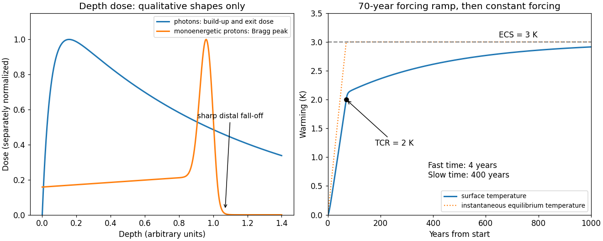

<h1 id="s10/2/c/solution">Solution</h1>

↑ **Parent:** [C](../c.md)

The dominant $z^2/\beta^2$ factor raises the [energy loss](../../../../../energy-loss.md) as a charged projectile slows, while the logarithm moderates that rise. This produces a [Bragg peak](../../../../../bragg-peak.md) close to the end of its [particle range](../../../../../particle-range.md). At still lower [velocity](../../../../../velocity.md), changing effective charge, shell effects and [nuclear stopping](../../../../../nuclear-stopping.md) invalidate extrapolation of the elementary [Bethe stopping formula](../../../../../bethe-stopping-formula.md) to zero [energy](../../../../../energy-split.md). A finite initial [energy](../../../../../energy-split.md) gives a finite [continuous-slowing-down range](../../../../../continuous-slowing-down-range.md),

$$
\boxed{R_{\rm CSDA}=\int_0^{T_0}\frac{dT}{S(T)}.}
$$

A higher initial [energy](../../../../../energy-split.md) increases the [particle range](../../../../../particle-range.md); greater electron [density](../../../../../density.md) increases [stopping power](../../../../../stopping-power.md) per unit length. Absorber $Z/A$ and $I$ also affect the depth. [Multiple Coulomb scattering](../../../../../multiple-coulomb-scattering.md), [energy-loss straggling](../../../../../energy-loss-straggling.md), nuclear reactions and the incident energy spread broaden the measured peak and distal fall-off; nuclear secondaries can produce a small tail. Superposing many incident energies makes a [spread-out Bragg peak](../../../../../spread-out-bragg-peak.md) for an extended target. The schematic curve below illustrates shapes only and is not patient [radiation dosimetry](../../../../../radiation-dosimetry.md).

**[Figure 2](#s10/2/c/image-qualitative-depth-dose-curves-and-a-two-timescale-climate-response-depth-is-in-arbitrary-units). Qualitative depth-dose curves and a two-timescale climate response; depth is in arbitrary units**.

## ↑ Ancestors (12)

1. [C](../c.md)
2. [2](../../2.md)
3. [S10](../../../s10.md)
4. [2019](../../../../2019-split.md)
5. [Past exam of the short options paper shared by Parts A and B of the physics course of the University of Oxford](../../../../split.md)
6. [Short options paper shared by Parts A and B of the physics course of the University of Oxford](../../../../../short-options-paper-shared-by-parts-a-and-b-of-the-physics-course-of-the-university-of-oxford.md)
7. [Physics course of the University of Oxford](../../../../../physics-course-of-the-university-of-oxford.md)
8. [Undergraduate course of the University of Oxford](../../../../../undergraduate-course-of-the-university-of-oxford.md)
9. [Course of the University of Oxford](../../../../../course-of-the-university-of-oxford.md)
10. [University of Oxford](../../../../../university-of-oxford-split.md)
11. [List of universities](../../../../../list-of-universities.md)
12. [Codex Wiki](../../../../../split.md)

## ← Incoming links (1)

- [Solution](../../../s25/2/c/solution.md)
