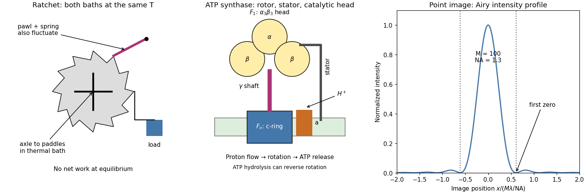

<h1 id="s12/2/c/solution">Solution</h1>

↑ **Parent:** [C](../c.md)

The left panel below shows paddles in a bath connected by an axle to an asymmetric toothed wheel, a spring-loaded pawl and a load. A naive argument lets random paddle kicks turn the wheel in one direction while the pawl blocks reverse motion, apparently extracting work from a single bath. The missing ingredient is the pawl's own [thermal fluctuations](../../../../../thermal-fluctuation.md). At the same [temperature](../../../../../temperature-split.md), it sometimes lifts and allows reverse slips. Correct forward and reverse transition rates obey [detailed balance](../../../../../detailed-balance.md), so no sustained directed rotation can do work at single-bath [thermal equilibrium](../../../../../thermal-equilibrium-split.md). The device illustrates, rather than disproves, the [Second law of thermodynamics](../../../../../second-law-of-thermodynamics-split.md).

A macroscopic shaken ratchet is driven far from [thermal equilibrium](../../../../../thermal-equilibrium-split.md): imposed shaking supplies organized mechanical [energy](../../../../../energy-split.md), and friction or inelastic collisions dissipate it. Its kilogram-scale parts are not moved appreciably by molecular [thermal fluctuations](../../../../../thermal-fluctuation.md). Rectification requires broken spatial symmetry from the teeth or pawl and appropriate dynamical coupling: the shaking must sometimes disengage or drive the pawl over a tooth while contact and dissipation prevent equal reverse motion. The load must remain below the available mean driving [torque](../../../../../torque.md). Isotropic, aperiodic shaking can satisfy these conditions because the asymmetric mechanism breaks directional symmetry; without the external [energy](../../../../../energy-split.md) supply, a working rectifier and dissipation, there is no guaranteed directed motion.

**[Figure 3](#s12/2/c/image-original-schematics-of-a-thermal-ratchet-rotary-atp-synthase-and-a-diffraction-limited-point-image). Original schematics of a thermal ratchet, rotary ATP synthase and a diffraction-limited point image**.

## ↑ Ancestors (12)

1. [C](../c.md)
2. [2](../../2.md)
3. [S12](../../../s12.md)
4. [2019](../../../../2019-split.md)
5. [Past exam of the short options paper shared by Parts A and B of the physics course of the University of Oxford](../../../../split.md)
6. [Short options paper shared by Parts A and B of the physics course of the University of Oxford](../../../../../short-options-paper-shared-by-parts-a-and-b-of-the-physics-course-of-the-university-of-oxford.md)
7. [Physics course of the University of Oxford](../../../../../physics-course-of-the-university-of-oxford.md)
8. [Undergraduate course of the University of Oxford](../../../../../undergraduate-course-of-the-university-of-oxford.md)
9. [Course of the University of Oxford](../../../../../course-of-the-university-of-oxford.md)
10. [University of Oxford](../../../../../university-of-oxford-split.md)
11. [List of universities](../../../../../list-of-universities.md)
12. [Codex Wiki](../../../../../split.md)

## ← Incoming links (2)

- [Solution](../../3/a/solution.md)
- [Solution](../../3/b/solution.md)
