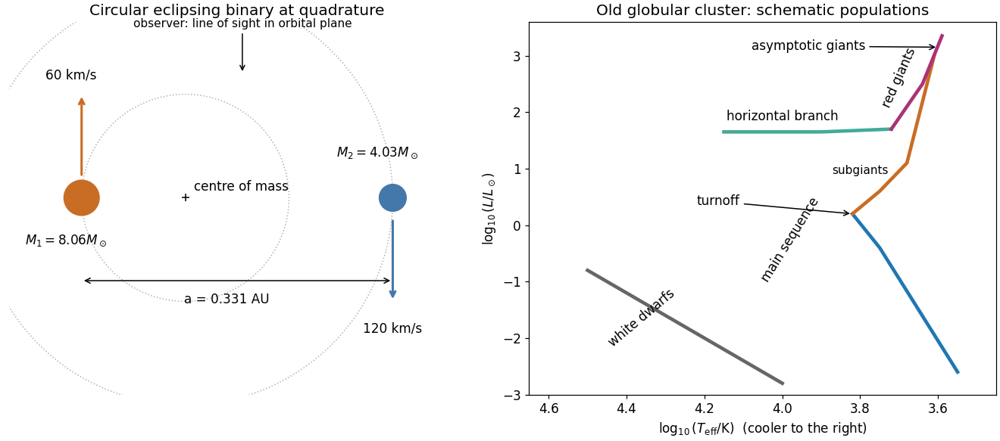

<h1 id="s2/1/b/solution">Solution</h1>

↑ **Parent:** [B](../b.md)

Assume a circular [orbit](../../../../../orbit-dynamical-system.md) and an [orbital inclination](../../../../../orbital-inclination.md) $i\simeq90^\circ$, as appropriate for a simple [eclipsing binary](../../../../../eclipsing-binary.md) estimate. At quadrature the two [radial velocities](../../../../../radial-velocity.md) are opposite and equal to the [orbital speeds](../../../../../orbital-speed.md). The more massive component has the smaller amplitude. With the [centre of mass](../../../../../center-of-mass.md) as origin,

$$
a_1=\frac{K_1P}{2\pi},\quad a_2=\frac{K_2P}{2\pi},\quad a=a_1+a_2,\quad \frac{M_1}{M_2}=\frac{K_2}{K_1}=2.
$$

Thus $a_1=0.1103\,\mathrm{AU}$, $a_2=0.2206\,\mathrm{AU}$ and [Kepler's third law](../../../../../kepler-s-third-law.md) gives

$$
\boxed{a=0.3309\,\mathrm{AU},\quad M_1=8.06M_\odot,\quad M_2=4.03M_\odot.}
$$

The [orbital plane](../../../../../orbital-plane.md) contains the observer's line of sight; at quadrature the two [velocities](../../../../../velocity.md) point towards and away from that observer, as labelled in the original schematic below. For an [elliptic orbit](../../../../../elliptic-orbit.md), the measured amplitudes instead give $a\sin i=P(K_1+K_2)\sqrt{1-e^2}/(2\pi)$; the numerical answer requires the circular assumption.

**[Figure 1](#s2/1/b/image-binary-geometry-and-an-old-globular-cluster-hertzsprung-russell-diagram-both-panels-are-schematic). Binary geometry and an old globular-cluster Hertzsprung-Russell diagram; both panels are schematic**.

## ↑ Ancestors (12)

1. [B](../b.md)
2. [1](../../1.md)
3. [S2](../../../s2.md)
4. [2019](../../../../2019-split.md)
5. [Past exam of the short options paper shared by Parts A and B of the physics course of the University of Oxford](../../../../split.md)
6. [Short options paper shared by Parts A and B of the physics course of the University of Oxford](../../../../../short-options-paper-shared-by-parts-a-and-b-of-the-physics-course-of-the-university-of-oxford.md)
7. [Physics course of the University of Oxford](../../../../../physics-course-of-the-university-of-oxford.md)
8. [Undergraduate course of the University of Oxford](../../../../../undergraduate-course-of-the-university-of-oxford.md)
9. [Course of the University of Oxford](../../../../../course-of-the-university-of-oxford.md)
10. [University of Oxford](../../../../../university-of-oxford-split.md)
11. [List of universities](../../../../../list-of-universities.md)
12. [Codex Wiki](../../../../../split.md)

## ← Incoming links (1)

- [Solution](../../2/c/solution.md)
