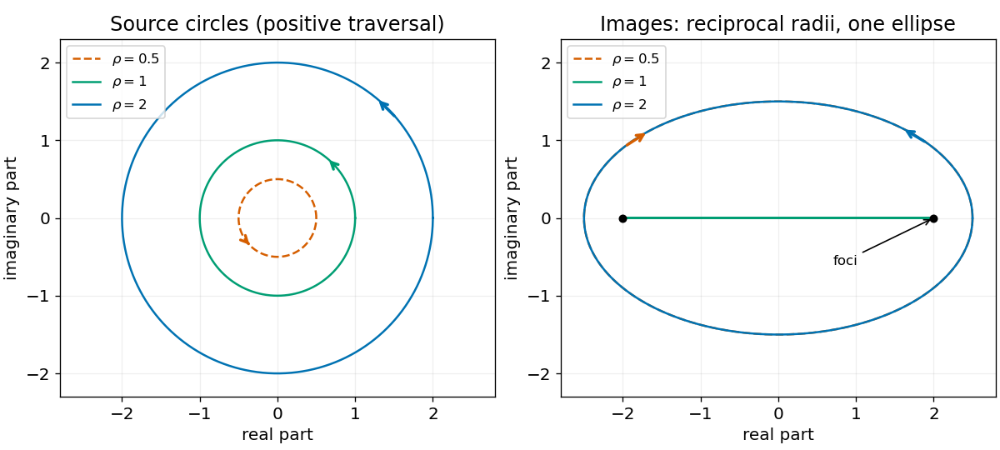

<h1 id="s1/2/d/solution">Solution</h1>

↑ **Parent:** [D](../d.md)

For a radius $\rho>0$, write $z=\rho e^{i\theta}$. Then

$$
w=(\rho+\rho^{-1})\cos\theta+i(\rho-\rho^{-1})\sin\theta.
$$

For $\rho\ne1$ its image is the [ellipse](../../../../../ellipse.md)

$$
\boxed{\frac{(\operatorname{Re}w)^2}{(\rho+\rho^{-1})^2}
+\frac{(\operatorname{Im}w)^2}{(\rho-\rho^{-1})^2}=1.}
$$

Its horizontal semiaxis is $\rho+\rho^{-1}$, its vertical semiaxis is $|\rho-\rho^{-1}|$, and its [foci](../../../../../focus-dynamical-systems.md) are $\pm2$ because the squared semiaxes differ by $4$. Reciprocal radii give the same [ellipse](../../../../../ellipse.md), traversed in opposite directions as $\theta$ increases.

**[Figure 1](#s1/2/d/image-the-joukowski-map-sends-reciprocal-radius-circles-to-one-ellipse-and-the-unit-circle-to-a-doubled-interval). The Joukowski map sends reciprocal-radius circles to one ellipse and the unit circle to a doubled interval**.

## ↑ Ancestors (12)

1. [D](../d.md)
2. [2](../../2.md)
3. [S1](../../../s1.md)
4. [2012](../../../../2012-split.md)
5. [Past exam of the short options paper shared by Prelims and Parts A and B of the physics course of the University of Oxford](../../../../split.md)
6. [Short options paper shared by Prelims and Parts A and B of the physics course of the University of Oxford](../../../../../short-options-paper-shared-by-prelims-and-parts-a-and-b-of-the-physics-course-of-the-university-of-oxford.md)
7. [Physics course of the University of Oxford](../../../../../physics-course-of-the-university-of-oxford.md)
8. [Undergraduate course of the University of Oxford](../../../../../undergraduate-course-of-the-university-of-oxford.md)
9. [Course of the University of Oxford](../../../../../course-of-the-university-of-oxford.md)
10. [University of Oxford](../../../../../university-of-oxford-split.md)
11. [List of universities](../../../../../list-of-universities.md)
12. [Codex Wiki](../../../../../split.md)
