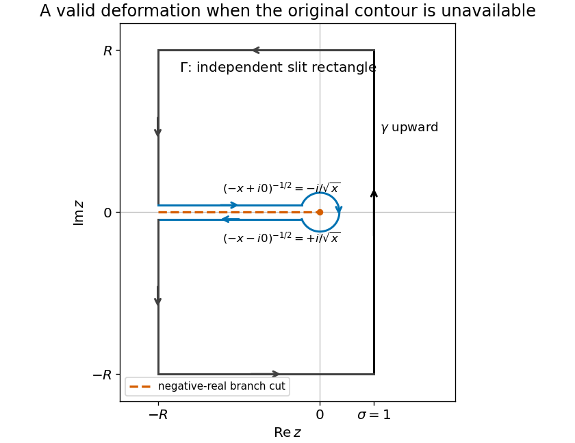

<h1 id="s1/3/b/solution">Solution</h1>

↑ **Parent:** [B](../b.md)

TODO: the original closed-contour drawing is absent from the source. The following independent [Bromwich contour](../../../../../bromwich-contour.md) deformation establishes the required discontinuity relation without asserting the missing drawing's exact geometry. Orient the vertical line upward, as required by the positive imaginary answer in the next part, and use the [principal square root](../../../../../principal-square-root-of-a-complex-number.md), $-\pi<\arg z<\pi$.

Close a truncated vertical line to the left with a rectangle, slit it along the negative real axis, and exclude a small circle about zero. The integrand is [holomorphic](../../../../../holomorphic-function-split.md) inside that slit domain, so the boundary [contour integral](../../../../../contour-integral.md) is zero. Horizontal boundary integrals are $O(R^{-1/2})$: integrating $e^x$ along $-R\le x\le1$ gives a bounded factor while $|z|^{-1/2}\le R^{-1/2}$. The left boundary contributes $O(e^{-R}R^{1/2})$, and the small circle contributes $O(\sqrt\varepsilon)$. All vanish in the indicated limits.

At $z=-x$ with $x>0$, the upper and lower bank values are respectively $-ie^{-x}/\sqrt x$ and $+ie^{-x}/\sqrt x$. The boundary follows the upper bank toward zero and the lower bank away from zero. Their combined contribution is $-2i\int_0^\infty e^{-x}x^{-1/2}dx$. Hence

$$
\boxed{I=2i\int_0^\infty e^{-x}x^{-1/2}dx.}
$$

The vertically improper integral converges conditionally; these estimates also justify the contour limit. Reversing the vertical orientation reverses its sign.

**[Figure 2](#s1/3/b/image-an-independently-chosen-slit-rectangle-contour-relates-the-upward-bromwich-integral-to-the-square-root-branch-jump). An independently chosen slit-rectangle contour relates the upward Bromwich integral to the square-root branch jump**.

## ↑ Ancestors (12)

1. [B](../b.md)
2. [3](../../3.md)
3. [S1](../../../s1.md)
4. [2012](../../../../2012-split.md)
5. [Past exam of the short options paper shared by Prelims and Parts A and B of the physics course of the University of Oxford](../../../../split.md)
6. [Short options paper shared by Prelims and Parts A and B of the physics course of the University of Oxford](../../../../../short-options-paper-shared-by-prelims-and-parts-a-and-b-of-the-physics-course-of-the-university-of-oxford.md)
7. [Physics course of the University of Oxford](../../../../../physics-course-of-the-university-of-oxford.md)
8. [Undergraduate course of the University of Oxford](../../../../../undergraduate-course-of-the-university-of-oxford.md)
9. [Course of the University of Oxford](../../../../../course-of-the-university-of-oxford.md)
10. [University of Oxford](../../../../../university-of-oxford-split.md)
11. [List of universities](../../../../../list-of-universities.md)
12. [Codex Wiki](../../../../../split.md)
