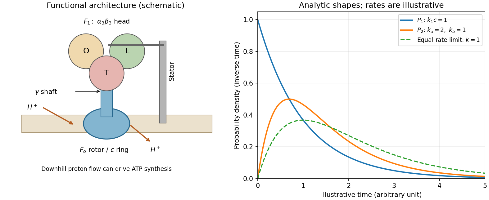

<h1 id="s12/2/1/solution">Solution</h1>

↑ **Parent:** [1](../1.md)

[ATP synthase](../../../../../atp-synthase.md) couples downhill proton motion across a [cell membrane](../../../../../cell-membrane-split.md) to synthesis of [ATP](../../../../../adenosine-triphosphate.md) from [ADP](../../../../../adenosine-diphosphate.md) and inorganic phosphate. Its membrane-embedded $F_o$ sector contains an $a$ subunit with offset proton-access half-channels and a rotating $c$-subunit ring. Reversible protonation of sites on the ring permits rotation relative to the stationary $a$ subunit. The central rotor transmits this motion through the $\gamma$ shaft to the soluble $F_1$ head. A peripheral stator holds the head relative to the membrane sector. The common bacterial schematic has an $\alpha_3\beta_3$ head, catalytic sites mainly on the three $\beta$ subunits, and a central $\gamma/\epsilon$ rotor; accessory stator components depend on the organism.

The [binding-change mechanism](../../../../../binding-change-mechanism.md) cycles the catalytic sites between open, loose-binding and tight-binding conformations. Rotor orientation changes their affinities for [ADP](../../../../../adenosine-diphosphate.md), phosphate and [ATP](../../../../../adenosine-triphosphate.md); the sites operate out of phase. Tight binding favors formation of bound [ATP](../../../../../adenosine-triphosphate.md), and mechanical rotation changes the conformation to permit product release. In the ideal tightly coupled cycle, one revolution gives three catalytic turnovers:

$$
\boxed{3\ \text{ATP per }360^\circ,\qquad 1\ \text{ATP per }120^\circ.}
$$

The proton count is not universally fixed: an ideal ring with $n_c$ proton-carrying subunits gives $n_c$ protons per revolution and $n_c/3$ protons per synthesized [ATP](../../../../../adenosine-triphosphate.md), before additional transport costs.

For a proton moving from side 1 to side 2, its molar [electrochemical potential](../../../../../electrochemical-potential.md) change is

$$
\Delta\mu_{\mathrm H^+}=RT\log\frac{a_{\mathrm H^+,2}}{a_{\mathrm H^+,1}}+F(\psi_2-\psi_1).
$$

The chemical gradient and membrane [electric potential difference](../../../../../electric-potential-difference.md) together supply the [proton-motive force](../../../../../proton-motive-force.md). Synthesis requires the proton free-energy release to meet the positive [Gibbs free energy](../../../../../gibbs-free-energy.md) of [ATP](../../../../../adenosine-triphosphate.md) synthesis. The coupling is reversible: isolated $F_1$ supplied with [ATP](../../../../../adenosine-triphosphate.md) can hydrolyse it and rotate its shaft, while the intact enzyme can use hydrolysis-driven rotation to pump protons against their gradient. The sketch is structural and schematic; it does not reconstruct the absent stepping trace.

**[Figure 8](#s12/2/1/image-atp-synthase-architecture-and-the-two-derived-dwell-time-distributions). ATP synthase architecture and the two derived dwell-time distributions**. The structural panel shows a membrane rotor, shaft, stator and three catalytic sites. The distribution panel uses explicitly illustrative dimensionless rates, not values read from the absent source stepping plot.

## ↑ Ancestors (12)

1. [1](../1.md)
2. [2](../../2.md)
3. [S12](../../../s12.md)
4. [2012](../../../../2012-split.md)
5. [Past exam of the short options paper shared by Prelims and Parts A and B of the physics course of the University of Oxford](../../../../split.md)
6. [Short options paper shared by Prelims and Parts A and B of the physics course of the University of Oxford](../../../../../short-options-paper-shared-by-prelims-and-parts-a-and-b-of-the-physics-course-of-the-university-of-oxford.md)
7. [Physics course of the University of Oxford](../../../../../physics-course-of-the-university-of-oxford.md)
8. [Undergraduate course of the University of Oxford](../../../../../undergraduate-course-of-the-university-of-oxford.md)
9. [Course of the University of Oxford](../../../../../course-of-the-university-of-oxford.md)
10. [University of Oxford](../../../../../university-of-oxford-split.md)
11. [List of universities](../../../../../list-of-universities.md)
12. [Codex Wiki](../../../../../split.md)
