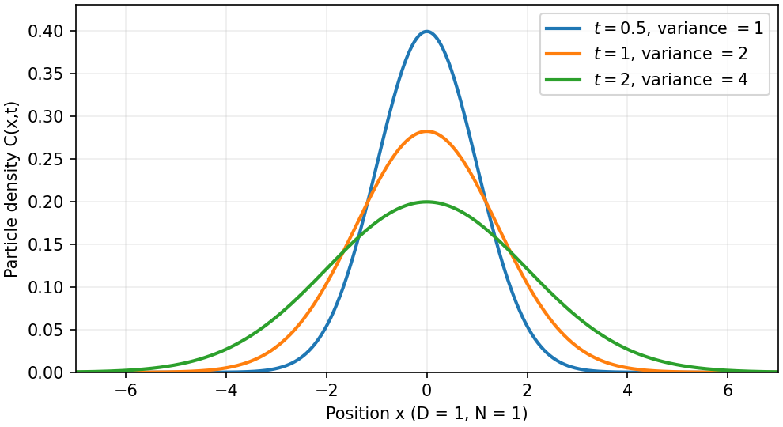

<h1 id="s12/3/3/solution">Solution</h1>

↑ **Parent:** [3](../3.md)

For constant $D$ and no drift, particle conservation and [Fick's first law](../../../../../fick-s-first-law.md) give the one-dimensional [diffusion equation](../../../../../diffusion-equation-split.md) $\partial_t C=D\partial_x^2 C$. For $C=A t^{-1/2}e^{-x^2/(4Dt)}$,

$$
\partial_t C=C\left(-\frac1{2t}+\frac{x^2}{4Dt^2}\right),\qquad
\partial_x^2 C=C\left(-\frac1{2Dt}+\frac{x^2}{4D^2t^2}\right),
$$

so direct substitution verifies the equation for $t>0$. The [Gaussian integral](../../../../../gaussian-integral.md) fixes the normalization:

$$
\int_{-\infty}^{\infty}C\,dx=A\sqrt{4\pi D}=N,\qquad
\boxed{C(x,t)=\frac{N}{\sqrt{4\pi Dt}}\exp\left(-\frac{x^2}{4Dt}\right).}
$$

This is the [heat kernel](../../../../../heat-kernel.md) for a point release, with $C(x,0)=N\delta(x)$ in the distributional limit. It remains centered at zero while its width grows as $t^{1/2}$ and its peak falls as $t^{-1/2}$. To compute the second moment, set $y=x/\sqrt{4Dt}$:

$$
\langle x^2\rangle=\frac1N\int x^2C\,dx
=\frac{4Dt}{\sqrt\pi}\int_{-\infty}^{\infty}y^2e^{-y^2}\,dy
=\boxed{2Dt},
$$

using $\int y^2e^{-y^2}dy=\sqrt\pi/2$ over the whole real line, obtained by integration by parts.

If the mean number of independent unbiased jumps in time $t$ is $\langle m\rangle=ft$, conditioning on $m$ gives $\langle x^2(t)\rangle=\Delta\langle m\rangle=f\Delta t$. Matching it to the continuum [diffusion](../../../../../diffusion.md) result yields

$$
\boxed{D=\frac{f\Delta}{2}.}
$$

For fixed-magnitude steps $a$, $\Delta=a^2$. The equality of second moments also holds for Poisson jump times independent of the increments; a Gaussian continuum approximation additionally requires many steps and finite step variance.

**[Figure 9](#s12/3/3/image-spreading-of-a-normalized-one-dimensional-diffusion-packet). Spreading of a normalized one-dimensional diffusion packet**. Analytic Gaussian profiles with N=1 and D=1 at three illustrative times have fixed unit area, peak proportional to inverse square root of time, and variance 2Dt.

## ↑ Ancestors (12)

1. [3](../3.md)
2. [3](../../3.md)
3. [S12](../../../s12.md)
4. [2012](../../../../2012-split.md)
5. [Past exam of the short options paper shared by Prelims and Parts A and B of the physics course of the University of Oxford](../../../../split.md)
6. [Short options paper shared by Prelims and Parts A and B of the physics course of the University of Oxford](../../../../../short-options-paper-shared-by-prelims-and-parts-a-and-b-of-the-physics-course-of-the-university-of-oxford.md)
7. [Physics course of the University of Oxford](../../../../../physics-course-of-the-university-of-oxford.md)
8. [Undergraduate course of the University of Oxford](../../../../../undergraduate-course-of-the-university-of-oxford.md)
9. [Course of the University of Oxford](../../../../../course-of-the-university-of-oxford.md)
10. [University of Oxford](../../../../../university-of-oxford-split.md)
11. [List of universities](../../../../../list-of-universities.md)
12. [Codex Wiki](../../../../../split.md)
