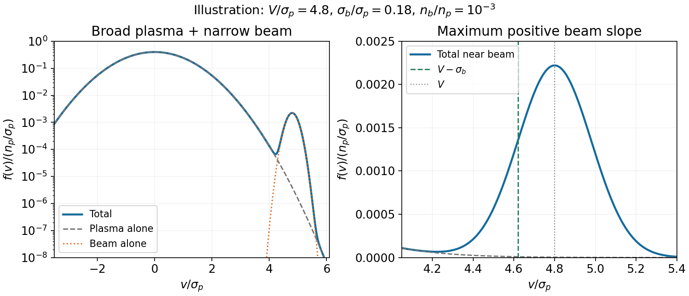

<h1 id="s16/1/2/solution">Solution</h1>

↑ **Parent:** [2](../2.md)

Define the one-dimensional thermal widths $\sigma_p=\sqrt{k_{\rm B}T_p/m_e}$ and $\sigma_b=\sqrt{k_{\rm B}T_b/m_e}$. Normalize each [velocity distribution](../../../../../velocity-distribution.md) to its electron number density:

$$
f_p(v)=\frac{n_p}{\sqrt{2\pi}\sigma_p}e^{-v^2/(2\sigma_p^2)},\qquad
f_b(v)=\frac{n_b}{\sqrt{2\pi}\sigma_b}e^{-(v-V)^2/(2\sigma_b^2)}.
$$

The total is $f=f_p+f_b$. It consists of a broad peak centred at zero and a much narrower displaced beam near $V$, with $V\gg\sigma_p\gg\sigma_b$. Their areas, rather than their peak heights, are $n_p$ and $n_b$. A weak narrow beam can make a positive-slope region on its low-velocity side even while contributing little to the total density.

**[Figure 10](#s16/1/2/image-broad-plasma-maxwellian-and-a-narrow-displaced-electron-beam). Broad plasma Maxwellian and a narrow displaced electron beam**. Illustrative normalized widths and density ratio are used to display the beam on the background tail. The marked V−sigma\_b is the point of maximum positive beam slope, not a universal exact marginal-mode velocity.

## ↑ Ancestors (12)

1. [2](../2.md)
2. [1](../../1.md)
3. [S16](../../../s16.md)
4. [2012](../../../../2012-split.md)
5. [Past exam of the short options paper shared by Prelims and Parts A and B of the physics course of the University of Oxford](../../../../split.md)
6. [Short options paper shared by Prelims and Parts A and B of the physics course of the University of Oxford](../../../../../short-options-paper-shared-by-prelims-and-parts-a-and-b-of-the-physics-course-of-the-university-of-oxford.md)
7. [Physics course of the University of Oxford](../../../../../physics-course-of-the-university-of-oxford.md)
8. [Undergraduate course of the University of Oxford](../../../../../undergraduate-course-of-the-university-of-oxford.md)
9. [Course of the University of Oxford](../../../../../course-of-the-university-of-oxford.md)
10. [University of Oxford](../../../../../university-of-oxford-split.md)
11. [List of universities](../../../../../list-of-universities.md)
12. [Codex Wiki](../../../../../split.md)
