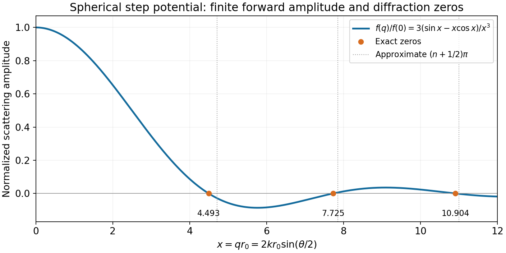

<h1 id="s18/2/3/solution">Solution</h1>

↑ **Parent:** [3](../3.md)

Apart from the finite forward limit, amplitude zeros obey $\sin x-x\cos x=0$, or $\tan x=x$, where $x=qr_0$. The first positive root is $x_1\simeq4.49341$. Since the accessible range is $0\le x\le2kr_0$,

$$
\boxed{k_c=\frac{x_1}{2r_0}\simeq\frac{2.247}{r_0}.}
$$

Thus there are no zeros for $k<k_c$; the first enters at the largest momentum transfer, $\theta=\pi$, when $k=k_c$.

For larger roots, $x_n$ lies just below $a_n=\pi(n+\tfrac12)$, $n=1,2,\ldots$. Expanding $\tan(a_n-\varepsilon)\simeq1/\varepsilon$ gives $x_n=a_n-1/a_n+O(a_n^{-3})$. Keeping its leading term yields the requested diffraction estimate

$$
\boxed{\theta_n\simeq2\arcsin\left[\frac\pi{2kr_0}\left(n+\frac12\right)\right],\qquad \pi\left(n+\frac12\right)\le2kr_0.}
$$

Exactly, replace the numerator $\pi(n+\tfrac12)$ by the corresponding root $x_n$. The displayed approximation is a large-$qr_0$ root approximation: taking $k$ large at fixed low order does not make $x_1$ equal to $3\pi/2$. For example, the exact first angle at high $k$ is approximately $4.49341/(kr_0)$, not $4.71239/(kr_0)$.

**[Figure 11](#s18/2/3/image-born-scattering-form-factor-of-a-spherical-constant-potential). Born scattering form factor of a spherical constant potential**. The exact normalized amplitude and its first three zeros are shown. The asymptotic half-integer-pi locations are close estimates, with a visible low-order correction.

## ↑ Ancestors (12)

1. [3](../3.md)
2. [2](../../2.md)
3. [S18](../../../s18.md)
4. [2012](../../../../2012-split.md)
5. [Past exam of the short options paper shared by Prelims and Parts A and B of the physics course of the University of Oxford](../../../../split.md)
6. [Short options paper shared by Prelims and Parts A and B of the physics course of the University of Oxford](../../../../../short-options-paper-shared-by-prelims-and-parts-a-and-b-of-the-physics-course-of-the-university-of-oxford.md)
7. [Physics course of the University of Oxford](../../../../../physics-course-of-the-university-of-oxford.md)
8. [Undergraduate course of the University of Oxford](../../../../../undergraduate-course-of-the-university-of-oxford.md)
9. [Course of the University of Oxford](../../../../../course-of-the-university-of-oxford.md)
10. [University of Oxford](../../../../../university-of-oxford-split.md)
11. [List of universities](../../../../../list-of-universities.md)
12. [Codex Wiki](../../../../../split.md)
