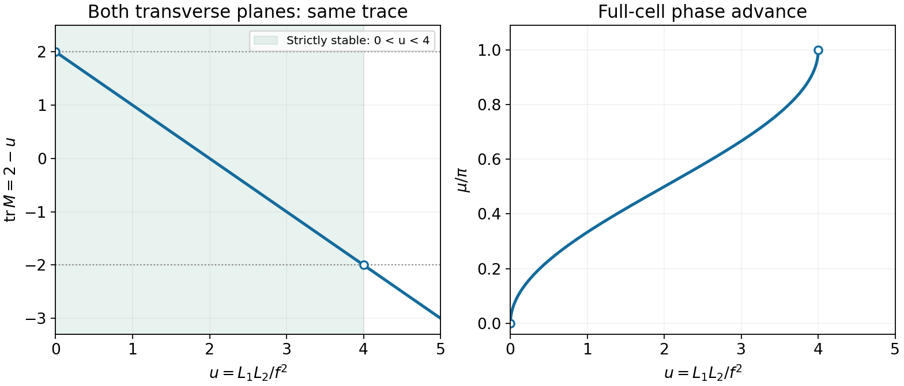

<h1 id="s19/1/c/solution">Solution</h1>

↑ **Parent:** [C](../c.md)

For a real determinant-one map, bounded generic repeated transport requires eigenvalues $e^{\pm i\mu}$, equivalently $|\operatorname{tr}M|<2$. Here both planes have $\operatorname{tr}M=2-L_1L_2/f^2$, so

$$
\boxed{0<\frac{L_1L_2}{f^2}<4,\qquad \cos\mu=1-\frac{L_1L_2}{2f^2}.}
$$

For positive drift lengths and $f>0$, this means $f>\sqrt{L_1L_2}/2$. The equalities are marginal and generally produce a Jordan-block growth rather than stable motion. Moving the reference point changes the map by a similarity transformation, $M\to PMP^{-1}$, so the eigenvalues and full-cell phase advance are unchanged.

Write the stable map using the [Courant-Snyder parameters](../../../../../courant-snyder-parameters.md), also called Twiss parameters:

$$
M=\begin{pmatrix}\cos\mu+\alpha\sin\mu&\beta\sin\mu\\-\gamma_T\sin\mu&\cos\mu-\alpha\sin\mu\end{pmatrix},\qquad \beta\gamma_T-\alpha^2=1.
$$

At the chosen reference point $\beta=M_{12}/\sin\mu$, $\alpha=(M_{11}-M_{22})/(2\sin\mu)$, and $\gamma_T=-M_{21}/\sin\mu$. Repeated traversal gives

$$
\boxed{M^n=\begin{pmatrix}\cos n\mu+\alpha\sin n\mu&\beta\sin n\mu\\-\gamma_T\sin n\mu&\cos n\mu-\alpha\sin n\mu\end{pmatrix}.}
$$

If the full ring contains $N_c$ identical cells, its one-turn phase is $N_c\mu$ modulo $2\pi$; $n$ ring turns use $nN_c\mu$. The displayed $M^n$ is for $n$ repetitions of the specified cell.

**[Figure 12](#s19/1/c/image-stability-and-phase-advance-of-the-equal-strength-quadrupole-cell). Stability and phase advance of the equal-strength quadrupole cell**. Both transverse planes have trace 2 minus L\_1 L\_2/f squared. The strict stable interval excludes the two marginal boundaries.

## ↑ Ancestors (12)

1. [C](../c.md)
2. [1](../../1.md)
3. [S19](../../../s19.md)
4. [2012](../../../../2012-split.md)
5. [Past exam of the short options paper shared by Prelims and Parts A and B of the physics course of the University of Oxford](../../../../split.md)
6. [Short options paper shared by Prelims and Parts A and B of the physics course of the University of Oxford](../../../../../short-options-paper-shared-by-prelims-and-parts-a-and-b-of-the-physics-course-of-the-university-of-oxford.md)
7. [Physics course of the University of Oxford](../../../../../physics-course-of-the-university-of-oxford.md)
8. [Undergraduate course of the University of Oxford](../../../../../undergraduate-course-of-the-university-of-oxford.md)
9. [Course of the University of Oxford](../../../../../course-of-the-university-of-oxford.md)
10. [University of Oxford](../../../../../university-of-oxford-split.md)
11. [List of universities](../../../../../list-of-universities.md)
12. [Codex Wiki](../../../../../split.md)
