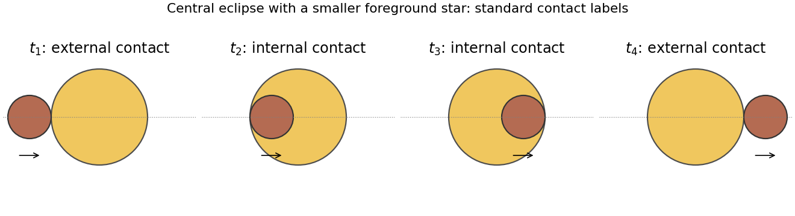

<h1 id="s2/1/3/solution">Solution</h1>

↑ **Parent:** [3](../3.md)

TODO: the source light curve, its numerical contact phases and the meanings of the four plotted time labels are absent, so unique numerical stellar radii cannot be recovered. The [central eclipse contact-radius relations](../../../../../central-eclipse-contact-radius-relations.md) explain what the missing measurements would determine.

If $t_1,\ldots,t_4$ denote the usual first through fourth contacts of a central eclipse, define $T_{14}=t_4-t_1$ and $T_{23}=t_3-t_2$, and let $R_L\ge R_S$ be the two radii. For a circular edge-on orbit,

$$
R_L+R_S=a\sin\frac{\pi T_{14}}P,\qquad
R_L-R_S=a\sin\frac{\pi T_{23}}P.
$$

Taking half their sum and difference gives the radii. For short eclipses the familiar approximation is $R_L\simeq v_{\rm rel}(T_{14}+T_{23})/4$ and $R_S\simeq v_{\rm rel}(T_{14}-T_{23})/4$, with $v_{\rm rel}=2K$. At first and fourth contact the discs touch externally; at second and third the smaller disc is just internally tangent to the larger. Noncentral eclipses require the projected impact parameter as well.

**[Figure 3](#s2/1/3/image-conditional-central-eclipse-contact-geometry-this-schematic-supplies-no-readings-from-the-missing-source-light-curve). Conditional central-eclipse contact geometry; this schematic supplies no readings from the missing source light curve**.

## ↑ Ancestors (12)

1. [3](../3.md)
2. [1](../../1.md)
3. [S2](../../../s2.md)
4. [2012](../../../../2012-split.md)
5. [Past exam of the short options paper shared by Prelims and Parts A and B of the physics course of the University of Oxford](../../../../split.md)
6. [Short options paper shared by Prelims and Parts A and B of the physics course of the University of Oxford](../../../../../short-options-paper-shared-by-prelims-and-parts-a-and-b-of-the-physics-course-of-the-university-of-oxford.md)
7. [Physics course of the University of Oxford](../../../../../physics-course-of-the-university-of-oxford.md)
8. [Undergraduate course of the University of Oxford](../../../../../undergraduate-course-of-the-university-of-oxford.md)
9. [Course of the University of Oxford](../../../../../course-of-the-university-of-oxford.md)
10. [University of Oxford](../../../../../university-of-oxford-split.md)
11. [List of universities](../../../../../list-of-universities.md)
12. [Codex Wiki](../../../../../split.md)
