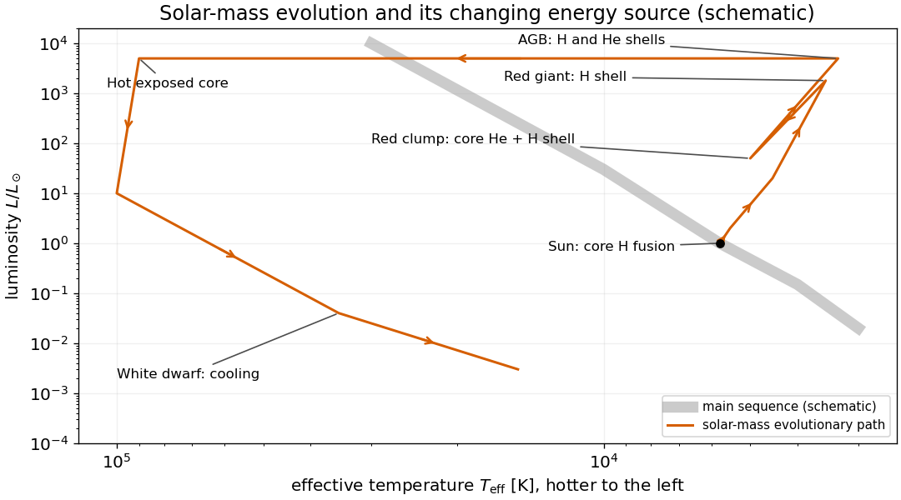

<h1 id="s2/2/3/solution">Solution</h1>

↑ **Parent:** [3](../3.md)

A [Hertzsprung-Russell diagram](../../../../../hertzsprung-russell-diagram.md) plots [stellar luminosity](../../../../../stellar-luminosity.md) upward and [effective temperature](../../../../../effective-temperature.md) increasing toward the left. The [main sequence](../../../../../main-sequence.md) runs from hot luminous stars at upper left to cool faint stars at lower right, with the Sun near $T_{\rm eff}\simeq5800\,\mathrm K$, $L=L_\odot$.

In the [evolution of a solar-mass star](../../../../../evolution-of-a-solar-mass-star.md), core hydrogen fusion initially supplies the luminosity. As core hydrogen is exhausted, hydrogen-shell fusion around a contracting helium core carries the star through the [subgiant](../../../../../subgiant.md) and [red giant](../../../../../red-giant.md) phases toward higher luminosity and lower surface temperature. Helium ignition is followed by core helium fusion with a hydrogen-burning shell, placing a solar-mass star in the [red clump](../../../../../red-clump.md). The later [Asymptotic giant branch](../../../../../asymptotic-giant-branch.md) has hydrogen- and helium-burning shells around a carbon-oxygen core. Envelope ejection exposes a hot central star of a [planetary nebula](../../../../../planetary-nebula.md); residual shell burning ends and the resulting [white dwarf](../../../../../white-dwarf.md) radiates stored thermal energy as it cools.

**[Figure 4](#s2/2/3/image-schematic-solar-mass-evolution-on-an-h-r-diagram-with-the-dominant-energy-sources-labelled). Schematic solar-mass evolution on an H-R diagram, with the dominant energy sources labelled**.

## ↑ Ancestors (12)

1. [3](../3.md)
2. [2](../../2.md)
3. [S2](../../../s2.md)
4. [2012](../../../../2012-split.md)
5. [Past exam of the short options paper shared by Prelims and Parts A and B of the physics course of the University of Oxford](../../../../split.md)
6. [Short options paper shared by Prelims and Parts A and B of the physics course of the University of Oxford](../../../../../short-options-paper-shared-by-prelims-and-parts-a-and-b-of-the-physics-course-of-the-university-of-oxford.md)
7. [Physics course of the University of Oxford](../../../../../physics-course-of-the-university-of-oxford.md)
8. [Undergraduate course of the University of Oxford](../../../../../undergraduate-course-of-the-university-of-oxford.md)
9. [Course of the University of Oxford](../../../../../course-of-the-university-of-oxford.md)
10. [University of Oxford](../../../../../university-of-oxford-split.md)
11. [List of universities](../../../../../list-of-universities.md)
12. [Codex Wiki](../../../../../split.md)
