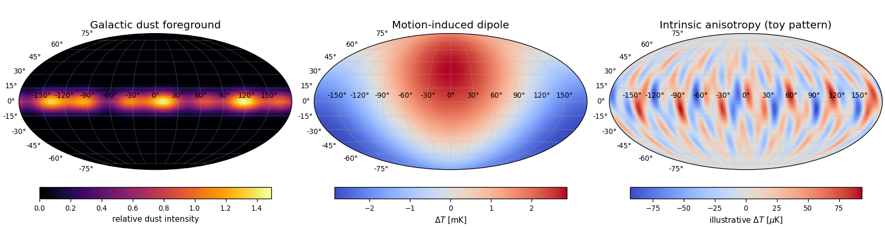

<h1 id="s2/3/c/solution">Solution</h1>

↑ **Parent:** [C](../c.md)

After subtracting the mean, the motion-induced dipole and [galactic foregrounds](../../../../../galactic-foreground.md), intrinsic [Cosmic microwave background anisotropy](../../../../../cosmic-microwave-background-anisotropy-split.md) appears as angular hot and cold patches, typically at the $10^{-5}$ fractional scale. These spatial [temperature fluctuations](../../../../../temperature-fluctuation.md) encode early density and velocity structure. The displayed patch pattern is illustrative, with no claim to reproduce an observed sky map.

**[Figure 5](#s2/3/c/image-schematic-microwave-components-galactic-dust-a-kinematic-dipole-and-intrinsic-anisotropy-using-separate-colour-scales). Schematic microwave components: Galactic dust, a kinematic dipole and intrinsic anisotropy, using separate colour scales**.

## ↑ Ancestors (12)

1. [C](../c.md)
2. [3](../../3.md)
3. [S2](../../../s2.md)
4. [2012](../../../../2012-split.md)
5. [Past exam of the short options paper shared by Prelims and Parts A and B of the physics course of the University of Oxford](../../../../split.md)
6. [Short options paper shared by Prelims and Parts A and B of the physics course of the University of Oxford](../../../../../short-options-paper-shared-by-prelims-and-parts-a-and-b-of-the-physics-course-of-the-university-of-oxford.md)
7. [Physics course of the University of Oxford](../../../../../physics-course-of-the-university-of-oxford.md)
8. [Undergraduate course of the University of Oxford](../../../../../undergraduate-course-of-the-university-of-oxford.md)
9. [Course of the University of Oxford](../../../../../course-of-the-university-of-oxford.md)
10. [University of Oxford](../../../../../university-of-oxford-split.md)
11. [List of universities](../../../../../list-of-universities.md)
12. [Codex Wiki](../../../../../split.md)
