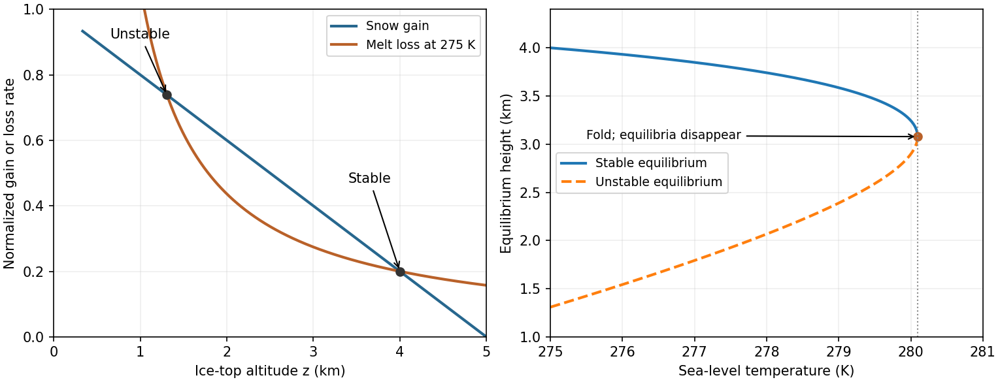

<h1 id="s25/2/2/solution">Solution</h1>

↑ **Parent:** [2](../2.md)

Write $s=T_s-273.15\,\mathrm K$ as the numerical sea-level Celsius [temperature](../../../../../temperature-split.md) in degrees Celsius, and use the same degree increments for $\Gamma z$. The model's top temperature is $T_C=s-\Gamma z$. For positive $\alpha$ its intended cold-ice branch has $T_C<0$, so the positive melt-loss magnitude and snow gain are

$$
L(z)=\frac{\alpha}{\Gamma z-s},\qquad A(z)=1-\beta z,\qquad
F(z)=\dot M=A(z)-L(z).
$$

The model is singular at $z=s/\Gamma$ and is not a physical melting law across that boundary. On the relevant interval $s/\Gamma<z<1/\beta$, $L$ decreases hyperbolically and $A$ decreases linearly. Assume a fixed area and positive ice density, so increasing [mass](../../../../../mass.md) increases $z$: stability has the same sign as $F'(z)$.

The equilibrium equation is

$$
(1-\beta z)(\Gamma z-s)=\alpha,
$$

with roots

$$
\boxed{z_\pm=\frac{\Gamma+\beta s\pm\sqrt{(\Gamma-\beta s)^2-4\alpha\beta\Gamma}}{2\beta\Gamma}.}
$$

Two distinct physical equilibria, one stable, exist provided

$$
\boxed{\Gamma-\beta s>2\sqrt{\alpha\beta\Gamma}\quad\Longleftrightarrow\quad
s<\frac\Gamma\beta-2\sqrt{\frac{\alpha\Gamma}{\beta}}.}
$$

This combines a positive allowed interval with a strictly positive discriminant. At the larger root $F'<0$ and small perturbations restore the ice cap; the smaller root has $F'>0$ and is unstable. Since

$$
F'(z)=-\beta+\frac{\alpha\Gamma}{(\Gamma z-s)^2},
$$

a restoring local response requires

$$
\boxed{z>z_{\rm slope}=\frac s\Gamma+\sqrt{\frac{\alpha}{\beta\Gamma}}.}
$$

This is the lower height bound from the stability derivative; the stable equilibrium itself is $z_+$. The minimum initial height for persistence, a different notion of threshold, is the unstable separator $z_-$: initial heights above it approach $z_+$, while lower heights lose ice and leave the model's cold branch. At equality in the discriminant condition the two equilibria merge, giving a marginal fold rather than a strictly stable ice cap.

**[Figure 13](#s25/2/2/image-snow-accumulation-melt-loss-and-the-ice-cap-stability-threshold). Snow accumulation, melt loss and the ice-cap stability threshold**. The initial curves have an unstable lower intersection and a stable upper intersection. Slow sea-level warming shifts the melt curve until both equilibria meet at a fold; all temperatures inside the reciprocal melt law are Celsius.

## ↑ Ancestors (12)

1. [2](../2.md)
2. [2](../../2.md)
3. [S25](../../../s25.md)
4. [2012](../../../../2012-split.md)
5. [Past exam of the short options paper shared by Prelims and Parts A and B of the physics course of the University of Oxford](../../../../split.md)
6. [Short options paper shared by Prelims and Parts A and B of the physics course of the University of Oxford](../../../../../short-options-paper-shared-by-prelims-and-parts-a-and-b-of-the-physics-course-of-the-university-of-oxford.md)
7. [Physics course of the University of Oxford](../../../../../physics-course-of-the-university-of-oxford.md)
8. [Undergraduate course of the University of Oxford](../../../../../undergraduate-course-of-the-university-of-oxford.md)
9. [Course of the University of Oxford](../../../../../course-of-the-university-of-oxford.md)
10. [University of Oxford](../../../../../university-of-oxford-split.md)
11. [List of universities](../../../../../list-of-universities.md)
12. [Codex Wiki](../../../../../split.md)
