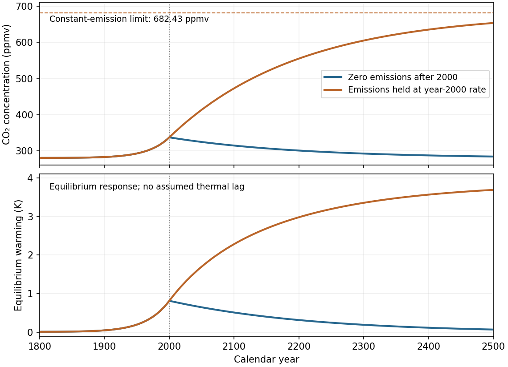

<h1 id="s25/3/4/a/solution">Solution</h1>

↑ **Parent:** [A](../a.md)

Let $t=0$ now denote the year 2000 and $C_{00}=336.95\,\mathrm{ppmv}$. When emissions stop, the model gives

$$
\boxed{C(t)=C_0+(C_{00}-C_0)e^{-t/(200\,\mathrm{yr})}.}
$$

The concentration peaks at the switch, then returns exponentially to $279\,\mathrm{ppmv}$; in 2500 it is about $283.76\,\mathrm{ppmv}$. Before 2000 both scenarios share the exponential-emissions trajectory.

Using the specified logarithmic equilibrium warming relative to $C_0$,

$$
\Delta T_{\rm eq}(C)=3\log_2(C/C_0)\,\mathrm K,
$$

gives the fast-adjustment peak estimate

$$
\boxed{\Delta T_{\rm peak}\approx3\log_2(336.95/279)\simeq0.82\,\mathrm K.}
$$

An unspecified finite thermal response time below twenty years delays and reduces that peak relative to the instantaneous-equilibrium value; its exact amount cannot be fixed without a response law and a chosen thermal time. The carbon-removal time is much longer, so the warming subsequently declines gradually in this model. Taking the 1800 concentration $280$ as the temperature reference instead changes the quoted estimate by only $0.016\,\mathrm K$.

**[Figure 14](#s25/3/4/a/image-the-two-specified-carbon-emission-scenarios-from-1800-to-2500). The two specified carbon-emission scenarios from 1800 to 2500**. Both curves share the prescribed emissions growth up to 2000. Zero later emissions give exponential return to 279 ppmv; holding emissions constant gives approach to 682.43 ppmv. The inset-free lower panel shows equilibrium warming rather than an invented thermal adjustment history.

## ↑ Ancestors (13)

1. [A](../a.md)
2. [4](../../4.md)
3. [3](../../../3.md)
4. [S25](../../../../s25.md)
5. [2012](../../../../../2012-split.md)
6. [Past exam of the short options paper shared by Prelims and Parts A and B of the physics course of the University of Oxford](../../../../../split.md)
7. [Short options paper shared by Prelims and Parts A and B of the physics course of the University of Oxford](../../../../../../short-options-paper-shared-by-prelims-and-parts-a-and-b-of-the-physics-course-of-the-university-of-oxford.md)
8. [Physics course of the University of Oxford](../../../../../../physics-course-of-the-university-of-oxford.md)
9. [Undergraduate course of the University of Oxford](../../../../../../undergraduate-course-of-the-university-of-oxford.md)
10. [Course of the University of Oxford](../../../../../../course-of-the-university-of-oxford.md)
11. [University of Oxford](../../../../../../university-of-oxford-split.md)
12. [List of universities](../../../../../../list-of-universities.md)
13. [Codex Wiki](../../../../../../split.md)
