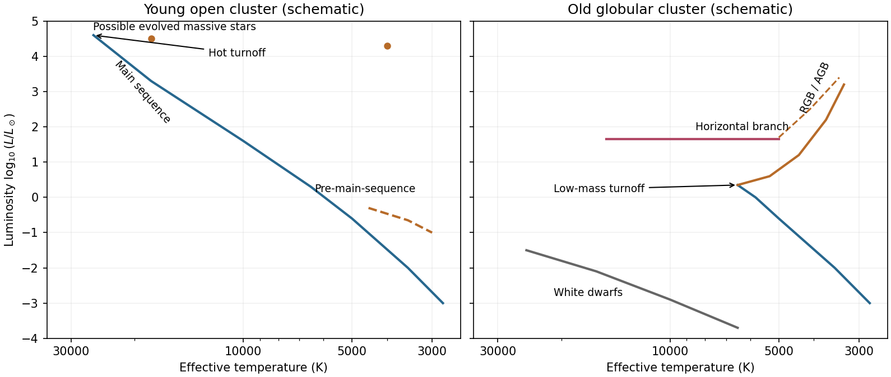

<h1 id="s26/2/3/i/solution">Solution</h1>

↑ **Parent:** [I](../i.md)

For a young [open cluster](../../../../../../open-cluster.md), the [Hertzsprung-Russell diagram](../../../../../../hertzsprung-russell-diagram.md) contains a populated [main sequence](../../../../../../main-sequence.md) reaching hot, luminous, high-mass stars, with a high-mass [main-sequence turnoff](../../../../../../main-sequence-turnoff.md) determined by its age. Cool low-mass members may still lie on tracks of [pre-main-sequence stars](../../../../../../pre-main-sequence-star.md) above the lower main sequence. Depending on how young the cluster is, a few evolved blue or red supergiants may already be present; an extremely young cluster need not have any. It lacks the dominant old low-mass red-giant and horizontal-branch populations of an old globular cluster.

**[Figure 15](#s26/2/3/i/image-schematic-temperature-luminosity-diagrams-of-young-and-old-star-clusters). Schematic temperature-luminosity diagrams of young and old star clusters**. Temperature decreases to the right. The young cluster reaches a hot luminous turnoff and contains possible pre-main-sequence stars; the old cluster has a cool low-mass turnoff, red giant and horizontal branches, and a white-dwarf sequence. Curves are illustrative population sketches, not fitted isochrones.

## ↑ Ancestors (13)

1. [I](../i.md)
2. [3](../../3.md)
3. [2](../../../2.md)
4. [S26](../../../../s26.md)
5. [2012](../../../../../2012-split.md)
6. [Past exam of the short options paper shared by Prelims and Parts A and B of the physics course of the University of Oxford](../../../../../split.md)
7. [Short options paper shared by Prelims and Parts A and B of the physics course of the University of Oxford](../../../../../../short-options-paper-shared-by-prelims-and-parts-a-and-b-of-the-physics-course-of-the-university-of-oxford.md)
8. [Physics course of the University of Oxford](../../../../../../physics-course-of-the-university-of-oxford.md)
9. [Undergraduate course of the University of Oxford](../../../../../../undergraduate-course-of-the-university-of-oxford.md)
10. [Course of the University of Oxford](../../../../../../course-of-the-university-of-oxford.md)
11. [University of Oxford](../../../../../../university-of-oxford-split.md)
12. [List of universities](../../../../../../list-of-universities.md)
13. [Codex Wiki](../../../../../../split.md)
