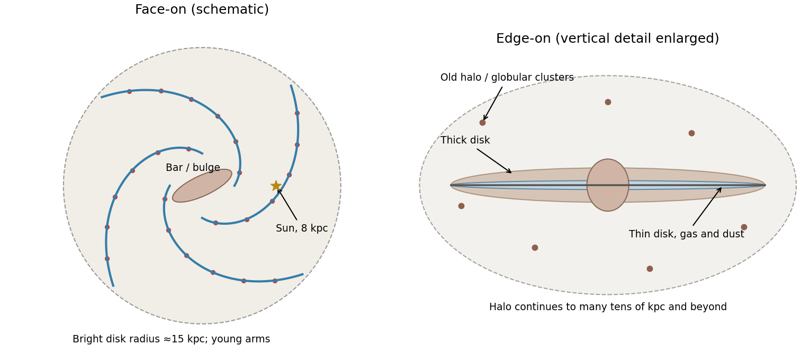

<h1 id="s26/3/1/a/solution">Solution</h1>

↑ **Parent:** [A](../a.md)

Face-on, the [Milky Way](../../../../../../milky-way.md) is a [barred spiral galaxy](../../../../../../barred-spiral-galaxy.md): a central bulge and bar of scale a few kiloparsecs lie inside a disk of stellar radius roughly $15\,\mathrm{kpc}$, with spiral arms containing gas, dust, [H II regions](../../../../../../h-ii-region.md) and young stars. Recent [star formation](../../../../../../star-formation.md) is concentrated in molecular clouds and arm complexes. The [Sun](../../../../../../sun.md) lies in the disk about $8\,\mathrm{kpc}$ from the centre in the source's convention. Old stars are also present throughout the disk, while the bulge, thick disk and extended stellar halo contain important old populations. [Globular clusters](../../../../../../globular-cluster.md) occupy a roughly spheroidal halo extending well beyond the bright disk.

**[Figure 16](#s26/3/1/a/image-original-schematic-face-on-and-edge-on-views-of-the-milky-way). Original schematic face-on and edge-on views of the Milky Way**. The face-on panel labels a barred centre, spiral star-forming regions, the Sun and an approximate 15 kpc bright-disk radius. The edge-on panel separates the thin dusty disk, thick disk, bulge and old halo/globular-cluster population. Halo extent is indicated schematically beyond the plotted field.

## ↑ Ancestors (13)

1. [A](../a.md)
2. [1](../../1.md)
3. [3](../../../3.md)
4. [S26](../../../../s26.md)
5. [2012](../../../../../2012-split.md)
6. [Past exam of the short options paper shared by Prelims and Parts A and B of the physics course of the University of Oxford](../../../../../split.md)
7. [Short options paper shared by Prelims and Parts A and B of the physics course of the University of Oxford](../../../../../../short-options-paper-shared-by-prelims-and-parts-a-and-b-of-the-physics-course-of-the-university-of-oxford.md)
8. [Physics course of the University of Oxford](../../../../../../physics-course-of-the-university-of-oxford.md)
9. [Undergraduate course of the University of Oxford](../../../../../../undergraduate-course-of-the-university-of-oxford.md)
10. [Course of the University of Oxford](../../../../../../course-of-the-university-of-oxford.md)
11. [University of Oxford](../../../../../../university-of-oxford-split.md)
12. [List of universities](../../../../../../list-of-universities.md)
13. [Codex Wiki](../../../../../../split.md)
