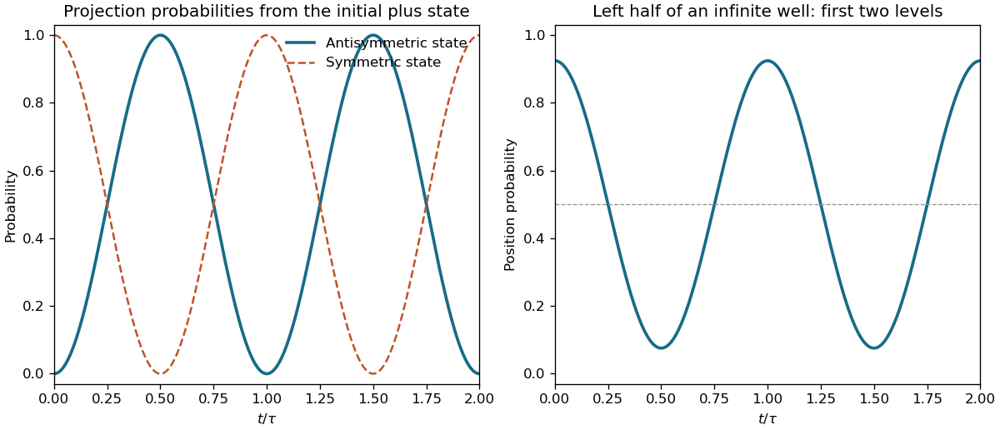

<h1 id="s3/3/6/solution">Solution</h1>

↑ **Parent:** [6](../6.md)

Choose the infinite well as $0<x<a$ with real eigenfunctions $\psi_n=\sqrt{2/a}\sin(n\pi x/a)$. This fixes the relative phase convention for the specified initial plus state. Each of the first two states has [probability](../../../../../probability.md) $1/2$ in the left half. Their cross integral is

$$
\int_0^{a/2}\psi_1\psi_2\,dx=\frac2\pi\int_0^{\pi/2}\sin u\sin2u\,du=\frac4{3\pi}.
$$

The evolving superposition therefore gives

$$
\boxed{P_{\rm left}(t)=\frac12+\frac4{3\pi}\cos\left(\frac{(E_2-E_1)t}{\hbar}\right).}
$$

Since $E_n=n^2\pi^2\hbar^2/(2ma^2)$, the angular frequency and ordinary frequency are

$$
\boxed{\omega=\frac{3\pi^2\hbar}{2ma^2},\qquad
f=\frac{\omega}{2\pi}=\frac{3h}{8ma^2}.}
$$

The [probability](../../../../../probability.md) varies between $1/2\pm4/(3\pi)$ and remains in $[0,1]$. Changing the sign convention of one eigenfunction while keeping the same physical initial state requires changing its superposition coefficient too; otherwise one has prepared the other initial state and reversed the initial spatial bias.

**[Figure 6](#s3/3/6/image-original-two-state-transition-and-left-half-well-probabilities-over-two-recurrence-periods). Original two-state transition and left-half well probabilities over two recurrence periods**.

## ↑ Ancestors (12)

1. [6](../6.md)
2. [3](../../3.md)
3. [S3](../../../s3.md)
4. [2012](../../../../2012-split.md)
5. [Past exam of the short options paper shared by Prelims and Parts A and B of the physics course of the University of Oxford](../../../../split.md)
6. [Short options paper shared by Prelims and Parts A and B of the physics course of the University of Oxford](../../../../../short-options-paper-shared-by-prelims-and-parts-a-and-b-of-the-physics-course-of-the-university-of-oxford.md)
7. [Physics course of the University of Oxford](../../../../../physics-course-of-the-university-of-oxford.md)
8. [Undergraduate course of the University of Oxford](../../../../../undergraduate-course-of-the-university-of-oxford.md)
9. [Course of the University of Oxford](../../../../../course-of-the-university-of-oxford.md)
10. [University of Oxford](../../../../../university-of-oxford-split.md)
11. [List of universities](../../../../../list-of-universities.md)
12. [Codex Wiki](../../../../../split.md)
