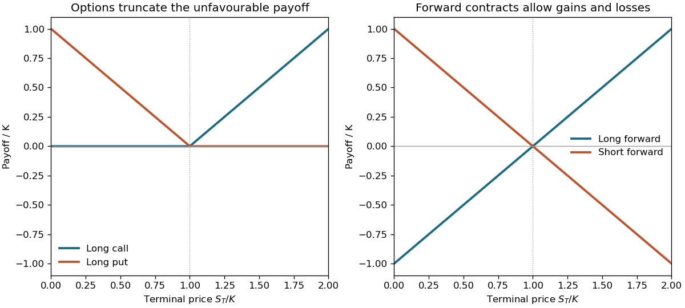

<h1 id="s9/1/2/solution">Solution</h1>

↑ **Parent:** [2](../2.md)

Let $S_T$ be the terminal asset price and $K$ a common strike or forward delivery price. A long European call and put have expiry payoffs

$$
\boxed{C_T=(S_T-K)^+,\qquad P_T=(K-S_T)^+.}
$$

The call is zero below $K$ and then rises with slope one; the put falls with slope minus one below $K$ and is zero above it. A long forward instead has $\boxed{F_T^{\rm long}=S_T-K}$ and a short forward has $\boxed{F_T^{\rm short}=K-S_T}$. Both are straight lines crossing zero at $K$, with negative as well as positive outcomes.

The option's exercise right truncates the unfavourable side, whereas the forward is an obligation. These are **payoffs**, not total profits: an option premium and its financing cost have not been subtracted. A newly agreed fair forward may have zero initial value while still having a nonzero future delivery price.

**[Figure 7](#s9/1/2/image-original-european-call-and-put-payoffs-compared-with-long-and-short-forward-contract-payoffs). Original European call and put payoffs compared with long and short forward-contract payoffs**.

## ↑ Ancestors (12)

1. [2](../2.md)
2. [1](../../1.md)
3. [S9](../../../s9.md)
4. [2012](../../../../2012-split.md)
5. [Past exam of the short options paper shared by Prelims and Parts A and B of the physics course of the University of Oxford](../../../../split.md)
6. [Short options paper shared by Prelims and Parts A and B of the physics course of the University of Oxford](../../../../../short-options-paper-shared-by-prelims-and-parts-a-and-b-of-the-physics-course-of-the-university-of-oxford.md)
7. [Physics course of the University of Oxford](../../../../../physics-course-of-the-university-of-oxford.md)
8. [Undergraduate course of the University of Oxford](../../../../../undergraduate-course-of-the-university-of-oxford.md)
9. [Course of the University of Oxford](../../../../../course-of-the-university-of-oxford.md)
10. [University of Oxford](../../../../../university-of-oxford-split.md)
11. [List of universities](../../../../../list-of-universities.md)
12. [Codex Wiki](../../../../../split.md)
