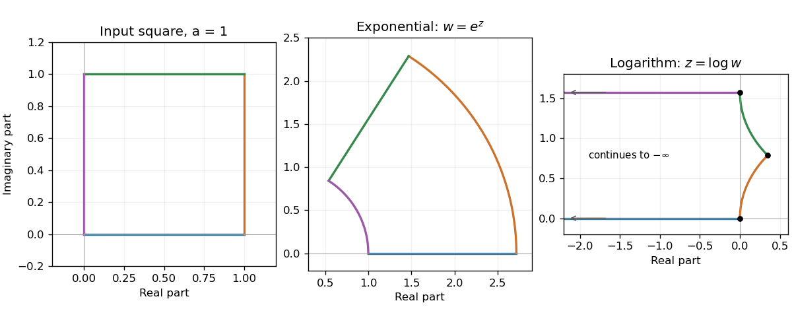

<h1 id="s1/2/4/solution">Solution</h1>

↑ **Parent:** [4](../4.md)

Use the [complex logarithm](../../../../../complex-logarithm.md) with $0\leq\arg w\leq\pi/2$ on the nonzero points of the first-quadrant square. Put $z=x+iy=\log|w|+i\arg w$. The square bounds $\operatorname{Re}w,\operatorname{Im}w\leq a$ give

$$
\boxed{0\leq y\leq\frac\pi2,\qquad x\leq\log a-\log\max(\cos y,\sin y).}
$$

The two edges meeting at $w=0$ map to the horizontal half-lines $y=0$ and $y=\pi/2$, extending indefinitely to the left. The other edges map to $x=\log a-\log\cos y$ for $0\leq y\leq\pi/4$ and $x=\log a-\log\sin y$ for $\pi/4\leq y\leq\pi/2$. They meet at $\log(a\sqrt2)+i\pi/4$.

**The angles are preserved at $a$, $a(1+i)$ and $ia$.** There $d\log w/dw=1/w$ is finite and nonzero. The origin is a [branch point](../../../../../branch-point.md), has no finite logarithmic image, and supplies no fourth finite vertex at which angle preservation could be asserted.

**[Figure 1](#s1/2/4/image-a-square-its-exponential-annular-sector-and-its-logarithmic-image-extending-to-the-left). A square, its exponential annular sector, and its logarithmic image extending to the left**.

## ↑ Ancestors (12)

1. [4](../4.md)
2. [2](../../2.md)
3. [S1](../../../s1.md)
4. [2015](../../../../2015-split.md)
5. [Past exam of the short options paper shared by Prelims and Parts A and B of the physics course of the University of Oxford](../../../../split.md)
6. [Short options paper shared by Prelims and Parts A and B of the physics course of the University of Oxford](../../../../../short-options-paper-shared-by-prelims-and-parts-a-and-b-of-the-physics-course-of-the-university-of-oxford.md)
7. [Physics course of the University of Oxford](../../../../../physics-course-of-the-university-of-oxford.md)
8. [Undergraduate course of the University of Oxford](../../../../../undergraduate-course-of-the-university-of-oxford.md)
9. [Course of the University of Oxford](../../../../../course-of-the-university-of-oxford.md)
10. [University of Oxford](../../../../../university-of-oxford-split.md)
11. [List of universities](../../../../../list-of-universities.md)
12. [Codex Wiki](../../../../../split.md)
