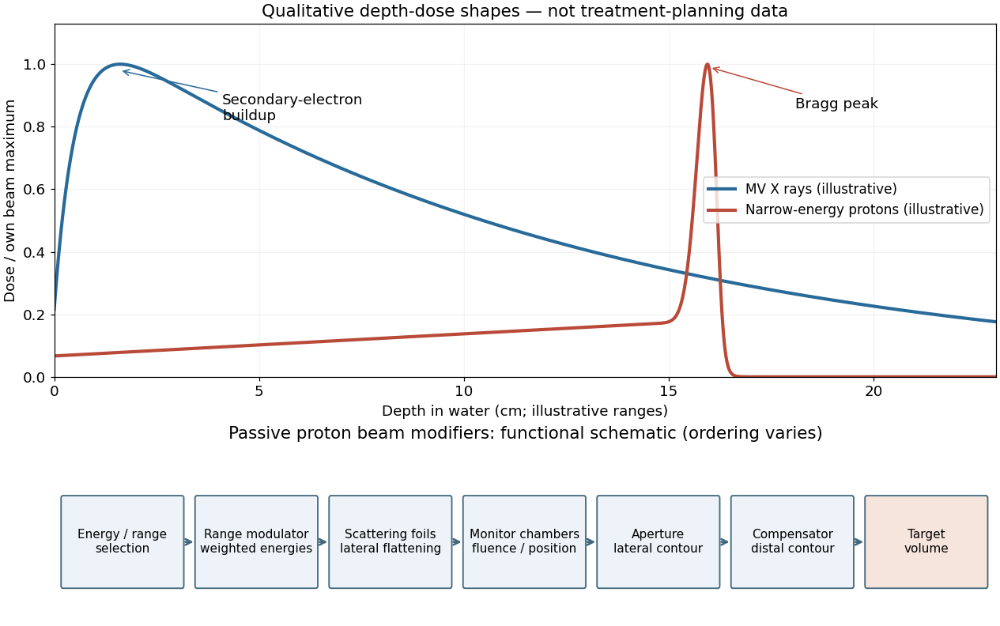

<h1 id="s10/2/1/solution">Solution</h1>

↑ **Parent:** [1](../1.md)

For a megavoltage [X-ray](../../../../../x-ray.md) beam, the surface [absorbed dose](../../../../../absorbed-dose.md) is below the subsurface maximum. [Photons](../../../../../photon.md) generate energetic secondary [electrons](../../../../../electron.md), mainly through [Compton scattering](../../../../../compton-scattering.md); the downstream electron fluence initially builds up until approximate [charged-particle equilibrium](../../../../../charged-particle-equilibrium.md) is established. Beyond this buildup region, decreasing primary [photon fluence](../../../../../photon-fluence.md), scattering and geometric spreading make the [depth-dose curve](../../../../../depth-dose-curve.md) fall gradually. A penetrating photon beam has a substantial exit dose.

A nearly monoenergetic [proton](../../../../../proton.md) beam deposits a moderate entrance dose, then a sharp [Bragg peak](../../../../../bragg-peak.md) near the end of its range. As nonrelativistic [protons](../../../../../proton.md) slow, their electronic [stopping power](../../../../../stopping-power.md) rises approximately as $1/v^2$ over the relevant part of the track. Once the protons stop, the dose falls steeply. Range straggling and energy spread broaden the peak; nuclear interactions add a smaller nonideal tail, so an exact hard cutoff is an idealization. Superposing appropriate incident energies produces a [spread-out Bragg peak](../../../../../spread-out-bragg-peak.md) covering an extended target.[pp. 487–489, increasing specific ionization near the end of range](../../../../../radiological-use-of-fast-protons-by-robert-r-wilson.md)

The label MV for an [X-ray](../../../../../x-ray.md) treatment beam specifies the nominal accelerating potential of the electron accelerator. Its [bremsstrahlung](../../../../../bremsstrahlung.md) beam is a broad [photon energy](../../../../../photon-energy.md) spectrum with an endpoint of order $eV$, not a monoenergetic beam whose individual photons all carry the quoted numerical energy. [Proton therapy](../../../../../proton-therapy.md) beam energies can instead be specified directly in MeV per incident proton.

**[Figure 5](#s10/2/1/image-qualitative-photon-and-proton-depth-dose-profiles-and-functions-of-passive-proton-beam-modifiers). Qualitative photon and proton depth-dose profiles and functions of passive proton beam modifiers**.

## ↑ Ancestors (12)

1. [1](../1.md)
2. [2](../../2.md)
3. [S10](../../../s10.md)
4. [2015](../../../../2015-split.md)
5. [Past exam of the short options paper shared by Prelims and Parts A and B of the physics course of the University of Oxford](../../../../split.md)
6. [Short options paper shared by Prelims and Parts A and B of the physics course of the University of Oxford](../../../../../short-options-paper-shared-by-prelims-and-parts-a-and-b-of-the-physics-course-of-the-university-of-oxford.md)
7. [Physics course of the University of Oxford](../../../../../physics-course-of-the-university-of-oxford.md)
8. [Undergraduate course of the University of Oxford](../../../../../undergraduate-course-of-the-university-of-oxford.md)
9. [Course of the University of Oxford](../../../../../course-of-the-university-of-oxford.md)
10. [University of Oxford](../../../../../university-of-oxford-split.md)
11. [List of universities](../../../../../list-of-universities.md)
12. [Codex Wiki](../../../../../split.md)
