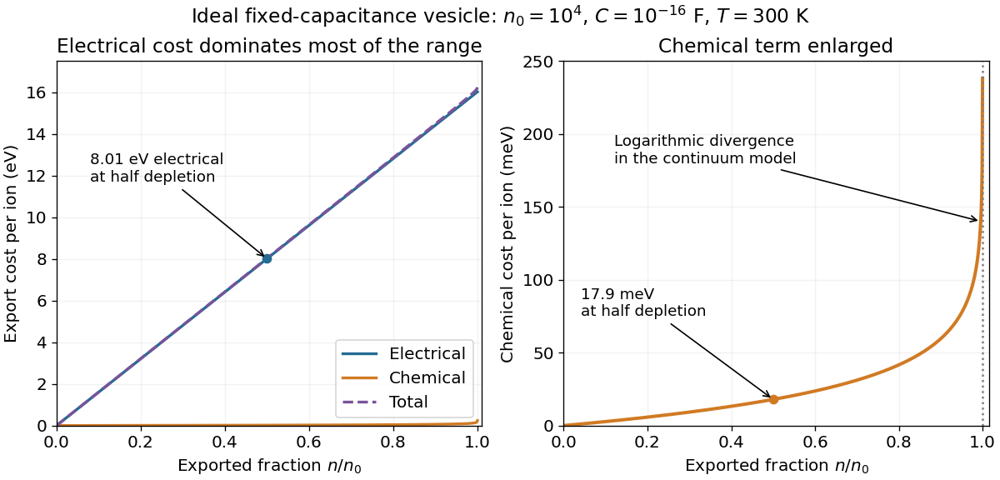

<h1 id="s12/3/3/solution">Solution</h1>

↑ **Parent:** [3](../3.md)

Use the initial equal-concentration, zero-potential reference, or equivalently quote component changes relative to the initial electrochemical equilibrium. At $n=n_0/2=5000$, with $C=10^{-16}\,\mathrm F$,

$$
\boxed{\Delta G_{\rm elec}=\frac{5000e^2}{C}=1.28\times10^{-18}\,\mathrm J=8.01\,\mathrm{eV}.}
$$

At room temperature $T=300\,\mathrm K$, the chemical component is

$$
\boxed{\Delta G_{\rm chem}=k_{\rm B}T\ln2=2.87\times10^{-21}\,\mathrm J=0.0179\,\mathrm{eV}.}
$$

The electrical cost dominates by about $447$. The associated change in [membrane potential](../../../../../membrane-potential-split.md) is $-ne/C=-8.01\,\mathrm V$. Such a large voltage is a consequence of the ideal fixed-capacitance, perfectly impermeable model; an actual lipid membrane would not generally remain intact and nonconducting over this entire extrapolation.

The electrical component is a straight line through zero, $ne^2/C$. The chemical component, $k_{\rm B}T\ln[n_0/(n_0-n)]$, starts at zero, increases convexly, and diverges as $n\to n_0^-$ because the remaining internal concentration vanishes. Their sum lies above both: nearly electrical over most of the stated range, but eventually diverging with the chemical term. For a nonzero initial equilibrium potential, the separate _absolute_ electrical and chemical components have opposite constant offsets; the total curve and the quoted changes remain the same. The final few ions require a discrete-particle treatment rather than a literal continuum divergence.

**[Figure 6](#s12/3/3/image-electrical-chemical-and-total-sodium-export-costs-in-the-ideal-vesicle-model). Electrical, chemical and total sodium export costs in the ideal vesicle model**.

## ↑ Ancestors (12)

1. [3](../3.md)
2. [3](../../3.md)
3. [S12](../../../s12.md)
4. [2015](../../../../2015-split.md)
5. [Past exam of the short options paper shared by Prelims and Parts A and B of the physics course of the University of Oxford](../../../../split.md)
6. [Short options paper shared by Prelims and Parts A and B of the physics course of the University of Oxford](../../../../../short-options-paper-shared-by-prelims-and-parts-a-and-b-of-the-physics-course-of-the-university-of-oxford.md)
7. [Physics course of the University of Oxford](../../../../../physics-course-of-the-university-of-oxford.md)
8. [Undergraduate course of the University of Oxford](../../../../../undergraduate-course-of-the-university-of-oxford.md)
9. [Course of the University of Oxford](../../../../../course-of-the-university-of-oxford.md)
10. [University of Oxford](../../../../../university-of-oxford-split.md)
11. [List of universities](../../../../../list-of-universities.md)
12. [Codex Wiki](../../../../../split.md)
