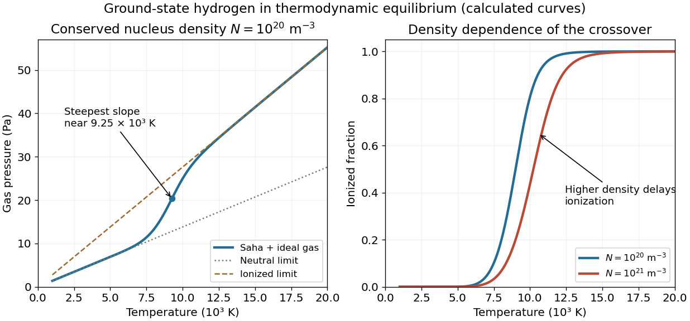

<h1 id="s16/1/2/solution">Solution</h1>

↑ **Parent:** [2](../2.md)

Let $N=n_H+n_p$ be the conserved number density of hydrogen nuclei, whether ionized or bound, and $x=n_p/N=n_e/N$ the [ionization fraction](../../../../../ionization-fraction.md). The ideal [gas pressure](../../../../../gas-pressure.md) counts neutral atoms, free protons and free electrons:

$$
P=Nk_BT(1+x),\qquad \frac{x^2}{1-x}=\frac{S(T)}N,\quad S(T)=\frac{(2\pi m_ek_BT)^{3/2}}{h^3}e^{-R/(k_BT)}.
$$

At low temperature $x\simeq0$ and $P\simeq Nk_BT$. Heating through the ionization region increases the particle count as well as their thermal energy, giving a steeper rise. At high temperature $x\simeq1$, so $P\simeq2Nk_BT$ and the asymptotic slope is twice the low-temperature slope. There is a smooth ionization crossover, not a pressure discontinuity.

The held graph is legible. Representative readings are $P(5000\,\mathrm K)\simeq6.8\,\mathrm{Pa}$ and $P(15000\,\mathrm K)\simeq41.4\,\mathrm{Pa}$, with readout uncertainties of roughly $0.3$–$0.5\,\mathrm{Pa}$ and about $100\,\mathrm K$. They give $N\simeq P/(k_BT)$ on the neutral branch and $N\simeq P/(2k_BT)$ on the ionized branch, respectively. Both are consistent with

$$
\boxed{N\simeq(1.0\pm0.05)\times10^{20}\,\mathrm{m^{-3}}.}
$$

The error is a conservative graph-reading estimate, not a fitted experimental confidence interval.

For that density, the [Saha equation](../../../../../saha-ionization-equation.md) gives $x\simeq0.50$ at $9000\,\mathrm K$, $x\simeq0.81$ at $10000\,\mathrm K$, and $x\simeq0.9992$ at $15000\,\mathrm K$. Differentiating the ionization relation gives

$$
x'=\frac{x(1-x)}{2-x}\left(\frac{3}{2T}+\frac{R}{k_BT^2}\right),\qquad P'=Nk_B(1+x+Tx').
$$

The calculated maximum slope occurs near $9.25\times10^3\,\mathrm K$, consistent with the source's visibly steepest region at roughly $(9.3\pm0.4)\times10^3\,\mathrm K$. This checks the actual slope rather than identifying it without justification with exactly half ionization.

Taking the neutral ground-state gas as the zero of internal binding energy, the matter [energy density](../../../../../energy-density.md) is translational kinetic energy plus ionization energy:

$$
u=\frac32Nk_BT(1+x)+NxR.
$$

At $15000\,\mathrm K$, with $R=13.6\,\mathrm{eV}$, these terms are about $62$ and $218\,\mathrm{J\,m^{-3}}$, giving

$$
\boxed{u\simeq2.8\times10^2\,\mathrm{J\,m^{-3}}.}
$$

Rest energies are excluded. A separate equilibrium radiation field, if the gas were in a blackbody cavity, would add its own radiation energy density; it is not part of this gas-only estimate.

**[Figure 7](#s16/1/2/image-calculated-hydrogen-pressure-and-ionization-crossover-at-two-conserved-nucleus-densities). Calculated hydrogen pressure and ionization crossover at two conserved nucleus densities**.

## ↑ Ancestors (12)

1. [2](../2.md)
2. [1](../../1.md)
3. [S16](../../../s16.md)
4. [2015](../../../../2015-split.md)
5. [Past exam of the short options paper shared by Prelims and Parts A and B of the physics course of the University of Oxford](../../../../split.md)
6. [Short options paper shared by Prelims and Parts A and B of the physics course of the University of Oxford](../../../../../short-options-paper-shared-by-prelims-and-parts-a-and-b-of-the-physics-course-of-the-university-of-oxford.md)
7. [Physics course of the University of Oxford](../../../../../physics-course-of-the-university-of-oxford.md)
8. [Undergraduate course of the University of Oxford](../../../../../undergraduate-course-of-the-university-of-oxford.md)
9. [Course of the University of Oxford](../../../../../course-of-the-university-of-oxford.md)
10. [University of Oxford](../../../../../university-of-oxford-split.md)
11. [List of universities](../../../../../list-of-universities.md)
12. [Codex Wiki](../../../../../split.md)
