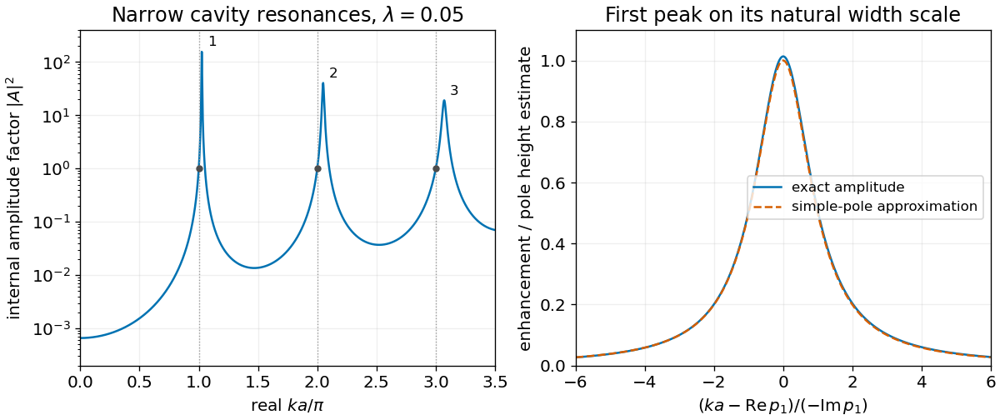

<h1 id="s18/1/6/solution">Solution</h1>

↑ **Parent:** [6](../6.md)

For real $x=ka$, taking the [modulus](../../../../../modulus.md) squared of the amplitude gives the [half-line delta-well amplitude enhancement](../../../../../half-line-delta-well-amplitude-enhancement.md)

$$
\boxed{|A(x)|^2=\frac{\lambda^2x^2}{(1-\cos2x)^2+(\lambda x-\sin2x)^2}.}
$$

The supplied [resonance poles](../../../../../resonance-pole.md) have real parts $x_n\simeq n\pi(1+\lambda/2+\lambda^2/4)$ and negative imaginary parts $-\gamma_n\simeq-(\lambda n\pi/2)^2$ for fixed low $n$ at $\lambda\ll1$.[Problem 1, PDF pp.5–6: pole expansion](../../../../../advanced-quantum-mechanics-s18-exam-2015-solutions.md) Linearizing the denominator at a simple pole gives

$$
|A(x)|^2\simeq\frac{\lambda^2x_n^2}{|D'(p_n)|^2[(x-x_n)^2+\gamma_n^2]},\qquad D(x)=1-e^{2ix}+i\lambda x.
$$

Thus the sketch has narrow, tall peaks with a locally [Lorentzian line shape](../../../../../lorentzian-line-shape.md), just above positive integer multiples of $\pi$. Their half-widths are $\gamma_n$, and the leading peak heights are $4/(\lambda^2n^2\pi^2)$. In this fixed-low-mode approximation, increasing $n$ broadens and lowers the peaks. Exactly at $x=n\pi\ne0$, the value is one. At zero it has the finite limit $\lambda^2/(2-\lambda)^2$ for $\lambda\ne2$.

The peaks represent long-lived [standing waves](../../../../../standing-wave.md) between the wall and the attractive [delta potential](../../../../../delta-potential.md). Despite the source's transmission-coefficient terminology, $|A|^2$ is an internal amplitude factor and can exceed one. The interior [probability current](../../../../../probability-current.md) is zero, and the reflected [probability current](../../../../../probability-current.md) equals the incident magnitude; the hard wall passes no transmitted flux.

**[Figure 8](#s18/1/6/image-internal-standing-wave-resonances-and-the-lorentzian-line-shape-of-the-first-peak). Internal standing-wave resonances and the Lorentzian line shape of the first peak**.

## ↑ Ancestors (12)

1. [6](../6.md)
2. [1](../../1.md)
3. [S18](../../../s18.md)
4. [2015](../../../../2015-split.md)
5. [Past exam of the short options paper shared by Prelims and Parts A and B of the physics course of the University of Oxford](../../../../split.md)
6. [Short options paper shared by Prelims and Parts A and B of the physics course of the University of Oxford](../../../../../short-options-paper-shared-by-prelims-and-parts-a-and-b-of-the-physics-course-of-the-university-of-oxford.md)
7. [Physics course of the University of Oxford](../../../../../physics-course-of-the-university-of-oxford.md)
8. [Undergraduate course of the University of Oxford](../../../../../undergraduate-course-of-the-university-of-oxford.md)
9. [Course of the University of Oxford](../../../../../course-of-the-university-of-oxford.md)
10. [University of Oxford](../../../../../university-of-oxford-split.md)
11. [List of universities](../../../../../list-of-universities.md)
12. [Codex Wiki](../../../../../split.md)
