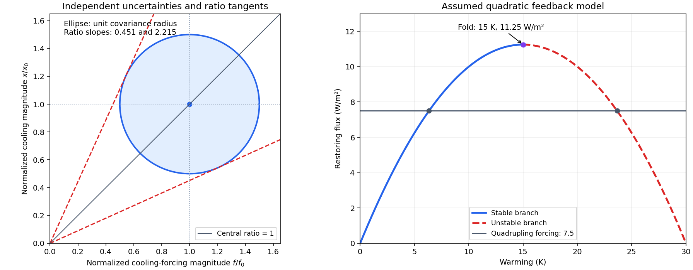

<h1 id="s25/2/2/solution">Solution</h1>

↑ **Parent:** [2](../2.md)

Take the logarithmic forcing law with its normalization fixed by the given doubling value. Let $x$ be the positive magnitude of cooling and $f$ the positive magnitude of the earlier negative forcing:

$$
f=\frac{3.75}{\ln2}\ln\frac{280}{C},\qquad x=1.0\,\mathrm K.
$$

At $C=212\,\mathrm{ppm}$, $f_0=1.5051\,\mathrm{W\,m^{-2}}$. Equilibrium then yields

$$
\boxed{\lambda_0=f_0/x_0=1.505\,\mathrm{W\,m^{-2}\,K^{-1}},\qquad
\Delta T_{2\times,0}=3.75\frac{x_0}{f_0}=2.492\,\mathrm K.}
$$

The concentration endpoints $185$ and $244\,\mathrm{ppm}$ imply forcing magnitudes $2.242$ and $0.7445\,\mathrm{W\,m^{-2}}$, approximately $f_0\pm0.75$. Define normalized variables $u=f/f_0$ and $v=x/x_0$. Independent approximately Gaussian uncertainties give the one-standard-deviation covariance ellipse

$$
\boxed{\frac{(u-1)^2}{0.50^2}+\frac{(v-1)^2}{0.50^2}\simeq1.}
$$

Its centre is $(1,1)$ and its principal directions are the two coordinate axes. Warming is $2.492(v/u)\,\mathrm K$, so rays from the origin have constant inferred warming. The bounding rays tangent to this ellipse have slopes $m$ satisfying $(1-m)^2=\tfrac14(1+m^2)$, or

$$
m_-\simeq0.4514,\qquad m_+\simeq2.2153.
$$

This gives the useful asymmetric one-parameter profile estimate

$$
\boxed{\Delta T_{2\times}\simeq2.5\,\mathrm K,\qquad
\text{approximate }1\sigma\text{ interval }1.1\text{–}5.5\,\mathrm K.}
$$

The concentration data supply only marginal intervals, not a full likelihood. This result explicitly approximates their logarithmic forcing uncertainty as Gaussian. Linear error propagation would instead give fractional uncertainty $\sqrt{0.5^2+0.5^2}=0.707$, or roughly $2.49\pm1.76\,\mathrm K$, and misses the large reciprocal asymmetry. A unit-radius two-dimensional covariance ellipse itself contains about $39\%$ of a bivariate Gaussian, not $68\%$; the quoted interval uses the one-parameter $\Delta\chi^2=1$ profile/ratio construction, rather than claiming that ellipse is a $68\%$ joint region.

**[Figure 9](#s25/2/2/image-climate-sensitivity-from-uncertain-forcing-and-a-quadratic-feedback-fold). Climate sensitivity from uncertain forcing and a quadratic feedback fold**. Original model plots: the left panel shows the normalized independent-uncertainty ellipse and tangent constant-sensitivity rays. The right panel plots the assumed quadratic restoring flux, its stable and unstable branches, and the finite forcing at which those equilibria merge. The fold is a property of this toy model, not an observed carbon-dioxide threshold.

## ↑ Ancestors (12)

1. [2](../2.md)
2. [2](../../2.md)
3. [S25](../../../s25.md)
4. [2015](../../../../2015-split.md)
5. [Past exam of the short options paper shared by Prelims and Parts A and B of the physics course of the University of Oxford](../../../../split.md)
6. [Short options paper shared by Prelims and Parts A and B of the physics course of the University of Oxford](../../../../../short-options-paper-shared-by-prelims-and-parts-a-and-b-of-the-physics-course-of-the-university-of-oxford.md)
7. [Physics course of the University of Oxford](../../../../../physics-course-of-the-university-of-oxford.md)
8. [Undergraduate course of the University of Oxford](../../../../../undergraduate-course-of-the-university-of-oxford.md)
9. [Course of the University of Oxford](../../../../../course-of-the-university-of-oxford.md)
10. [University of Oxford](../../../../../university-of-oxford-split.md)
11. [List of universities](../../../../../list-of-universities.md)
12. [Codex Wiki](../../../../../split.md)
