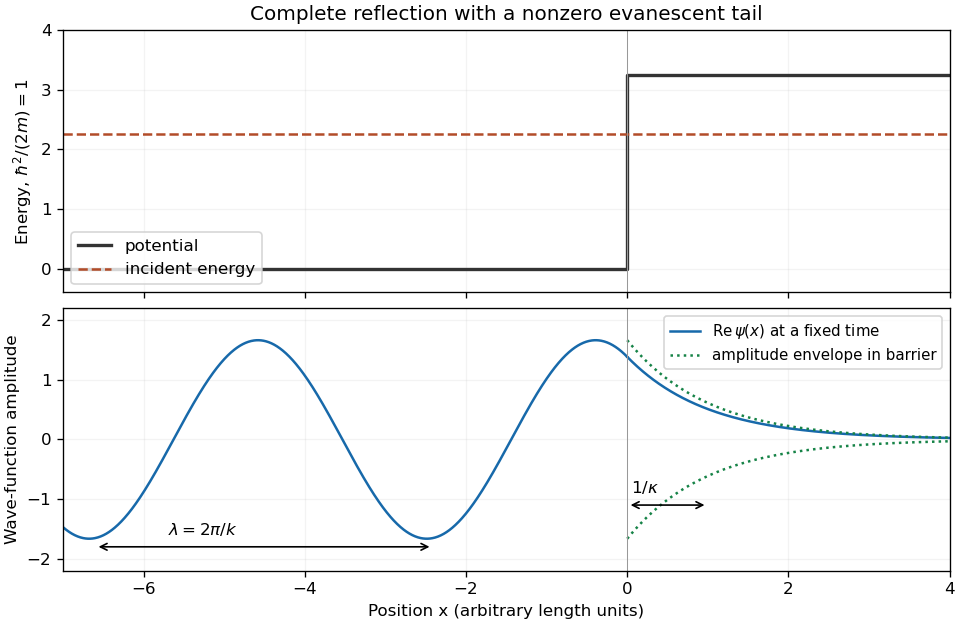

<h1 id="s3/1/b/solution">Solution</h1>

↑ **Parent:** [B](../b.md)

On the incident side, $\phi$ is the superposition of incoming and reflected waves, producing a standing-wave pattern whose travelling-wave [de Broglie wavelength](../../../../../de-broglie-wavelength.md) is $\lambda=2\pi/k$. On the forbidden side, it decays exponentially and remains nonzero near the boundary. A sketch should therefore show oscillations for $x<0$, a continuous function and slope at zero, and the evanescent tail for $x>0$ beside the potential step.

The quantum distinction is **finite probability density inside the classically forbidden region**, despite complete reflection. There is no transmitted flux at arbitrarily large positive $x$ for this semi-infinite step. A finite-width barrier would allow [quantum tunnelling](../../../../../quantum-tunnelling.md), a different boundary-value problem.

**[Figure 2](#s3/1/b/image-a-reflected-wave-joins-a-decaying-tail-inside-a-semi-infinite-potential-step). A reflected wave joins a decaying tail inside a semi-infinite potential step**.

## ↑ Ancestors (12)

1. [B](../b.md)
2. [1](../../1.md)
3. [S3](../../../s3.md)
4. [2015](../../../../2015-split.md)
5. [Past exam of the short options paper shared by Prelims and Parts A and B of the physics course of the University of Oxford](../../../../split.md)
6. [Short options paper shared by Prelims and Parts A and B of the physics course of the University of Oxford](../../../../../short-options-paper-shared-by-prelims-and-parts-a-and-b-of-the-physics-course-of-the-university-of-oxford.md)
7. [Physics course of the University of Oxford](../../../../../physics-course-of-the-university-of-oxford.md)
8. [Undergraduate course of the University of Oxford](../../../../../undergraduate-course-of-the-university-of-oxford.md)
9. [Course of the University of Oxford](../../../../../course-of-the-university-of-oxford.md)
10. [University of Oxford](../../../../../university-of-oxford-split.md)
11. [List of universities](../../../../../list-of-universities.md)
12. [Codex Wiki](../../../../../split.md)
