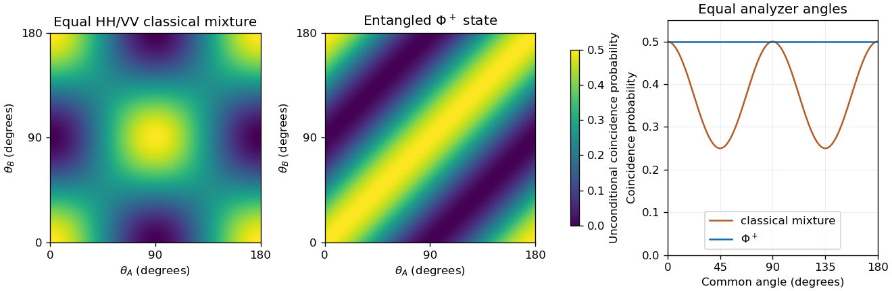

<h1 id="s3/3/4/solution">Solution</h1>

↑ **Parent:** [4](../4.md)

The normalized [Bell state](../../../../../bell-state-split.md)

$$
\boxed{|\Phi^+\rangle=\frac{|HH\rangle+|VV\rangle}{\sqrt2}}
$$

has equal outcomes for any common real linear-polarization basis. In the stated rotated basis it is $(|\theta^{(+)}\theta^{(+)}\rangle+|\theta^{(-)}\theta^{(-)}\rangle)/\sqrt2$: the cross terms cancel when the inverse rotation is substituted.

Thus the coincidence probability for the transmitted ports is $p(A,B)=\tfrac12\cos^2(\theta_A-\theta_B)$. At equal angles it is **$1/2$ per emitted pair**, while Bob transmits with probability **one conditional on Alice's transmission**. Both photons are blocked for the other half of ideal pairs. The phrase always in coincidence must therefore mean matching outcomes or conditional transmission, rather than unit unconditional transmission through both polarizers.

The classical mixture has no coherence between $HH$ and $VV$; it gives equal-angle coincidence probability $1/4$ at $45^\circ$, rather than $1/2$. The coherent [quantum superposition](../../../../../quantum-superposition.md) maintains correlation in this rotated basis. Bob's unconditional transmission remains $1/2$, so the conditional correlation does not permit signalling by Alice's polarizer choice.

**[Figure 3](#s3/3/4/image-classical-and-entangled-photon-pair-coincidence-probabilities-in-rotated-linear-polarization-bases). Classical and entangled photon-pair coincidence probabilities in rotated linear-polarization bases**.

## ↑ Ancestors (12)

1. [4](../4.md)
2. [3](../../3.md)
3. [S3](../../../s3.md)
4. [2015](../../../../2015-split.md)
5. [Past exam of the short options paper shared by Prelims and Parts A and B of the physics course of the University of Oxford](../../../../split.md)
6. [Short options paper shared by Prelims and Parts A and B of the physics course of the University of Oxford](../../../../../short-options-paper-shared-by-prelims-and-parts-a-and-b-of-the-physics-course-of-the-university-of-oxford.md)
7. [Physics course of the University of Oxford](../../../../../physics-course-of-the-university-of-oxford.md)
8. [Undergraduate course of the University of Oxford](../../../../../undergraduate-course-of-the-university-of-oxford.md)
9. [Course of the University of Oxford](../../../../../course-of-the-university-of-oxford.md)
10. [University of Oxford](../../../../../university-of-oxford-split.md)
11. [List of universities](../../../../../list-of-universities.md)
12. [Codex Wiki](../../../../../split.md)
