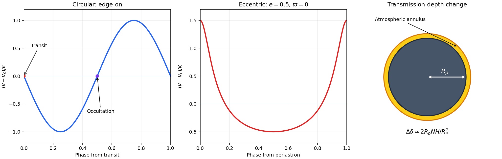

<h1 id="s30/1/2/solution">Solution</h1>

↑ **Parent:** [2](../2.md)

A circular orbit has uniform angular motion, so its [Keplerian radial-velocity curve](../../../../../keplerian-radial-velocity-curve.md) is sinusoidal. Choose phase $\phi=(t-t_{\rm tr})/P$, positive stellar velocity away from the observer, and an edge-on circular orbit. One consistent convention is

$$
\boxed{V-V_0=-K\sin(2\pi\phi).}
$$

Transit occurs at the decreasing systemic-velocity crossing $\phi=0$; secondary eclipse is at the increasing crossing $\phi=1/2$. Extrema occur one quarter of an orbit away. Reversing the velocity sign convention reverses the crossing directions but not the conjunction phases.

For an eccentric orbit, $\nu$ is not proportional to time. Solve $\mathcal M=E-e\sin E$, then use $\tan(\nu/2)=\sqrt{(1+e)/(1-e)}\tan(E/2)$ in the stated velocity relation. Motion is fastest near periastron, so the curve has an abrupt feature there and a more prolonged change near apastron, with its shape also depending on $\varpi$. It is not merely a shifted sinusoid. An eccentric transit need not coincide with $V=V_0$, because the $e\cos\varpi$ offset remains at conjunction.

**[Figure 10](#s30/1/2/image-circular-and-eccentric-stellar-radial-velocities-and-a-transmission-spectrum-annulus). Circular and eccentric stellar radial velocities, and a transmission-spectrum annulus**. Original calculated velocity curves use a circular transit as phase zero on the left, and periastron as phase zero for the separate eccentric example with $e=0.5$ and $\varpi=0$. The right panel illustrates the projected area added by one atmospheric scale height; its atmospheric thickness is exaggerated for visibility.

## ↑ Ancestors (12)

1. [2](../2.md)
2. [1](../../1.md)
3. [S30](../../../s30.md)
4. [2015](../../../../2015-split.md)
5. [Past exam of the short options paper shared by Prelims and Parts A and B of the physics course of the University of Oxford](../../../../split.md)
6. [Short options paper shared by Prelims and Parts A and B of the physics course of the University of Oxford](../../../../../short-options-paper-shared-by-prelims-and-parts-a-and-b-of-the-physics-course-of-the-university-of-oxford.md)
7. [Physics course of the University of Oxford](../../../../../physics-course-of-the-university-of-oxford.md)
8. [Undergraduate course of the University of Oxford](../../../../../undergraduate-course-of-the-university-of-oxford.md)
9. [Course of the University of Oxford](../../../../../course-of-the-university-of-oxford.md)
10. [University of Oxford](../../../../../university-of-oxford-split.md)
11. [List of universities](../../../../../list-of-universities.md)
12. [Codex Wiki](../../../../../split.md)
